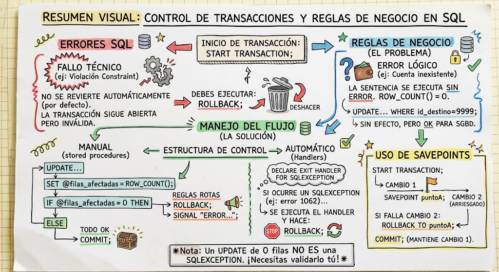

::: extra
# ¿Qué ocurre cuando hay un error explícito en una Transacción?

En motores de bases de datos como MySQL, un error de ejecución de una sentencia individual dentro de un bloque `START TRANSACTION` **no necesariamente deshace toda la transacción de manera automática** (salvo en ciertos errores críticos o dependiendo del motor de almacenamiento y configuraciones de sesión).

- **Comportamiento por defecto:** Si una sentencia dentro de una transacción falla (por ejemplo, una violación de clave foránea o un tipo de dato inválido), esa sentencia concreta se aborta, pero la transacción **permanece abierta** en la sesión.
- **Riesgo:** Si el usuario o la aplicación ejecuta un `COMMIT` después de que una sentencia previa falló, las operaciones exitosas antes del error se guardarán de forma permanente, rompiendo la consistencia de los datos.
- **Regla general:** Es responsabilidad del desarrollador/DBA capturar el error y solicitar explícitamente un `ROLLBACK`.

# Errores Lógicos vs. Reglas de Negocio (Operaciones "Exitosas" que fallan)

Un motor SQL no considera error la ausencia de filas modificadas. Una sentencia `UPDATE` o `DELETE` que no encuentra registros coincidentes en la cláusula `WHERE` se ejecuta **correctamente con código de retorno 0**.

## El Problema de las Reglas de Negocio:

- **Ejemplo:** Transferir dinero actualizando el saldo de la cuenta `A` y sumándolo a la cuenta `B`.
- Si la cuenta `B` no existe, la sentencia `UPDATE cuentas SET saldo = saldo + X WHERE id = B;` devuelve `0 filas afectadas`.
- Para la base de datos **no hay error de sintaxis ni de restricciones**, pero la regla de negocio se ha roto (el dinero se descontó de `A` pero nunca llegó a `B`).

# Comprobación de Resultados en SQL: `ROW_COUNT()`

Para validar el resultado de operaciones de modificación de datos (`INSERT`, `UPDATE`, `DELETE`) dentro del flujo de la transacción, MySQL proporciona la función `ROW_COUNT()`.

- **`ROW_COUNT()`:** Devuelve el número de filas afectadas por la **última** sentencia SQL ejecutada dentro de la misma sesión.

- **Atención:** Si ejecutas un `SELECT`, `ROW_COUNT()` devolverá `-1` (para contar filas en `SELECT` se utiliza `FOUND_ROWS()` o `COUNT(*)`).

- **Persistencia:** Dado que `ROW_COUNT()` cambia con cada sentencia, si se requiere evaluar su resultado más adelante, debe guardarse inmediatamente en una variable de usuario o local:

  ``` sql
  UPDATE productos SET stock = stock - 1 WHERE id_producto = 1 AND stock > 0;
  SET @filas_modificadas = ROW_COUNT();
  ```

# Control de Flujo con Procedimientos Almacenados (`Stored Procedures`)

Para implementar comprobaciones condicionales dentro del propio SGBD, la transacción se encapsula dentro de un procedimiento almacenado utilizando estructuras `IF ... THEN ... ELSE`.

## Ejemplo práctico: Transferencia segura con validación de filas afectadas

``` sql
DELIMITER //

CREATE PROCEDURE sp_realizar_transferencia(
    IN p_origen INT,
    IN p_destino INT,
    IN p_monto DECIMAL(10,2)
)
BEGIN
    DECLARE v_filas_origen INT DEFAULT 0;
    DECLARE v_filas_destino INT DEFAULT 0;

    -- Inicio de la transacción
    START TRANSACTION;

    -- 1. Restar dinero del origen
    UPDATE cuentas 
    SET saldo = saldo - p_monto 
    WHERE id_cuenta = p_origen AND saldo >= p_monto;
    
    SET v_filas_origen = ROW_COUNT();

    -- 2. Sumar dinero al destino
    UPDATE cuentas 
    SET saldo = saldo + p_monto 
    WHERE id_cuenta = p_destino;
    
    SET v_filas_destino = ROW_COUNT();

    -- 3. Evaluación de reglas de negocio
    IF v_filas_origen = 0 THEN
        -- Falló la cuenta origen (no existe o saldo insuficiente)
        ROLLBACK;
        SIGNAL SQLSTATE '45000' 
        SET MESSAGE_TEXT = 'Error: Cuenta de origen no existe o no tiene saldo suficiente.';
        
    ELSEIF v_filas_destino = 0 THEN
        -- Falló la cuenta destino (no existe)
        ROLLBACK;
        SIGNAL SQLSTATE '45000' 
        SET MESSAGE_TEXT = 'Error: La cuenta de destino no existe. Transacción revertida.';
        
    ELSE
        -- Ambas operaciones modificaron exactamente su fila correspondiente
        COMMIT;
        SELECT 'Transacción completada con éxito.' AS estado;
    END IF;

END //

DELIMITER ;
```

# Manejo Automatizado de Excepciones (`HANDLERS`)

Para interceptar errores técnicos nativos del motor (como fallos de clave duplicada, llaves foráneas o datos nulos) sin depender de validaciones manuales `IF`, se utilizan los **Manejadores de Excepciones** (`DECLARE ... HANDLER`).

## Tipos de Handlers:

1.  `CONTINUE HANDLER`: Ejecuta la instrucción del handler y continúa la ejecución del bloque SQL.
2.  `EXIT HANDLER`: Ejecuta la instrucción del handler y aborta inmediatamente la ejecución del bloque contenedor (`BEGIN ... END`).

## Estructura de Manejo de Excepciones en Transacciones:

``` sql
DELIMITER //

CREATE PROCEDURE sp_operacion_segura()
BEGIN
    -- Declaración de un Handler para cualquier error de SQL
    DECLARE EXIT HANDLER FOR SQLEXCEPTION
    BEGIN
        -- Ante cualquier error técnico, revierte los cambios automáticamente
        ROLLBACK;
        -- Re-emite el error para informar a la sesión
        RESIGNAL;
    END;

    -- Inicia la transacción
    START TRANSACTION;

    -- Operaciones SQL
    INSERT INTO tabla1 (columna) VALUES ('Dato');
    UPDATE tabla2 SET columna = 100 WHERE id = 1;

    -- Si no hubo error técnico, se confirma
    COMMIT;
END //

DELIMITER ;
```

# Puntos de Salvado (`SAVEPOINT`)

Los puntos de salvado permiten deshacer partes específicas de una transacción sin la necesidad de revertir todas las operaciones previas realizadas con éxito dentro del mismo bloque.

## Comandos clave:

- `SAVEPOINT nombre_punto;` — Establece una marca intermedia.
- `ROLLBACK TO SAVEPOINT nombre_punto;` — Revierte los cambios realizados **después** de ese punto, conservando los anteriores.
- `RELEASE SAVEPOINT nombre_punto;` — Elimina la marca guardada sin deshacer cambios.

## Flujo de uso:

``` sql
START TRANSACTION;

-- Operación 1 (Crítica)
UPDATE cuentas SET saldo = saldo - 100 WHERE id_cuenta = 1;

-- Crear punto de restauración
SAVEPOINT post_retiro;

-- Operación 2 (Secundaria / Condicional)
UPDATE cuentas SET saldo = saldo + 100 WHERE id_cuenta = 9999;

-- Comprobar si la operación 2 falló a nivel lógico
IF ROW_COUNT() = 0 THEN
    -- Deshace solo el intento de abono, manteniendo el saldo retirado
    ROLLBACK TO SAVEPOINT post_retiro;
    -- Decisión posterior: o se cancela todo o se redirige
    ROLLBACK; 
ELSE
    COMMIT;
END IF;
```
:::

