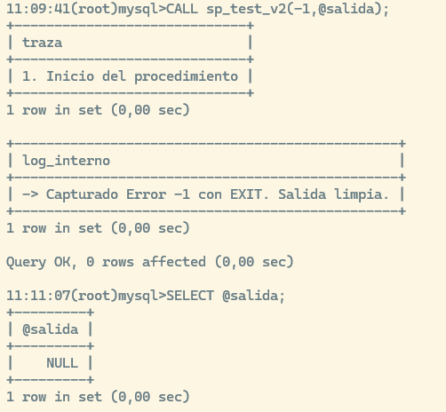
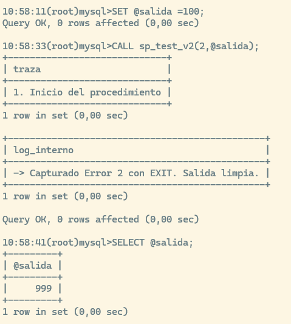
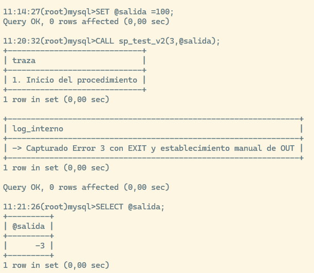
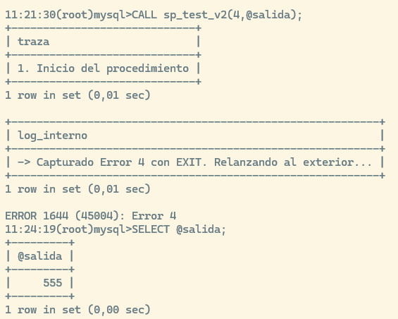
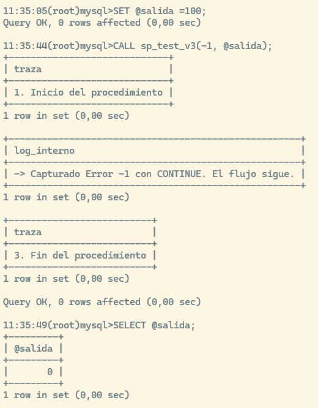
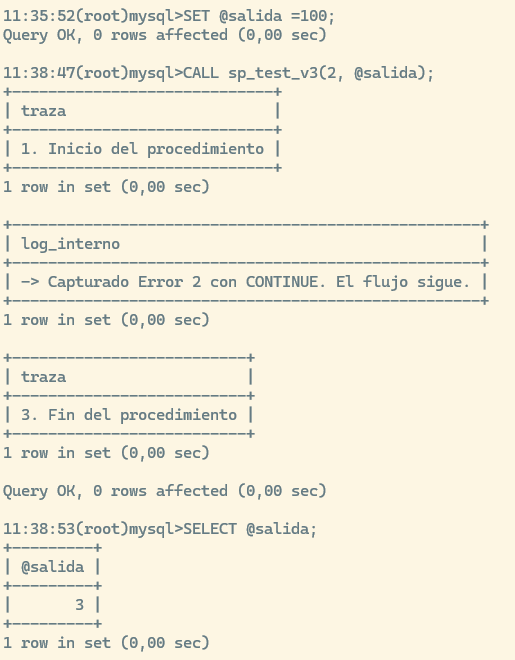
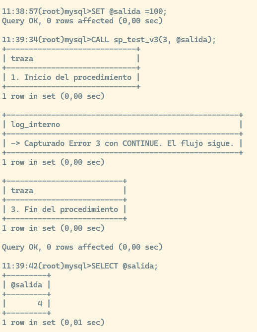
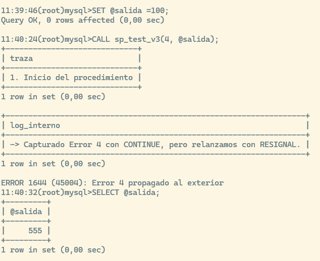

En programación y desarrollo de bases de datos, una **excepción** es una situación anómala o un error inesperado que interrumpe el flujo normal de ejecución de un programa (por ejemplo, intentar insertar una clave duplicada, dividir por cero o buscar un registro que no existe).

El **manejo de excepciones** es el mecanismo que nos permite **anticipar, capturar y gestionar** esos errores de forma controlada para evitar que la aplicación se rompa abruptamente o deje la base de datos en un estado incoherente.

# Conceptos Fundamentales

Antes de ver la sintaxis específica de cada gestor, es necesario entender tres pilares universales del control de errores:

## Tipos de Errores

1.  **Errores del Sistema (Predefinidos):** Son lanzados automáticamente por la base de datos cuando se viola una regla (ej. violar una restricción `FOREIGN KEY` o `UNIQUE`, desbordamiento de tipo de datos).
2.  **Errores de Negocio (Personalizados):** Son condiciones definidas por el desarrollador mediante reglas del dominio (ej. *"No se puede realizar una venta si la nota del cliente es menor a 5"*). Para estos casos lanzamos manualmente una excepción.

## Modos de Reacción al Error

-   **Continuar (Continue):** Se detecta el fallo, se ejecuta una acción correctiva o de registro (*logging*), y el programa **continúa** ejecutando la siguiente línea.
-   **Salir/Abortar (Exit / Rollback):** Se captura el error, se cancela la transacción en curso para no dejar datos a medias, y se interrumpe la ejecución del bloque actual.

## Identificadores de Error (SQLSTATE y Códigos)

La mayoría de motores relacionales utilizan el estándar ISO de códigos de error de 5 caracteres alfanuméricos llamado **`SQLSTATE`**. \* Por ejemplo, la clase `45000` está reservada globalmente para **excepciones personalizadas definidas por el usuario**.


# El comando `SIGNAL` en MySQL y MariaDB

El comando **`SIGNAL`** es la instrucción estándar SQL utilizada para **generar, lanzar o simular un error de forma artificial** dentro de un procedimiento almacenado, función o trigger.

Mientras que los errores normales ocurren de forma automática (como intentar dividir por cero o violar una clave única), `SIGNAL` te permite a ti, como desarrollador, decidir **cuándo** se rompe la ejecución del código en función de tus propias reglas de negocio.

La estructura básica de un `SIGNAL` requiere obligatoriamente un código **`SQLSTATE`** y opcionalmente puede acompañarse de un mensaje de texto descriptivo:

``` sql
SIGNAL SQLSTATE 'sqlstate_value'
    [SET MESSAGE_TEXT = 'Descripción detallada del error'];
```

-   **`SQLSTATE`**: Es un código de 5 caracteres estandarizado a nivel internacional.

    -   Por convenio universal, para **errores personalizados creados por el usuario** (reglas de negocio propias), siempre se utiliza el código genérico **`'45000'`**.

-   **`MESSAGE_TEXT`**: Es el mensaje de texto legible que recibirá la aplicación cliente o que atrapará tu manejador de excepciones (`DECLARE HANDLER`).

## Casos de Uso Principales

¿Cuándo debes usar `SIGNAL` en la vida real?

1.  **Validación temprana de parámetros (*Guard Clauses*):** Comprobar al inicio de un procedimiento si los datos de entrada son lógicos antes de ejecutar ninguna consulta pesada (ej: asegurar que una cantidad no sea negativa o que una fecha de fin sea posterior a la de inicio).

2.  **Validación de reglas de negocio complejas:** Restricciones que las restricciones clásicas de base de datos (`CHECK` o `FOREIGN KEY`) no pueden cubrir fácilmente (ej: comprobar si el saldo de una cuenta es suficiente antes de autorizar una transferencia).

3.  **Control de flujo por errores lógicos:** Forzar la interrupción de un proceso cuando una consulta crítica no devuelve el resultado esperado (ej: verificar que `ROW_COUNT() > 0` tras un `UPDATE`).

**Ejemplo Práctico Ilustrativo**

Imagina un procedimiento para actualizar el stock de un almacén. Queremos usar `SIGNAL` para frenar la ejecución si intentamos restar más cantidad de la que realmente hay disponible en stock:

``` sql
DROP PROCEDURE IF EXISTS sp_actualizar_stock;
DELIMITER //

CREATE PROCEDURE sp_actualizar_stock(
    IN p_id_producto INT,
    IN p_cantidad_a_restar INT
)
SQL SECURITY INVOKER
CONTAINS SQL
BEGIN
    DECLARE v_stock_actual INT;

    -- 1. Validación previa de parámetros de entrada
    IF p_cantidad_a_restar <= 0 THEN
        SIGNAL SQLSTATE '45000' 
            SET MESSAGE_TEXT = 'La cantidad a restar debe ser mayor que cero.';
    END IF;

    -- Consultamos el stock actual del producto
    SELECT stock INTO v_stock_actual 
    FROM productos 
    WHERE id_producto = p_id_producto;

    -- 2. Validación de regla de negocio: ¿Existe el producto?
    IF v_stock_actual IS NULL THEN
        SIGNAL SQLSTATE '45000' 
            SET MESSAGE_TEXT = 'El producto especificado no existe en el catálogo.';
    END IF;

    -- 3. Validación de regla de negocio: ¿Hay stock suficiente?
    IF v_stock_actual < p_cantidad_a_restar THEN
        SIGNAL SQLSTATE '45000' 
            SET MESSAGE_TEXT = 'Stock insuficiente para completar la operación.';
    END IF;

    -- Si todas las validaciones pasan, procedemos con la actualización normal
    UPDATE productos 
    SET stock = stock - p_cantidad_a_restar 
    WHERE id_producto = p_id_producto;

END//
DELIMITER ;
```

### ¿Qué ocurre cuando salta un `SIGNAL`?

En cuanto la ejecución del procedimiento lee la línea de `SIGNAL`:

1.  **Detiene el flujo normal** de manera inmediata.

2.  Si **no hay** un manejador de errores (`DECLARE HANDLER`) activo, el error escala directamente hacia afuera, aborta el procedimiento por completo y devuelve el mensaje a la consola o aplicación cliente.

3.  Si **sí hay** un manejador configurado ( `CONTINUE` o `EXIT`), este interceptará el error para ejecutar tareas de limpieza o auditoría.

## Equivalencias en otros motores de bases de datos

Al igual que MySQL utiliza `SIGNAL SQLSTATE '45000'` para lanzar errores personalizados, los demás motores de bases de datos principales disponen de sus propias instrucciones nativas para interrumpir la ejecución y enviar un mensaje de error controlado al exterior.

Aquí tienes las equivalencias exactas en **PostgreSQL**, **SQL Server** y **Oracle**:

### PostgreSQL (PL/pgSQL): `RAISE EXCEPTION`

En PostgreSQL se utiliza la instrucción `RAISE` combinada con la opción `EXCEPTION`. Puedes especificar opcionalmente un código de error personalizado (`ERRCODE`).

``` sql
CREATE OR REPLACE FUNCTION sp_verificar_stock(p_stock INT) 
RETURNS VOID AS $$
BEGIN
    IF p_stock < 0 THEN
        -- Lanzamos la excepción con un mensaje claro
        RAISE EXCEPTION 'Stock insuficiente para procesar la operación' 
            USING ERRCODE = 'P0001'; -- 'P' indica código personalizado definido por el usuario
    END IF;
END;
$$ LANGUAGE plpgsql;
```

### SQL Server (T-SQL): `THROW` (o el clásico `RAISERROR`)

En SQL Server, el estándar moderno (a partir de SQL Server 2012) es utilizar **`THROW`**, que permite definir un número de error personalizado (entre 50000 y 2147483647), un mensaje de texto y un estado.

``` sql
CREATE PROCEDURE sp_verificar_stock 
    @stock INT
AS
BEGIN
    IF @stock < 0
    BEGIN
        -- Número de error personalizado (debe estar entre 50000 y 2147483647), mensaje y estado
        THROW 50000, 'Stock insuficiente para procesar la operación', 1;
    END
END;
```

*(Nota histórica: Antiguamente se usaba `RAISERROR('Mensaje', Nivel_Severidad, Estado)`, pero Microsoft recomienda `THROW` en versiones modernas).*

### Oracle (PL/SQL): `RAISE_APPLICATION_ERROR`

En Oracle, la forma estándar de lanzar un error controlado desde un bloque PL/SQL es mediante el procedimiento integrado **`RAISE_APPLICATION_ERROR`**.

⚠️ **Particularidad importante:** Los códigos de error en Oracle **deben ser obligatoriamente números negativos** comprendidos en el rango reservado de **`-20000` a `-20999`**.

``` sql
CREATE OR REPLACE PROCEDURE sp_verificar_stock (
    p_stock IN NUMBER
) AS
BEGIN
    IF p_stock < 0 THEN
        -- El código debe estar entre -20000 y -20999
        RAISE_APPLICATION_ERROR(-20001, 'Stock insuficiente para procesar la operación');
    END IF;
END;
/
```

### Tabla Resumen de Equivalencias

|  |  |  |
|------------------|-------------------------|-----------------------------|
| **Motor** | **Instrucción para lanzar el error** | **Rango / Formato del Código** |
| **MySQL / MariaDB** | `SIGNAL SQLSTATE '45000' SET MESSAGE_TEXT = '...';` | Cadena de 5 caracteres (ej. `'45000'`) |
| **PostgreSQL** | `RAISE EXCEPTION '...' USING ERRCODE = 'P0001';` | Códigos SQLSTATE estándar (ej. `'P0001'`) |
| **SQL Server** | `THROW 50000, '...', 1;` | Entero entre `50000` y `2147483647` |
| **Oracle** | `RAISE_APPLICATION_ERROR(-20001, '...');` | Número negativo entre `-20000` y `-20999` |

------------------------------------------------------------------------

# Manejo de Excepciones en MySQL y MariaDB

Un handler en MySQL es un mecanismo de control de excepciones que permite capturar y gestionar errores, advertencias o condiciones específicas que ocurren durante la ejecución de un procedimiento almacenado, función, trigger o evento. Cuando se produce la condición definida, MySQL ejecuta el bloque de código asociado al handler, permitiendo por ejemplo realizar un ROLLBACK, registrar el error o continuar la ejecución sin interrumpir completamente el proceso.

```sql
DECLARE {CONTINUE | EXIT} HANDLER
    FOR condicion
    sentencia;
```
Donde:

CONTINUE: ejecuta el handler y continúa con la siguiente instrucción.
EXIT: ejecuta el handler y abandona el bloque BEGIN...END actual.

Condiciones disponibles: 
```sql
-- Cualquier error SQL
SQLEXCEPTION

-- Advertencias SQL
SQLWARNING

-- No se encontraron filas
NOT FOUND

-- Código de error MySQL
1062

-- Estado SQL (SQLSTATE)
SQLSTATE '23000'
``` 

Ejemplos:

```sql
-- Capturar cualquier error SQL
DECLARE EXIT HANDLER FOR SQLEXCEPTION
BEGIN
    ROLLBACK;
END;
```

```sql
-- Capturar clave duplicada (error 1062)
DECLARE CONTINUE HANDLER FOR 1062
SET v_duplicado = 1;
```
```sql
-- Capturar violación de restricción de integridad
DECLARE EXIT HANDLER FOR SQLSTATE '23000'
BEGIN
    ROLLBACK;
END;
```
```sql
-- Capturar múltiples condiciones
DECLARE EXIT HANDLER FOR SQLWARNING, SQLEXCEPTION
BEGIN
    ROLLBACK;
END;
```
Las condiciones basadas en SQLSTATE suelen ser más portables entre versiones y motores, mientras que los códigos numéricos (por ejemplo, 1062) son específicos de MySQL.

En MySQL, los DECLARE ... HANDLER solo pueden definirse dentro de rutinas almacenadas:

-   PROCEDURE
-   FUNCTION
-   TRIGGER
-   EVENT

No puedes declarar un manejador de errores directamente en un script SQL normal ejecutado desde el cliente.

::: nota
Debe ser declarado obligatoriamente **después** de la declaración de variables y cursores, pero **antes** del código principal del bloque.
:::

## Sintaxis General

``` sql
DECLARE { CONTINUE | EXIT } HANDLER FOR condicion
BEGIN
    -- Código para responder al error
END;
```

## Tipos de Condición en MySQL

-   `SQLEXCEPTION`: Captura cualquier error grave de SQL.
-   `SQLWARNING`: Captura advertencias.
-   `NOT FOUND`: Captura casos donde un `SELECT INTO` o un `FETCH` de cursor no encuentra filas.
-   `SQLSTATE 'codigo'`: Captura un código específico de error.

## Ejemplo Práctico en MySQL: Transacción Segura con `EXIT HANDLER`

En este ejemplo, insertamos una nueva transacción. Si ocurre un fallo (como una clave duplicada), el manejador captura el error, hace un `ROLLBACK` para dejar la base de datos intacta y devuelve un parámetro de error controlado.

``` sql
DELIMITER //

CREATE PROCEDURE sp_registrar_transferencia(
    IN p_cuenta_origen INT,
    IN p_cuenta_destino INT,
    IN p_monto DECIMAL(10,2),
    OUT p_codigo_respuesta INT -- 0: Éxito, 1: Error
)
SQL SECURITY INVOKER
BEGIN
    -- Declaramos el Handler para cualquier excepción de SQL
    DECLARE EXIT HANDLER FOR SQLEXCEPTION
    BEGIN
        -- Si ocurre un error, deshacemos los cambios
        ROLLBACK;
        SET p_codigo_respuesta = 1; -- Marcamos que hubo error
    END;

    -- Inicializamos como exitoso
    SET p_codigo_respuesta = 0;

    -- Iniciamos la transacción
    START TRANSACTION;

        -- Comprobación de regla de negocio manual (Lanzamos excepción si monto <= 0)
        IF p_monto <= 0 THEN
            SIGNAL SQLSTATE '45000'
                SET MESSAGE_TEXT = 'El monto a transferir debe ser mayor a cero.';
        END IF;

        -- Operaciones bancarias
        UPDATE cuentas SET saldo = saldo - p_monto WHERE id_cuenta = p_cuenta_origen;
        UPDATE cuentas SET saldo = saldo + p_monto WHERE id_cuenta = p_cuenta_destino;

    -- Si todo fue bien, confirmamos los cambios
    COMMIT;
END //

DELIMITER ;
```

# Manejo de Excepciones en otros Motores Principales

Aunque la lógica es idéntica, la sintaxis varía significativamente entre los distintos Sistemas Gestores de Bases de Datos (RDBMS).

## PostgreSQL (PL/pgSQL)

PostgreSQL utiliza un bloque estructurado **`BEGIN ... EXCEPTION ... END`**, muy similar al estándar de lenguajes como Python o Java.

### Ejemplo Ilustrativo:

``` sql
CREATE OR REPLACE FUNCTION fn_insertar_usuario(p_email VARCHAR, p_nombre VARCHAR)
RETURNS VOID AS $$
BEGIN
    -- Intento de inserción
    INSERT INTO usuarios (email, nombre) VALUES (p_email, p_nombre);

EXCEPTION
    -- Captura específica de violación de restricción UNIQUE (clave duplicada)
    WHEN unique_violation THEN
        RAISE NOTICE 'El email % ya se encuentra registrado.', p_email;
    
    -- Captura genérica de cualquier otro error
    WHEN OTHERS THEN
        RAISE EXCEPTION 'Error inesperado al registrar el usuario: %', SQLERRM;
END;
$$ LANGUAGE plpgsql;
```
Se pueden dentro de bloques PL/pgSQL anónimos (DO), sin necesidad de crear una función permanente:
```sql
DO $$
BEGIN
    INSERT INTO clientes VALUES (1);

EXCEPTION
    WHEN unique_violation THEN
        RAISE NOTICE 'Clave duplicada';
END;
$$;
```

## Microsoft SQL Server (T-SQL)

Permite manejo de errores directamente en scripts mediante bloques TRY...CATCH, sin necesidad de crear un procedimiento.

SQL Server adopta la sintaxis nativa **`BEGIN TRY ... END TRY / BEGIN CATCH ... END CATCH`**, idéntica al manejo de errores en lenguajes como C# o Java.


### Ejemplo Ilustrativo:

``` sql
CREATE PROCEDURE sp_insertar_cliente
    @p_id_cliente INT,
    @p_nombre VARCHAR(100)
AS
BEGIN
    SET NOCOUNT ON;

    BEGIN TRY
        -- Código susceptible de fallo
        INSERT INTO clientes (id_cliente, nombre) 
        VALUES (@p_id_cliente, @p_nombre);

        PRINT 'Cliente registrado correctamente.';
    END TRY
    BEGIN CATCH
        -- Bloque de captura de errores
        PRINT 'Ocurrió un error en la ejecución.';
        PRINT 'Código de error: ' + CAST(ERROR_NUMBER() AS VARCHAR);
        PRINT 'Mensaje de error: ' + ERROR_MESSAGE();
        
        -- Si hay una transacción activa, la deshacemos
        IF @@TRANCOUNT > 0
            ROLLBACK TRANSACTION;
    END CATCH
END;
```

o fuera de un procedimiento:

```sql
BEGIN TRY
    BEGIN TRANSACTION;

    INSERT INTO clientes(id) VALUES (1);

    COMMIT TRANSACTION;
END TRY
BEGIN CATCH
    ROLLBACK TRANSACTION;

    PRINT ERROR_MESSAGE();
END CATCH;
``` 

## Oracle (PL/SQL)

Oracle maneja las excepciones al final del bloque mediante una sección explícita `EXCEPTION`. Permite usar nombres de excepciones predefinidas por Oracle (`DUP_VAL_ON_INDEX`, `NO_DATA_FOUND`, `ZERO_DIVIDE`) o definir excepciones propias.

### Ejemplo Ilustrativo:

``` sql
CREATE OR REPLACE PROCEDURE sp_actualizar_salario (
    p_emp_id IN NUMBER,
    p_incremento IN NUMBER
) AS
    -- Excepción personalizada de negocio
    e_incremento_invalido EXCEPTION;
BEGIN
    -- Validamos regla de negocio
    IF p_incremento <= 0 THEN
        RAISE e_incremento_invalido;
    END IF;

    UPDATE empleados 
    SET salario = salario + p_incremento 
    WHERE id_empleado = p_emp_id;

    IF SQL%NOTFOUND THEN
        RAISE NO_DATA_FOUND;
    END IF;

EXCEPTION
    WHEN e_incremento_invalido THEN
        DBMS_OUTPUT.PUT_LINE('Error: El incremento debe ser mayor que cero.');
    WHEN NO_DATA_FOUND THEN
        DBMS_OUTPUT.PUT_LINE('Error: El empleado no existe en la base de datos.');
    WHEN OTHERS THEN
        DBMS_OUTPUT.PUT_LINE('Error no controlado: ' || SQLERRM);
END;
/
```
Permite ejecutar bloques anónimos PL/SQL con manejo de excepciones sin necesidad de encapsular en un procedimiento
```sql
BEGIN
    INSERT INTO clientes VALUES (1);

EXCEPTION
    WHEN DUP_VAL_ON_INDEX THEN
        DBMS_OUTPUT.PUT_LINE('Duplicado');
END;
/
```
------------------------------------------------------------------------

# Cuadro Comparativo Resumen

| Motor | Estructura de Control | Lanzar Error Manualmente | Manejo Genérico de Errores |
|:----------------|:----------------|:----------------|:--------------------|
| **MySQL / MariaDB** | `DECLARE {CONTINUE/EXIT} HANDLER FOR ...` | `SIGNAL SQLSTATE '45000' SET MESSAGE_TEXT = ...` | `FOR SQLEXCEPTION` |
| **PostgreSQL** | `BEGIN ... EXCEPTION WHEN ... END` | `RAISE EXCEPTION 'mensaje'` | `WHEN OTHERS THEN` |
| **SQL Server** | `BEGIN TRY ... END TRY / BEGIN CATCH ... END CATCH` | `THROW 50000, 'mensaje', 1;` | Entra automáticamente al bloque `CATCH` |
| **Oracle** | `BEGIN ... EXCEPTION WHEN ... END` | `RAISE_APPLICATION_ERROR(-20001, 'mensaje')` | `WHEN OTHERS THEN` |

------------------------------------------------------------------------

# Buenas Prácticas Generales

1.  **Garantizar la Integridad de la Información:** Siempre que un procedimiento ejecute modificaciones (`INSERT`, `UPDATE`, `DELETE`) en múltiples tablas, usa transacciones combinadas con manejadores que ejecuten `ROLLBACK` ante cualquier fallo.
2.  **Mensajes Claros:** Evita mostrar códigos de error técnicos crudos al usuario final. Captura la excepción e informa con mensajes comprensibles de negocio.
3.  **No abusar del manejador genérico (`OTHERS` / `SQLEXCEPTION`):** Siempre que sea posible, intercepta errores específicos (como duplicados o ausencia de datos) para dar la respuesta adecuada a cada caso.

# Resignal y Propagación de Errores

El comando **`RESIGNAL`** es una herramienta clave dentro del manejo de excepciones en MySQL y MariaDB. Sirve para **propagar (o relanzar) un error** que acaba de ser interceptado por un manejador (`HANDLER`).

Para entenderlo de forma sencilla: Cuando un error ocurre y un manejador lo atrapa (por ejemplo, para hacer un `ROLLBACK` de una transacción, registrar un log o modificar una variable como hemos estado haciendo), el motor asume que el problema ya ha sido "gestionado" y, si tienes un manejador de tipo `CONTINUE`, el procedimiento continuaría su marcha como si nada.

Sin embargo, a veces necesitas hacer una tarea de limpieza local ante el error, **pero aun así quieres que el error original siga subiendo hacia arriba** (hacia la aplicación cliente o hacia el procedimiento que llamó a este) para abortar toda la operación. Ahí es donde entra `RESIGNAL`

## El patrón de auditoría y traducción de errores.

Imagina que estás construyendo un sistema crítico (como una pasarela de pagos o el registro de un pedido). Cuando algo falla a mitad del proceso, necesitas hacer dos cosas obligatorias:

1.  **Acción interna:** Registrar un log del fallo en una tabla de auditoría para los desarrolladores.

2.  **Acción externa:** Asegurarte de que el error **no se quede callado**, sino que suba hacia la aplicación que llamó al procedimiento (un backend en Python, una interfaz web o un script) para que el usuario reciba un mensaje claro de que la operación falló.

Aquí es donde `RESIGNAL` brilla: interceptas el error para registrar el problema en la sombra, y luego lo relanzas (incluso personalizando el mensaje) hacia afuera.

### Ejemplo: Registro de Pedidos con Auditoría de Errores

Imagina este procedimiento almacenado que intenta descontar stock de un producto:

``` sql
DROP PROCEDURE IF EXISTS sp_registrar_pedido;
DELIMITER //

CREATE PROCEDURE sp_registrar_pedido(
    IN p_id_producto INT,
    IN p_cantidad INT
)
SQL SECURITY INVOKER
CONTAINS SQL
BEGIN
    -- Declaramos un EXIT HANDLER para capturar cualquier error grave (SQLEXCEPTION)
    DECLARE EXIT HANDLER FOR SQLEXCEPTION
    BEGIN
        -- 1. TAREA INTERNA: Registramos el fallo en una tabla de logs o auditoría
        -- (Esto se ejecuta de forma silenciosa para el usuario final)
        INSERT INTO log_errores_sistema (fecha_hora, detalle_error) 
        VALUES (NOW(), CONCAT('Fallo procesando producto ID: ', p_id_producto));
        
        -- 2. ACCIÓN DE RESIGNAL: Relanzamos el error hacia el exterior, 
        -- pero esta vez lo "maquillamos" con un mensaje más descriptivo y limpio para el cliente
        RESIGNAL SET MESSAGE_TEXT = 'No se pudo procesar el pedido. El sistema de stock no está disponible o el producto no existe.';
    END;

    -- Validamos una regla de negocio inicial
    IF p_cantidad <= 0 THEN
        SIGNAL SQLSTATE '45000' SET MESSAGE_TEXT = 'La cantidad debe ser mayor a cero.';
    END IF;

    -- Intentamos actualizar el stock (si el id_producto no existe o hay un fallo de BD, saltará el error)
    UPDATE stock_productos 
    SET stock_actual = stock_actual - p_cantidad 
    WHERE id_producto = p_id_producto;

    -- Si la actualización no afectó a ninguna fila, forzamos un error manualmente
    IF ROW_COUNT() = 0 THEN
        SIGNAL SQLSTATE '45000' SET MESSAGE_TEXT = 'El producto especificado no existe en el catálogo.';
    END IF;

END//

DELIMITER ;
```

1.  **Captura el problema:** Si ocurre un error (por ejemplo, el producto no existe o la tabla de stock sufre un bloqueo), la ejecución normal se corta y salta directo al `DECLARE HANDLER`.

2.  **Realiza una operación si hay un error:** Gracias a que lo atrapamos con el `HANDLER`, pudimos insertar una línea en la tabla `log_errores_sistema`. Si no hubiéramos usado un handler, el procedimiento habría muerto antes de poder guardar ese registro de auditoría.

3.  **Avisa al exterior con `RESIGNAL`:** Una vez hecho el registro interno, el procedimiento **no se traga el error**. Utiliza `RESIGNAL` para lanzarlo hacia arriba. Además, fíjate en la magia: puedes cambiar el texto original del error técnico de MySQL por un mensaje de negocio comprensible (`SET MESSAGE_TEXT = 'No se pudo procesar el pedido...'`).

De esta manera, el script o la aplicación que ejecute el `CALL` sabrá inmediatamente que la transacción falló, mientras que tu base de datos se habrá quedado con el registro interno de qué fue lo que pasó.

::: practica
# Ejemplos explicativos de manejo de errores y `RESIGNAL`.

Vamos a ver en la práctica cómo responde sql a errores en distintas situaciones de manejo. Tenemos un procedimiento muy sencillo donde simplemente sumamos uno al valor introducido y lo devolvemos, pero tenemos dos situaciones que generarán un error de lógica interna: valores de 2 y 3 dan error.

## Preparación

Vamos a crear una tabla que almacenará unos valores insertados mediante los procedimientos, esta tabla será útil en la última fase de la práctica.

``` sql
DROP TABLE IF EXISTS tabla_intermedia;
CREATE TABLE tabla_intermedia (
    id INT AUTO_INCREMENT PRIMARY KEY,
    operacion_realizada VARCHAR(255)
);
```

## Versión 1: Sin Manejadores (`SIGNAL` Puro)

En esta versión no hay ningún `DECLARE HANDLER`. Si lanzamos un error, la ejecución se corta de inmediato, no se llega al final y el error salta de forma abrupta hacia el exterior. Las opciones 2 y 3 simplemente muestran la opción de cambiar el el valor del error y el mensaje de salida.

``` sql
SET @salida =100;

DROP PROCEDURE IF EXISTS sp_test_v1;

DELIMITER //
CREATE PROCEDURE sp_test_v1(IN p_in INT, OUT p_out INT)
BEGIN
    SELECT '1. Inicio del procedimiento' AS traza;
    INSERT INTO tabla_intermedia (operacion_realizada) VALUES(CONCAT('sp_test_v1(', p_in, ')'));
    SET p_out = 999;
    SET @salida = 555;
    -- Evaluamos los escenarios de error
    IF p_in = 2 THEN
        SIGNAL SQLSTATE '45002' SET MESSAGE_TEXT = 'Error lanzado: Escenario 2';
    ELSEIF p_in = 3 THEN
        SIGNAL SQLSTATE '45003' SET MESSAGE_TEXT = 'Error lanzado: Escenario 3';    
    END IF;
    
    -- Operación normal si p_in es 1 u otro valor
    SET p_out = p_in + 1;
    
    SELECT '3. Fin del procedimiento' AS traza;
END//

DELIMITER ;
```

Antes de hacer cada prueba vamos a resetear el valor de la variable @salida a 100 para asegurarnos de que no se conserva el valor de la prueba anterior.

``` sql
SET @salida =100;
```

si pasamos 1: `CALL sp_test_v1(1, @salida);`

El procedimiento no creará ningún error y nos devuelve:

```         
+-----------------------------+
| traza                       |
+-----------------------------+
| 1. Inicio del procedimiento |
+-----------------------------+

+--------------------------+
| traza                    |
+--------------------------+
| 3. Fin del procedimiento |
+--------------------------+
```

y la variable @salida: `SELECT @salida;`

```         
+---------+
| @salida |
+---------+
|       2 |
+---------+
```

Resetamos salida a 100.

Pasamos 2: `CALL sp_test_v1(2, @salida);` nos devuelve:

```         
+-----------------------------+
| traza                       |
+-----------------------------+
| 1. Inicio del procedimiento |
+-----------------------------+

ERROR 1644 (45002): Error lanzado: Escenario 2
```

Nota que se ha parado la ejecución después del error y no se ha imprimido "3. Fin del procedimiento"

`SELECT @salida;` Conserva el valor que tuviera almacenado antes de producirse el error. El procedimiento no devuelve nada por OUT actualizándolo. Las líneas que se ejecutasen antes del error son definitivas.

```         
+---------+
| @salida |
+---------+
|     555 |
+---------+
```

## Versión 2: Manejadores con EXIT (y RESIGNAL en el error 3)

Aquí interceptamos los errores mediante bloques EXIT. El manejador frena el flujo normal del bloque principal, ejecuta su lógica interna (lo que pongamos entre el BEGIN Y END dentro del bloque del handler) y sale limpiamente del procedimiento. La diferencia entre el caso -1 y el caso 2 es sólo a qué altura del procedimiento se lanza el error. Con -1 el error se lanza antes de ejecutar ninguna actualización de variables, mientras que con 2 ya se han ejecutado dos líneas antes del error.

``` sql
SET @salida =100;
DROP PROCEDURE IF EXISTS sp_test_v2;

DELIMITER //

CREATE PROCEDURE sp_test_v2(IN p_in INT, OUT p_out INT)
BEGIN
    
    -- Manejador EXIT para el Error 2: Intercepta, maneja y sale de forma controlada
    DECLARE EXIT HANDLER FOR SQLSTATE '45011'
    BEGIN       
        SELECT '-> Capturado Error -1 con EXIT. Salida limpia.' AS log_interno;        
    END;
    
    DECLARE EXIT HANDLER FOR SQLSTATE '45002'
    BEGIN       
        SELECT '-> Capturado Error 2 con EXIT. Salida limpia después de actualizar variables' AS log_interno;           
    END;

    -- Manejador EXIT para el Error 3: Intercepta y establece un valor de salida
    DECLARE EXIT HANDLER FOR SQLSTATE '45003'
    BEGIN
        SET p_out = -3;
        SELECT '-> Capturado Error 3 con EXIT y establecimiento manual de OUT' AS log_interno;       
    END;

    -- Manejador EXIT para el Error 3: Intercepta, hace tareas y RELANZA (RESIGNAL)
    DECLARE EXIT HANDLER FOR SQLSTATE '45004'
    BEGIN
        SET p_out = -4;
        SELECT '-> Capturado Error 4 con EXIT. Relanzando al exterior...' AS log_interno;
        RESIGNAL SET MESSAGE_TEXT = 'Error 4';
    END;

    SELECT '1. Inicio del procedimiento' AS traza;
    INSERT INTO tabla_intermedia (operacion_realizada) VALUES(CONCAT('sp_test_v2(', p_in, ')'));
    IF p_in = -1 THEN 
        SIGNAL SQLSTATE '45011' SET MESSAGE_TEXT = 'Error provocado tipo -1';
    END IF;

    SET p_out = 999;
    SET @salida = 555;    

    IF p_in = 2 THEN
        SIGNAL SQLSTATE '45002' SET MESSAGE_TEXT = 'Error provocado tipo 2';
    ELSEIF p_in = 3 THEN
        SIGNAL SQLSTATE '45003' SET MESSAGE_TEXT = 'Error provocado tipo 3';
    ELSEIF p_in = 4 THEN
        SIGNAL SQLSTATE '45004' SET MESSAGE_TEXT = 'Error provocado tipo 4';
    END IF;
    
    SET p_out = p_in + 1;
    
    SELECT '3. Fin del procedimiento' AS traza; -- Tampoco se alcanza si salta el signal, porque el EXIT aborta el bloque
END//

DELIMITER ;
```

Reseteamos el valor de la variable @salida a 100 entre cada prueba. `SET @salida =100;`

CASO 1 `CALL sp_test_v2(-1,@salida);`:

El procedimiento falla antes de ejecutar ninguna actualización de variables.



La variable @salida ha sido reinicializada a NULL al entrar en el procedimiento, y como no se ha actualizado ninguna vez, conserva ese valor de salida y se lanza al exterior. Al contrario que en los errores sin manejar,después del ejecutar el procedimiento, la variable ha recibido el valor de salida y no conserva el valor que tenía antes de entrar en el procedimiento (100).

Volvemos a inicializar la variable salida a 100: `SET @salida =100;`

CASO 2: `CALL sp_test_v2(2,@salida);`

Se han ejecutado estas dos líneas antes del error, en este orden: `SET p_out = 999;` `SET @salida = 555;`

El manejador `EXIT` atrapa el error, muestra su mensaje interno y termina el procedimiento. Al llamar de nuevo a @salida vemos que el valor que habíamos puesto en la variable de salida p_out =999, lo que significa que el procedimiento ha devuelto OUT al exterior.



CASO 3: `CALL sp_test_v2(3,@salida);` Atrapa el error, asigna p_out = -3 antes de salir dentro del bloque del manejador, por lo que todas las actualizaciones anteriores se han sobreescrito.



CASO 4: `CALL sp_test_v2(3,@salida);`

El código es igual que el anterior pero con RESIGNAL.

Vemos que ahora el output muestra el mensaje de error, al contrario que en las situaciones anteriores. En lugar de haber actualizado la variable de salida a -4 como le dijimos en el handler (y que funcionó en el caso anterior), esta vez NO manda la variable @salida hacia el exterior, pero la línea que ejecutó el cambio a 555 sí funcionó, porque estaba actualizando directamente la variable de sesión @salida y no la variable de salida p_out.



## Versión 3: Manejadores con `CONTINUE` (y `RESIGNAL` en el error 4)

Con un manejador **`CONTINUE`**, cuando ocurre el error y se captura, MySQL ejecuta el código interno del manejador **pero después el flujo NO se detiene**: la ejecución regresa al bloque principal y continúa ejecutando las líneas que vienen justo a continuación del error.

``` sql
SET @salida = 100;
DROP PROCEDURE IF EXISTS sp_test_v3;

DELIMITER //

CREATE PROCEDURE sp_test_v3(IN p_in INT, OUT p_out INT)
BEGIN
    -- Manejador CONTINUE para el Error -1
    DECLARE CONTINUE HANDLER FOR SQLSTATE '45011'
    BEGIN       
        SELECT '-> Capturado Error -1 con CONTINUE. El flujo sigue.' AS log_interno;        
    END;
    
    -- Manejador CONTINUE para el Error 2
    DECLARE CONTINUE HANDLER FOR SQLSTATE '45002'
    BEGIN       
        SELECT '-> Capturado Error 2 con CONTINUE. El flujo sigue.' AS log_interno;        
    END;

    -- Manejador CONTINUE para el Error 3
    DECLARE CONTINUE HANDLER FOR SQLSTATE '45003'
    BEGIN
        SET p_out = -3;
        SELECT '-> Capturado Error 3 con CONTINUE. El flujo sigue.' AS log_interno;       
    END;

    -- Manejador CONTINUE para el Error 4 (con RESIGNAL)
    DECLARE CONTINUE HANDLER FOR SQLSTATE '45004'
    BEGIN
        SET p_out = -4;
        SELECT '-> Capturado Error 4 con CONTINUE, pero relanzamos con RESIGNAL.' AS log_interno;
        RESIGNAL SET MESSAGE_TEXT = 'Error 4 propagado al exterior';
    END;

    SELECT '1. Inicio del procedimiento' AS traza;
   INSERT INTO tabla_intermedia (operacion_realizada) VALUES(CONCAT('sp_test_v3(', p_in, ')'));
    IF p_in = -1 THEN 
        SIGNAL SQLSTATE '45011' SET MESSAGE_TEXT = 'Error provocado tipo -1';
    END IF;

    SET p_out = 999;
    SET @salida = 555;    

    IF p_in = 2 THEN
        SIGNAL SQLSTATE '45002' SET MESSAGE_TEXT = 'Error provocado tipo 2';
    ELSEIF p_in = 3 THEN
        SIGNAL SQLSTATE '45003' SET MESSAGE_TEXT = 'Error provocado tipo 3';
    ELSEIF p_in = 4 THEN
        SIGNAL SQLSTATE '45004' SET MESSAGE_TEXT = 'Error provocado tipo 4';
    END IF;
    
    -- ¡ATENCIÓN AL FLUJO CONTINUE! Esta línea se ejecutará SIEMPRE que el error no haga RESIGNAL
    SET p_out = p_in + 1;
    
    SELECT '3. Fin del procedimiento' AS traza;
END//

DELIMITER ;
```

CASO 1: `CALL sp_test_v3(-1, @salida);`

El procedimiento termina hasta la última línea, el valor que habíamos definido dentro del bloque del `DECLARE CONTINUE HANDLER` se sobreescribe con la operación final `SET p_out = p_in + 1;` y el valor final de @salida después del procedimiento es 0.



CASO 2: `CALL sp_test_v3(2, @salida);`

EL valor final de @salida después del procedimiento es 3.



CASO 3: `CALL sp_test_v3(3, @salida);`

EL valor final de @salida después del procedimiento es 4.



CASO 4: CALL sp_test_v3(4, @salida);

EL valor final de @salida después del procedimiento es 555.



------------------------------------------------------------------------

# Manejando los errores en procedimientos anidados

Vamos a crear una tabla que nos sirva de log de auditoría para ver cómo se ven el resultado de un procedimiento desde fuera.

``` sql
-- 1. Creamos una tabla de prueba muy sencilla para ver el efecto del COMMIT y ROLLBACK
DROP TABLE IF EXISTS log_transacciones;
CREATE TABLE log_transacciones (
    id INT AUTO_INCREMENT PRIMARY KEY,
    operacion_realizada VARCHAR(255),
    error_detectado VARCHAR(255),
    valor_entrada INT,
    valor_variable_salida INT,
    detalle VARCHAR(255)
);
```

Ahora creamos un procedimiento que llamará al procedimiento secundario, y en base a su fallo o éxito, deberá hacer un commit o rollback de una o varias operaciones.

``` sql
-- 1. Creamos el procedimiento que gestiona la transacción de forma transparente
DROP PROCEDURE IF EXISTS sp_ejecutar_transaccion_universal;

DELIMITER //

CREATE PROCEDURE sp_ejecutar_transaccion_universal(
    IN p_version INT,       -- 1 para sp_test_v1, 2 para sp_test_v2, 3 para sp_test_v3
    IN p_valor INT          -- El valor de entrada (1, 2, 3, 4...)
)
BEGIN
    DECLARE v_mensaje_error VARCHAR(255);
    DECLARE v_nombre_proc VARCHAR(50);
    
    -- Manejador automático de excepciones
    DECLARE EXIT HANDLER FOR SQLEXCEPTION
    BEGIN
        GET DIAGNOSTICS CONDITION 1 v_mensaje_error = MESSAGE_TEXT;
        ROLLBACK;
        
        INSERT INTO log_transacciones (
            operacion_realizada, error_detectado, valor_entrada, valor_variable_salida, detalle
        ) 
        VALUES (
            CONCAT('CALL sp_test_v', p_version, '(', p_valor, ', @salida)'), 
            v_mensaje_error, 
            p_valor, 
            @salida,
            'ROLLBACK'
        );
    END;

    -- Definimos el nombre del procedimiento según el número de versión elegido
    SET v_nombre_proc = CASE p_version
        WHEN 1 THEN 'sp_test_v1'
        WHEN 2 THEN 'sp_test_v2'
        WHEN 3 THEN 'sp_test_v3'
        ELSE 'sp_test_v1'
    END;

    START TRANSACTION;
        -- Llamada estática limpia según la versión seleccionada
        IF p_version = 1 THEN
            CALL sp_test_v1(p_valor, @salida);
        ELSEIF p_version = 2 THEN
            CALL sp_test_v2(p_valor, @salida);
        ELSEIF p_version = 3 THEN
            CALL sp_test_v3(p_valor, @salida);
        END IF;

        COMMIT;
        
        INSERT INTO log_transacciones (
            operacion_realizada, error_detectado, valor_entrada, valor_variable_salida, detalle
        ) 
        VALUES (
            CONCAT('CALL ', v_nombre_proc, '(', p_valor, ', @salida)'), 
            NULL, 
            p_valor, 
            @salida,
            'COMMIT'
        );
END//

DELIMITER ;
```

luego realizamos todas las pruebas. Como ejemplo:

``` sql
-- Probando la versión 2 con el valor de error 4 (genera ROLLBACK y captura el error real)
SET @salida = 100;
CALL sp_ejecutar_transaccion_universal(2, 4);
SELECT * FROM log_transacciones;
```

La tabla final con los resultados nos muestra claramente qué transacciones se han confirmado y cuáles se han revertido, junto con los mensajes de error capturados y los valores de salida correspondientes. Esto permite un análisis detallado del comportamiento de los procedimientos anidados y la gestión de errores en un entorno controlado. Vemos que los errores manejados que no han sido propagados al exterior No han producido un rollback, por lo tanto tendremos que hacer verificiones manuales de los valores de salida para saber si la transacción se ha realizado correctamente o no.

```         
SELECT * FROM log_transacciones order by operacion_realizada;
+----+------------------------------+----------------------------------+----------------+-----------------------+----------+
| id | operacion_realizada          | error_detectado                  | valor_entrada  | valor_variable_salida | detalle  |
+----+------------------------------+----------------------------------+----------------+-----------------------+----------+
|  1 | CALL sp_test_v1(1, @salida)  | NULL                             |              1 |                     2 | COMMIT   |
|  2 | CALL sp_test_v1(2, @salida)  | Error lanzado: Escenario 2       |              2 |                   555 | ROLLBACK |
|  3 | CALL sp_test_v1(3, @salida)  | Error lanzado: Escenario 3       |              3 |                   555 | ROLLBACK |
|  4 | CALL sp_test_v2(-1, @salida) | NULL                             |             -1 |                  NULL | COMMIT   |
|  5 | CALL sp_test_v2(1, @salida)  | NULL                             |              1 |                     2 | COMMIT   |
|  6 | CALL sp_test_v2(2, @salida)  | NULL                             |              2 |                   999 | COMMIT   |
|  7 | CALL sp_test_v2(3, @salida)  | NULL                             |              3 |                    -3 | COMMIT   |
|  8 | CALL sp_test_v2(4, @salida)  | Error 4                          |              4 |                   555 | ROLLBACK |
|  9 | CALL sp_test_v3(-1, @salida) | NULL                             |             -1 |                     0 | COMMIT   |
| 10 | CALL sp_test_v3(1, @salida)  | NULL                             |              1 |                     2 | COMMIT   |
| 11 | CALL sp_test_v3(2, @salida)  | NULL                             |              2 |                     3 | COMMIT   |
| 12 | CALL sp_test_v3(3, @salida)  | NULL                             |              3 |                     4 | COMMIT   |
| 13 | CALL sp_test_v3(4, @salida)  | Error 4 propagado al exterior    |              4 |                   555 | ROLLBACK |
+----+------------------------------+----------------------------------+----------------+-----------------------+----------+
```

Ahora leemos los resultados de tabla_intermedia para ver si las transacciones que han fallado y han hecho ROLLBACK han dejado algún rastro de su ejecución. Vemos que los procedimientos que han fallado y han hecho ROLLBACK no han dejado registros en la tabla_intermedia, mientras que los que han hecho COMMIT sí, a pesar de que el rollback se haya hecho fuera del procedimiento que ha fallado. Esto es un ejemplo de cómo manejar transacciones y errores en procedimientos anidados, asegurando que los datos se mantengan consistentes y que los errores se registren adecuadamente para su análisis posterior.

`SELECT * FROM tabla_intermedia;`

```         
id  operacion_realizada
1   sp_test_v1(1)
4   sp_test_v2(-1)
5   sp_test_v2(1)
6   sp_test_v2(2)
7   sp_test_v2(3)
9   sp_test_v3(-1)
10  sp_test_v3(1)
11  sp_test_v3(2)
12  sp_test_v3(3)
```

## Comparativa de todos los escenarios

Esta es la parte más importante para estudiar. Cada fila representa un comportamiento diferente de MySQL ante un error.

| Situación | ¿Continúa el código? | ¿Sale OUT al exterior? | ¿Error exterior? | Transacción padre |
|---------------|---------------|---------------|---------------|---------------|
| Sin HANDLER | No | No | Sí | ROLLBACK |
| EXIT sin RESIGNAL | No | Sí, valor actual | No | COMMIT |
| EXIT con RESIGNAL | No | No | Sí | ROLLBACK |
| CONTINUE sin RESIGNAL | Sí | Sí, valor final | No | COMMIT |
| CONTINUE con RESIGNAL | No | No | Sí | ROLLBACK |
| Sin error | Sí | Sí, valor final | No | COMMIT |

## Qué sucede con los parámetros OUT

Conviene distinguir tres situaciones:

A. El procedimiento termina normalmente

OUT devuelto

-   Sin errores.

-   Error capturado por EXIT sin RESIGNAL.

-   Error capturado por CONTINUE sin RESIGNAL.

MySQL devuelve al exterior el valor que tenga el parámetro `OUT` al finalizar el procedimiento.

B. El procedimiento termina propagando un error

OUT no devuelto

-   SIGNAL sin HANDLER.

-   EXIT con RESIGNAL.

-   CONTINUE con RESIGNAL.

Aunque se haya asignado un valor a `OUT` antes o dentro del manejador, no se devuelve al parámetro externo.

C. Variables de sesión

Persisten independientemente del OUT

Las variables de sesión (`@variable`) se actualizan directamente. No dependen de que el procedimiento termine normalmente y tampoco se revierten mediante `ROLLBACK`.

Por eso podemos tener un error propagado, un `ROLLBACK` y, aun así, encontrar una variable de sesión con un valor actualizado.

```{mermaid}
%%{init: {
  "theme": "base",
  "themeVariables": {
    "fontFamily": "Inter, system-ui, sans-serif",
    "fontSize": "11px",
    "lineColor": "#94a3b8",
    "primaryTextColor": "#1e293b",
    "background": "transparent"
  },
  "flowchart": {
    "useMaxWidth": true,
    "htmlLabels": true,
    "nodeSpacing": 12,
    "rankSpacing": 18,
    "diagramPadding": 5,
    "curve": "basis"
  }
}}%%

flowchart LR

subgraph HIJO["1. PROCEDIMIENTO HIJO"]
    direction LR
    A([SIGNAL]) --> B{"¿Hay HANDLER?"}
    B -- NO --> X[Error sin capturar]
    B -- SI --> C[Ejecuta HANDLER]
    C --> D{"¿RESIGNAL?"}
    D -- SI --> X
    D -- NO --> E{"Tipo"}
    E -- EXIT --> F[Sale del bloque]
    E -- CONT --> G[Continua]
    F --> N[Fin normal]
    G --> N
end

subgraph SALIDA["2. RESULTADO"]
    direction LR
    X --> O["OUT no devuelto"]
    N --> P["OUT devuelto"]
end

subgraph PADRE["3. PADRE"]
    direction LR
    O --> R[ROLLBACK]
    P --> S[COMMIT]
end

classDef inicio fill:#eff6ff,stroke:#3b82f6,color:#1e3a8a,stroke-width:1.5px;
classDef decision fill:#fefce8,stroke:#eab308,color:#713f12,stroke-width:1.5px;
classDef error fill:#fef2f2,stroke:#ef4444,color:#7f1d1d,stroke-width:1.5px;
classDef exito fill:#f0fdf4,stroke:#22c55e,color:#14532d,stroke-width:1.5px;
classDef proceso fill:#f8fafc,stroke:#64748b,color:#334155,stroke-width:1.5px;

class A inicio;
class B,D,E decision;
class X,O,R error;
class N,P,S exito;
class C,F,G proceso;

style HIJO fill:#f8fafc,stroke:#cbd5e1,stroke-width:1px,rx:6,ry:6;
style SALIDA fill:#f8fafc,stroke:#cbd5e1,stroke-width:1px,rx:6,ry:6;
style PADRE fill:#f8fafc,stroke:#cbd5e1,stroke-width:1px,rx:6,ry:6;
```

## La decisión del procedimiento padre

La regla fundamental:

\- El procedimiento padre no decide en función de si el hijo ha tenido un error interno.

\- Decide en función de si recibe o no una excepción.

\- Un HANDLER que captura el error sin relanzarlo oculta la excepción al procedimiento padre.

\- RESIGNAL vuelve a propagar la excepción y permite que el padre active su propio manejador.

EXIT y CONTINUE determinan qué sucede con el flujo del procedimiento. RESIGNAL determina si el error sigue propagándose. Y es la propagación del error, no su mera existencia, la que determina si el procedimiento padre entra en su manejador de excepciones y ejecuta el ROLLBACK.
:::

------------------------------------------------------------------------

# ¿Qué es `GET DIAGNOSTICS`?

Es una instrucción estándar de SQL (soportada en MySQL, MariaDB y PostgreSQL) que permite **extraer información detallada sobre la ejecución de la sentencia SQL más reciente**.

Mientras que las variables globales tradicionales solo te dicen de forma muy general si algo falló, `GET DIAGNOSTICS` actúa como una "caja negra" a la que puedes consultar justo después de un error o advertencia para obtener datos precisos: códigos de error específicos del motor, mensajes descriptivos del sistema, estados SQL (`SQLSTATE`) o la cantidad de filas afectadas.

## Sintaxis y Tipos de Diagnóstico

La sintaxis básica se divide en dos vertientes principales:

### Información de la instrucción (Statement Information)

Sirve para consultar métricas generales de la última operación ejecutada (como el conteo de filas):

``` sql
GET DIAGNOSTICS variable_destino = ROW_COUNT;
```

### Información de una condición o error específico (`CONDITION`)

Es la más utilizada dentro de los manejadores de errores (`DECLARE HANDLER`) para inspeccionar la causa exacta de una excepción:

``` sql
GET DIAGNOSTICS CONDITION 1 
    variable_sqlstate = RETURNED_SQLSTATE, 
    variable_errno = MYSQL_ERRNO, 
    variable_mensaje = MESSAGE_TEXT;
```

-   **`CONDITION 1`**: Indica que quieres revisar el primer error o advertencia registrado en la pila de diagnósticos.

-   **Atributos comunes que puedes extraer**:

    -   `RETURNED_SQLSTATE`: El código estándar de 5 caracteres del estándar SQL.

    -   `MYSQL_ERRNO`: El código numérico interno del error (específico de MySQL/MariaDB).

    -   `MESSAGE_TEXT`: El mensaje de texto explicativo que generó el motor de base de datos.

## Casos de Uso Principales

1.  **Depuración y Logs Personalizados:** Capturar el mensaje exacto de un error en un bloque de control de errores para guardarlo en una tabla de auditoría sin interrumpir drásticamente la ejecución del sistema (usando un `CONTINUE HANDLER`).

2.  **Manejo Inteligente de Restricciones:** Identificar si una violación de llave única ocurrió por un campo específico mediante el número de error (`MYSQL_ERRNO`) para tomar decisiones lógicas en el procedimiento.

3.  **Control de Advertencias (`WARNINGS`):** Analizar si una sentencia generó advertencias silenciosas que el usuario o el script deban conocer.

## Tabla de Compatibilidad entre Motores SQL

|  |  |  |
|-------------------------------------------------------|-----------------------------------------|----------------------------------------------------------------------------------------------------------------------------------------------------------------|
| **Motor de Base de Datos** | **Soporte para GET DIAGNOSTICS** | **Alternativa o Forma de Uso** |
| **MySQL / MariaDB** | **Sí** (Desde la versión 5.6) | Soporte completo tanto para `ROW_COUNT` como para `CONDITION n` con atributos como `MYSQL_ERRNO` y `MESSAGE_TEXT`. |
| **PostgreSQL** | **Sí** (Estándar nativo) | Altamente compatible con el estándar SQL ANSI, permitiendo capturar múltiples métricas de diagnóstico en bloques PL/pgSQL. |
| **Oracle Database** | **No directo** | Utiliza bloques PL/SQL mediante el bloque de excepciones genérico y funciones como `SQLCODE` y `SQLERRM`. |
| **SQL Server (T-SQL)** | **No** | Utiliza bloques estructurados de control de errores `TRY...CATCH` combinados con funciones como `ERROR_NUMBER()`, `ERROR_MESSAGE()` y `@@ROWCOUNT`. |

## Ejemplo Práctico en un Procedimiento Almacenado

El siguiente ejemplo muestra cómo utilizar `GET DIAGNOSTICS CONDITION` dentro de un manejador de excepciones para interceptar un error (por ejemplo, duplicidad de datos) y extraer sus propiedades:

``` sql
DELIMITER //

CREATE PROCEDURE sp_registrar_correo(IN p_email VARCHAR(100))
BEGIN
    -- Variables para almacenar los datos del diagnóstico
    DECLARE v_error_code INT;
    DECLARE v_sql_state VARCHAR(5);
    DECLARE v_mensaje_error VARCHAR(255);

    -- Manejador de excepciones que captura cualquier error SQL
    DECLARE CONTINUE HANDLER FOR SQLEXCEPTION
    BEGIN
        -- Extraemos la información del primer error registrado
        GET DIAGNOSTICS CONDITION 1 
            v_error_code = MYSQL_ERRNO,
            v_sql_state = RETURNED_SQLSTATE,
            v_mensaje_error = MESSAGE_TEXT;
            
        -- Mostramos los detalles capturados de forma controlada
        SELECT 
            v_error_code AS codigo_interno, 
            v_sql_state AS estado_sql, 
            v_mensaje_error AS descripcion;
    END;

    -- Intento de inserción (si el correo ya existe por un índice UNIQUE, saltará el error)
    INSERT INTO usuarios (email) VALUES (p_email);
    
    SELECT '¡Registro insertado correctamente!' AS resultado;
END//

DELIMITER ;
```