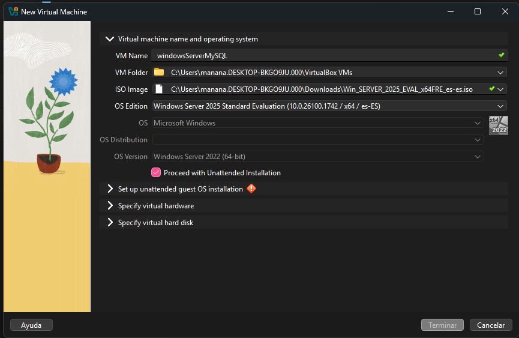
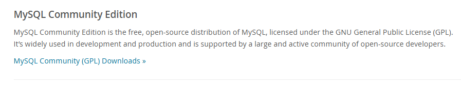
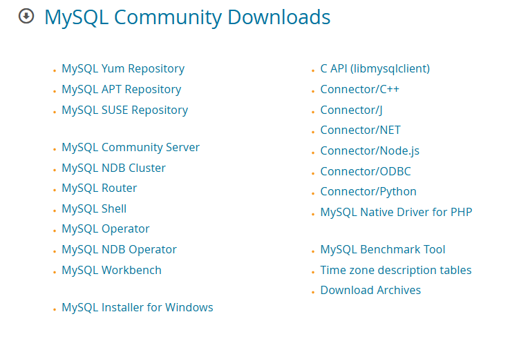
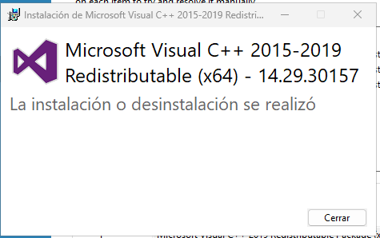
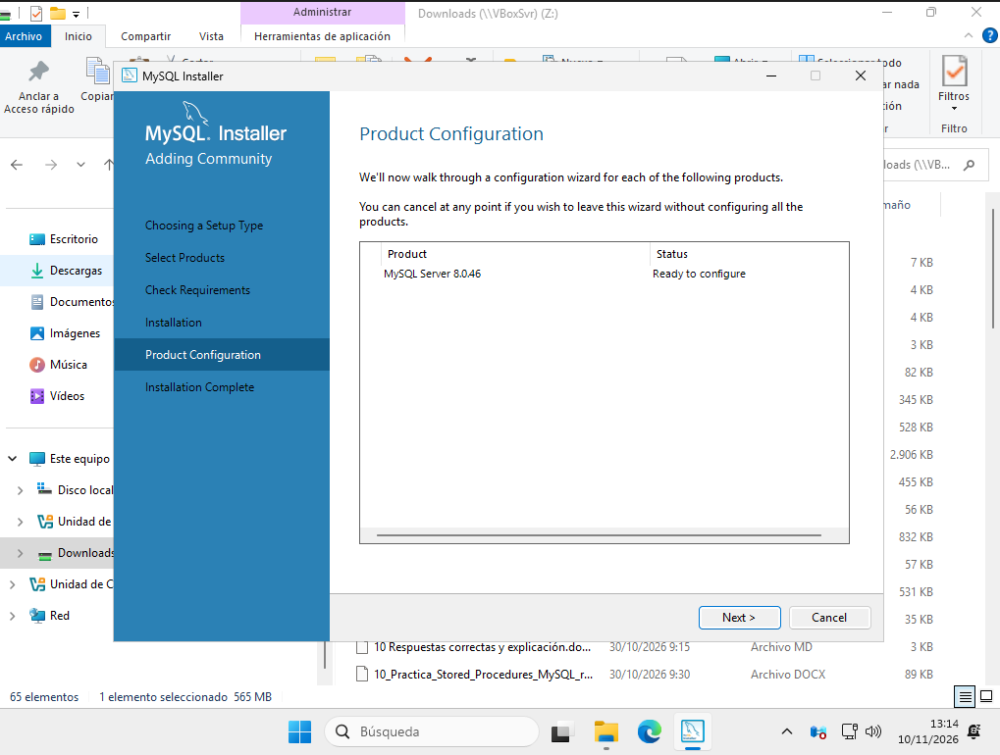
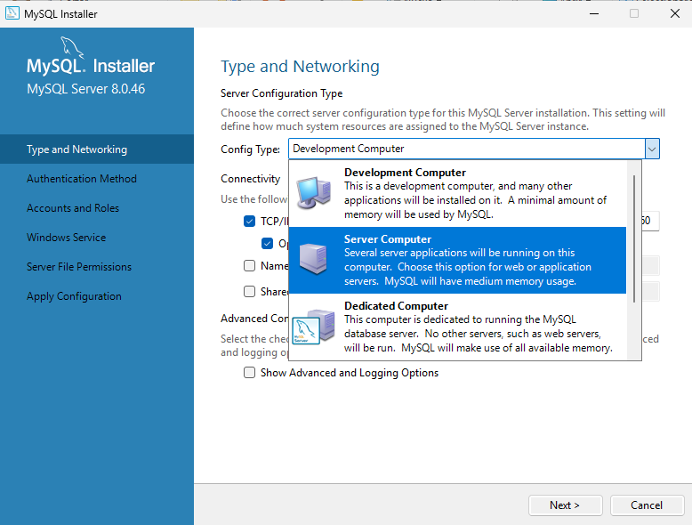
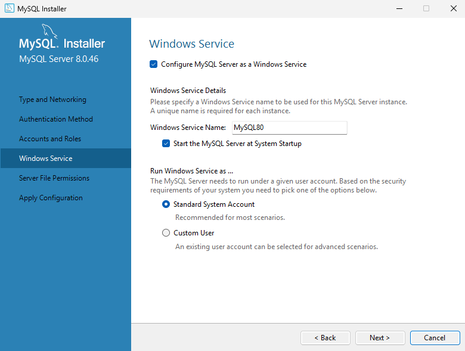
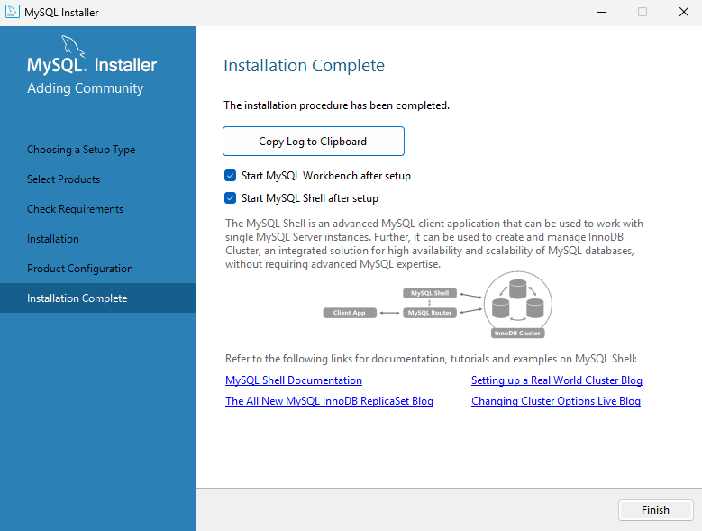
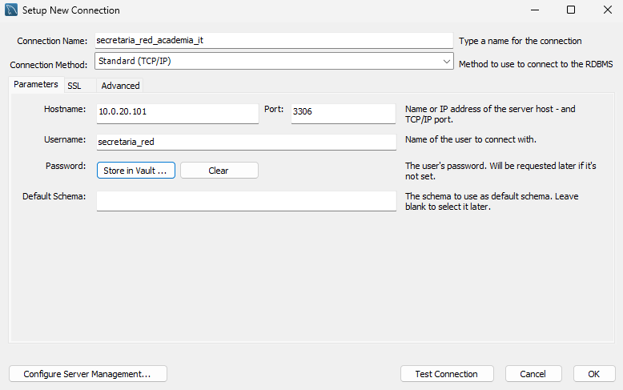
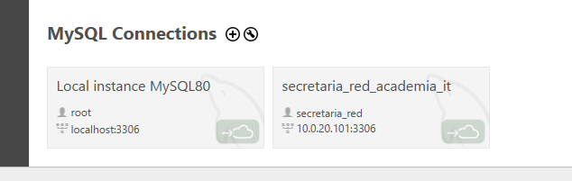

En Oracle Virtual Box vamos a crear una nueva máquina virtual Windows Server.

Durante la instalación seleccionamos Windows Server 2025 Standard Evaluation (experiencia de escritorio)

contraseña usada Pass1234!

Una vez iniciado conviene instalar Guest Addtions.

Tenemos descargado el archivo de instalacion de mySQL \
<https://www.mysql.com/downloads/>

Aqui usaremos MySQL installer for Windows, pero hay que notar que se ha descontinuado este instalador, por lo que ya no está instalando la versión más moderna. Para conseguir la última version tendremos que seleccionar de la lista MySQL Community Sever y MySQL Shell

Una vez que tienes el instalador puedes seleccionar qué productos quieres instalar.

Si seleccionas Server only, el cliente se instalará también, ya que es necesario para interactuar con el servidor.

La instalación necesita Microsoft Visual C++, se instalará por defecto, pero hay que asegurarse que el ordenador o la máquina virtual tienen acceso a internet, de lo contrario habrá que descargar el instalador y pasárselo a la máquina del servidor. \

Para nuestras necesidades nos vale con dejar aquí Development Computer, esto dará menos recursos a MySQL para que la máquina pueda hacer otras cosas, pero en la mayor parte de los casos querremos seleccionar Server Computer o Dedicated Computer

Al contrario que en Linux, aquí nos pedirá una contraseña para el usuario por defecto root, usaremos la misma que usamos para el sistema, Pass1234!

Dejamos las dos siguientes pantallas tal y como viene por defecto\

](images/paste-38.png)

