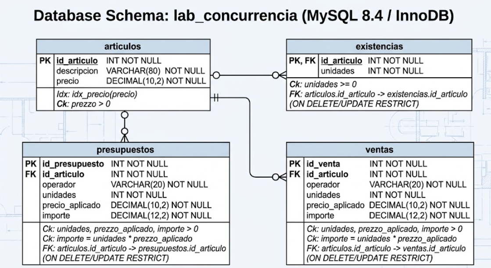
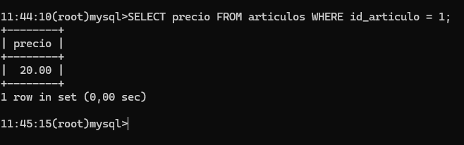

Dos conexiones y una tienda con presupuestos y ventas

La práctica reproduce operaciones que compiten por los mismos datos. Cada caso indica qué ejecuta A, qué ejecuta B, qué debe verse y por qué una sentencia termina o espera. La comparación cambia una condición cada vez para distinguir leer, proteger y modificar.

## Objetivos de aprendizaje

- Distinguir una lectura normal de FOR SHARE y FOR UPDATE.
- Reconocer cuándo una modificación espera y cuándo una lectura puede continuar.
- Comparar los cuatro aislamientos configurando la conexión que consulta.
- Registrar una venta sin adjudicar dos veces la última unidad.
- Explicar una espera, un interbloqueo y un tiempo de espera agotado.

## La idea que organiza todos los casos

| Mecanismo | Pregunta que responde |
|------------------------------------|------------------------------------|
| Transacción | ¿Qué cambios se confirman o cancelan conjuntamente? |
| Bloqueo | ¿Qué solicitud de acceso incompatible debe esperar? |
| Aislamiento | ¿Qué referencia de los datos utiliza cada transacción y cómo se coordina? |

::: nota
Un SELECT con FOR UPDATE sigue siendo una lectura. MVCC significa control de concurrencia mediante múltiples versiones: InnoDB conserva versiones anteriores para que una lectura normal pueda consultar los datos que le corresponden sin esperar a una modificación pendiente. El aislamiento no se elige automáticamente según el tipo de compra: lo configura el programa o el administrador y lo aplica InnoDB. \[1, 2\]
:::

Duración orientativa: dos sesiones de tres horas para los casos principales y una sesión adicional para ampliación, repetición y actividad final. Se parte de MySQL 8.4 instalado y se utiliza una base de datos nueva, lab_concurrencia.

## Recorrido e índice de casos

Casos 1 a 6: bloqueos de registro. Casos 7 a 12: aislamiento y lecturas. Caso 13: rangos. Casos 14 a 16: diagnóstico y ampliación. Caso 17: aplicación conjunta.

| Caso | Situación                                                   | Página |
|---------------|---------------------------------|------------------------|
| 1    | Una modificación bloquea otra pero permite leer             | 6      |
| 2    | Dos presupuestos comparten la protección del precio         | 8      |
| 3    | El mismo trabajo con protección exclusiva                   | 10     |
| 4    | Vender la última unidad leyendo antes de modificar          | 12     |
| 5    | El UPDATE condicionado ya obtiene sus bloqueos              | 14     |
| 6    | Dos lectores compartidos intentan convertirse en escritores | 16     |
| 7    | READ UNCOMMITTED permite leer una propuesta descartada      | 18     |
| 8    | READ COMMITTED renueva cada consulta                        | 19     |
| 9    | REPEATABLE READ conserva la referencia del informe          | 20     |
| 10   | SERIALIZABLE hace proteger a la lectura normal              | 22     |
| 11   | El conjunto del informe con READ COMMITTED                  | 23     |
| 12   | El conjunto del informe con REPEATABLE READ                 | 24     |
| 13   | Una lectura de rango frena la inserción                     | 25     |
| 14   | Una espera agotada no cancela todo                          | 26     |
| 15   | Un bloqueo explícito alcanza toda la tabla                  | 28     |
| 16   | La estructura tiene su propia protección                    | 29     |
| 17   | Actividad final de dos vendedores y una revisión de precio  | 30     |

En todos los casos A se mantiene en REPEATABLE READ. En B se indica expresamente el nivel antes de empezar. Las letras A y B identifican conexiones; no son nombres de niveles ni partes del ejercicio.

## Escenario y datos que se van a utilizar

El catálogo y el stock se guardan en tablas distintas. Así se puede proteger un precio sin bloquear por ese motivo el registro de existencias. Presupuestos y ventas conservan el precio aplicado, aunque el precio actual cambie después.

| Tabla | Campos y función |
|----------------|--------------------------------------------------------|
| articulos | id_articulo PK; descripcion; precio. Índice idx_precio para la prueba de rangos. |
| existencias | id_articulo PK y FK hacia articulos; unidades. Una fila de stock por artículo. |
| presupuestos | id_presupuesto PK; id_articulo FK; operador; unidades; precio_aplicado; importe. No descuenta stock. |
| ventas | id_venta PK; id_articulo FK; operador; unidades; precio_aplicado; importe. Se confirma junto con el descuento. |

PK identifica de forma única. FK mantiene la relación entre tablas. Un artículo tiene una fila de existencias y puede aparecer en muchos presupuestos o ventas. No se requiere un presupuesto para registrar una venta.

| ID  | Artículo  | Precio | Stock |
|-----|-----------|--------|-------|
| 1   | Teclado   | 20.00  | 1     |
| 2   | Ratón     | 30.00  | 10    |
| 3   | Monitor   | 200.00 | 5     |
| 4   | Impresora | 150.00 | 2     |

Los presupuestos y las ventas empiezan vacíos. Los identificadores se escriben expresamente para reconocer los documentos de A y B. Las restricciones impiden stock negativo y comprueban que importe = unidades $\times$ precio_aplicado.

::: nota
Las FK también pueden adquirir bloqueos al comprobar referencias. En los casos 2 y 3, FOR SHARE o FOR UPDATE protege el precio desde la lectura, antes del INSERT. No se afirma que toda inserción relacionada necesite una lectura con bloqueo escrita a mano. \[3\]
:::



## Crear el laboratorio y abrir dos conexiones

### Paso 1 Preparar los archivos

Copiar los dos SQL en el servidor o equipo desde el que se ejecuta el cliente mysql. Las rutas siguientes suponen la carpeta `/home/sysadmin/` en Ubuntu. Si se usa otra ruta, sustituirla.

[generador de db para practica bloqueos](practica_bloqueos.sql)

[reiniciar laboratorio](reiniciar_laboratorio_concurrencia.sql)

### Paso 2 Cargar el SQL inicial una sola vez

Desde la terminal de Ubuntu, fuera del indicador `mysql>`, con una cuenta administrativa local:

``` sql
sudo mysql --default-character-set=utf8mb4 < \
  /home/sysadmin/lab/00_crear_laboratorio_concurrencia.sql
```

Las barras al final unen las líneas en Bash. El nombre de archivo completa la ruta. El SQL crea la base de datos, las cuatro tablas InnoDB y los INSERT iniciales. `lab_concurrencia` no debe existir: si existe, detener la carga y comprobar de qué laboratorio se trata. No utilizar `--force`.

Alternativa dentro del cliente mysql: usar `SOURCE` seguido de la ruta completa del archivo. En Windows, usar una ruta local real con barras `/`, por ejemplo `C:/laboratorio/00_crear_laboratorio_concurrencia.sql`. No ejecutar la carga inicial una vez en cada conexión.

### Paso 3 Abrir A y B

``` sql
sudo mysql --default-character-set=utf8mb4
```

Abrir dos terminales y ejecutar el comando en cada una. Si se utiliza una cuenta con contraseña, sustituirlo por `mysql -u USUARIO -p --default-character-set=utf8mb4`. En clientes remotos, añadir `-h` y la dirección real del servidor.

``` sql
USE lab_concurrencia;
SELECT CONNECTION_ID() AS conexion, CURRENT_USER() AS cuenta;
```

Los identificadores deben ser distintos aunque se use la misma cuenta. Cada conexión tiene su transacción, su aislamiento y sus variables `@precio_A` o `@precio_B`. Dos pestañas de un editor pueden compartir conexión: comprobar siempre `CONNECTION_ID()`.

Los casos básicos requieren `SELECT`, `INSERT`, `UPDATE` y `DELETE` sobre el laboratorio. Las demostraciones de tabla y estructura requieren además `LOCK TABLES` y `ALTER`. Cada estudiante o pareja debe disponer de su propio servidor o base de datos, sin cambios de otras parejas.

## Preparación común antes de cada caso

Aplicar los pasos siguientes antes de cada caso, incluida cada repetición de los casos 11 y 12. No reiniciar entre los pasos de un mismo caso.

### Paso 1 Si hay una sentencia esperando

Liberar primero el bloqueo desde la conexión que lo mantiene. No pegar más SQL en la conexión ocupada. Si se utilizó `LOCK TABLES`, ejecutar `UNLOCK TABLES` en quien lo adquirió.

### Paso 2 En A y en B ejecutar

``` sql
ROLLBACK;
SET SESSION autocommit = 1;
USE lab_concurrencia;
SET SESSION TRANSACTION ISOLATION LEVEL REPEATABLE READ;
SET SESSION innodb_lock_wait_timeout = 300;
```

`ROLLBACK` cancela cambios anteriores. Autocommit establece el punto de partida; `START TRANSACTION` seguirá permitiendo agrupar cambios. La espera de 300 segundos da tiempo para alternar entre ventanas. No es la caducidad del bloqueo ni el límite de todas las clases de bloqueo. \[4, 5\]

### Paso 3 Solo en A restaurar los datos

(nota, he incluido las instrucciones del paso 2 en este script de forma que en A solo hay que correrlo y nos podemos saltar el paso anterior)

``` sql
SOURCE /home/sysadmin/reiniciar_laboratorio_concurrencia.sql;
```

Si la línea anterior no cabe visualmente, escribirla en una sola línea. El reinicio borra los resultados de esta práctica y restaura sus cuatro artículos. No elimina otras bases de datos. Debe devolver los datos iniciales y cero presupuestos y ventas. Si aparece un error, detenerse y resolverlo antes de continuar.

### Paso 4 En B aplicar el nivel indicado al inicio del caso

Cada caso proporciona su sentencia exacta. A no cambia: continúa en REPEATABLE READ. Configurar B no configura A, y `COMMIT` no elimina el nivel configurado para la sesión.

### Comprobación en cada conexión

``` sql
SELECT CONNECTION_ID(), @@session.autocommit, @@session.transaction_isolation;
```

El caso 6 requiere `innodb_deadlock_detect = 1`; el caso 14 requiere `innodb_rollback_on_timeout = 0`. Consultar estas variables globales con el docente. Si difieren, no cambiar el servidor sin revisar el efecto sobre otras sesiones.

## Caso 1 Una modificación bloquea otra pero permite leer

**Situación.** A prepara un precio nuevo; B quiere consultar el catálogo y después propone otro precio para el mismo artículo.

**Objetivo.** Distinguir leer una versión de modificar el registro actual.

**Aislamiento.** A: REPEATABLE READ. B: REPEATABLE READ.

Después de la preparación común, ejecutar solo en B:

``` sql
SET SESSION TRANSACTION ISOLATION LEVEL REPEATABLE READ;
```

Ejecutar en orden; cada bloque pertenece solo a la sesión indicada.

### Paso 1 Sesión A Cambiar el precio sin confirmar

``` sql
START TRANSACTION;
UPDATE articulos SET precio = 25.00 WHERE id_articulo = 1;
```

*Resultado esperado.* El UPDATE termina y deja un cambio pendiente. *Por qué.* La modificación obtiene un bloqueo exclusivo sobre el artículo 1.

### Paso 2 Sesión A Comprobar el propio cambio

``` sql
SELECT precio FROM articulos WHERE id_articulo = 1;
```

*Resultado esperado.* 25.00. *Por qué.* La conexión ve su propio cambio antes de COMMIT.


### Paso 3 Sesión B Leer normalmente

``` sql
SELECT precio FROM articulos WHERE id_articulo = 1;
```



*Resultado esperado.* 20.00 sin esperar. *Por qué.* B consulta una versión confirmada mediante MVCC.

### Paso 4 Sesión B Intentar otra modificación

``` sql
START TRANSACTION;
UPDATE articulos SET precio = 30.00 WHERE id_articulo = 1;
```

*Resultado esperado.* B queda esperando; no ejecutar todavía más SQL en B. *Por qué.* Su UPDATE necesita exclusividad sobre el registro bloqueado por A.

::: nota-importante
Detenerse aquí y pasar al siguiente paso en la otra conexión. La espera es el resultado previsto.
:::

### Paso 5 Sesión A Descartar el precio provisional

``` sql
ROLLBACK;
```

*Resultado esperado.* A deshace su cambio y libera el bloqueo. *Por qué.* Cancelar permite que B obtenga la protección que esperaba.

### Paso 6 Sesión B Esperar a que termine su UPDATE

No enviar una nueva sentencia: observar la que ya se había enviado.

*Resultado esperado.* El UPDATE pendiente termina. *Por qué.* Ahora B puede modificar; su transacción sigue abierta.

### Paso 7 Sesión B Comprobar y cancelar su propuesta

``` sql
SELECT precio FROM articulos WHERE id_articulo = 1;
```

*Resultado esperado.* 30.00 dentro de B. *Por qué.* Ese valor sigue pendiente; no fue confirmado por el desbloqueo.

### Paso 8 Sesión B Finalizar

``` sql
ROLLBACK;
```

*Resultado esperado.* Se descarta también la propuesta de B. *Por qué.* El registro recupera el precio inicial.

### Paso 9 Sesión A Verificar el resultado final

``` sql
SELECT precio FROM articulos WHERE id_articulo = 1;
```

*Resultado esperado.* 20.00. *Por qué.* Ambas propuestas se cancelaron.

### Qué se ha demostrado

Un SELECT normal puede continuar; un UPDATE incompatible espera. START TRANSACTION no bloquea por sí solo todas las lecturas.

**Cuándo utilizarlo.** Mostrar un catálogo con SELECT normal. Coordinar las modificaciones con los bloqueos que obtiene InnoDB.

## Caso 2 Dos presupuestos comparten la protección del precio

**Situación.** Regla de esta prueba: el precio debe seguir vigente hasta confirmar cada presupuesto. A y B preparan documentos diferentes del mismo artículo. **Objetivo.** Ver que FOR SHARE permite dos lectores protegidos y escrituras en otros registros. **Aislamiento.** A: REPEATABLE READ. B: REPEATABLE READ.

Después de la preparación común, ejecutar solo en B:

``` sql
SET SESSION TRANSACTION ISOLATION LEVEL REPEATABLE READ;
```

Ejecutar en orden; cada bloque pertenece solo a la sesión indicada.

### Paso 1 Sesión A Leer y proteger el precio

``` sql
START TRANSACTION;
SELECT precio INTO @precio_A FROM articulos WHERE id_articulo = 1 FOR SHARE;
SELECT @precio_A;
```

*Resultado esperado.* 20.00; mantener la transacción abierta. *Por qué.* FOR SHARE adquiere un bloqueo compartido S. INTO guarda el precio en una variable de esta conexión.

### Paso 2 Sesión A Crear el presupuesto de A

``` sql
INSERT INTO presupuestos(id_presupuesto, id_articulo, operador, unidades, precio_aplicado, importe)
VALUES (101, 1, 'A', 2, @precio_A, 2 * @precio_A);
```

*Resultado esperado.* Una fila insertada, pendiente. *Por qué.* Se escribe en presupuestos, no en la fila de precio protegida.

### Paso 3 Sesión B Leer sin solicitar protección

``` sql
SELECT precio FROM articulos WHERE id_articulo = 1;
```

*Resultado esperado.* 20.00 sin esperar. *Por qué.* Un SELECT normal no necesita compartir el bloqueo.

### Paso 4 Sesión B Solicitar también protección compartida

``` sql
START TRANSACTION;
SELECT precio INTO @precio_B FROM articulos WHERE id_articulo = 1 FOR SHARE;
SELECT @precio_B;
```

*Resultado esperado.* 20.00 sin esperar a A. *Por qué.* Los bloqueos S de ambas conexiones son compatibles.

### Paso 5 Sesión B Crear otro presupuesto

``` sql
INSERT INTO presupuestos(id_presupuesto, id_articulo, operador, unidades, precio_aplicado, importe)
VALUES (102, 1, 'B', 3, @precio_B, 3 * @precio_B);
```

*Resultado esperado.* Una fila insertada, pendiente. *Por qué.* El identificador 102 es distinto del 101 utilizado por A.

### Paso 6 Sesión B Confirmar su documento

``` sql
COMMIT;
```

*Resultado esperado.* El presupuesto 102 queda confirmado. *Por qué.* B libera su protección; A sigue manteniendo la suya.

### Paso 7 Sesión B Intentar cambiar el precio como responsable

``` sql
START TRANSACTION;
UPDATE articulos SET precio = 25.00 WHERE id_articulo = 1;
```

*Resultado esperado.* B espera a A. *Por qué.* B ahora escribe sobre el dato de referencia y necesita un bloqueo X.

::: nota-importante
Detenerse aquí y pasar al siguiente paso en la otra conexión. La espera es el resultado previsto.
:::

### Paso 8 Sesión A Confirmar su presupuesto

``` sql
COMMIT;
```

*Resultado esperado.* El presupuesto 101 queda confirmado y se libera su S. *Por qué.* El presupuesto se confirma mientras su precio todavía está protegido.

### Paso 9 Sesión B Reanudar la modificación

No enviar una nueva sentencia: observar la que ya se había enviado.

*Resultado esperado.* El UPDATE pendiente termina. *Por qué.* A ya no mantiene un bloqueo incompatible.

### Paso 10 Sesión B Cancelar el cambio de precio

``` sql
ROLLBACK;
```

*Resultado esperado.* El precio vuelve a 20.00. *Por qué.* La modificación pertenecía a otra transacción, no a los presupuestos confirmados.

### Paso 11 Sesión A Revisar los dos documentos

``` sql
SELECT id_presupuesto, precio_aplicado, importe FROM presupuestos ORDER BY id_presupuesto;
```

*Resultado esperado.* 101: precio 20.00 e importe 40.00; 102: precio 20.00 e importe 60.00. *Por qué.* Las dos escrituras en registros distintos fueron posibles mientras se compartía la protección del precio.

### Qué se ha demostrado

Ambos leen y protegen el mismo precio a la vez. Cada uno inserta su propio presupuesto. La protección compartida frena al que intenta cambiar el precio.

**Cuándo utilizarlo.** Usar FOR SHARE cuando se necesita impedir cambios del dato de referencia hasta terminar. Si solo importa conservar el precio leído como histórico, puede bastar un SELECT normal.

## Caso 3 El mismo trabajo con protección exclusiva

**Situación.** Se repite la regla del caso 2, pero A utiliza FOR UPDATE sobre el precio aunque no va a cambiarlo. **Objetivo.** Observar qué lectura de B espera y cuál puede continuar. **Aislamiento.** A: REPEATABLE READ. B: REPEATABLE READ.

Después de la preparación común, ejecutar solo en B:

``` sql
SET SESSION TRANSACTION ISOLATION LEVEL REPEATABLE READ;
```

Ejecutar en orden; cada bloque pertenece solo a la sesión indicada.

### Paso 1 Sesión A Proteger el precio en exclusiva

``` sql
START TRANSACTION;
SELECT precio INTO @precio_A FROM articulos WHERE id_articulo = 1 FOR UPDATE;
SELECT @precio_A;
```

*Resultado esperado.* 20.00 y bloqueo X. *Por qué.* A solicita más exclusividad que en el caso anterior.

### Paso 2 Sesión A Guardar su presupuesto

``` sql
INSERT INTO presupuestos(id_presupuesto, id_articulo, operador, unidades, precio_aplicado, importe)
VALUES (101, 1, 'A', 2, @precio_A, 2 * @precio_A);
```

*Resultado esperado.* Una fila pendiente. *Por qué.* A escribe un documento propio.

### Paso 3 Sesión B Leer normalmente el precio

``` sql
SELECT precio FROM articulos WHERE id_articulo = 1;
```

*Resultado esperado.* 20.00 sin esperar. *Por qué.* Esta lectura usa MVCC; el X no bloquea toda lectura normal.

### Paso 4 Sesión B Pedir la protección que necesita su operación

``` sql
START TRANSACTION;
SELECT precio FROM articulos WHERE id_articulo = 1 FOR SHARE;
```

*Resultado esperado.* B espera. *Por qué.* Su petición S es incompatible con el X de A.

::: nota-importante
Detenerse aquí y pasar al siguiente paso en la otra conexión. La espera es el resultado previsto.
:::

### Paso 5 Sesión A Confirmar

``` sql
COMMIT;
```

*Resultado esperado.* A confirma el presupuesto y libera el X. *Por qué.* Finalizar permite obtener el bloqueo S de B.

### Paso 6 Sesión B Continuar su lectura protegida

No enviar una nueva sentencia: observar la que ya se había enviado.

*Resultado esperado.* 20.00; B obtiene ahora su S. *Por qué.* El precio no cambió, pero su protección no se podía compartir mientras A mantenía X.

### Paso 7 Sesión B Capturar el precio y guardar otro presupuesto

``` sql
SELECT precio INTO @precio_B FROM articulos WHERE id_articulo = 1 FOR SHARE;
INSERT INTO presupuestos(id_presupuesto, id_articulo, operador, unidades, precio_aplicado, importe)
VALUES (102, 1, 'B', 3, @precio_B, 3 * @precio_B);
```

*Resultado esperado.* Una fila pendiente. *Por qué.* La lectura protegida ya puede utilizarse para preparar su documento.

### Paso 8 Sesión B Confirmar

``` sql
COMMIT;
```

*Resultado esperado.* Los dos presupuestos quedan confirmados. *Por qué.* El resultado de los documentos es el mismo que en el caso 2, pero B tuvo una espera adicional.

### Qué se ha demostrado

El SELECT normal de B continúa. El SELECT con FOR SHARE de B espera al X de A. No se espera por leer: se espera por solicitar un bloqueo incompatible.

**Cuándo utilizarlo.** Para varios lectores que solo necesitan proteger el mismo precio, FOR SHARE permite más concurrencia que FOR UPDATE.

## Caso 4 Vender la última unidad leyendo antes de modificar

**Situación.** Dos vendedores intentan adjudicar el teclado. Solo queda una unidad y la venta debe registrarse junto con el descuento. **Objetivo.** Utilizar FOR UPDATE cuando la decisión requiere modificar la misma fila consultada. **Aislamiento.** A: REPEATABLE READ. B: REPEATABLE READ.

Después de la preparación común, ejecutar solo en B:

``` sql
SET SESSION TRANSACTION ISOLATION LEVEL REPEATABLE READ;
```

Ejecutar en orden; cada bloque pertenece solo a la sesión indicada.

### Paso 1 Sesión A Capturar un precio protegido

``` sql
START TRANSACTION;
SELECT precio INTO @precio_A FROM articulos WHERE id_articulo = 1 FOR SHARE;
```

*Resultado esperado.* Se guarda 20.00 en `@precio_A`. *Por qué.* Se protege la referencia de precio; aún no se ha bloqueado el stock.

### Paso 2 Sesión A Leer y proteger el stock

``` sql
SELECT unidades FROM existencias WHERE id_articulo = 1 FOR UPDATE;
```

*Resultado esperado.* 1. *Por qué.* A necesita modificar esta misma fila.

### Paso 3 Sesión B Consultar la disponibilidad sin bloquear

``` sql
SELECT unidades FROM existencias WHERE id_articulo = 1;
```

*Resultado esperado.* 1 sin esperar. *Por qué.* A todavía no descontó; mostrar disponibilidad no reserva.

### Paso 4 Sesión B Intentar adjudicar con una lectura protegida

``` sql
START TRANSACTION;
SELECT unidades FROM existencias WHERE id_articulo = 1 FOR UPDATE;
```

*Resultado esperado.* B espera a A. *Por qué.* No puede obtener un segundo X sobre esa fila.

::: nota-importante
Detenerse aquí y pasar al siguiente paso en la otra conexión. La espera es el resultado previsto.
:::

### Paso 5 Sesión A Descontar condicionalmente

``` sql
UPDATE existencias SET unidades = unidades - 1 WHERE id_articulo = 1 AND unidades > 0;
SELECT ROW_COUNT() AS filas_modificadas;
```

*Resultado esperado.* 1. *Por qué.* La condición impide descontar sin unidades. ROW_COUNT se consulta inmediatamente.

### Paso 6 Sesión A Registrar la venta

``` sql
INSERT INTO ventas(id_venta, id_articulo, operador, unidades, precio_aplicado, importe)
VALUES (201, 1, 'A', 1, @precio_A, @precio_A);
```

*Resultado esperado.* Una venta pendiente. *Por qué.* Se registra en la misma transacción que el descuento.

### Paso 7 Sesión A Comprobar el conjunto

``` sql
SELECT unidades FROM existencias WHERE id_articulo = 1;
SELECT id_venta, importe FROM ventas;
```

*Resultado esperado.* Stock 0 y venta 201 por 20.00. *Por qué.* A comprueba sus propios cambios antes de confirmar.

### Paso 8 Sesión A Confirmar

``` sql
COMMIT;
```

*Resultado esperado.* Stock y venta quedan confirmados conjuntamente. *Por qué.* Se liberan tanto el S del precio como el X del stock.

### Paso 9 Sesión B Reanudar la lectura

No enviar una nueva sentencia: observar la que ya se había enviado.

*Resultado esperado.* 0. *Por qué.* La lectura con bloqueo usa el estado disponible tras A, no una fotografía de stock 1.

### Paso 10 Sesión B Cancelar su intento sin insertar una venta

``` sql
ROLLBACK;
```

*Resultado esperado.* B no adjudica nada. *Por qué.* El stock leído es cero; no procede crear otra venta.

### Paso 11 Sesión A Verificar el resultado

``` sql
SELECT unidades FROM existencias WHERE id_articulo = 1;
SELECT COUNT(*), SUM(importe) FROM ventas;
```

*Resultado esperado.* Una venta por 20.00; el stock sigue en 0. *Por qué.* La unidad se adjudicó una sola vez.

### Qué se ha demostrado

B espera desde su lectura protegida. Tras la confirmación de A, lee cero y no registra otra venta.

**Cuándo utilizarlo.** Transacción breve para consultar, decidir, descontar y registrar; no mantenerla abierta mientras un cliente se lo piensa.

## Caso 5 El UPDATE condicionado ya obtiene sus bloqueos

**Situación.** Se compara el caso anterior con el descuento expresado en una sola sentencia. Aquí no se registra una venta completa. **Objetivo.** Comprobar que no es obligatorio ejecutar FOR UPDATE antes de cada UPDATE. **Aislamiento.** A: REPEATABLE READ. B: REPEATABLE READ.

Después de la preparación común, ejecutar solo en B:

``` sql
SET SESSION TRANSACTION ISOLATION LEVEL REPEATABLE READ;
```

Ejecutar en orden; cada bloque pertenece solo a la sesión indicada.

### Paso 1 Sesión A Descontar sin lectura previa

``` sql
START TRANSACTION;
UPDATE existencias SET unidades = unidades - 1 WHERE id_articulo = 1 AND unidades > 0;
SELECT ROW_COUNT();
```

*Resultado esperado.* 1. *Por qué.* El UPDATE obtiene automáticamente el bloqueo X.

### Paso 2 Sesión B Intentar el mismo descuento

``` sql
START TRANSACTION;
UPDATE existencias SET unidades = unidades - 1 WHERE id_articulo = 1 AND unidades > 0;
```

*Resultado esperado.* B espera. *Por qué.* La fila está protegida por A.

::: nota-importante
Detenerse aquí y pasar al siguiente paso en la otra conexión. La espera es el resultado previsto.
:::

### Paso 3 Sesión A Confirmar su descuento

``` sql
COMMIT;
```

*Resultado esperado.* El stock confirmado pasa a 0. *Por qué.* B puede continuar sobre la situación actual.

### Paso 4 Sesión B Esperar a que termine el UPDATE

No enviar una nueva sentencia: observar la que ya se había enviado.

*Resultado esperado.* Termina sin modificar filas. *Por qué.* Ya no se cumple unidades \> 0.

### Paso 5 Sesión B Comprobar inmediatamente el resultado

``` sql
SELECT ROW_COUNT();
```

*Resultado esperado.* 0. *Por qué.* Una sentencia válida puede no adjudicar ninguna unidad.

### Paso 6 Sesión B Finalizar

``` sql
ROLLBACK;
```

*Resultado esperado.* Se cierra el intento. *Por qué.* No había descuento propio que conservar.

### Paso 7 Sesión A Verificar

``` sql
SELECT unidades FROM existencias WHERE id_articulo = 1;
SELECT COUNT(*) FROM ventas;
```

*Resultado esperado.* Stock 0 y cero ventas registradas. *Por qué.* Este caso solo probó el descuento. Una venta completa requiere registrar y comprobar sus otros cambios.

### Qué se ha demostrado

A modifica una fila; B espera y finalmente modifica cero porque ya no queda stock.

**Cuándo utilizarlo.** Usar una operación SQL condicionada cuando expresa por sí sola la comprobación y la modificación necesarias.

## Caso 6 Dos lectores compartidos intentan convertirse en escritores

**Situación.** A y B utilizan FOR SHARE sobre el mismo stock y después ambos quieren descontarlo. **Objetivo.** Entender por qué el código con FOR SHARE puede funcionar solo y provocar un ciclo al concurrir. **Aislamiento.** A: REPEATABLE READ. B: REPEATABLE READ.

Después de la preparación común, ejecutar solo en B:

``` sql
SET SESSION TRANSACTION ISOLATION LEVEL REPEATABLE READ;
```

Ejecutar en orden; cada bloque pertenece solo a la sesión indicada.

::: nota
Comprobar antes en A: `SELECT @@global.innodb_deadlock_detect;` debe devolver 1. Ejecutar el paso de B antes de que venza la espera de A.
:::

### Paso 1 Sesión A Leer con protección compartida

``` sql
START TRANSACTION;
SELECT unidades FROM existencias WHERE id_articulo = 1 FOR SHARE;
```

*Resultado esperado.* 1. *Por qué.* A obtiene S, no X.

### Paso 2 Sesión B Compartir la protección

``` sql
START TRANSACTION;
SELECT unidades FROM existencias WHERE id_articulo = 1 FOR SHARE;
```

*Resultado esperado.* 1 sin esperar. *Por qué.* B también obtiene S.

### Paso 3 Sesión A Intentar modificar

``` sql
UPDATE existencias SET unidades = unidades - 1 WHERE id_articulo = 1 AND unidades > 0;
```

*Resultado esperado.* A espera a que B libere S. *Por qué.* A necesita obtener X.

::: nota-importante
Detenerse aquí y pasar al siguiente paso en la otra conexión. La espera es el resultado previsto.
:::

### Paso 4 Sesión B Intentar modificar antes del timeout

``` sql
UPDATE existencias SET unidades = unidades - 1 WHERE id_articulo = 1 AND unidades > 0;
```

*Resultado esperado.* Una conexión recibe 1213; la otra puede terminar su UPDATE. *Por qué.* B necesita X mientras A conserva S: se forma un ciclo. No se fija de antemano la víctima.

### Paso 5 Sesión A y B Comprobar que las sentencias han terminado

No enviar una nueva sentencia: observar la que ya se había enviado.

*Resultado esperado.* Una transacción se canceló por completo; la otra sigue pendiente. *Por qué.* El desbloqueo no confirma automáticamente la transacción superviviente.

### Paso 6 Sesión A Cancelar cualquier cambio superviviente

``` sql
ROLLBACK;
```

*Resultado esperado.* A queda sin cambios pendientes. *Por qué.* También puede ejecutarse si A fue la víctima.

### Paso 7 Sesión B Cancelar y comprobar

``` sql
ROLLBACK;
SELECT unidades FROM existencias WHERE id_articulo = 1;
```

*Resultado esperado.* 1. *Por qué.* La cancelación de ambas permite recuperar el estado inicial.

### Qué se ha demostrado

El problema no está en leer: ambas conexiones obtuvieron S y después necesitan X. InnoDB cancela una transacción para romper el ciclo.

**Cuándo utilizarlo.** Preferir FOR UPDATE desde la lectura si se prevé modificar la misma fila; gestionar siempre los errores de concurrencia.

## Caso 7 READ UNCOMMITTED permite leer una propuesta descartada

**Situación.** A prueba un precio de 25.00 pero luego lo descarta. B consulta con READ UNCOMMITTED. **Objetivo.** Ver una lectura sucia y relacionarla con el aislamiento de quien lee. **Aislamiento.** A: REPEATABLE READ. B: READ UNCOMMITTED.

Después de la preparación común, ejecutar solo en B:

``` sql
SET SESSION TRANSACTION ISOLATION LEVEL READ UNCOMMITTED;
```

Ejecutar en orden; cada bloque pertenece solo a la sesión indicada.

### Paso 1 Sesión A Preparar un precio sin confirmar

``` sql
START TRANSACTION;
UPDATE articulos SET precio = 25.00 WHERE id_articulo = 1;
```

*Resultado esperado.* Cambio pendiente. *Por qué.* A escribe con su aislamiento fijo REPEATABLE READ.

### Paso 2 Sesión B Leer la propuesta ajena

``` sql
START TRANSACTION;
SELECT precio FROM articulos WHERE id_articulo = 1;
```

*Resultado esperado.* 25.00. *Por qué.* B utiliza READ UNCOMMITTED y admite una lectura sucia.

### Paso 3 Sesión A Cancelar la propuesta

``` sql
ROLLBACK;
```

*Resultado esperado.* Se recupera 20.00. *Por qué.* Los 25.00 nunca se confirmaron.

### Paso 4 Sesión B Leer otra vez

``` sql
SELECT precio FROM articulos WHERE id_articulo = 1;
```

*Resultado esperado.* 20.00 dentro de su misma transacción. *Por qué.* Se comprueba que el dato leído antes era provisional.

### Paso 5 Sesión B Terminar

``` sql
ROLLBACK;
```

*Resultado esperado.* Prueba finalizada. *Por qué.* El nivel no se cambia solo; se restablece al preparar el siguiente caso.

### Qué se ha demostrado

El nivel de B permite observar cambios ajenos pendientes aunque A siga en REPEATABLE READ.

**Cuándo utilizarlo.** Solo cuando se acepte conscientemente leer datos que después se descarten. No es necesario para mostrar un catálogo con lecturas no bloqueantes.

## Caso 8 READ COMMITTED renueva cada consulta

**Situación.** B consulta un catálogo mientras A publica un nuevo precio. **Objetivo.** Comprobar que no se lee el cambio pendiente y que después del COMMIT una nueva lectura sí cambia. **Aislamiento.** A: REPEATABLE READ. B: READ COMMITTED.

Después de la preparación común, ejecutar solo en B:

``` sql
SET SESSION TRANSACTION ISOLATION LEVEL READ COMMITTED;
```

Ejecutar en orden; cada bloque pertenece solo a la sesión indicada.

### Paso 1 Sesión B Abrir y leer

``` sql
START TRANSACTION;
SELECT precio FROM articulos WHERE id_articulo = 1;
```

*Resultado esperado.* 20.00. *Por qué.* Se crea la referencia de esta consulta.

### Paso 2 Sesión A Cambiar sin confirmar todavía

``` sql
START TRANSACTION;
UPDATE articulos SET precio = 25.00 WHERE id_articulo = 1;
```

*Resultado esperado.* 25.00 pendiente solo en A. *Por qué.* A mantiene un X; B no cambia de aislamiento.

### Paso 3 Sesión B Consultar mientras A sigue pendiente

``` sql
SELECT precio FROM articulos WHERE id_articulo = 1;
```

*Resultado esperado.* 20.00 sin esperar. *Por qué.* READ COMMITTED no admite el cambio ajeno sin confirmar.

### Paso 4 Sesión A Publicar el cambio

``` sql
COMMIT;
```

*Resultado esperado.* 25.00 confirmado. *Por qué.* El nuevo precio pasa a formar parte de los datos confirmados.

### Paso 5 Sesión B Repetir sin cerrar su transacción

``` sql
SELECT precio FROM articulos WHERE id_articulo = 1;
```

*Resultado esperado.* 25.00. *Por qué.* Esta lectura consistente usa una nueva instantánea.

### Paso 6 Sesión B Terminar

``` sql
COMMIT;
```

*Resultado esperado.* B finaliza. *Por qué.* No se cambió el dato; se compararon dos lecturas confirmadas.

### Qué se ha demostrado

Dos lecturas de la misma transacción pueden usar referencias confirmadas diferentes.

**Cuándo utilizarlo.** Operaciones que desean una instantánea nueva en cada consulta, aceptando que los datos cambien entre consultas.

## Caso 9 REPEATABLE READ conserva la referencia del informe

**Situación.** B prepara un informe con varias consultas. A confirma un nuevo precio mientras B sigue trabajando. **Objetivo.** Distinguir instantánea estable y protección mediante bloqueo. **Aislamiento.** A: REPEATABLE READ. B: REPEATABLE READ.

Después de la preparación común, ejecutar solo en B:

``` sql
SET SESSION TRANSACTION ISOLATION LEVEL REPEATABLE READ;
```

Ejecutar en orden; cada bloque pertenece solo a la sesión indicada.

### Paso 1 Sesión B Fijar su instantánea mediante la primera lectura

``` sql
START TRANSACTION;
SELECT precio FROM articulos WHERE id_articulo = 1;
```

*Resultado esperado.* 20.00. *Por qué.* START TRANSACTION por sí solo no fijó esta instantánea; lo hace la primera lectura consistente.

### Paso 2 Sesión A Cambiar el precio

``` sql
START TRANSACTION;
UPDATE articulos SET precio = 25.00 WHERE id_articulo = 1;
```

*Resultado esperado.* El UPDATE termina sin esperar a la lectura normal de B. *Por qué.* B no había solicitado un S ni un X sobre el registro.

### Paso 3 Sesión A Confirmar

``` sql
COMMIT;
```

*Resultado esperado.* 25.00 confirmado. *Por qué.* La operación de A termina, pero B no ha finalizado.

### Paso 4 Sesión B Repetir la lectura normal

``` sql
SELECT precio FROM articulos WHERE id_articulo = 1;
```

*Resultado esperado.* 20.00. *Por qué.* Se conserva su instantánea.

### Paso 5 Sesión B Comparar con una lectura con bloqueo

``` sql
SELECT precio FROM articulos WHERE id_articulo = 1 FOR UPDATE;
```

*Resultado esperado.* 25.00. *Por qué.* Esta lectura utiliza el estado actual disponible para bloquear; no la fotografía del SELECT anterior.

### Paso 6 Sesión B Volver al SELECT normal sin hacer UPDATE

``` sql
SELECT precio FROM articulos WHERE id_articulo = 1;
```

*Resultado esperado.* 20.00. *Por qué.* Obtener X no renueva por sí solo la instantánea ni modifica el precio.

### Paso 7 Sesión B Finalizar y consultar fuera de la transacción

``` sql
COMMIT;
SELECT precio FROM articulos WHERE id_articulo = 1;
```

*Resultado esperado.* 25.00. *Por qué.* La nueva consulta ya pertenece a otra transacción.

### Qué se ha demostrado

El SELECT normal de B conserva 20.00; FOR UPDATE puede leer 25.00. A pudo modificar, por lo que la fotografía no era un bloqueo.

**Cuándo utilizarlo.** Informes de varias lecturas consistentes que necesitan la misma referencia temporal; no confundir esa referencia con reservar un dato.

## Caso 10 SERIALIZABLE hace proteger a la lectura normal

**Situación.** B comprueba el precio dentro de una transacción explícita. A intenta modificarlo después. **Objetivo.** Comparar con el caso 9 usando un SELECT sin FOR SHARE ni FOR UPDATE. **Aislamiento.** A: REPEATABLE READ. B: SERIALIZABLE.

Después de la preparación común, ejecutar solo en B:

``` sql
SET SESSION TRANSACTION ISOLATION LEVEL SERIALIZABLE;
```

Ejecutar en orden; cada bloque pertenece solo a la sesión indicada.

### Paso 1 Sesión B Consultar primero

``` sql
START TRANSACTION;
SELECT precio FROM articulos WHERE id_articulo = 1;
```

*Resultado esperado.* 20.00. *Por qué.* En esta transacción explícita SERIALIZABLE, el SELECT normal actúa como una lectura compartida con bloqueo.

### Paso 2 Sesión A Intentar publicar un precio

``` sql
START TRANSACTION;
UPDATE articulos SET precio = 25.00 WHERE id_articulo = 1;
```

*Resultado esperado.* A espera a B. *Por qué.* La lectura de B ha solicitado S; el UPDATE de A necesita X.

::: nota-importante
Detenerse aquí y pasar al siguiente paso en la otra conexión. La espera es el resultado previsto.
:::

### Paso 3 Sesión B Finalizar su comprobación

``` sql
COMMIT;
```

*Resultado esperado.* Se libera la protección de B. *Por qué.* Ahora puede continuar el escritor A.

### Paso 4 Sesión A Reanudar el UPDATE

No enviar una nueva sentencia: observar la que ya se había enviado.

*Resultado esperado.* Termina el UPDATE. *Por qué.* El cambio sigue pendiente en A.

### Paso 5 Sesión A Confirmar el precio

``` sql
COMMIT;
```

*Resultado esperado.* 25.00 confirmado. *Por qué.* Se completa la escritura.

### Paso 6 Sesión B Consultar en otra transacción

``` sql
SELECT precio FROM articulos WHERE id_articulo = 1;
```

*Resultado esperado.* 25.00. *Por qué.* Con autocommit, esta lectura aislada no es la transacción explícita del paso 1.

### Qué se ha demostrado

El SELECT de B en esta transacción obtiene protección compartida y A espera. El aislamiento cambia cómo se coordina una lectura normal.

**Cuándo utilizarlo.** Cuando la operación necesita garantías de serialización; evaluar las esperas y los posibles interbloqueos que añade.

## Caso 11 El conjunto del informe con READ COMMITTED

**Situación.** B lista artículos de 100 euros o más. A añade un artículo de 180.00. **Objetivo.** Comparar una fila fantasma con la conservación de una instantánea. **Aislamiento.** A: REPEATABLE READ. B: READ COMMITTED.

Después de la preparación común, ejecutar solo en B:

``` sql
SET SESSION TRANSACTION ISOLATION LEVEL READ COMMITTED;
```

Ejecutar en orden; cada bloque pertenece solo a la sesión indicada.

### Paso 1 Sesión B Obtener el conjunto inicial

``` sql
START TRANSACTION;
SELECT id_articulo FROM articulos WHERE precio >= 100 ORDER BY id_articulo;
```

*Resultado esperado.* 3 y 4. *Por qué.* Monitor e impresora cumplen el filtro.

### Paso 2 Sesión A Añadir un artículo y sus existencias

``` sql
START TRANSACTION;
INSERT INTO articulos VALUES (5, 'Cámara', 180.00);
INSERT INTO existencias VALUES (5, 3);
```

*Resultado esperado.* Dos filas pendientes en tablas distintas. *Por qué.* Se crea el artículo y su stock como una sola unidad de trabajo.

### Paso 3 Sesión A Confirmar

``` sql
COMMIT;
```

*Resultado esperado.* La cámara queda confirmada. *Por qué.* B mantiene la misma transacción de lectura.

### Paso 4 Sesión B Repetir la misma consulta

``` sql
SELECT id_articulo FROM articulos WHERE precio >= 100 ORDER BY id_articulo;
```

*Resultado esperado.* 3, 4 y 5. *Por qué.* El aislamiento de B decide si se renueva su instantánea.

### Paso 5 Sesión B Finalizar y consultar otra vez

``` sql
COMMIT;
SELECT id_articulo FROM articulos WHERE precio >= 100 ORDER BY id_articulo;
```

*Resultado esperado.* 3, 4 y 5. *Por qué.* Una nueva transacción puede ver la cámara en los dos niveles.

### Qué se ha demostrado

En READ COMMITTED la segunda lectura puede incorporar la fila nueva; en REPEATABLE READ el SELECT consistente conserva el conjunto anterior. En ambos casos A pudo insertar.

**Cuándo utilizarlo.** Distinguir una lista estable por MVCC de impedir físicamente una inserción.

## Caso 12 El conjunto del informe con REPEATABLE READ

**Situación.** B lista artículos de 100 euros o más. A añade un artículo de 180.00. **Objetivo.** Comparar una fila fantasma con la conservación de una instantánea. **Aislamiento.** A: REPEATABLE READ. B: REPEATABLE READ.

Después de la preparación común, ejecutar solo en B:

``` sql
SET SESSION TRANSACTION ISOLATION LEVEL REPEATABLE READ;
```

Ejecutar en orden; cada bloque pertenece solo a la sesión indicada.

### Paso 1 Sesión B Obtener el conjunto inicial

``` sql
START TRANSACTION;
SELECT id_articulo FROM articulos WHERE precio >= 100 ORDER BY id_articulo;
```

*Resultado esperado.* 3 y 4. *Por qué.* Monitor e impresora cumplen el filtro.

### Paso 2 Sesión A Añadir un artículo y sus existencias

``` sql
START TRANSACTION;
INSERT INTO articulos VALUES (5, 'Cámara', 180.00);
INSERT INTO existencias VALUES (5, 3);
```

*Resultado esperado.* Dos filas pendientes en tablas distintas. *Por qué.* Se crea el artículo y su stock como una sola unidad de trabajo.

### Paso 3 Sesión A Confirmar

``` sql
COMMIT;
```

*Resultado esperado.* La cámara queda confirmada. *Por qué.* B mantiene la misma transacción de lectura.

### Paso 4 Sesión B Repetir la misma consulta

``` sql
SELECT id_articulo FROM articulos WHERE precio >= 100 ORDER BY id_articulo;
```

*Resultado esperado.* solo 3 y 4. *Por qué.* El aislamiento de B decide si se renueva su instantánea.

### Paso 5 Sesión B Finalizar y consultar otra vez

``` sql
COMMIT;
SELECT id_articulo FROM articulos WHERE precio >= 100 ORDER BY id_articulo;
```

*Resultado esperado.* 3, 4 y 5. *Por qué.* Una nueva transacción puede ver la cámara en los dos niveles.

### Qué se ha demostrado

En READ COMMITTED la segunda lectura puede incorporar la fila nueva; en REPEATABLE READ el SELECT consistente conserva el conjunto anterior. En ambos casos A pudo insertar.

**Cuándo utilizarlo.** Distinguir una lista estable por MVCC de impedir físicamente una inserción.

## Caso 13 Una lectura de rango frena la inserción

**Situación.** B quiere mantener protegido el conjunto de artículos de 100 euros o más. A intenta añadir la cámara. **Objetivo.** Observar bloqueos de registros e intervalos frente a una lectura consistente normal. **Aislamiento.** A: REPEATABLE READ. B: REPEATABLE READ.

Después de la preparación común, ejecutar solo en B:

``` sql
SET SESSION TRANSACTION ISOLATION LEVEL REPEATABLE READ;
```

Ejecutar en orden; cada bloque pertenece solo a la sesión indicada.

### Paso 1 Sesión B Leer y proteger el rango

``` sql
START TRANSACTION;
SELECT id_articulo FROM articulos FORCE INDEX (idx_precio) WHERE precio >= 100 FOR UPDATE;
```

*Resultado esperado.* Artículos 4 y 3 en orden del índice de precio. *Por qué.* REPEATABLE READ usa protección de registros e intervalos en esta búsqueda de rango. FORCE INDEX hace explícito el índice del ejercicio.

### Paso 2 Sesión A Intentar insertar dentro del rango

``` sql
START TRANSACTION;
INSERT INTO articulos VALUES (5, 'Cámara', 180.00);
```

*Resultado esperado.* A espera. *Por qué.* La nueva clave de precio 180.00 cae en un intervalo protegido por B.

::: nota-importante
Detenerse aquí y pasar al siguiente paso en la otra conexión. La espera es el resultado previsto.
:::

### Paso 3 Sesión B Liberar el rango

``` sql
COMMIT;
```

*Resultado esperado.* La comprobación protegida termina. *Por qué.* A puede continuar la inserción.

### Paso 4 Sesión A Reanudar la inserción

No enviar una nueva sentencia: observar la que ya se había enviado.

*Resultado esperado.* Termina el INSERT, aún pendiente. *Por qué.* InnoDB puede obtener la protección necesaria para insertar.

### Paso 5 Sesión A Cancelar el artículo de prueba

``` sql
ROLLBACK;
```

*Resultado esperado.* La cámara no queda registrada. *Por qué.* Se recupera el conjunto inicial.

### Paso 6 Sesión B Verificar

``` sql
SELECT id_articulo FROM articulos WHERE precio >= 100 ORDER BY id_articulo;
```

*Resultado esperado.* 3 y 4. *Por qué.* La inserción de A se canceló.

### Qué se ha demostrado

La lectura de rango con bloqueo impide insertar dentro del intervalo protegido. No es la instantánea quien hace esperar a A.

**Cuándo utilizarlo.** Operaciones que necesitan proteger un rango frente a cambios concurrentes; los índices y el recorrido determinan el alcance real.

## Caso 14 Una espera agotada no cancela todo

**Situación.** A retiene el teclado. B ya ha modificado el stock del ratón antes de intentar acceder al teclado. **Objetivo.** Distinguir timeout de interbloqueo y comprobar que pueden quedar cambios previos pendientes. **Aislamiento.** A: REPEATABLE READ. B: REPEATABLE READ.

Después de la preparación común, ejecutar solo en B:

``` sql
SET SESSION TRANSACTION ISOLATION LEVEL REPEATABLE READ;
```

Ejecutar en orden; cada bloque pertenece solo a la sesión indicada.

::: nota
Comprobar antes en A: `SELECT @@global.innodb_rollback_on_timeout;` debe devolver 0. El error 1205 de esta prueba es intencionado.
:::

### Paso 1 Sesión A Retener una modificación

``` sql
START TRANSACTION;
UPDATE existencias SET unidades = 0 WHERE id_articulo = 1;
```

*Resultado esperado.* Cambio pendiente en A. *Por qué.* Se bloquea la fila del teclado.

### Paso 2 Sesión B Fijar una espera breve y modificar otra fila

``` sql
SET SESSION innodb_lock_wait_timeout = 5;
START TRANSACTION;
UPDATE existencias SET unidades = unidades - 1 WHERE id_articulo = 2;
```

*Resultado esperado.* El ratón pasa de 10 a 9 dentro de B. *Por qué.* Esta fila es diferente y su modificación puede continuar.

### Paso 3 Sesión B Esperar al teclado hasta agotar el límite

``` sql
UPDATE existencias SET unidades = unidades - 1 WHERE id_articulo = 1 AND unidades > 0;
```

*Resultado esperado.* Tras unos cinco segundos, error 1205. *Por qué.* El límite pertenece a la conexión que espera; no libera el bloqueo de A.

### Paso 4 Sesión B Comprobar el cambio anterior

``` sql
SELECT unidades FROM existencias WHERE id_articulo = 2;
```

*Resultado esperado.* 9. *Por qué.* El cambio del ratón continúa pendiente con `innodb_rollback_on_timeout` desactivado.

### Paso 5 Sesión A Cancelar su modificación

``` sql
ROLLBACK;
```

*Resultado esperado.* Se libera el teclado. *Por qué.* A no se canceló por el timeout de B.

### Paso 6 Sesión B Cancelar y recuperar la espera de laboratorio

``` sql
ROLLBACK;
SET SESSION innodb_lock_wait_timeout = 300;
SELECT id_articulo, unidades FROM existencias WHERE id_articulo IN (1, 2) ORDER BY id_articulo;
```

*Resultado esperado.* Teclado 1 y ratón 10. *Por qué.* El ROLLBACK explícito deshace la modificación que B todavía conservaba.

### Qué se ha demostrado

El error 1205 cancela por defecto la sentencia que esperaba, no toda la transacción de B. B todavía debe decidir qué hacer con su modificación anterior.

**Cuándo utilizarlo.** En la aplicación, gestionar el fallo y finalizar explícitamente la unidad de trabajo; no asumir que cualquier error deshace todo.

## Caso 15 Un bloqueo explícito alcanza toda la tabla

**Situación.** Se interviene el catálogo completo, en lugar de proteger solamente un artículo. **Objetivo.** Comparar un bloqueo de fila con LOCK TABLES WRITE. **Aislamiento.** A: REPEATABLE READ. B: REPEATABLE READ.

Después de la preparación común, ejecutar solo en B:

``` sql
SET SESSION TRANSACTION ISOLATION LEVEL REPEATABLE READ;
```

Ejecutar en orden; cada bloque pertenece solo a la sesión indicada.

### Paso 1 Sesión A Bloquear la tabla sin iniciar otra transacción

``` sql
SET SESSION autocommit = 0;
LOCK TABLES articulos WRITE;
```

*Resultado esperado.* A obtiene el bloqueo explícito. *Por qué.* LOCK TABLES tiene confirmaciones implícitas. No ejecutar después START TRANSACTION.

### Paso 2 Sesión B Intentar leer otro artículo

``` sql
SELECT precio FROM articulos WHERE id_articulo = 2;
```

*Resultado esperado.* B espera incluso siendo un SELECT normal. *Por qué.* Se solicita acceso a una tabla bloqueada explícitamente; no es el X de un solo registro.

::: nota-importante
Detenerse aquí y pasar al siguiente paso en la otra conexión. La espera es el resultado previsto.
:::

### Paso 3 Sesión A Liberar y restaurar la configuración

``` sql
UNLOCK TABLES;
ROLLBACK;
SET SESSION autocommit = 1;
```

*Resultado esperado.* Se permite el acceso a B. *Por qué.* UNLOCK TABLES libera la protección explícita.

### Paso 4 Sesión B Reanudar la consulta

No enviar una nueva sentencia: observar la que ya se había enviado.

*Resultado esperado.* 30.00. *Por qué.* B vuelve a tener acceso a la tabla.

### Qué se ha demostrado

La lectura normal de otro artículo también espera porque se ha restringido el acceso a la tabla completa.

**Cuándo utilizarlo.** Demostración de mantenimiento; no es el patrón habitual para una venta.

## Caso 16 La estructura tiene su propia protección

**Situación.** A consulta una tabla dentro de una transacción. B solicita una operación ALTER TABLE sobre esa tabla. **Objetivo.** Reconocer los bloqueos de metadatos y no confundirlos con los de registros. **Aislamiento.** A: REPEATABLE READ. B: REPEATABLE READ.

Después de la preparación común, ejecutar solo en B:

``` sql
SET SESSION TRANSACTION ISOLATION LEVEL REPEATABLE READ;
```

Ejecutar en orden; cada bloque pertenece solo a la sesión indicada.

::: nota
Verificar que descripcion es VARCHAR(80) NOT NULL antes del ALTER. La definición del laboratorio no debe haberse modificado. ALTER TABLE tiene efectos de confirmación implícita.
:::

### Paso 1 Sesión A Mantener la tabla en uso

``` sql
START TRANSACTION;
SELECT precio FROM articulos WHERE id_articulo = 1;
```

*Resultado esperado.* 20.00. *Por qué.* El SELECT conserva protección de metadatos durante su transacción.

### Paso 2 Sesión B Solicitar un ALTER que conserva la definición

``` sql
ALTER TABLE articulos MODIFY descripcion VARCHAR(80) NOT NULL;
```

*Resultado esperado.* B espera. *Por qué.* Se necesita coordinar el cambio de estructura con el uso de A. La columna ya tiene esta definición.

::: nota-importante
Detenerse aquí y pasar al siguiente paso en la otra conexión. La espera es el resultado previsto.
:::

### Paso 3 Sesión A Finalizar

``` sql
COMMIT;
```

*Resultado esperado.* Se libera la protección de metadatos de A. *Por qué.* B puede completar su ALTER.

### Paso 4 Sesión B Esperar el fin del ALTER

No enviar una nueva sentencia: observar la que ya se había enviado.

*Resultado esperado.* El ALTER termina. *Por qué.* ALTER TABLE tiene confirmaciones implícitas; no se pretende deshacerlo con ROLLBACK.

### Qué se ha demostrado

Un SELECT sin bloqueo de registro puede mantener un MDL que haga esperar a una operación de estructura.

**Cuándo utilizarlo.** Diagnosticar cambios de estructura pendientes; un cambio de aislamiento no resuelve todos los tipos de espera.

## Caso 17 Actividad final de dos vendedores y una revisión de precio

**Situación.** A debe vender dos ratones por su precio vigente. B quiere consultar y después cambiar ese precio a 35.00. **Objetivo.** Integrar protección compartida de precio, exclusividad del stock, lectura mediante MVCC y confirmación conjunta de la venta. **Aislamiento.** A: REPEATABLE READ. B: REPEATABLE READ.

Después de la preparación común, ejecutar solo en B:

``` sql
SET SESSION TRANSACTION ISOLATION LEVEL REPEATABLE READ;
```

Ejecutar en orden; cada bloque pertenece solo a la sesión indicada.

### Intento previo sin consultar la solución

Determinar qué dato necesita S, cuál necesita X y en qué punto debe esperar B. Predecir precio actual, stock e importe histórico al terminar. Después contrastar con la secuencia resuelta siguiente.

### Paso 1 Sesión A Leer y proteger el precio vigente

``` sql
START TRANSACTION;
SELECT precio INTO @precio_A FROM articulos WHERE id_articulo = 2 FOR SHARE;
SELECT @precio_A;
```

*Resultado esperado.* 30.00. *Por qué.* El precio debe permanecer protegido hasta confirmar esta venta.

### Paso 2 Sesión A Consultar el stock para modificarlo

``` sql
SELECT unidades FROM existencias WHERE id_articulo = 2 FOR UPDATE;
```

*Resultado esperado.* 10. *Por qué.* A solicita exclusividad sobre el registro que va a descontar.

### Paso 3 Sesión A Descontar las dos unidades

``` sql
UPDATE existencias SET unidades = unidades - 2 WHERE id_articulo = 2 AND unidades >= 2;
SELECT ROW_COUNT();
```

*Resultado esperado.* 1. *Por qué.* La condición expresa la disponibilidad necesaria.

### Paso 4 Sesión A Registrar la venta completa

``` sql
INSERT INTO ventas(id_venta, id_articulo, operador, unidades, precio_aplicado, importe)
VALUES (301, 2, 'A', 2, @precio_A, 2 * @precio_A);
```

*Resultado esperado.* Venta pendiente de dos unidades por 60.00. *Por qué.* El precio aplicado se conserva en la venta.

### Paso 5 Sesión A Comprobar antes de confirmar

``` sql
SELECT unidades FROM existencias WHERE id_articulo = 2;
SELECT unidades, precio_aplicado, importe FROM ventas WHERE id_venta = 301;
```

*Resultado esperado.* Stock propio 8 y venta 2 por 30.00, total 60.00. *Por qué.* Se comprueba la unidad de trabajo completa.

### Paso 6 Sesión B Consultar normalmente el precio y el stock

``` sql
SELECT precio FROM articulos WHERE id_articulo = 2;
SELECT unidades FROM existencias WHERE id_articulo = 2;
```

*Resultado esperado.* Precio 30.00 y stock confirmado 10. *Por qué.* Los SELECT normales pueden leer versiones confirmadas; todavía no ven el stock pendiente de A.

### Paso 7 Sesión B Intentar actualizar el precio

``` sql
START TRANSACTION;
UPDATE articulos SET precio = 35.00 WHERE id_articulo = 2;
```

*Resultado esperado.* B espera. *Por qué.* El X necesario para cambiar el precio es incompatible con el S de A.

::: nota-importante
Detenerse aquí y pasar al siguiente paso en la otra conexión. La espera es el resultado previsto.
:::

### Paso 8 Sesión A Confirmar la venta

``` sql
COMMIT;
```

*Resultado esperado.* La venta y el descuento quedan confirmados. *Por qué.* La referencia de precio ya se utilizó y puede dejar de protegerse.

### Paso 9 Sesión B Reanudar el cambio

No enviar una nueva sentencia: observar la que ya se había enviado.

*Resultado esperado.* El UPDATE termina. *Por qué.* El nuevo precio no cambia el importe histórico de la venta de A.

### Paso 10 Sesión B Confirmar el nuevo precio

``` sql
COMMIT;
```

*Resultado esperado.* 35.00 confirmado. *Por qué.* B termina su unidad de trabajo.

### Paso 11 Sesión A Verificar las tres partes

``` sql
SELECT a.precio, e.unidades, v.importe
FROM articulos AS a
JOIN existencias AS e ON e.id_articulo = a.id_articulo
JOIN ventas AS v ON v.id_articulo = a.id_articulo
WHERE a.id_articulo = 2 AND v.id_venta = 301;
```

*Resultado esperado.* Precio actual 35.00, stock 8 e importe de venta 60.00. *Por qué.* La cotización actual, el stock y el importe aplicado son hechos distintos.

### Qué se ha demostrado

La lectura normal de B no bloquea. Su escritura del precio espera. La venta conserva el precio 30.00 y queda confirmada junto con stock 8; después B puede confirmar 35.00.

**Cuándo utilizarlo.** Elegir la protección por la regla concreta de la operación y mantener las transacciones breves.

## Comparación final de lecturas y protecciones

Esta matriz se aplica a registros de InnoDB, búsquedas por clave primaria existente y las lecturas normales de READ COMMITTED o REPEATABLE READ. No resume LOCK TABLES ni MDL.

| A mantiene | B SELECT normal | B FOR SHARE | B FOR UPDATE o escritura |
|------------------|------------------|------------------|------------------|
| S compartido | Puede leer mediante MVCC. | Puede obtener S. | Espera a que se libere S. |
| X exclusivo | Puede leer mediante MVCC. | Espera. | Espera. |

FOR SHARE y FOR UPDATE son SELECT. La espera aparece al solicitar una protección incompatible, no por el mero hecho de consultar. Si B solo necesita el precio leído y acepta que después cambie, puede utilizar una lectura normal. Si exige que no cambie hasta completar su trabajo, debe protegerlo.

| Aislamiento de B | Lecturas normales dentro de su transacción |
|------------------------------------|------------------------------------|
| READ UNCOMMITTED | Puede leer cambios de A pendientes. |
| READ COMMITTED | Renueva la instantánea en cada lectura consistente. |
| REPEATABLE READ | Conserva la primera instantánea consistente, con sus propios cambios visibles. |
| SERIALIZABLE | En las transacciones explícitas de la práctica, las lecturas normales adquieren protección compartida. |

El aislamiento afecta a las propias operaciones de cada conexión, también a ciertos aspectos de sus bloqueos de escritura. Los ejemplos mantienen fijo A para estudiar B, pero esa simplificación didáctica no significa que el aislamiento del escritor nunca importe. \[2, 3\]

Con autocommit y sin START TRANSACTION, dos SELECT separados son transacciones diferentes. REPEATABLE READ no fija una fotografía para toda la conexión. Un SELECT aislado de solo lectura en SERIALIZABLE con autocommit puede ejecutarse sin bloqueo. \[2, 4\]

## Distinguir familias de bloqueo y alcance

El modo y el alcance son dimensiones diferentes. Un mismo bloqueo puede ser exclusivo y de registro; no son opciones excluyentes de una única lista. \[7\]

| Familia | Relación con lo observado |
|------------------------------------|------------------------------------|
| S y X | Compartir la protección o exigir exclusividad sobre registros; casos 1 a 6. |
| Registro de índice | Se protege una clave existente; casos de búsquedas por PK. |
| Hueco y next key | Se protege un intervalo; next-key combina registro y hueco anterior; caso 13. |
| Intención IS e IX | Señales automáticas a nivel de tabla para coordinar protecciones de registros y tabla. IX no equivale a cerrar toda la tabla. |
| Intención de inserción | Petición previa a insertar en un hueco; puede esperar al rango protegido del caso 13. |
| Tabla READ y WRITE | LOCK TABLES limita el acceso a toda la tabla; caso 15. READ permite lectores y frena escrituras; WRITE frena otras lecturas y escrituras. |
| Metadatos MDL | Protege la definición del objeto; caso 16. |

Completan el mapa de InnoDB los bloqueos AUTO-INC de asignación de identificadores y los de predicado para índices SPATIAL. No se fuerzan en estas tablas: sus claves son manuales y no hay datos geográficos. En MySQL 8.4 el modo AUTO_INCREMENT predeterminado es 2, intercalado; evita el bloqueo especial AUTO-INC de tabla. \[7, 8\]

NOWAIT y SKIP LOCKED son opciones de lecturas con bloqueo: devolver error al no obtener inmediatamente un bloqueo de fila u omitir filas bloqueadas. No son aislamientos nuevos ni sustituyen la comprobación de reglas del negocio. \[1\]

## Errores comunes y cierre del laboratorio

| Error de interpretación | Corrección |
|------------------------------------|------------------------------------|
| FOR UPDATE ya modifica | Solo lee y solicita X; la modificación necesita su sentencia. |
| A fija lo que lee B | El aislamiento configurado en B regula sus propias lecturas. |
| Toda lectura espera a X | Una lectura consistente normal puede consultar versiones. |
| El bloqueo caduca a los 300 segundos | Ese valor limita la espera de quien solicita el bloqueo de fila. |
| Cualquier error cancela todo | Un timeout normalmente cancela la sentencia; un deadlock cancela toda la transacción víctima. |
| Más sentencias implican más bloqueo | Importan los registros recorridos, los índices, el modo, el aislamiento y cuánto dura la transacción. |

Si se cierra la conexión, MySQL deshace su transacción pendiente al detectar el cierre. Si cae el servidor, InnoDB recupera el estado al reiniciar. Lo confirmado antes, incluso de forma implícita, no se revierte. Si se pierde la respuesta a COMMIT, comprobar el resultado antes de repetir operaciones. \[4, 9\]

### Cierre en ambas conexiones

``` sql
UNLOCK TABLES;
ROLLBACK;
SET SESSION autocommit = 1;
SET SESSION TRANSACTION ISOLATION LEVEL REPEATABLE READ;
SET SESSION innodb_lock_wait_timeout = 300;
```

Si una sentencia sigue esperando, liberar primero su bloqueo desde la otra sesión. El SQL de reinicio puede utilizarse después para dejar el laboratorio limpio, pero no se ejecuta hasta que ambas transacciones hayan terminado.

## Aplicación en un programa real

Abrir la transacción, ejecutar y comprobar las operaciones y confirmar o cancelar. No mantener un bloqueo mientras una persona decide qué comprar o introduce los datos de pago. Un carrito o una reserva temporal debe representarse mediante datos de negocio. La transacción que los registra debe ser breve.

## Evidencias y preguntas de razonamiento

Para cada caso realizado, entregar el número de caso, los identificadores de A y B, su aislamiento, la sentencia relevante y una explicación de qué ocurrió y por qué. La evidencia debe mostrar el antes, la espera o lectura y el resultado final.

| Pregunta | Respuesta esperada |
|------------------------------------|------------------------------------|
| ¿Por qué el SELECT normal de B del caso 3 termina? | No solicita un bloqueo S o X sobre la fila; puede leer mediante MVCC. |
| ¿Qué espera el otro SELECT de B en el caso 3? | Obtener un bloqueo S incompatible con el X de A. |
| ¿Por qué FOR SHARE permite los dos presupuestos? | Comparten la referencia de precio y escriben documentos diferentes. |
| ¿Qué cambia entre los casos 8 y 9? | La instantánea de las lecturas consistentes de B: por consulta frente a por transacción. |
| ¿Quién provoca la espera del caso 10? | El S obtenido por la lectura de B en su transacción SERIALIZABLE. |
| ¿Qué conserva B tras el error del caso 14? | La modificación previa del ratón, pendiente hasta finalizar. |
| ¿Por qué en la actividad final el precio actual no coincide con el de la venta? | B cambia el catálogo después del COMMIT de A; la venta conserva el precio aplicado. |

## Criterio de comprensión

La respuesta debe distinguir cuándo B solo lee y cuándo también solicita protección. Debe indicar qué conexión conserva la transacción abierta. No basta con afirmar que algo está blocked: hay que identificar qué solicitud es incompatible y qué paso la libera.

## Fuentes oficiales y validación técnica

Entorno de referencia: MySQL 8.4 con InnoDB. Documentación consultada el 20 de octubre de 2026. Las rutas de archivos del cliente deben adaptarse a la ubicación real; los permisos y los valores globales deben comprobarse en el servidor instalado.

- \[1\] Lecturas con bloqueo
- \[2\] Niveles de aislamiento
- \[3\] Bloqueos adquiridos por sentencias
- \[4\] Autocommit COMMIT y ROLLBACK
- \[5\] Tratamiento de errores
- \[6\] SET TRANSACTION
- \[7\] Tipos de bloqueo de InnoDB
- \[8\] Asignación AUTO_INCREMENT
- \[9\] Recuperación de InnoDB
- \[10\] LOCK TABLES y UNLOCK TABLES
- \[11\] Bloqueos de metadatos
- \[12\] Detección de interbloqueos

Validación: carga inicial, reinicio y secuencias de los 17 casos ejecutados con conexiones independientes sobre MySQL 8.4.10. Se verificaron los valores esperados, las esperas de bloqueos, el error de interbloqueo y el tiempo de espera agotado.