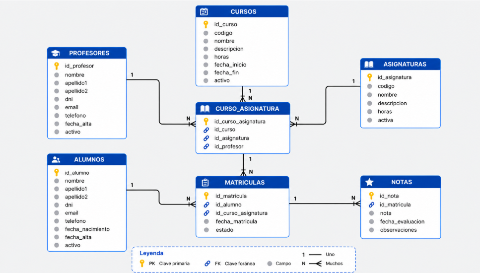

# Introducción y Objetivos

El objetivo de esta práctica es diseñar el esquema Entidad-Relación y el Modelo Relacional para el centro de formación **Academia IT**. La base de datos permite gestionar el historial académico, automatizar el control de matrículas por asignatura individual y calificaciones, así como prevenir inconsistencias o pérdidas accidentales de información mediante restricciones relacionales y políticas de borrado.

El diseño cumple estrictamente con el requisito de estar compuesto por **exactamente siete tablas**.

------------------------------------------------------------------------

# Enunciado

**Diseño de una base de datos para Academia IT**

Academia IT es un centro de formación que quiere almacenar en una base de datos la información de su alumnado, profesorado, cursos, asignaturas, matrículas y calificaciones.

Actualmente, esta información se gestiona en documentos separados, lo que dificulta consultar las matrículas y mantener el historial académico. El centro necesita un modelo que permita organizar estos datos y evitar duplicidades e incoherencias.

A partir de los requisitos siguientes, diseña el esquema entidad-relación y su transformación a un modelo relacional de **exactamente siete tablas**.

**Información que necesita almacenar el centro**

**Alumnado y profesorado**

De cada alumno se guardarán el nombre, primer apellido, segundo apellido, DNI o NIE, correo electrónico, teléfono, fecha de nacimiento, fecha de alta y si está activo.

De cada profesor se guardarán el nombre, primer apellido, segundo apellido, DNI o NIE, correo electrónico, teléfono, fecha de alta y si está activo.

En ambos casos, serán obligatorios el nombre, primer apellido, correo electrónico, fecha de alta y estado de actividad. Los demás datos podrán quedar sin informar.

Dentro del alumnado no podrán repetirse los correos electrónicos ni los DNI o NIE informados. La misma regla se aplicará, por separado, al profesorado. Al registrar un alumno o profesor, se considerará activo por defecto.

**Cursos y asignaturas**

De cada curso se guardarán un código, un nombre, una descripción, el número total de horas, las fechas de inicio y finalización y si está activo.

Todos estos datos serán obligatorios excepto la descripción. El código no podrá repetirse, las horas deberán ser mayores que cero y la fecha de finalización no podrá ser anterior a la de inicio. Los cursos estarán activos por defecto.

De cada asignatura se guardarán un código, un nombre, una descripción, el número de horas y si está activa.

Todos estos datos serán obligatorios excepto la descripción. El código no podrá repetirse y las horas deberán ser mayores que cero. Las asignaturas estarán activas por defecto. Podrán existir asignaturas con el mismo nombre siempre que tengan códigos distintos.

**Organización de la formación**

Un curso está compuesto por varias asignaturas. Una misma asignatura puede formar parte de distintos cursos y existe en el catálogo independientemente de los cursos en los que se imparta.

Para cada asignatura incluida en un curso debe conocerse qué profesor la imparte. Una asignatura concreta dentro de un curso tendrá un único profesor asignado. Un profesor podrá impartir distintas asignaturas y participar en distintos cursos.

No se podrá incluir dos veces la misma asignatura en un mismo curso.

**Matrículas**

**El alumnado se matricula individualmente en asignaturas de un curso. No es necesario que se matricule en el curso completo.**

Cada matrícula debe identificar al alumno y a la asignatura concreta que se imparte dentro de un curso. También se guardarán la fecha de matrícula y su estado; ambos datos serán obligatorios.

Algunos ejemplos de estado son «matriculado», «finalizado» y «abandonado». Estos ejemplos no constituyen una lista cerrada de valores.

Un alumno podrá matricularse en varias asignaturas. Una asignatura de un curso podrá tener varios alumnos matriculados. No se permitirá matricular dos veces al mismo alumno en la misma asignatura del mismo curso.

**Calificaciones**

Cada matrícula podrá tener una única calificación final. De ella se almacenarán la nota, la fecha de evaluación y las observaciones.

La nota podrá quedar sin informar. Cuando exista, deberá estar comprendida entre 0 y 10 y admitir dos decimales. La fecha de evaluación y las observaciones también serán opcionales.

Una nota sin informar representa una evaluación pendiente y debe distinguirse de una calificación de 0,00.

Cada registro de calificación debe estar asociado a una matrícula existente. Esa matrícula ya identifica al alumno y a la asignatura del curso que está realizando, por lo que estos vínculos no deben repetirse en la calificación.

**Conservación del historial**

El centro quiere conservar su historial académico. No se permitirá borrar un registro mientras existan otros que lo referencien mediante una clave foránea.

Cuando un alumno, profesor, curso o asignatura deje de utilizarse, se podrá marcar como inactivo mediante el dato de actividad previsto.

**Trabajo que debe entregar el alumnado**

1.  **Diagrama entidad-relación.** Identifica las entidades y relaciones necesarias, indica las cardinalidades y justifica cómo representas las matrículas individuales y las calificaciones.

2.  **Modelo relacional de siete tablas.** Define las tablas y sus campos. Cada tabla tendrá un identificador interno entero positivo, autoincremental y utilizado como clave primaria.

3.  **Diccionario de datos.** Para cada campo, indica su descripción, tipo MySQL, obligatoriedad y valor por defecto cuando corresponda. Utiliza estas longitudes máximas:

    - Nombres de personas y apellidos: 50 caracteres.

    - DNI o NIE: 12 caracteres.

    - Correo electrónico: 254 caracteres.

    - Teléfono y códigos: 20 caracteres.

    - Nombre de asignatura: 100 caracteres.

    - Nombre de curso: 150 caracteres.

    - Estado de matrícula: 20 caracteres.

    - Observaciones de la calificación: 255 caracteres.

Las descripciones de cursos y asignaturas se almacenarán como texto de longitud variable.

2.  **Claves y restricciones.** Especifica las claves primarias y foráneas, las restricciones de unicidad y las comprobaciones necesarias para cumplir el enunciado.

3.  **Índices.** Propón índices para consultar personas por sus apellidos y nombre, localizar cursos por sus fechas y consultar las relaciones entre registros. Explica cuáles quedan cubiertos por claves o restricciones de unicidad.

4.  **Política de borrado.** Indica la acción que aplicarás a cada clave foránea para conservar el historial.

5.  **Comprobación del modelo.** Explica cómo tu diseño permite estas situaciones:

    - Un alumno se matricula únicamente en SQL y Linux de un curso que contiene más asignaturas.

    - Una misma asignatura se imparte en dos cursos distintos.

    - Una matrícula todavía no tiene calificación.

    - Un alumno obtiene una calificación de 0,00.

Explica también qué restricciones impedirían una matrícula duplicada, una segunda nota final para la misma matrícula y una calificación vinculada a una matrícula inexistente.

El diseño debe ajustarse a la información descrita. No añadas entidades, campos ni requisitos que no aparezcan en el enunciado.

------------------------------------------------------------------------

# Diagrama Entidad-Relación (E/R)

## Modelo Relacional (7 Tablas)

El modelo relacional está compuesto exactamente por las siguientes 7 tablas:

1.  `alumnos` (`id_alumno` \[PK\], ...)

2.  `profesores` (`id_profesor` \[PK\], ...)

3.  `cursos` (`id_curso` \[PK\], ...)

4.  `asignaturas` (`id_asignatura` \[PK\], ...)

5.  `curso_asignaturas` (`id_curso_asignatura` \[PK\], `id_curso` \[FK\], `id_asignatura` \[FK\], `id_profesor` \[FK\])

6.  `matriculas` (`id_matricula` \[PK\], `id_alumno` \[FK\], `id_curso_asignatura` \[FK\], ...)

7.  `calificaciones` (`id_calificacion` \[PK\], `id_matricula` \[FK, UNIQUE\], ...)


## Relaciones y Justificación de Intersecciones

- **CURSO_ASIGNATURA_PROFESOR** (Relación ternaria o entidad débil/intersección de la organización del curso):
  - Un curso contiene varias asignaturas y una asignatura se puede impartir en varios cursos.
  - Cada combinación concreta de asignatura en un curso la imparte exactamente un profesor.
  - *Cardinalidad*: `CURSO (1,N) ---- ASIGNATURA (1,N) ---- PROFESOR (0,N)`.
- **MATRICULA**:
  - Vincula a un **Alumno** con una asignatura concreta impartida dentro de un curso (**Curso_Asignatura_Profesor**).
  - *Justificación*: El enunciado especifica que el alumnado se matricula de forma individual por asignaturas dentro de un curso. Por tanto, la matrícula no apunta al curso completo ni a la asignatura abstracta, sino a la impartición específica (`id_curso_asignatura`).
- **CALIFICACION**:
  - Relación $1:1$ (opcional) asociada directamente a la **Matrícula**.
  - *Justificación*: Se modela como una entidad separada para permitir que la clave primaria autoincremental propia satisfaga la estructura pedida y mantenga una restricción de unicidad (`UNIQUE`) sobre la clave foránea `id_matricula`. Esto garantiza que cada matrícula pueda tener, como máximo, una calificación final.

# Diccionario de Datos

### Tabla: `alumnos`

+--------------------+-----------------------------+-------------------------------+-----------------+-----------------------+
|                    |                             |                               |                 |                       |
+====================+=============================+===============================+=================+=======================+
| **Campo**          | **Descripción**             | **Tipo MySQL**                | **Obligatorio** | **Valor por Defecto** |
+--------------------+-----------------------------+-------------------------------+-----------------+-----------------------+
| `id_alumno`        | Identificador interno único | `INT UNSIGNED AUTO_INCREMENT` | Sí              | *AUTO_INCREMENT*      |
+--------------------+-----------------------------+-------------------------------+-----------------+-----------------------+
| `nombre`           | Nombre del alumno           | `VARCHAR(50)`                 | Sí              | —                     |
+--------------------+-----------------------------+-------------------------------+-----------------+-----------------------+
| `apellido1`        | Primer apellido             | `VARCHAR(50)`                 | Sí              | —                     |
+--------------------+-----------------------------+-------------------------------+-----------------+-----------------------+
| `apellido2`        | Segundo apellido            | `VARCHAR(50)`                 | No              | NULL                  |
+--------------------+-----------------------------+-------------------------------+-----------------+-----------------------+
| `dni_nie`          | Documento de identidad      | `VARCHAR(12)`                 | No              | NULL                  |
+--------------------+-----------------------------+-------------------------------+-----------------+-----------------------+
| `email`            | Correo electrónico          | `VARCHAR(254)`                | Sí              | —                     |
+--------------------+-----------------------------+-------------------------------+-----------------+-----------------------+
| `telefono`         | Teléfono de contacto        | `VARCHAR(20)`                 | No              | NULL                  |
+--------------------+-----------------------------+-------------------------------+-----------------+-----------------------+
| `fecha_nacimiento` | Fecha de nacimiento         | `DATE`                        | No              | NULL                  |
+--------------------+-----------------------------+-------------------------------+-----------------+-----------------------+
| `fecha_alta`       | Fecha de registro           | `DATE`                        | Sí              | —                     |
+--------------------+-----------------------------+-------------------------------+-----------------+-----------------------+
| `activo`           | Estado de actividad         | `BOOLEAN`                     | Sí              | `TRUE`                |
+--------------------+-----------------------------+-------------------------------+-----------------+-----------------------+

### Tabla: `profesores`

+---------------+-----------------------------+-------------------------------+-----------------+-----------------------+
|               |                             |                               |                 |                       |
+===============+=============================+===============================+=================+=======================+
| **Campo**     | **Descripción**             | **Tipo MySQL**                | **Obligatorio** | **Valor por Defecto** |
+---------------+-----------------------------+-------------------------------+-----------------+-----------------------+
| `id_profesor` | Identificador interno único | `INT UNSIGNED AUTO_INCREMENT` | Sí              | *AUTO_INCREMENT*      |
+---------------+-----------------------------+-------------------------------+-----------------+-----------------------+
| `nombre`      | Nombre del profesor         | `VARCHAR(50)`                 | Sí              | —                     |
+---------------+-----------------------------+-------------------------------+-----------------+-----------------------+
| `apellido1`   | Primer apellido             | `VARCHAR(50)`                 | Sí              | —                     |
+---------------+-----------------------------+-------------------------------+-----------------+-----------------------+
| `apellido2`   | Segundo apellido            | `VARCHAR(50)`                 | No              | NULL                  |
+---------------+-----------------------------+-------------------------------+-----------------+-----------------------+
| `dni_nie`     | Documento de identidad      | `VARCHAR(12)`                 | No              | NULL                  |
+---------------+-----------------------------+-------------------------------+-----------------+-----------------------+
| `email`       | Correo electrónico          | `VARCHAR(254)`                | Sí              | —                     |
+---------------+-----------------------------+-------------------------------+-----------------+-----------------------+
| `telefono`    | Teléfono de contacto        | `VARCHAR(20)`                 | No              | NULL                  |
+---------------+-----------------------------+-------------------------------+-----------------+-----------------------+
| `fecha_alta`  | Fecha de registro           | `DATE`                        | Sí              | —                     |
+---------------+-----------------------------+-------------------------------+-----------------+-----------------------+
| `activo`      | Estado de actividad         | `BOOLEAN`                     | Sí              | `TRUE`                |
+---------------+-----------------------------+-------------------------------+-----------------+-----------------------+

### Tabla: `cursos`

+-----------------+--------------------------------+-------------------------------+-----------------+-----------------------+
|                 |                                |                               |                 |                       |
+=================+================================+===============================+=================+=======================+
| **Campo**       | **Descripción**                | **Tipo MySQL**                | **Obligatorio** | **Valor por Defecto** |
+-----------------+--------------------------------+-------------------------------+-----------------+-----------------------+
| `id_curso`      | Identificador interno único    | `INT UNSIGNED AUTO_INCREMENT` | Sí              | *AUTO_INCREMENT*      |
+-----------------+--------------------------------+-------------------------------+-----------------+-----------------------+
| `codigo`        | Código identificador del curso | `VARCHAR(20)`                 | Sí              | —                     |
+-----------------+--------------------------------+-------------------------------+-----------------+-----------------------+
| `nombre`        | Nombre del curso               | `VARCHAR(150)`                | Sí              | —                     |
+-----------------+--------------------------------+-------------------------------+-----------------+-----------------------+
| `descripcion`   | Descripción detallada          | `TEXT`                        | No              | NULL                  |
+-----------------+--------------------------------+-------------------------------+-----------------+-----------------------+
| `horas_totales` | Número total de horas          | `INT UNSIGNED`                | Sí              | —          |
+-----------------+--------------------------------+-------------------------------+-----------------+-----------------------+
| `fecha_inicio`  | Fecha de inicio del curso      | `DATE`                        | Sí              | —          |
+-----------------+--------------------------------+-------------------------------+-----------------+-----------------------+
| `fecha_fin`     | Fecha de finalización          | `DATE`                        | Sí              | —          |
+-----------------+--------------------------------+-------------------------------+-----------------+-----------------------+
| `activo`        | Estado de actividad del curso  | `BOOLEAN`                     | Sí              | `TRUE`                |
|                 |                                |                               |                 |                       |
|                 |                                |                               |                 |            |
+-----------------+--------------------------------+-------------------------------+-----------------+-----------------------+

### Tabla: `asignaturas`

+-----------------+----------------------------------+-------------------------------+-----------------+-----------------------+
|                 |                                  |                               |                 |                       |
+=================+==================================+===============================+=================+=======================+
| **Campo**       | **Descripción**                  | **Tipo MySQL**                | **Obligatorio** | **Valor por Defecto** |
+-----------------+----------------------------------+-------------------------------+-----------------+-----------------------+
| `id_asignatura` | Identificador interno único      | `INT UNSIGNED AUTO_INCREMENT` | Sí              | *AUTO_INCREMENT*      |
+-----------------+----------------------------------+-------------------------------+-----------------+-----------------------+
| `codigo`        | Código de la asignatura          | `VARCHAR(20)`                 | Sí              | —                     |
+-----------------+----------------------------------+-------------------------------+-----------------+-----------------------+
| `nombre`        | Nombre de la asignatura          | `VARCHAR(100)`                | Sí              | —                     |
+-----------------+----------------------------------+-------------------------------+-----------------+-----------------------+
| `descripcion`   | Descripción detallada            | `TEXT`                        | No              | NULL                  |
+-----------------+----------------------------------+-------------------------------+-----------------+-----------------------+
| `horas`         | Número de horas de la asignatura | `INT UNSIGNED`                | Sí              | —              |
+-----------------+----------------------------------+-------------------------------+-----------------+-----------------------+
| `activa`        | Estado de actividad              | `BOOLEAN`                     | Sí              | `TRUE`                |
|                 |                                  |                               |                 |                       |
|                 |                                  |                               |                 |                   |
+-----------------+----------------------------------+-------------------------------+-----------------+-----------------------+

### Tabla: `curso_asignaturas`

+-----------------------+--------------------------------------------------+-------------------------------+-----------------+-----------------------+
|                       |                                                  |                               |                 |                       |
+=======================+==================================================+===============================+=================+=======================+
| **Campo**             | **Descripción**                                  | **Tipo MySQL**                | **Obligatorio** | **Valor por Defecto** |
+-----------------------+--------------------------------------------------+-------------------------------+-----------------+-----------------------+
| `id_curso_asignatura` | Identificador único de la asignatura en el curso | `INT UNSIGNED AUTO_INCREMENT` | Sí              | *AUTO_INCREMENT*      |
+-----------------------+--------------------------------------------------+-------------------------------+-----------------+-----------------------+
| `id_curso`            | Referencia al curso                              | `INT UNSIGNED`                | Sí              | —                     |
+-----------------------+--------------------------------------------------+-------------------------------+-----------------+-----------------------+
| `id_asignatura`       | Referencia a la asignatura                       | `INT UNSIGNED`                | Sí              | —                     |
+-----------------------+--------------------------------------------------+-------------------------------+-----------------+-----------------------+
| `id_profesor`         | Profesor que imparte la asignatura en este curso | `INT UNSIGNED`                | Sí              | —                    |
+-----------------------+--------------------------------------------------+-------------------------------+-----------------+-----------------------+

### Tabla: `matriculas`

+-----------------------+-------------------------------------------------+-------------------------------+-----------------+-----------------------+
|                       |                                                 |                               |                 |                       |
+=======================+=================================================+===============================+=================+=======================+
| **Campo**             | **Descripción**                                 | **Tipo MySQL**                | **Obligatorio** | **Valor por Defecto** |
+-----------------------+-------------------------------------------------+-------------------------------+-----------------+-----------------------+
| `id_matricula`        | Identificador único de la matrícula             | `INT UNSIGNED AUTO_INCREMENT` | Sí              | *AUTO_INCREMENT*      |
+-----------------------+-------------------------------------------------+-------------------------------+-----------------+-----------------------+
| `id_alumno`           | Referencia al alumno                            | `INT UNSIGNED`                | Sí              | —                     |
+-----------------------+-------------------------------------------------+-------------------------------+-----------------+-----------------------+
| `id_curso_asignatura` | Asignatura de un curso impartida                | `INT UNSIGNED`                | Sí              | —                     |
+-----------------------+-------------------------------------------------+-------------------------------+-----------------+-----------------------+
| `fecha_matricula`     | Fecha de formalización de matrícula             | `DATE`                        | Sí              | —                     |
+-----------------------+-------------------------------------------------+-------------------------------+-----------------+-----------------------+
| `estado`              | Estado actual (ej. 'matriculado', 'abandonado') | `VARCHAR(20)`                 | Sí              | —                     |
+-----------------------+-------------------------------------------------+-------------------------------+-----------------+-----------------------+

### Tabla: `calificaciones`

+--------------------+-----------------------------------------------+-------------------------------+-----------------+-----------------------+
|                    |                                               |                               |                 |                       |
+====================+===============================================+===============================+=================+=======================+
| **Campo**          | **Descripción**                               | **Tipo MySQL**                | **Obligatorio** | **Valor por Defecto** |
+--------------------+-----------------------------------------------+-------------------------------+-----------------+-----------------------+
| `id_calificacion`  | Identificador interno único                   | `INT UNSIGNED AUTO_INCREMENT` | Sí              | *AUTO_INCREMENT*      |
+--------------------+-----------------------------------------------+-------------------------------+-----------------+-----------------------+
| `id_matricula`     | Referencia a la matrícula evaluada            | `INT UNSIGNED`                | Sí              | —                     |
+--------------------+-----------------------------------------------+-------------------------------+-----------------+-----------------------+
| `nota`             | Calificación numérica obtenida (0.00 a 10.00) | `DECIMAL(4,2)`                | No              | NULL                  |
+--------------------+-----------------------------------------------+-------------------------------+-----------------+-----------------------+
| `fecha_evaluacion` | Fecha en la que se registra la nota           | `DATE`                        | No              | NULL                  |
+--------------------+-----------------------------------------------+-------------------------------+-----------------+-----------------------+
| `observaciones`    | Comentarios u observaciones                   | `VARCHAR(255)`                | No              | NULL                  |
+--------------------+-----------------------------------------------+-------------------------------+-----------------+-----------------------+

## Diagrama

```{mermaid}
erDiagram
    ALUMNO ||--o{ MATRICULA : realiza
    PROFESOR ||--o{ CURSO_ASIGNATURA : imparte
    CURSO ||--o{ CURSO_ASIGNATURA : contiene
    ASIGNATURA ||--o{ CURSO_ASIGNATURA : incluye
    CURSO_ASIGNATURA ||--o{ MATRICULA : pertenece
    MATRICULA ||--o| CALIFICACION : obtiene

    ALUMNO {
        int id_alumno PK
        string dni_nie UK
        string email UK
        string nombre
        boolean activo
    }

    PROFESOR {
        int id_profesor PK
        string dni_nie UK
        string email UK
        string nombre
        boolean activo
    }

    CURSO {
        int id_curso PK
        string codigo UK
        string nombre
        int horas_totales
        boolean activo
    }

    ASIGNATURA {
        int id_asignatura PK
        string codigo UK
        string nombre
        int horas
        boolean activa
    }

    CURSO_ASIGNATURA {
        int id_curso_asignatura PK
        int id_curso FK
        int id_asignatura FK
        int id_profesor FK
    }

    MATRICULA {
        int id_matricula PK
        int id_alumno FK
        int id_curso_asignatura FK
        date fecha_matricula
        string estado
    }

    CALIFICACION {
        int id_calificacion PK
        int id_matricula FK, UK
        decimal nota
        date fecha_evaluacion
        string observaciones
    }
```

# DDL SQL

``` sql
-- 1. Tabla ALUMNOS
CREATE TABLE alumnos (
    id_alumno INT UNSIGNED AUTO_INCREMENT PRIMARY KEY,
    nombre VARCHAR(50) NOT NULL,
    apellido1 VARCHAR(50) NOT NULL,
    apellido2 VARCHAR(50),
    dni_nie VARCHAR(12),
    email VARCHAR(254) NOT NULL,
    telefono VARCHAR(20),
    fecha_nacimiento DATE,
    fecha_alta DATE NOT NULL,
    activo BOOLEAN NOT NULL DEFAULT TRUE,
    CONSTRAINT uq_alumno_email UNIQUE (email),
    CONSTRAINT uq_alumno_dni_nie UNIQUE (dni_nie)
);

-- 2. Tabla PROFESORES
CREATE TABLE profesores (
    id_profesor INT UNSIGNED AUTO_INCREMENT PRIMARY KEY,
    nombre VARCHAR(50) NOT NULL,
    apellido1 VARCHAR(50) NOT NULL,
    apellido2 VARCHAR(50),
    dni_nie VARCHAR(12),
    email VARCHAR(254) NOT NULL,
    telefono VARCHAR(20),
    fecha_alta DATE NOT NULL,
    activo BOOLEAN NOT NULL DEFAULT TRUE,
    CONSTRAINT uq_profesor_email UNIQUE (email),
    CONSTRAINT uq_profesor_dni_nie UNIQUE (dni_nie)
);

-- 3. Tabla CURSOS
CREATE TABLE cursos (
    id_curso INT UNSIGNED AUTO_INCREMENT PRIMARY KEY,
    codigo VARCHAR(20) NOT NULL,
    nombre VARCHAR(150) NOT NULL,
    descripcion TEXT,
    horas_totales INT UNSIGNED NOT NULL,
    fecha_inicio DATE NOT NULL,
    fecha_fin DATE NOT NULL,
    activo BOOLEAN NOT NULL DEFAULT TRUE,
    CONSTRAINT uq_curso_codigo UNIQUE (codigo),
    CONSTRAINT chk_curso_horas CHECK (horas_totales > 0),
    CONSTRAINT chk_curso_fechas CHECK (fecha_fin >= fecha_inicio)
);

-- 4. Tabla ASIGNATURAS
CREATE TABLE asignaturas (
    id_asignatura INT UNSIGNED AUTO_INCREMENT PRIMARY KEY,
    codigo VARCHAR(20) NOT NULL,
    nombre VARCHAR(100) NOT NULL,
    descripcion TEXT,
    horas INT UNSIGNED NOT NULL,
    activa BOOLEAN NOT NULL DEFAULT TRUE,
    CONSTRAINT uq_asignatura_codigo UNIQUE (codigo),
    CONSTRAINT chk_asignatura_horas CHECK (horas > 0)
);

-- 5. Tabla CURSO_ASIGNATURAS
CREATE TABLE curso_asignaturas (
    id_curso_asignatura INT UNSIGNED AUTO_INCREMENT PRIMARY KEY,
    id_curso INT UNSIGNED NOT NULL,
    id_asignatura INT UNSIGNED NOT NULL,
    id_profesor INT UNSIGNED NOT NULL,
    CONSTRAINT uq_curso_asignatura UNIQUE (id_curso, id_asignatura),
    CONSTRAINT fk_ca_curso FOREIGN KEY (id_curso) REFERENCES cursos(id_curso) ON DELETE RESTRICT,
    CONSTRAINT fk_ca_asignatura FOREIGN KEY (id_asignatura) REFERENCES asignaturas(id_asignatura) ON DELETE RESTRICT,
    CONSTRAINT fk_ca_profesor FOREIGN KEY (id_profesor) REFERENCES profesores(id_profesor) ON DELETE RESTRICT
);

-- 6. Tabla MATRICULAS
CREATE TABLE matriculas (
    id_matricula INT UNSIGNED AUTO_INCREMENT PRIMARY KEY,
    id_alumno INT UNSIGNED NOT NULL,
    id_curso_asignatura INT UNSIGNED NOT NULL,
    fecha_matricula DATE NOT NULL,
    estado VARCHAR(20) NOT NULL,
    CONSTRAINT uq_matricula_alumno_ca UNIQUE (id_alumno, id_curso_asignatura),
    CONSTRAINT fk_mat_alumno FOREIGN KEY (id_alumno) REFERENCES alumnos(id_alumno) ON DELETE RESTRICT,
    CONSTRAINT fk_mat_ca FOREIGN KEY (id_curso_asignatura) REFERENCES curso_asignaturas(id_curso_asignatura) ON DELETE RESTRICT
);

-- 7. Tabla CALIFICACIONES
CREATE TABLE calificaciones (
    id_calificacion INT UNSIGNED AUTO_INCREMENT PRIMARY KEY,
    id_matricula INT UNSIGNED NOT NULL,
    nota DECIMAL(4,2),
    fecha_evaluacion DATE,
    observaciones VARCHAR(255),
    CONSTRAINT uq_calificacion_matricula UNIQUE (id_matricula),
    CONSTRAINT fk_cal_matricula FOREIGN KEY (id_matricula) REFERENCES matriculas(id_matricula) ON DELETE RESTRICT,
    CONSTRAINT chk_calificacion_nota CHECK (nota IS NULL OR (nota >= 0.00 AND nota <= 10.00))
);
```

# Índices Recomendados

1.  **Búsqueda de personas por apellidos y nombre**:

    - `idx_alumnos_apellidos_nombre` ON `alumnos(apellido1, apellido2, nombre)`

    - `idx_profesores_apellidos_nombre` ON `profesores(apellido1, apellido2, nombre)`

    - *Explicación*: Optimiza consultas de filtrado u ordenación por nombre completo.

2.  **Localización de cursos por fechas**:

    - `idx_cursos_fechas` ON `cursos(fecha_inicio, fecha_fin)`

    - *Explicación*: Acelera búsquedas de cursos activos en rangos temporales específicos.

3.  **Consulta de relaciones y claves foráneas**:

    - `idx_ca_profesor` ON `curso_asignaturas(id_profesor)`

    - `idx_ca_asignatura` ON `curso_asignaturas(id_asignatura)`

    - `idx_matriculas_ca` ON `matriculas(id_curso_asignatura)`

*Cobertura implícita*: Las restricciones `UNIQUE` y las claves primarias (`PRIMARY KEY`) generan automáticamente índices únicos secundarios o primarios (B-Tree en MySQL InnoDB) para los campos `email`, `dni_nie`, `codigo`, `id_matricula` en `calificaciones`, y las claves compuestas `(id_curso, id_asignatura)` e `(id_alumno, id_curso_asignatura)`.

# Política de Borrado e Historial Academic

Para garantizar la conservación del historial académico solicitada:

- **Acción aplicada en todas las Claves Foráneas**: `ON DELETE RESTRICT` (o `ON DELETE NO ACTION`).

- **Justificación**: Se impide cualquier borrado físico (`DELETE`) de un alumno, profesor, curso o asignatura si existen matrículas, asignaciones o calificaciones asociadas.

- **Baja Lógica**: Para dejar de utilizar una entidad sin romper la integridad referencial, se debe modificar su flag de actividad (`activo = FALSE` / `activa = FALSE`).

# Comprobación del Modelo

## Escenarios Permitidos

1.  **Matrícula parcial en asignaturas sueltas (ej. SQL y Linux)**:

    - El alumno se matricula mediante dos filas distintas en la tabla `matriculas`, haciendo referencia a los registros específicos de `id_curso_asignatura` correspondientes a SQL y Linux en ese curso, sin necesidad de matricularse en las demás asignaturas.

2.  **Misma asignatura en dos cursos distintos**:

    - La tabla `asignaturas` almacena una única entrada de la asignatura (ej. "Bases de Datos"). La tabla `curso_asignaturas` vincula esta asignatura con dos `id_curso` diferentes.

3.  **Matrícula sin calificación**:

    - El registro existe en `matriculas`, pero aún no existe ningún registro asociado en la tabla `calificaciones` (relación $1:0$) .

4.  **Calificación de 0,00**:

    - Existe un registro en `calificaciones` con `nota = 0.00`. Esto es totalmente distinto de la ausencia de calificación o `nota IS NULL` (evaluación pendiente) .

## Imposibilidad de Operaciones Anómalas

- **Matrícula duplicada**: Impedida por la restricción de unicidad `CONSTRAINT uq_matricula_alumno_ca UNIQUE (id_alumno, id_curso_asignatura)` .

- **Segunda nota para la misma matrícula**: Impedida por la restricción `CONSTRAINT uq_calificacion_matricula UNIQUE (id_matricula)` .

- **Calificación vinculada a una matrícula inexistente**: Impedida por la clave foránea `CONSTRAINT fk_cal_matricula FOREIGN KEY (id_matricula) REFERENCES matriculas(id_matricula)` .

------------------------------------------------------------------------

