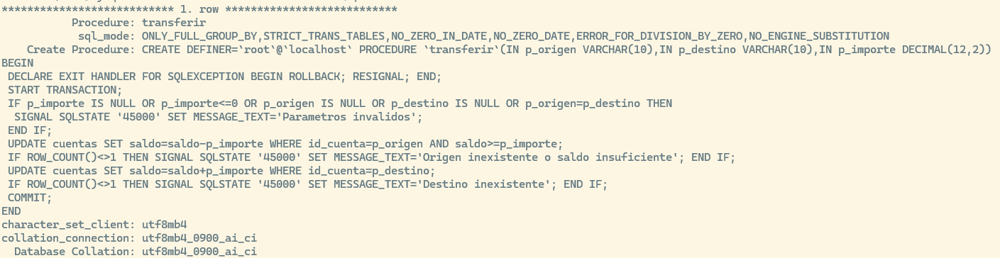
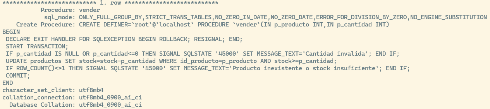

Práctica independiente MySQL 8.4 LTS Motor InnoDB Dificultad progresiva

# Objetivos de aprendizaje

Distinguir errores SQL y errores lógicos; observar el alcance de ROLLBACK; comprobar filas afectadas; aplicar restricciones, `SIGNAL`, `HANDLER` y `RESIGNAL`; verificar que `COMMIT` solo se ejecuta tras validar resultados.

# Analogía introductoria

`COMMIT` es la firma de recepción de un paquete: confirma lo que hay dentro, pero no comprueba si el pedido contenía todos los artículos. La aplicación o el procedimiento debe verificarlo antes.

# Entorno y preparación

MySQL 8.4 con tablas InnoDB. Ejecutar el fichero [laboratorio_transacciones_seguras.sql](laboratorio_transacciones_seguras.sql) en un servidor de prácticas. AVISO: el fichero elimina y recrea exclusivamente la base `laboratorio_transacciones_seguras`. No ejecutarlo en producción. Se recomienda usar el cliente mysql clásico; en casos con errores, ejecutar cada sentencia por separado y observar los mensajes.

``` sql
mysql -u root -p < 12_laboratorio_transacciones_seguras.sql
USE laboratorio_transacciones_seguras;
SHOW TABLE STATUS;
SELECT * FROM cuentas;
```

Datos iniciales:

``` txt
+-----------+---------+--------+
| id_cuenta | titular | saldo  |
+-----------+---------+--------+
| A         | Ana     | 500.00 |
| B         | Bruno   | 200.00 |
| C         | Carla   |   0.00 |
+-----------+---------+--------+
```

Para reiniciar entre casos: `CALL reiniciar_datos();` (fuera de una transacción). No ejecutar este procedimiento mientras haya una transacción abierta.

# Principio general

En InnoDB, un error de una sentencia puede cancelar solo esa sentencia; no siempre toda la transacción. Un `UPDATE` que no encuentra filas normalmente NO es un error. Un deadlock, en cambio, puede deshacer la transacción completa. Las restricciones detectan datos inválidos, no todas las reglas de negocio.

# Transferencia a cuenta inexistente: fallo silencioso

# Entorno de partida y procedimiento

Ejecutar las sentencias en orden. Si aparece un error, leerlo antes de continuar; en estos casos se fuerza la continuación deliberadamente para observar el peligro.

``` sql
CALL reiniciar_datos();
START TRANSACTION;
UPDATE cuentas SET saldo=saldo-100 WHERE id_cuenta='A';
UPDATE cuentas SET saldo=saldo+100 WHERE id_cuenta='Z';
SELECT ROW_COUNT();
COMMIT;
SELECT * FROM cuentas;
```

# Resultado esperado y por qué

`ROW_COUNT()` devuelve 0 después del segundo `UPDATE`; A queda con 400 y Z no existe. No hubo error SQL.

# Cómo evitarlo o solucionarlo

Validar exactamente una fila tras cada UPDATE; SIGNAL y manejador de errores.

``` sql
DELIMITER //

CREATE PROCEDURE transferir_saldo_seguro(
    IN p_cuenta_origen VARCHAR(10),
    IN p_cuenta_destino VARCHAR(10),
    IN p_monto DECIMAL(10,2)
)
BEGIN
    -- Declarar un manejador de excepciones que atrape tanto errores SQL 
    -- como el error personalizado que lanzaremos con SIGNAL
    DECLARE EXIT HANDLER FOR SQLEXCEPTION
    BEGIN
        ROLLBACK;
        SELECT 'Error lógico o del sistema: Se ha detectado un fallo en las cuentas. ROLLBACK ejecutado y saldo intacto.' AS mensaje;
    END;

    -- Iniciar la transacción
    START TRANSACTION;

    -- 1. Restar saldo a la cuenta de origen
    UPDATE cuentas SET saldo = saldo - p_monto WHERE id_cuenta = p_cuenta_origen;
    
    -- Validar si la cuenta de origen realmente existía y se actualizó
    IF ROW_COUNT() = 0 THEN
        SIGNAL SQLSTATE '45000' SET MESSAGE_TEXT = 'La cuenta de origen no existe.';
    END IF;

    -- 2. Sumar saldo a la cuenta de destino
    UPDATE cuentas SET saldo = saldo + p_monto WHERE id_cuenta = p_cuenta_destino;
    
    -- Validar si la cuenta de destino existe (aquí es donde cae el caso 'Z')
    IF ROW_COUNT() = 0 THEN
        SIGNAL SQLSTATE '45000' SET MESSAGE_TEXT = 'La cuenta de destino no existe (fallo silencioso evitado).';
    END IF;

    -- Si ambas operaciones modificaron exactamente una fila, se confirma
    COMMIT;
    SELECT 'Transferencia completada con éxito (COMMIT ejecutado).' AS mensaje;

END //

DELIMITER ;
```

# Error de clave duplicada: `COMMIT` puede confirmar cambios previos

# Entorno de partida y procedimiento

Ejecutar las sentencias en orden. Si aparece un error, leerlo antes de continuar; en estos casos se fuerza la continuación deliberadamente para observar el peligro.

``` sql
CALL reiniciar_datos();
START TRANSACTION;
UPDATE cuentas SET saldo=saldo+25 WHERE id_cuenta='B';
INSERT INTO clientes VALUES (3, 'Otra Ana', 'ana@ejemplo.test');
COMMIT;
SELECT saldo FROM cuentas WHERE id_cuenta='B';
```

# Resultado esperado y por qué

El `INSERT` falla por la regla `UNIQUE`. `ERROR 1062 (23000): Duplicate entry 'ana@ejemplo.test' for key 'clientes.email'` Si el cliente continúa y ejecuta `COMMIT`, B queda con 225. **El fallo de la sentencia no cancela automáticamente toda la transacción.**

# Cómo evitarlo o solucionarlo

Al producirse el error, ejecutar `ROLLBACK` en lugar de `COMMIT`; automatizarlo con `HANDLER`.

``` sql
DELIMITER //

CREATE PROCEDURE registrar_cliente_y_actualizar_saldo(
    IN p_id_cuenta VARCHAR(10),
    IN p_incremento_saldo DECIMAL(10,2),
    IN p_id_cliente INT,
    IN p_nombre_cliente VARCHAR(100),
    IN p_email_cliente VARCHAR(100)
)
BEGIN
    -- Declarar un manejador de excepciones: si ocurre cualquier error SQL (como el error 1062 de duplicado),
    -- se ejecuta el ROLLBACK automáticamente y se detiene la ejecución del bloque.
    DECLARE EXIT HANDLER FOR SQLEXCEPTION
    BEGIN
        ROLLBACK;
        SELECT 'Error en la transacción: Clave duplicada u otro fallo. Se ha aplicado ROLLBACK y la cuenta no se ha modificado.' AS mensaje;
    END;

    -- Iniciar la transacción de manera explícita
    START TRANSACTION;

    -- 1. Actualizar el saldo de la cuenta
    UPDATE cuentas SET saldo = saldo + p_incremento_saldo WHERE id_cuenta = p_id_cuenta;

    -- 2. Intentar insertar el cliente (fallará si el email o ID ya existen por la restricción UNIQUE/PRIMARY KEY)
    INSERT INTO clientes VALUES (p_id_cliente, p_nombre_cliente, p_email_cliente);

    -- Si ambas operaciones tienen éxito, se confirma la transacción de forma segura
    COMMIT;
    SELECT 'Transacción completada con éxito (COMMIT ejecutado).' AS mensaje;

END //

DELIMITER ;
```

# FOREIGN KEY: pedido con cliente inexistente

# Entorno de partida y procedimiento

Ejecutar las sentencias en orden. Si aparece un error, leerlo antes de continuar; en estos casos se fuerza la continuación deliberadamente para observar el peligro.

``` sql
CALL reiniciar_datos();
START TRANSACTION;
UPDATE productos SET precio=precio+1 WHERE id_producto=1;
INSERT INTO pedidos VALUES (10,999, 'nuevo');
COMMIT;
SELECT precio FROM productos WHERE id_producto=1;
```

# Resultado esperado y por qué

El INSERT falla por Foreign Key: `ERROR 1452 (23000): Cannot add or update a child row: a foreign key constraint fails (`laboratorio_transacciones_seguras`.`pedidos`, CONSTRAINT`pedidos_ibfk_1`FOREIGN KEY (`id_cliente`) REFERENCES`clientes`(`id_cliente`))`. Si se hace `COMMIT` después, el precio del teclado sigue con el valor actualizado y cuesta 21.

# Cómo evitarlo o solucionarlo

Cancelar la transacción al fallar cualquier operación obligatoria.

``` sql
DELIMITER //

CREATE PROCEDURE realizar_pedido_seguro(
    IN p_id_pedido INT, 
    IN p_id_cliente INT, 
    IN p_estado VARCHAR(50),
    IN p_id_producto INT
)
BEGIN
    -- Declarar un manejador para cualquier SQLException
    DECLARE EXIT HANDLER FOR SQLEXCEPTION
    BEGIN
        -- Si ocurre cualquier error (como fallo de FK), se deshace todo
        ROLLBACK;
        SELECT 'Error en la transacción: Operación cancelada (ROLLBACK ejecutado).' AS mensaje;
    END;

    -- Iniciar la transacción
    START TRANSACTION;

    -- 1. Actualizar el producto
    UPDATE productos SET precio = precio + 1 WHERE id_producto = p_id_producto;

    -- 2. Insertar el pedido (fallará si el cliente no existe debido a la FK)
    INSERT INTO pedidos VALUES (p_id_pedido, p_id_cliente, p_estado);

    -- Si ambas sentencias tienen éxito, se confirma la transacción
    COMMIT;
    SELECT 'Transacción completada con éxito (COMMIT ejecutado).' AS mensaje;

END //

DELIMITER ;
```

# CHECK: stock negativo

# Entorno de partida y procedimiento

Ejecutar las sentencias en orden. Si aparece un error, leerlo antes de continuar; en estos casos se fuerza la continuación deliberadamente para observar el peligro.

``` sql
CALL reiniciar_datos();
START TRANSACTION;
UPDATE productos SET precio=precio+5 WHERE id_producto=1;
UPDATE productos SET stock=-1 WHERE id_producto=1;
COMMIT;
SELECT stock, precio FROM productos WHERE id_producto=1;
```

# Resultado esperado y por qué

CHECK rechaza el stock negativo: `ERROR 3819 (HY000): Check constraint 'ck_stock' is violated.` Si se continúa hasta `COMMIT`, el precio sí cambia a 25.

# Cómo evitarlo o solucionarlo

CHECK evita valores inválidos; Usaremos un `HANDLER` como en los casos anteriores.

# Sin CHECK vulnerado, pero venta inexistente

# Entorno de partida y procedimiento

Ejecutar las sentencias en orden. Si aparece un error, leerlo antes de continuar; en estos casos se fuerza la continuación deliberadamente para observar el peligro.

``` sql
CALL reiniciar_datos();
START TRANSACTION;
UPDATE productos SET stock=stock-1 WHERE id_producto=999;
SELECT ROW_COUNT();
COMMIT;
```

# Resultado esperado y por qué

`ROW_COUNT()` es 0, pero el sistema no lanza un error; `COMMIT` puede ejecutarse sin error.

# Cómo evitarlo o solucionarlo

Comprobar filas afectadas y generar SIGNAL si no se cumple el resultado esperado.

``` sql
DELIMITER //

CREATE PROCEDURE vender_producto_seguro(
    IN p_id_producto INT,
    IN p_cantidad INT
)
BEGIN
    -- Declarar un manejador de excepciones que atrape tanto errores SQL 
    -- como el error personalizado generado por SIGNAL
    DECLARE EXIT HANDLER FOR SQLEXCEPTION
    BEGIN
        ROLLBACK;
        SELECT 'Error: El producto no existe o no se pudo actualizar. Se ha aplicado ROLLBACK y la transacción ha sido abortada.' AS mensaje;
    END;

    -- Iniciar la transacción de manera explícita
    START TRANSACTION;

    -- 1. Intentar actualizar el stock restando la cantidad indicada
    UPDATE productos 
    SET stock = stock - p_cantidad 
    WHERE id_producto = p_id_producto;

    -- 2. Comprobar inmediatamente cuántas filas afectó la última sentencia
    IF ROW_COUNT() = 0 THEN
        SIGNAL SQLSTATE '45000' SET MESSAGE_TEXT = 'El ID de producto especificado no existe (fallo silencioso evitado).';
    END IF;

    -- Si la actualización fue exitosa y afectó exactamente a una fila, se confirma
    COMMIT;
    SELECT 'Venta/Actualización de stock completada con éxito (COMMIT ejecutado).' AS mensaje;

END //

DELIMITER ;
```

# Error en la operación intermedia de tres

# Entorno de partida y procedimiento

Ejecutar las sentencias en orden. Si aparece un error, leerlo antes de continuar; en estos casos se fuerza la continuación deliberadamente para observar el peligro.

``` sql
CALL reiniciar_datos();
START TRANSACTION;
UPDATE cuentas SET saldo=saldo+10 WHERE id_cuenta='B';
INSERT INTO clientes VALUES (1, 'Duplicado', 'otro@ejemplo.test');
UPDATE cuentas SET saldo=saldo+20 WHERE id_cuenta='C';
COMMIT;
SELECT * FROM cuentas;
```

# Resultado esperado y por qué

La segunda sentencia falla `ERROR 1062 (23000): Duplicate entry '1' for key 'clientes.PRIMARY'`; si se siguen ejecutando las demás y se hace commit:

``` txt
+-----------+---------+--------+
| id_cuenta | titular | saldo  |
+-----------+---------+--------+
| A         | Ana     | 500.00 |
| B         | Bruno   | 210.00 |
| C         | Carla   |  20.00 |
+-----------+---------+--------+
```

# Cómo evitarlo o solucionarlo

Usar control de errores común y abortar antes de ejecutar operaciones posteriores.

# Restricción UNIQUE en reserva de plaza

# Entorno de partida y procedimiento

Ejecutar las sentencias en orden. Si aparece un error, leerlo antes de continuar; en estos casos se fuerza la continuación deliberadamente para observar el peligro.

``` sql
CALL reiniciar_datos();
START TRANSACTION;
UPDATE plazas SET ocupada_por=1 WHERE id_plaza=1;
UPDATE plazas SET ocupada_por=1 WHERE id_plaza=2;
COMMIT;
SELECT * FROM plazas;
```

# Resultado esperado y por qué

La segunda operación falla por UNIQUE `ERROR 1062 (23000): Duplicate entry '1' for key 'plazas.ocupada_por'`: el mismo cliente no puede ocupar dos plazas. Si se confirma, queda reservada la primera.

```         
+----------+-------------+
| id_plaza | ocupada_por |
+----------+-------------+
|        2 |        NULL |
|        1 |           1 |
+----------+-------------+
```

# Cómo evitarlo o solucionarlo

Rollback automático cuando la reserva debe ser todo o nada.

# Procedimiento con SIGNAL, HANDLER RESIGNAL

# Entorno de partida y procedimiento

Veamos el procedimiento que vamos a llamar usando `SHOW PROCEDURE transferir \G`



Ejecutar las sentencias en orden. Si aparece un error, leerlo antes de continuar; en estos casos se fuerza la continuación deliberadamente para observar el peligro.

``` sql
CALL reiniciar_datos();
CALL transferir('A', 'Z', 100);
SELECT * FROM cuentas;
```

# Resultado esperado y por qué

Se genera un error de aplicación (SQLSTATE 45000)`ERROR 1644 (45000): Destino inexistente`; `HANDLER` hace `ROLLBACK`;

```         
+-----------+---------+--------+
| id_cuenta | titular | saldo  |
+-----------+---------+--------+
| A         | Ana     | 500.00 |
| B         | Bruno   | 200.00 |
| C         | Carla   |   0.00 |
+-----------+---------+--------+
```

# Cómo se ha evitado

El procedimiento valida el resultado de cada `UPDATE` y confirma solo si ambos modifican exactamente una fila.

# Transferencia válida

# Entorno de partida y procedimiento

Ejecutar las sentencias en orden. Si aparece un error, leerlo antes de continuar; en estos casos se fuerza la continuación deliberadamente para observar el peligro.

``` sql
CALL reiniciar_datos();
CALL transferir('A', 'B', 100);
SELECT * FROM cuentas;
```

# Resultado esperado y por qué

```         
+-----------+---------+--------+
| id_cuenta | titular | saldo  |
+-----------+---------+--------+
| A         | Ana     | 400.00 |
| B         | Bruno   | 300.00 |
| C         | Carla   |   0.00 |
+-----------+---------+--------+
```

El procedimiento llega a COMMIT.

# Saldo insuficiente y parámetros inválidos

# Entorno de partida y procedimiento

Ejecutar las sentencias en orden. Si aparece un error, leerlo antes de continuar; en estos casos se fuerza la continuación deliberadamente para observar el peligro.

``` sql
CALL reiniciar_datos();
CALL transferir('C', 'B', 100);
SELECT * FROM cuentas;
CALL transferir('A', 'A', 10);
```

# Resultado esperado y por qué

Cada CALL incorrecto genera un error;

`ERROR 1644 (45000): Origen inexistente o saldo insuficiente`

`ERROR 1644 (45000): Parametros invalidos`

Los saldos no cambian.

# Cómo se ha evitado

Validar antes de confirmar y comprobar saldo en el propio `UPDATE` (ver líneas `IF ROW_COUNT()<>1 THEN SIGNAL SQLSTATE '45000' SET MESSAGE_TEXT=...`) evitando comprobaciones desactualizadas.

# Venta controlada con stock insuficiente



# Entorno de partida y procedimiento

Ejecutar las sentencias en orden. Si aparece un error, leerlo antes de continuar; en estos casos se fuerza la continuación deliberadamente para observar el peligro.

``` sql
CALL reiniciar_datos();
CALL vender(2,5);
SELECT * FROM productos WHERE id_producto=2;
```

# Resultado esperado y por qué

El ratón conserva stock = 2; se devuelve un error por falta de stoc. `ERROR 1644 (45000): Producto inexistente o stock insuficiente`

```         
+-------------+--------+-------+--------+
| id_producto | nombre | stock | precio |
+-------------+--------+-------+--------+
|           2 | Ratón  |     2 |  15.00 |
+-------------+--------+-------+--------+
```

# Cómo se ha evitado

UPDATE, condicional, ROW_COUNT(), SIGNAL y HANDLER.

# Venta válida

# Entorno de partida y procedimiento

Ejecutar las sentencias en orden. Si aparece un error, leerlo antes de continuar; en estos casos se fuerza la continuación deliberadamente para observar el peligro.

``` sql
CALL reiniciar_datos();
CALL vender(2,2);
SELECT * FROM productos WHERE id_producto=2;
```

# Resultado esperado y por qué

El stock del ratón pasa de 2 a 0 y se confirma.

``` txt
+-------------+--------+-------+--------+
| id_producto | nombre | stock | precio |
+-------------+--------+-------+--------+
|           2 | Ratón  |     0 |  15.00 |
+-------------+--------+-------+--------+
```

# SAVEPOINT: deshacer una parte no equivale a abortar todo

# Entorno de partida y procedimiento

Ejecutar las sentencias en orden. Si aparece un error, leerlo antes de continuar; en estos casos se fuerza la continuación deliberadamente para observar el peligro.

``` sql
CALL reiniciar_datos();
START TRANSACTION;
UPDATE cuentas SET saldo=saldo+10 WHERE id_cuenta='B';
SAVEPOINT antes_segundo;
UPDATE cuentas SET saldo=saldo+20 WHERE id_cuenta='C';
ROLLBACK TO SAVEPOINT antes_segundo;
COMMIT;
SELECT * FROM cuentas;
```

# Resultado esperado y por qué

``` txt
+-----------+---------+--------+
| id_cuenta | titular | saldo  |
+-----------+---------+--------+
| A         | Ana     | 500.00 |
| B         | Bruno   | 210.00 |
| C         | Carla   |   0.00 |
+-----------+---------+--------+
```

Se deshizo únicamente el tramo posterior al punto de guardado.

# Cien operaciones: comprobar invariantes finales

# Entorno de partida y procedimiento

Ejecutar las sentencias en orden. Si aparece un error, leerlo antes de continuar; en estos casos se fuerza la continuación deliberadamente para observar el peligro.

``` sql
CALL reiniciar_datos();
START TRANSACTION;
UPDATE cuentas SET saldo=saldo-5 WHERE id_cuenta='A';
UPDATE cuentas SET saldo=saldo+5 WHERE id_cuenta='B';
SELECT SUM(saldo) AS total FROM cuentas;
ROLLBACK;
```

# Resultado esperado y por qué

```         
+--------+
| total  |
+--------+
| 700.00 |
+--------+
```

El total permanece en 700; no obstante, conservar el total NO basta para demostrar que se transfirió al destinatario correcto.

# Cómo evitarlo o solucionarlo

Validar cada paso crítico, existencia de filas y reglas globales; la comprobación final complementa, no sustituye, las individuales.

# Dos sesiones y concurrencia: no confiar en una lectura previa

# Entorno de partida y procedimiento

Ejecutar las sentencias en orden. Si aparece un error, leerlo antes de continuar; en estos casos se fuerza la continuación deliberadamente para observar el peligro.

Sesión A:

``` sql
START TRANSACTION;
SELECT stock FROM productos WHERE id_producto=3;
```

Sesión B (otra conexión):

``` sql
START TRANSACTION;
UPDATE productos SET stock=stock-1 WHERE id_producto=3 AND stock>=1;
COMMIT;
```

Sesión A:

``` sql
UPDATE productos SET stock=stock-1 WHERE id_producto=3 AND stock>=1;
SELECT ROW_COUNT();
ROLLBACK;
```

# Resultado esperado y por qué

La sesión A pudo ver stock = 1 antes; después B lo consumió y el `UPDATE` condicional de A no descuenta otra unidad (ROW_COUNT=0).

# Cómo evitarlo o solucionarlo

Validar en el `UPDATE` atómico, no solo con un `SELECT` previo.

# Errores comunes y buenas prácticas

- Confundir \<\<0 filas afectadas\>\> con error SQL: hay que validar el resultado cuando se espera una fila.
- Suponer que cualquier error cancela toda la transacción: no es así en InnoDB.
- Continuar tras un error y ejecutar COMMIT: los cambios anteriores pueden persistir.
- Confiar solo en CHECK/FK/UNIQUE: protegen reglas concretas, no la lógica completa.
- Llamar a procedimientos que ejecutan START TRANSACTION dentro de otra transacción: MySQL no ofrece transacciones anidadas.
- Incluir DDL (DROP/ALTER/TRUNCATE) en una transacción de trabajo: puede provocar COMMIT implícito.
- Ejecutar el reinicio dentro de una transacción: reiniciar solo entre casos y con transacciones cerradas.
- En aplicaciones reales, controlar errores en la capa de aplicación y considerar reintentos ante deadlocks.

# Preguntas de razonamiento

1.  ¿Por qué una cuenta inexistente no provoca necesariamente error SQL?
2.  ¿Por qué un `UNIQUE` fallido puede dejar cambios anteriores confirmados?
3.  ¿Qué diferencia existe entre `SIGNAL` y `HANDLER`?
4.  ¿Qué aporta `RESIGNAL` a la aplicación cliente?
5.  ¿Por qué `ROW_COUNT()` debe consultarse inmediatamente?
6.  ¿En qué casos 0 filas modificadas no significa que la fila no exista?
7.  ¿Qué problema resuelve `CHECK` y cuál no?
8.  ¿Por qué `SAVEPOINT` no sustituye siempre a `ROLLBACK`?
9.  ¿Por qué verificar `SUM(saldo`) no basta para demostrar una transferencia correcta?
10. ¿Cómo evitarías vender el último monitor dos veces desde dos sesiones?

# Resumen final

`COMMIT` confirma cambios pendientes; no audita las reglas de negocio. Para transacciones fiables: InnoDB + restricciones + validaciones de resultado + `SIGNAL` + `HANDLER/ROLLBACK` + `RESIGNAL` + pruebas de concurrencia. Las garantías dependen de que las operaciones participen en la misma transacción y no haya confirmaciones implícitas.