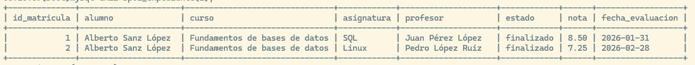
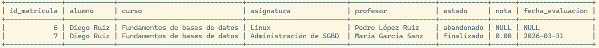
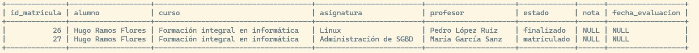
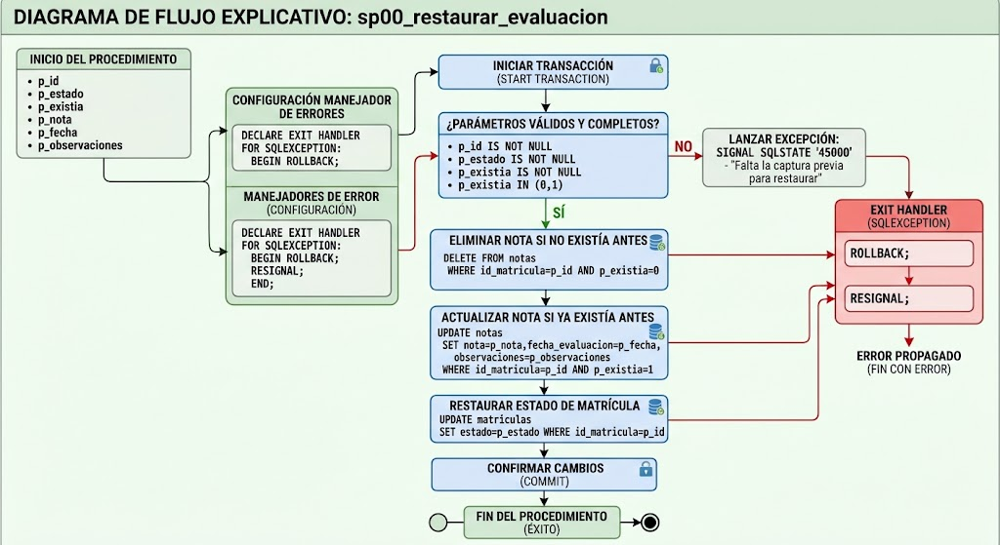
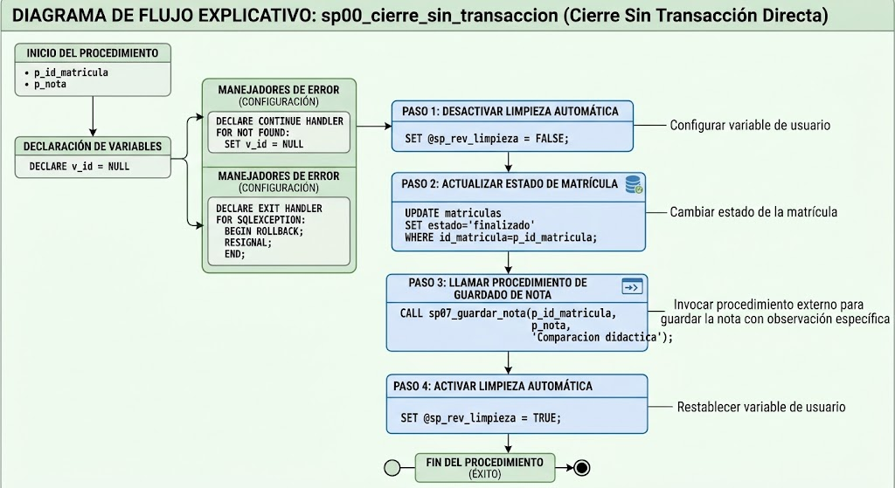
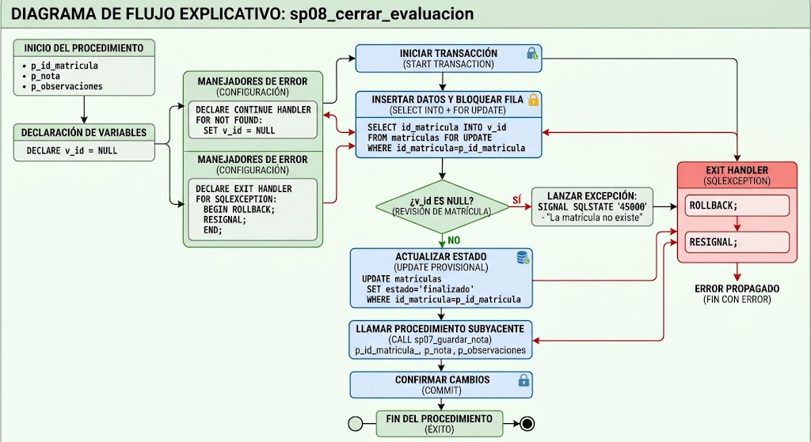
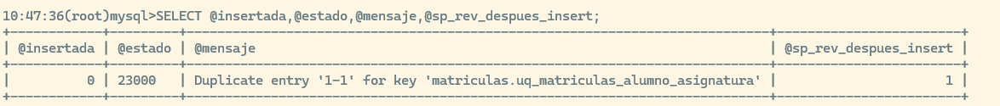

Academia IT Recorrido esencial y ampliación avanzada

Una práctica guiada para crear operaciones reutilizables, comprender sus permisos y comprobar sus resultados. Se parte de academia_it ya existente, con siete tablas y los datos previamente importados.

# Objetivos de aprendizaje

• Crear, ejecutar e inspeccionar procedimientos. • Utilizar IN, OUT, INOUT y variables con distintos ámbitos. • Entender las condiciones antes de utilizarlas en operaciones DML. • Separar el flujo de errores de la confirmación de los cambios. • Diseñar una operación atómica y recuperar los datos de prueba. • Comprobar seguridad, copias y contenidos avanzados.

# Cómo utilizar la práctica

| Recorrido | Actividades |
|------------------------|------------------------------------------------|
| Esencial | Apartados 1 a 21 y 27 a 29. Construcción paso a paso y reto de dos partes. |
| Avanzado | Apartados 22 a 26. Bucles, cursores, SQL dinámico, bloqueos y COMMIT implícito. |

Planificación orientativa: 12 a 16 horas para el recorrido esencial y 4 a 6 adicionales para la ampliación, ajustables a la experiencia del grupo. La ampliación se evalúa por separado cuando se asigna.

Todos los ejemplos utilizan nombres de tablas en minúsculas. El paquete SQL acompaña al documento y permite contrastar las soluciones y ejecutar las comprobaciones. Fuente técnica: MySQL 8.4.x.

# Preparar el entorno y comprobar la base existente

Objetivo. Trabajar sobre academia_it ya creada y con sus siete CSV importados. Esta práctica no vuelve a crear las tablas ni sustituye los datos de otros trabajos. El esquema es una secretaría: los procedimientos guardan operaciones reutilizables; las tablas conservan la información.

Conocimientos de partida. SELECT, JOIN, agregaciones y operaciones INSERT, UPDATE y DELETE. Como recordatorio: START TRANSACTION inicia un grupo de cambios; COMMIT los confirma y ROLLBACK deshace los pendientes. En los ejemplos provisionales se utiliza este mecanismo; en el apartado 17 se compara de forma completa con el flujo de errores.

## Paso 1 Identificar dónde se ejecuta cada instrucción

| Entorno | Qué se ejecuta |
|-------------------------|----------------------------------------------|
| Cliente mysql o editor SQL | USE, SELECT, CREATE PROCEDURE, CALL y las demás instrucciones SQL. |
| Terminal de Ubuntu | cd, mysql, mysqldump y la redirección de archivos. |
| Otra conexión | Las pruebas de permisos y de bloqueo. Sus variables \@ son independientes. |

Referencia técnica: MySQL Community Server 8.4.x y tablas InnoDB. El cliente mysql es el entorno principal. En Windows se pueden ejecutar los bloques SQL desde mysql o MySQL Workbench; DELIMITER es una orden del cliente, no una instrucción que una aplicación deba enviar al servidor. Verificar los menús contra la versión instalada.

## Paso 2 Crear una copia antes de empezar

Desde la terminal de Ubuntu, situarse en la carpeta de trabajo. La redirección \> la realiza la terminal y guarda el volcado en esa carpeta. `sudo mysql` solo corresponde a instalaciones donde la cuenta *root* local se autentica mediante el sistema operativo. Con una cuenta y contraseña, utilizar `mysql -u admin -p y mysqldump -u admin -p`, introduciendo la contraseña cuando se solicite.

``` bash
cd /home/sysadmin/practica_sp
sudo mysqldump --default-character-set=utf8mb4 \
  --routines --triggers --events --single-transaction \
  --no-tablespaces academia_it > academia_it_antes_sp.sql
sudo mysql --default-character-set=utf8mb4
```

En una terminal de Windows, si el cliente está en PATH, puede utilizarse `mysql -u admin -p --default-character-set=utf8mb4`. La copia se ejecuta con `mysqldump -u admin -p` y las mismas opciones.

Sustituir la carpeta por una ruta existente; no ejecutar comandos de terminal dentro del indicador mysql\>

## Paso 3 Consultar versión motor y recuentos

``` sql
USE academia_it;
SELECT DATABASE(),VERSION(),@@autocommit,@@sql_mode;
SHOW TABLE STATUS;
SELECT 'alumnos' AS tabla,COUNT(*) AS filas FROM alumnos
UNION ALL SELECT 'profesores',COUNT(*) FROM profesores
UNION ALL SELECT 'asignaturas',COUNT(*) FROM asignaturas
UNION ALL SELECT 'cursos',COUNT(*) FROM cursos
UNION ALL SELECT 'curso_asignatura',COUNT(*) FROM curso_asignatura
UNION ALL SELECT 'matriculas',COUNT(*) FROM matriculas
UNION ALL SELECT 'notas',COUNT(*) FROM notas;
```

```         
+------------------+-------+
| tabla            | filas |
+------------------+-------+
| alumnos          |    12 |
| profesores       |     5 |
| asignaturas      |     8 |
| cursos           |     3 |
| curso_asignatura |    15 |
| matriculas       |    27 |
| notas            |    25 |
+------------------+-------+
```

Los recuentos pertenecen a los CSV originales. Si difieren, identificar qué actividad modificó los datos antes de aplicar los resultados esperados. No reimportar los CSV sobre las tablas existentes para forzar coincidencias.

## Paso 4 Reconocer los casos de prueba

``` sql
SELECT m.id_matricula,al.nombre,m.estado,n.id_nota,n.nota
FROM matriculas m
JOIN alumnos al USING(id_alumno)
LEFT JOIN notas n USING(id_matricula)
WHERE m.id_matricula IN (1,2,6,7,26,27)
ORDER BY m.id_matricula;
```

```         
+--------------+---------+-------------+---------+------+
| id_matricula | nombre  | estado      | id_nota | nota |
+--------------+---------+-------------+---------+------+
|            1 | Alberto | finalizado  |       1 | 8.50 |
|            2 | Alberto | finalizado  |       2 | 7.25 |
|            6 | Diego   | abandonado  |       6 | NULL |
|            7 | Diego   | finalizado  |       7 | 0.00 |
|           26 | Hugo    | finalizado  |    NULL | NULL |
|           27 | Hugo    | matriculado |    NULL | NULL |
+--------------+---------+-------------+---------+------+
```

-   *curso_asignatura* relaciona un curso, una asignatura y un profesor.

-   *matriculas* enlaza un alumno con una fila de `curso_asignatura`.

-   *notas* referencia una matrícula y `UNIQUE(id_matricula)` permite como máximo una nota final por matrícula.

-   Las claves foráneas, UNIQUE y CHECK continúan siendo la protección de los datos.

Notas para la práctica

-   Crear o reemplazar definiciones fuera de las transacciones de prueba: el DDL puede provocar COMMIT implícito.

-   Ejecutar los errores previstos individualmente. Después de un error, la siguiente instrucción de comprobación puede requerir una ejecución manual.

-   Cerrar cada prueba con ROLLBACK o con la recuperación expresamente indicada. Un identificador AUTO_INCREMENT puede consumirse aunque la fila se deshaga.

-   No ejecutar las comprobaciones mientras otras sesiones modifiquen esos datos. autocommit=1 no demuestra por sí solo que no exista una transacción explícita abierta.

Pregunta. ¿Por qué una matrícula sin fila de notas no es lo mismo que una fila de notas con nota NULL?

# Crear y ejecutar un procedimiento

Objetivo. Separar la definición de una operación de su ejecución. Como una receta, el procedimiento conserva instrucciones y un nombre, no una fotografía permanente del resultado.

## Paso 1 Guardar una consulta sencilla

``` sql
DROP PROCEDURE IF EXISTS sp00_listado;
CREATE PROCEDURE sp00_listado()
SELECT id_alumno,nombre,apellido1
FROM alumnos ORDER BY id_alumno;
```

`DROP PROCEDURE IF EXISTS` elimina solo la definición anterior de esta rutina, si existe; no elimina alumnos. Se incluye para repetir el ejercicio después de conservar cualquier versión propia. `CREATE PROCEDURE` guarda la nueva definición. Los paréntesis vacíos indican que no hay parámetros. Este primer cuerpo tiene una sola instrucción, por lo que no necesita `BEGIN` ... `END` ni cambiar el delimitador.

Esta definición omite SQL SECURITY: el modo predeterminado es `DEFINER`. No equivale a `INVOKER`. En el apartado 4 se comparan ambos modos antes de utilizar procedimientos más complejos.

## Paso 2 Ejecutar la operación

``` sql
CALL sp00_listado();
```

```         
+-----------+---------+-----------+
| id_alumno | nombre  | apellido1 |
+-----------+---------+-----------+
|         1 | Alberto | Sanz      |
|         2 | Lucía   | Martín    |
|         3 | Diego   | Ruiz      |
|         4 | Marta   | Navarro   |
|         5 | Elena   | Torres    |
|         6 | Pablo   | Serrano   |
|         7 | Sara    | Romero    |
|         8 | Javier  | Molina    |
|         9 | Clara   | Ortega    |
|        10 | Daniel  | Castro    |
|        11 | Irene   | Moreno    |
|        12 | Hugo    | Ramos     |
+-----------+---------+-----------+
```

-   Crear la rutina no había ejecutado el SELECT.

-   Cada CALL vuelve a consultar los datos visibles en esa ejecución; un cambio confirmado en alumnos puede cambiar el resultado de llamadas posteriores.

-   No es necesario recrear el procedimiento para que lea datos nuevos.

## Paso 3 Comprobar su persistencia

Cerrar y abrir la conexión no elimina la definición. La rutina permanece en el servidor hasta que se elimine. Volver a ejecutar solo CREATE con el mismo nombre produce un error de objeto existente; utilizar CALL para ejecutarla o seguir el procedimiento de reemplazo del apartado siguiente.

Pregunta. Si el número de alumnos cambia, ¿hay que recrear *sp00_listado* para ver los nuevos registros?

# Inspeccionar, modificar y eliminar las definiciones

Objetivo. Poder comprobar desde el principio qué procedimientos existen y qué código contienen. Estas operaciones se hacen fuera de una transacción de prueba.

## Paso 1 Listar las rutinas y consultar el código

``` sql
SHOW PROCEDURE STATUS WHERE Db='academia_it';
```

```         

+-------------+--------------+-----------+----------+----------------+---------------------+
| Db          | Name         | Type      | Language | Definer        | Modified            |
+-------------+--------------+-----------+----------+----------------+---------------------+
| academia_it | sp00_listado | PROCEDURE | SQL      | root@localhost | 2026-10-30 08:57:01 |
+-------------+--------------+-----------+----------+----------------+---------------------+
```

```         
+-------------+--------------+---------------------+---------------+---------+
| Db          | Name         | Created             | Security_type | Comment |
+-------------+--------------+---------------------+---------------+---------+
| academia_it | sp00_listado | 2026-10-30 08:57:01 | DEFINER       |         |
+-------------+--------------+---------------------+---------------+---------+
```

```         
+-------------+--------------+----------------------+----------------------+--------------------+
| Db          | Name         | character_set_client | collation_connection | Database Collation |
+-------------+--------------+----------------------+----------------------+--------------------+
| academia_it | sp00_listado | utf8mb4              | utf8mb4_0900_ai_ci   | utf8mb4_0900_ai_ci |
+-------------+--------------+----------------------+----------------------+--------------------+
```

``` sql
SHOW CREATE PROCEDURE academia_it.sp00_listado\G;
```

```         
09:04:22(root)mysql>SHOW CREATE PROCEDURE academia_it.sp00_listado\G;
*************************** 1. row ***************************
           Procedure: sp00_listado
            sql_mode: ONLY_FULL_GROUP_BY,STRICT_TRANS_TABLES,NO_ZERO_IN_DATE,NO_ZERO_DATE,ERROR_FOR_DIVISION_BY_ZERO,NO_ENGINE_SUBSTITUTION
    Create Procedure: CREATE DEFINER=`root`@`localhost` PROCEDURE `sp00_listado`()
SELECT id_alumno,nombre,apellido1
FROM alumnos ORDER BY id_alumno
character_set_client: utf8mb4
collation_connection: utf8mb4_0900_ai_ci
  Database Collation: utf8mb4_0900_ai_ci
```

El primer comando lista procedimientos y características. El segundo muestra la definición, incluidos parámetros, cuerpo y seguridad. En la consola mysql puede terminarse la instrucción con \G en lugar de ; para mostrar sus columnas verticalmente. \G es una opción de presentación del cliente; no cambia el procedimiento. La visibilidad depende de los privilegios.

## Paso 2 Cambiar una característica

``` sql
ALTER PROCEDURE sp00_listado
COMMENT 'Listado inicial de alumnos ordenado por identificador';
SHOW CREATE PROCEDURE sp00_listado\G;
```

```         
09:11:41(root)mysql>SHOW CREATE PROCEDURE sp00_listado\G;
*************************** 1. row ***************************
           Procedure: sp00_listado
            sql_mode: ONLY_FULL_GROUP_BY,STRICT_TRANS_TABLES,NO_ZERO_IN_DATE,NO_ZERO_DATE,ERROR_FOR_DIVISION_BY_ZERO,NO_ENGINE_SUBSTITUTION
    Create Procedure: CREATE DEFINER=`root`@`localhost` PROCEDURE `sp00_listado`()
    COMMENT 'Listado inicial de alumnos ordenado por identificador'
SELECT id_alumno,nombre,apellido1
FROM alumnos ORDER BY id_alumno
character_set_client: utf8mb4
collation_connection: utf8mb4_0900_ai_ci
  Database Collation: utf8mb4_0900_ai_ci
```

COMMENT es una descripción del objeto. ALTER PROCEDURE puede cambiar determinadas características, **pero no el cuerpo ni los parámetros.** Para modificar estos últimos se elimina y recrea la rutina. Sus permisos de ejecución específicos deben revisarse después del reemplazo.

## Paso 3 Comprender el reemplazo

Los bloques de definición del laboratorio empiezan por `DROP PROCEDURE IF EXISTS` y después `CREATE PROCEDURE`. Antes de repetirlos, guardar la versión propia y revisar qué cuentas dependen del objeto. No hace falta borrar datos ni volver a cargar la base. Para practicar la eliminación puede borrarse sp00_listado y crearse de nuevo con su bloque del apartado 2.

``` sql
DROP PROCEDURE IF EXISTS sp00_listado;
```

Tras eliminarlo, `CALL sp00_listado();` falla porque la rutina no existe. Después de recrearlo vuelve a funcionar. El listado de alumnos conserva sus doce filas.

Pregunta. ¿Por qué una modificación del cuerpo exige revisar también los permisos?

# Comprender SQL SECURITY antes de continuar

Objetivo. Distinguir el permiso para llamar a una rutina de los permisos utilizados por sus instrucciones. `EXECUTE` autoriza `CALL`. `SQL SECURITY` decide con qué cuenta se comprueban las operaciones interiores.

## Paso 1 Crear consulta INVOKER y DEFINER

``` sql
DROP PROCEDURE IF EXISTS sp00_contar_invoker;
CREATE PROCEDURE sp00_contar_invoker()
SQL SECURITY INVOKER
SELECT COUNT(*) AS total_alumnos FROM alumnos;

DROP PROCEDURE IF EXISTS sp00_contar_definer;
CREATE PROCEDURE sp00_contar_definer()
SQL SECURITY DEFINER
SELECT COUNT(*) AS total_alumnos FROM alumnos;
```

La característica se escribe después de los parámetros y antes del cuerpo. En *INVOKER*, una llamada directa utiliza los privilegios del usuario que ejecuta `CALL`. En *DEFINER* utiliza los de la cuenta registrada como definidora. **Si no se escribe una cláusula DEFINER explícita, esa cuenta es quien crea el objeto.**

``` sql
CALL sp00_contar_invoker();
CALL sp00_contar_definer();
```

Como administrador con los permisos necesarios, ambos ejemplos devuelven 12. Esa coincidencia no demuestra que los modos sean iguales: se necesita una cuenta con permisos diferentes para apreciar la diferencia.

| Modo | Permisos para la consulta interior |
|------------------------|-----------------------------------------------|
| INVOKER | El invocador necesita EXECUTE y SELECT sobre alumnos. |
| DEFINER | El invocador necesita EXECUTE. El definidor necesita los permisos de ejecución y SELECT necesarios. |
| Sin SQL SECURITY explícito | Se utiliza DEFINER por defecto. |

## Paso 2 Entender las limitaciones de cada procedimiento

Si una cuenta tiene `EXECUTE` sobre ambos objetos, pero no `SELECT` sobre alumnos, la llamada *INVOKER* falla. La llamada *DEFINER* puede funcionar si su definidor dispone de los permisos necesarios. Esto no concede SELECT directo a quien llama ni le permite realizar operaciones diferentes de las definidas en la rutina.

El atributo *DEFINER* identifica una cuenta; *SQL SECURITY* decide si se usan sus privilegios. Incluso una rutina *INVOKER* tiene un definidor registrado, aunque ese atributo no determine los permisos de sus instrucciones.

Los ejemplos de este apartado ilustran el contexto. La demostración administrativa real, con un definidor de permisos mínimos y otra conexión, se realiza en el apartado 20. No utilizar una cuenta administradora como definidora de una operación expuesta a usuarios finales sin analizar sus permisos y contenido.

Pregunta. ¿Basta con probar ambos modos desde la cuenta administradora para demostrar que funcionan igual para todos?

# Agrupar varias instrucciones con BEGIN y END

Objetivo. Ejecutar más de una instrucción mediante una misma llamada. `BEGIN` abre el bloque del procedimiento y `END` lo cierra. Ese `BEGIN` no inicia una transacción.

## Paso 1 Entender el delimitador

El cliente mysql suele enviar una sentencia al encontrar `;`. La definición siguiente contiene varios `;` interiores. `DELIMITER //` cambia de forma temporal el delimitador por defect de `;` a `//` . Esto nos permite escribir varias sentencias separadas por ; y que no se ejecuten inmediatamente. Al terminar el procedimiento usamos el nuevo delimitador `//` para enviar `CREATE PROCEDURE` completo. `DELIMITER` no cambia las reglas del servidor ni sustituye los ; interiores.

``` sql
DROP PROCEDURE IF EXISTS sp00_dos_consultas;
DELIMITER //
CREATE PROCEDURE sp00_dos_consultas()
SQL SECURITY INVOKER
READS SQL DATA
BEGIN
  SELECT id_alumno,nombre FROM alumnos ORDER BY id_alumno;
  SELECT COUNT(*) AS total_alumnos FROM alumnos;
END//
DELIMITER ;
```

`END//` reúne dos piezas diferentes: `END` cierra el bloque y `//` termina la definición para el cliente. `DELIMITER ;` restaura la terminación habitual.

## Paso 2 Observar dos conjuntos de resultados

``` sql
CALL sp00_dos_consultas();
```

El primer resultado contiene doce alumnos y el segundo una fila con total_alumnos=12. Una aplicación debe recoger todos los conjuntos de resultados que devuelva la llamada. En un cliente gráfico pueden aparecer en pestañas diferentes.

## Paso 3 Crear el listado académico del laboratorio

``` sql
DROP PROCEDURE IF EXISTS sp01_listar_activos;
DELIMITER //
CREATE PROCEDURE sp01_listar_activos()
SQL SECURITY INVOKER
READS SQL DATA
COMMENT 'Listado del alumnado activo'
BEGIN
  SELECT id_alumno,nombre,apellido1,apellido2
  FROM alumnos
  WHERE activo=TRUE
  ORDER BY apellido1,apellido2,nombre;
END//
DELIMITER ;
```

`SQL SECURITY INVOKER` aplica los permisos del invocador. `READS SQL DATA` describe que la rutina consulta datos. `COMMENT` añade su descripción. *READS SQL DATA*, *MODIFIES SQL DATA* y *CONTAINS SQL* son características informativas; no sustituyen los permisos ni impiden por sí mismas ejecutar instrucciones de otra categoría.

``` sql
CALL sp01_listar_activos();
```

```         
+-----------+---------+-----------+-----------+
| id_alumno | nombre  | apellido1 | apellido2 |
+-----------+---------+-----------+-----------+
|        10 | Daniel  | Castro    | Santos    |
|         2 | Lucía   | Martín    | García    |
|         8 | Javier  | Molina    | Díaz      |
|        11 | Irene   | Moreno    | Vega      |
|         4 | Marta   | Navarro   | Pérez     |
|         9 | Clara   | Ortega    | NULL      |
|        12 | Hugo    | Ramos     | Flores    |
|         7 | Sara    | Romero    | Vidal     |
|         3 | Diego   | Ruiz      | NULL      |
|         1 | Alberto | Sanz      | López     |
|         6 | Pablo   | Serrano   | NULL      |
|         5 | Elena   | Torres    | Gil       |
+-----------+---------+-----------+-----------+
```

Pregunta. ¿Qué diferencia hay entre END IF, END y el delimitador //?

# Recibir un valor con un parámetro IN

Objetivo. Elegir el alumno que se consulta sin cambiar la definición. Un parámetro es un dato de la llamada; no es una nueva columna de la tabla.

## Paso 1 Crear una búsqueda con un parámetro de entrada

``` sql
DROP PROCEDURE IF EXISTS sp00_buscar;
DELIMITER //
CREATE PROCEDURE sp00_buscar(IN p_id_alumno INT UNSIGNED)
SQL SECURITY INVOKER
READS SQL DATA
BEGIN
  SELECT id_alumno,nombre,apellido1
  FROM alumnos WHERE id_alumno=p_id_alumno;
END//
DELIMITER ;
```

`IN` indica entrada. *p_id_alumno* es el nombre elegido para la variable de entrada en el procedimiento. Este es el nombre que habrá que usar cuando debamos utilizar el valor pasado al procedimiento; `p_` es una convención que evita confundir el parámetro con `id_alumno`. *INT UNSIGNED* es el tipo de datos que el procedimiento va a recibir, debe coincidir con el tipo de dato de la columna donde se vaya a sustituir ese valor.

## Paso 2 Realizar llamadas al procedimiento con distintos valores del parámetro

``` sql
CALL sp00_buscar(3);
CALL sp00_buscar(7);
CALL sp00_buscar(999);
```

Las dos primeras llamadas devuelven Diego Ruiz y Sara Romero, respectivamente. La tercera devuelve cero filas `Empty set (0,00 sec)`

## Paso 3 Distinguir argumentos y parámetros

``` sql
SET @id_buscado=3;
CALL sp00_buscar(@id_buscado);
```

El argumento de la llamada es @id_buscado; el parámetro interior es *p_id_alumno*.

El valor se entrega por posición. Un IN puede modificarse dentro de la rutina, pero esa modificación no se devuelve a la variable del llamador. La llamada sin su argumento debe probarse individualmente: CALL sp00_buscar(); produce un error de número de argumentos.

Pregunta. ¿Por qué WHERE id_alumno=id_alumno no sirve para seleccionar el identificador recibido?

# Entregar un resultado con OUT

Objetivo. Guardar el resultado de la operación en una variable del llamador para utilizarlo después.

## Paso 1 Crear una salida sencilla

``` sql
DROP PROCEDURE IF EXISTS sp00_contar;
DELIMITER //
CREATE PROCEDURE sp00_contar(OUT p_total BIGINT UNSIGNED)
SQL SECURITY INVOKER
READS SQL DATA
BEGIN
  SELECT COUNT(*) INTO p_total FROM alumnos;
END//
DELIMITER ;
```

`OUT p_total BIGINT UNSIGNED` declara un parámetro de salida para el recuento. `COUNT(*)` cuenta las filas e `INTO p_total` guarda ese resultado en el parámetro. Esta consulta no entrega un conjunto de resultados para mostrarlo directamente.

## Paso 2 Recibir y consultar la salida

``` sql
CALL sp00_contar(@total);
SELECT @total AS total_alumnos;
```

```         
+---------------+
| total_alumnos |
+---------------+
|            12 |
+---------------+
```

@total es una variable de usuario de la sesión y no necesita inicializarse para recibir *OUT*. **El parámetro *OUT* comienza como NULL dentro de la rutina, aunque la variable exterior tuviera otro valor;** el procedimiento debe asignar el resultado que desea entregar.

``` sql
SET @cantidad=999;
CALL sp00_contar(@cantidad);
SELECT @cantidad;
```

``` txt
+-----------+
| @cantidad |
+-----------+
|        12 |
+-----------+
```

*p_total* y @cantidad pueden tener nombres diferentes. El nombre exterior no altera la definición.

## Paso 3 Reconocer un destino de salida incorrecto

Ejecutar

``` sql
CALL sp00_contar(0);
```

`ERROR 1414 (42000): OUT or INOUT argument 1 for routine academia_it.sp00_contar is not a variable or NEW pseudo-variable in BEFORE trigger`

El literal 0 no es un lugar donde guardar el resultado. Desde estas llamadas directas se utiliza una variable de usuario. Dentro de otro procedimiento también pueden utilizarse variables locales o parámetros como destinos.

| Instrucción | Qué hace |
|----------------------------|--------------------------------------------|
| SELECT COUNT(\*) FROM alumnos; | Entrega una fila como resultado de la consulta. |
| SELECT COUNT(\*) INTO p_total FROM alumnos; | Asigna el número al parámetro, sin mostrar esa consulta como listado. |

Pregunta. ¿Por qué la llamada puede funcionar sin mostrar el número y luego `SELECT @total;` sí lo muestra?

# Actualizar un valor con INOUT

Objetivo. Recibir un valor inicial y devolverlo modificado mediante el mismo parámetro.

## Paso 1 Crear un procedimiento que realiza un cálculo sobre un valor que recibe.

``` sql
DROP PROCEDURE IF EXISTS sp00_incrementar;
DELIMITER //
CREATE PROCEDURE sp00_incrementar(INOUT p_valor INT)
SQL SECURITY INVOKER
CONTAINS SQL
BEGIN
  SET p_valor=p_valor+1;
END//
DELIMITER ;
```

SET calcula primero la expresión de la derecha y después asigna el resultado a la variable de la izquierda.

Un procedimiento puede realizar cálculos sin consultar ni modificar una tabla.

## Paso 2 Hacer dos llamadas consecutivas

``` sql
SET @numero=10;
CALL sp00_incrementar(@numero);
SELECT @numero;
```

``` txt
+---------+
| @numero |
+---------+
|      11 |
+---------+
```

``` sql
CALL sp00_incrementar(@numero);
SELECT @numero;
```

``` txt
+---------+
| @numero |
+---------+
|      12 |
+---------+
```

La segunda llamada recibe el 11 que dejó la primera. No vuelve al 10 inicial.

## Paso 3 Probar un valor de entrada NULL

``` sql
SET @numero=NULL;
CALL sp00_incrementar(@numero);
SELECT @numero;
```

``` txt
+---------+
| @numero |
+---------+
|    NULL |
+---------+
```

La expresión NULL+1 produce NULL. No es una excepción automática: para rechazarla debe programarse una validación, como se hará en el acumulador académico.

| Modo | Entrada exterior | Salida al terminar correctamente |
|-------------------|--------------------------|----------------------------|
| IN | Recibe el argumento. | No devuelve las modificaciones del parámetro. |
| OUT | Empieza como NULL dentro de la rutina. | Entrega el valor asignado. |
| INOUT | Recibe el valor de la variable. | Entrega el valor actualizado. |

Pregunta. ¿Por qué inicializar un OUT es innecesario para recibir un recuento, pero inicializar este INOUT sí cambia el resultado?

# Variables locales y los tres casos de SELECT INTO

Objetivo. Guardar datos intermedios dentro de la rutina y observar qué pasa si una consulta devuelve una, ninguna o varias filas.

## Paso 1 Declarar una variable local dentro de un procedimiento

``` sql
DROP PROCEDURE IF EXISTS sp00_local;
DELIMITER //
CREATE PROCEDURE sp00_local()
SQL SECURITY INVOKER
READS SQL DATA
BEGIN
  DECLARE v_total BIGINT UNSIGNED DEFAULT 0;
  SELECT COUNT(*) INTO v_total FROM alumnos;
  SELECT v_total AS total_alumnos;
END//
DELIMITER ;
```

`DECLARE` define una variable del bloque. Aquí se utiliza *BIGINT UNSIGNED* para el recuento y *DEFAULT 0* como valor inicial. Sin `DEFAULT`, su valor inicial sería NULL. v\_ es una convención; no forma parte de la sintaxis obligatoria.

``` sql
CALL sp00_local();
CALL sp00_local();
```

Ambas llamadas muestran 12.

``` txt
+---------------+
| total_alumnos |
+---------------+
|            12 |
+---------------+
```

Las declaraciones deben ir al principio del bloque antes de instrucciones ejecutables. La variable se declara e inicializa en cada ejecución. Fuera del procedimiento, `SELECT v_total;` no puede acceder a ella, las variables locales solo son visibles dentro del procedimiento donde se han creado, y dejan de existir cuando acaba la ejecución del procedimiento. si hacemos `SELECT @v_total;` desde fuera del procedimiento, mysql buscaría una variable con ese nombre perteneciente a la sesión, al no encontrarla, el resultado será NULL.

``` txt
+--------------------+
| @v_total           |
+--------------------+
| NULL               |
+--------------------+
```

## Paso 2 Sobreescribir el valor de una variable

Creamos una variable local cuyo valor por defecto es 'Anterior', este valor será sustituido luego por el resultado de la consulta.

``` sql
DROP PROCEDURE IF EXISTS sp00_into_una;
DELIMITER //
CREATE PROCEDURE sp00_into_una()
SQL SECURITY INVOKER
READS SQL DATA
BEGIN
  DECLARE v_nombre VARCHAR(50) DEFAULT 'Anterior'; --variable local 
  SELECT nombre INTO v_nombre
  FROM alumnos WHERE id_alumno=1;  ---actualizamos la variable local con el resultado de la consulta
  SELECT v_nombre AS valor_guardado; ---imprimimos por pantalla.
END//
DELIMITER ;
```

``` sql
CALL sp00_into_una();
```

``` txt
+----------------+
| valor_guardado |
+----------------+
| Alberto        |
+----------------+
```

La variable que contenía Anterior recibe el nombre de la única fila. El número de columnas seleccionadas debe coincidir con el número de variables de destino.

## Paso 3 ¿Que pasa si la consulta no devuelve ningún resultado?

``` sql
DROP PROCEDURE IF EXISTS sp00_into_ninguna;
DELIMITER //
CREATE PROCEDURE sp00_into_ninguna()
SQL SECURITY INVOKER
READS SQL DATA
BEGIN
  DECLARE v_nombre VARCHAR(50) DEFAULT 'Anterior';
  SELECT nombre INTO v_nombre
  FROM alumnos WHERE id_alumno=999;
  SELECT v_nombre AS valor_guardado;
END//
DELIMITER ;
```

``` sql
CALL sp00_into_ninguna();
```

``` txt
+----------------+
| valor_guardado |
+----------------+
| Anterior       |
+----------------+
```

`SELECT ... INTO` no encontró una fila y no sustituyó el contenido de la variable.

Dentro del mismo procedimiento se puede recibir aviso de que la consulta no resolvió en ninguna fila usando SHOW WARNINGS; inmediatamente después de la consulta.

La condición es No data, asociada al código 1329 y SQLSTATE 02000; no debe confundirse con asignar NULL. El cliente puede mostrar la advertencia en el resultado de CALL o mediante SHOW WARNINGS, ejecutado inmediatamente después y sin otras consultas intermedias.

Para observar la condición directamente en la sesión, sin que intervengan otras instrucciones de una rutina, repetir la búsqueda de cero filas y consultar el diagnóstico inmediatamente:

``` sql
DROP PROCEDURE IF EXISTS sp00_into_ninguna;
DELIMITER //
CREATE PROCEDURE sp00_into_ninguna()
SQL SECURITY INVOKER
READS SQL DATA
BEGIN
  DECLARE v_nombre VARCHAR(50) DEFAULT 'Anterior';
  SELECT nombre INTO v_nombre
  FROM alumnos WHERE id_alumno=999;
  SHOW WARNINGS;
  SELECT v_nombre AS valor_guardado;
END//
DELIMITER ;
```

``` txt
+---------+------+-----------------------------------------------------+
| Level   | Code | Message                                             |
+---------+------+-----------------------------------------------------+
| Warning | 1329 | No data - zero rows fetched, selected, or processed |
+---------+------+-----------------------------------------------------+
```

Una consulta agregada como SELECT COUNT(\*) INTO ... sin GROUP BY sí produce una fila aunque el recuento sea cero. Es un caso diferente de buscar directamente una fila inexistente.

## Paso 4 Intentar asignar varios resultados a una variable

``` sql
DROP PROCEDURE IF EXISTS sp00_into_varias;
DELIMITER //
CREATE PROCEDURE sp00_into_varias()
SQL SECURITY INVOKER
READS SQL DATA
BEGIN
  DECLARE v_nombre VARCHAR(50) DEFAULT 'Anterior';
  SELECT nombre INTO v_nombre
  FROM alumnos WHERE id_alumno IN (1,2);
  SELECT v_nombre AS valor_guardado;
END//
DELIMITER ;
```

Ejecutar individualmente `CALL sp00_into_varias();`.

`ERROR 1172 (42000): Result consisted of more than one row`

Porque las filas de Alberto y Lucía no caben en una sola variable de este modo. No se llega al SELECT posterior.

No añadir LIMIT 1 para ocultar una ambigüedad sin decidir qué fila se necesita; si se elige una, su orden debe quedar definido.

Pregunta. Una variable contiene un nombre de una búsqueda anterior. La siguiente búsqueda no encuentra filas. ¿Puede seguir mostrando el nombre anterior?

# IF ELSEIF, CASE y SIGNAL

Objetivo. Validar valores y elegir una respuesta antes de utilizar estas instrucciones en operaciones sobre datos. Una condición SQL puede ser verdadera, falsa o NULL; IS NULL comprueba ausencia de valor.

## Paso 1 Aplicar una clasificación con IF

``` sql
DROP PROCEDURE IF EXISTS sp00_clasificar_if;
DELIMITER //
CREATE PROCEDURE sp00_clasificar_if(IN p_nota DECIMAL(6,2), OUT
  p_resultado VARCHAR(20))
SQL SECURITY INVOKER
CONTAINS SQL
BEGIN
  IF p_nota IS NOT NULL AND (p_nota<0 OR p_nota>10) THEN
    SIGNAL SQLSTATE '45000'
      SET MESSAGE_TEXT='Nota fuera del intervalo 0 a 10';
  END IF;
  IF p_nota IS NULL THEN
    SET p_resultado='Pendiente';
  ELSEIF p_nota<5 THEN
    SET p_resultado='No superado';
  ELSEIF p_nota<9 THEN
    SET p_resultado='Superado';
  ELSE
    SET p_resultado='Destacado';
  END IF;
END//
DELIMITER ;
```

`IF condición THEN`introduce la rama verdadera; `ELSEIF condicion THEN` prueba otra condición si las anteriores no se cumplen; `ELSE` recoge los casos restantes; `END IF` cierra la estructura.

Solo se ejecuta la primera rama verdadera. Por eso el orden importa: comprobar ***nota\<9*** antes que ***nota\<5*** impediría alcanzar la segunda para valores bajos.

`SIGNAL SQLSTATE '45000'` genera una excepción definida por la aplicación. `SET MESSAGE_TEXT` le asigna un mensaje. No es una orden de confirmación ni de deshacer datos. **Una excepción no manejada como es el caso aquí, interrumpe la rutina;** su tratamiento se estudia en el apartado 13.

La primera decisión rechaza notas numéricas menores que 0 o mayores que 10 y genera una excepción. La segunda distingue pendiente, no superado, superado y destacado. Es una regla didáctica: NULL significa pendiente; 0 a menos de 5, no superado; 5 a menos de 9, superado; 9 a 10, destacado.

``` sql
CALL sp00_clasificar_if(NULL,@resultado); SELECT @resultado;
CALL sp00_clasificar_if(0,@resultado); SELECT @resultado;
CALL sp00_clasificar_if(5,@resultado); SELECT @resultado;
CALL sp00_clasificar_if(8.99,@resultado); SELECT @resultado;
CALL sp00_clasificar_if(9,@resultado); SELECT @resultado;
CALL sp00_clasificar_if(10,@resultado); SELECT @resultado;
CALL sp00_clasificar_if(11,@resultado);  --- la rutina se interrumpe y no llega a devolver nada a la variable @resultado, por lo tanto su valor sigue siendo lo que fuera antes de la ejecución. 
```

Se esperan Pendiente, No superado, Superado, Superado, Destacado, Destacado.\
Probar valores fuera de rango como -0.01 ú 11: producirán '`ERROR 1644 (45000): Nota fuera del intervalo 0 a 10`'.

DECIMAL(6,2) representa dos decimales: los argumentos con más decimales pueden convertirse o redondearse antes de que el cuerpo los valide.

``` sql
CALL sp00_clasificar_if(4.999,@resultado); SELECT @resultado;
```

resulta en:

```         
+------------+
| @resultado |
+------------+
| Superado   |
+------------+
```

## Paso 2 Expresar la misma clasificación con CASE

``` sql
DROP PROCEDURE IF EXISTS sp05_clasificar_nota;
DELIMITER //
CREATE PROCEDURE sp05_clasificar_nota(
  IN p_nota DECIMAL(6,2),OUT p_resultado VARCHAR(20))
SQL SECURITY INVOKER
CONTAINS SQL
BEGIN
  IF p_nota IS NOT NULL AND (p_nota<0 OR p_nota>10) THEN 
     SIGNAL SQLSTATE '45000' 
       SET MESSAGE_TEXT='Nota fuera del intervalo 0 a 10';
  END IF;
  CASE
    WHEN p_nota IS NULL THEN SET p_resultado='Pendiente';
    WHEN p_nota<5 THEN SET p_resultado='No superado';
    WHEN p_nota<9 THEN SET p_resultado='Superado';
    ELSE SET p_resultado='Destacado';
  END CASE;
END//
DELIMITER ;
```

Esta es la sentencia CASE de los programas almacenados, no es igual que el CASE WHEN de los SELECT que hemos estudiado anteriormente. Cada WHEN incluye una instrucción y el cierre es`END CASE;`

``` sql
CALL sp05_clasificar_nota(8.99,@resultado);
SELECT @resultado;
```

```         
+------------+
| @resultado |
+------------+
| Superado   |
+------------+
```

::: nota-importante
La rama ELSE es importante: una sentencia CASE sin coincidencia y sin ELSE genera un error; no debe suponerse que devuelve automáticamente NULL como una expresión CASE.
:::

Pregunta. ¿Por qué una nota cero participa en la clasificación y no se trata como pendiente?

# Construir un procedimiento más complejo

Objetivo. Ampliar la búsqueda IN del apartado 6, utilizando decisiones ya explicadas y recorriendo el modelo relacional completo.

**Recordar la cadena de relaciones:** El alumno se relaciona con matriculas; cada matrícula apunta a curso_asignatura; esa fila identifica el curso, la asignatura y el profesor. La nota se obtiene desde matriculas. LEFT JOIN notas conserva matrículas sin una fila de calificación.

## Paso 1 Crear un procedimiento que consulta el expediente completo del alumno.

``` sql
DROP PROCEDURE IF EXISTS sp02_expediente;
DELIMITER //
CREATE PROCEDURE sp02_expediente(IN p_id_alumno INT UNSIGNED)
SQL SECURITY INVOKER
READS SQL DATA
BEGIN
  IF NOT EXISTS (SELECT 1 FROM alumnos
           WHERE id_alumno=p_id_alumno) THEN 
     SIGNAL SQLSTATE '45000' 
        SET MESSAGE_TEXT='El alumno no existe';
  END IF;
  SELECT m.id_matricula,
     CONCAT_WS(' ',al.nombre,al.apellido1,al.apellido2) AS alumno,
     c.nombre AS curso,a.nombre AS asignatura,
     CONCAT_WS(' ',p.nombre,p.apellido1,p.apellido2) AS profesor,
     m.estado,n.nota,n.fecha_evaluacion
  FROM alumnos al
  JOIN matriculas m ON m.id_alumno=al.id_alumno
  JOIN curso_asignatura ca
    ON ca.id_curso_asignatura=m.id_curso_asignatura
  JOIN cursos c ON c.id_curso=ca.id_curso
  JOIN asignaturas a ON a.id_asignatura=ca.id_asignatura
  JOIN profesores p ON p.id_profesor=ca.id_profesor
  LEFT JOIN notas n ON n.id_matricula=m.id_matricula
  WHERE al.id_alumno=p_id_alumno
  ORDER BY m.id_matricula;
END//
DELIMITER ;
```

-   `NOT EXISTS` comprueba que la subconsulta no encuentra al alumno.

-   `SELECT 1` utiliza una constante porque interesa la existencia de una fila, no su contenido.

-   Si el alumno no existe, `SIGNAL` genera un error comprensible.

-   Si existe pero no tiene matrículas, la consulta devuelve cero filas: es una situación distinta.

-   `CONCAT_WS` une las partes del nombre con espacios y omite los componentes NULL.

## Paso 3 Consultar tres situaciones

``` sql
CALL sp02_expediente(1);
```



con notas con valor NULL:

``` sql
CALL sp02_expediente(3);
```



con un alumno sin expediente de notas:

``` sql
CALL sp02_expediente(12);
```



## Paso 4 Probar la validación

Ejecutar individualmente `CALL sp02_expediente(999);`.

`ERROR 1644 (45000): El alumno no existe`

Pregunta. ¿Qué perdería el expediente de Hugo si LEFT JOIN notas se sustituyera por JOIN notas?

# Combinar OUT INOUT y llamadas entre procedimientos

Objetivo. Obtener varios resultados de una consulta y reutilizar una rutina desde otra. Los parámetros se asocian por posición; dentro de una rutina los destinos de OUT pueden ser variables locales.

## Paso 1 Crear el resumen académico

``` sql
DROP PROCEDURE IF EXISTS sp03_resumen_alumno;
DELIMITER //
CREATE PROCEDURE sp03_resumen_alumno(
  IN p_id_alumno INT UNSIGNED,
  OUT p_total BIGINT UNSIGNED,
  OUT p_evaluadas BIGINT UNSIGNED,
  OUT p_media DECIMAL(5,2))
SQL SECURITY INVOKER
READS SQL DATA
BEGIN
  IF NOT EXISTS (SELECT 1 FROM alumnos
           WHERE id_alumno=p_id_alumno) THEN 
     SIGNAL SQLSTATE '45000' 
       SET MESSAGE_TEXT='El alumno no existe';
  END IF;
  SELECT COUNT(*),COUNT(n.nota),ROUND(AVG(n.nota),2)
  INTO p_total,p_evaluadas,p_media
  FROM matriculas m
  LEFT JOIN notas n ON n.id_matricula=m.id_matricula
  WHERE m.id_alumno=p_id_alumno;
END//
DELIMITER ;
```

La consulta agregada devuelve una fila y asigna tres columnas a tres destinos mediante `INTO`.

-   COUNT(\*) cuenta matrículas;

-   COUNT(n.nota) cuenta calificaciones numéricas, incluido cero;

-   AVG ignora NULL y ROUND limita la media a dos decimales.

## Paso 2 Recoger las tres salidas

``` sql
CALL sp03_resumen_alumno(1,@total,@evaluadas,@media);
SELECT @total,@evaluadas,@media;
```

``` txt
+--------+------------+--------+
| @total | @evaluadas | @media |
+--------+------------+--------+
|      2 |          2 |   7.88 |
+--------+------------+--------+
```

``` sql
CALL sp03_resumen_alumno(3,@total,@evaluadas,@media);
SELECT @total,@evaluadas,@media;
```

``` txt
+--------+------------+--------+
| @total | @evaluadas | @media |
+--------+------------+--------+
|      2 |          1 |   0.00 |
+--------+------------+--------+
```

``` sql
CALL sp03_resumen_alumno(12,@total,@evaluadas,@media);
SELECT @total,@evaluadas,@media;
```

``` txt
+--------+------------+--------+
| @total | @evaluadas | @media |
+--------+------------+--------+
|      2 |          0 |   NULL |
+--------+------------+--------+
```

## Paso 3 Probar un alumno existente sin matrículas

La siguiente inserción es provisional. UUID genera un texto distinto para evitar una colisión en el correo único. LAST_INSERT_ID obtiene el identificador generado en esta conexión. Todavía no se crea ninguna rutina dentro de la transacción.

``` sql
START TRANSACTION;

INSERT INTO alumnos(nombre,apellido1,email,fecha_alta)
VALUES('Prueba','Sin matriculas',
  CONCAT(UUID(),'@example.invalid'),CURRENT_DATE());

SET @alumno_provisional=LAST_INSERT_ID();

CALL sp03_resumen_alumno(@alumno_provisional,@t,@e,@m);
SELECT @t,@e,@m;

ROLLBACK;
```

``` txt
+------+------+------+
| @t   | @e   | @m   |
+------+------+------+
|    0 |    0 | NULL |
+------+------+------+
```

## Paso 4 Llamada a un procedimiento dentro de otro.

Este procedimiento recibe un id de alumno, y un valor númerico *p_acumulado* y hace una llamada interna al procedimiento *sp03_resumen_alumno*, de la respuesta de ese procedimiento coge la variable *v_total* (numero de matriculas) y se la suma a la variable *p_acumulado*, que se devuelve modificada al final de la ejecución.

``` sql
DROP PROCEDURE IF EXISTS sp04_acumular;
DELIMITER //
CREATE PROCEDURE sp04_acumular(
  IN p_id_alumno INT UNSIGNED,
  INOUT p_acumulado BIGINT UNSIGNED)
SQL SECURITY INVOKER
READS SQL DATA
BEGIN
  DECLARE v_total BIGINT UNSIGNED DEFAULT 0;
  DECLARE v_evaluadas BIGINT UNSIGNED DEFAULT 0;
  DECLARE v_media DECIMAL(5,2);
  IF p_acumulado IS NULL THEN 
     SIGNAL SQLSTATE '45000' 
       SET MESSAGE_TEXT='El acumulado debe inicializarse';
  END IF;
  CALL sp03_resumen_alumno(
     p_id_alumno,v_total,v_evaluadas,v_media);
  SET p_acumulado=p_acumulado+v_total;
END//
DELIMITER ;
```

Las variables *v_total*, *v_evaluadas* y *v_media* reciben los OUT *de sp03_resumen_alumno*. No llevan \@ porque pertenecen al bloque. La rutina acumula únicamente el total. Si ***p_acumulado*** es NULL, la validación interrumpe la llamada antes del cálculo.

``` sql
CALL sp04_acumular(1,@acumulado);
SELECT @acumulado;
```

`ERROR 1644 (45000): El acumulado debe inicializarse`

``` sql
SET @acumulado=0;
CALL sp04_acumular(1,@acumulado);
SELECT @acumulado;
```

``` txt
+------------+
| @acumulado |
+------------+
|          2 |
+------------+
```

``` sql
CALL sp04_acumular(2,@acumulado);
SELECT @acumulado;
```

``` txt
+------------+
| @acumulado |
+------------+
|          5 |
+------------+
```

Pregunta. ¿Por qué COUNT(\*) no sirve para contar las notas evaluadas de Diego y Hugo?

# Errores sin manejador, con CONTINUE y con EXIT

Objetivo. Separar el flujo de ejecución de la gestión de transacciones. Los siguientes procedimientos no modifican tablas: generan un error controlado y utilizan marcas de la sesión para comprobar hasta dónde han llegado.

El término de MySQL es condition handler, manejador de condiciones. HANDLER puede atender un error numérico, un SQLSTATE, una condición nombrada o una categoría. La instrucción asociada al manejador se ejecuta cuando aparece la condición correspondiente.

En las siguientes prácticas usamos la declaración e inicialización de una variable de sesión como ejemplo de sentencia que se ejecuta (o no) cuando ocurre un error. No confundir esto con el comporatmiento del procedimiento devolviendo variables OUT que veremos en el apartado siguiente.

## Paso 1 Observar el comportamiento sin manejador

``` sql
DROP PROCEDURE IF EXISTS sp00_flujo_sin_handler;
DELIMITER //
CREATE PROCEDURE sp00_flujo_sin_handler()
SQL SECURITY INVOKER
CONTAINS SQL
BEGIN
  SET @sp_rev_antes=TRUE; 
  SET @sp_rev_despues=FALSE;
  SET @sp_rev_capturado=FALSE;
  SIGNAL SQLSTATE '45000'
    SET MESSAGE_TEXT='Error didactico previsto';
  SET @sp_rev_despues=TRUE; ---esta sentencia no se ejecuta.
END//
DELIMITER ;
```

Ejecutar la llamada individualmente. Una vez mostrado su error, ejecutar el SELECT como una instrucción independiente.

``` sql
CALL sp00_flujo_sin_handler();
```

`ERROR 1644 (45000): Error didactico previsto`

``` sql
SELECT @sp_rev_antes,@sp_rev_capturado,@sp_rev_despues;
```

``` txt
+---------------+-------------------+-----------------+
| @sp_rev_antes | @sp_rev_capturado | @sp_rev_despues |
+---------------+-------------------+-----------------+
|             1 |                 0 |               0 |
+---------------+-------------------+-----------------+
```

Se alcanzó la primera marca, se generó SQLSTATE 45000 y no se alcanzó la instrucción posterior.

Una excepción no manejada interrumpe el programa almacenado, pero las instrucciones ya realizadas no se deshacen.

Que ya se haya realizado una instrucción no obliga a ejecutar las siguientes.

## Paso 2 Capturar y continuar

``` sql
DROP PROCEDURE IF EXISTS sp00_flujo_continue;
DELIMITER //
CREATE PROCEDURE sp00_flujo_continue()
SQL SECURITY INVOKER
CONTAINS SQL
BEGIN
  DECLARE CONTINUE HANDLER FOR SQLSTATE '45000'
  SET @sp_rev_capturado=TRUE;
  SET @sp_rev_antes=TRUE;
  SET @sp_rev_despues=FALSE;
  SET @sp_rev_capturado=FALSE;
  SIGNAL SQLSTATE '45000'
    SET MESSAGE_TEXT='Error didactico previsto';
  SET @sp_rev_despues=TRUE; --- esta sentencia se ejecuta
END//
DELIMITER ;
```

``` sql
CALL sp00_flujo_continue();
SELECT @sp_rev_antes,@sp_rev_capturado,@sp_rev_despues;
```

``` txt
+---------------+-------------------+-----------------+
| @sp_rev_antes | @sp_rev_capturado | @sp_rev_despues |
+---------------+-------------------+-----------------+
|             1 |                 1 |               1 |
+---------------+-------------------+-----------------+
```

El manejador reconoce `SQLSTATE 45000`, pone la marca de captura a verdadero y después la ejecución sigue tras `SIGNAL`. No vuelve a ejecutar ni corrige la instrucción fallida.

## Paso 3 Capturar y abandonar el bloque

``` sql
DROP PROCEDURE IF EXISTS sp00_flujo_exit;
DELIMITER //
CREATE PROCEDURE sp00_flujo_exit()
SQL SECURITY INVOKER
CONTAINS SQL
BEGIN
  DECLARE EXIT HANDLER FOR SQLSTATE '45000'
  SET @sp_rev_capturado=TRUE;
  SET @sp_rev_antes=TRUE;
  SET @sp_rev_despues=FALSE;
  SET @sp_rev_capturado=FALSE;
  SIGNAL SQLSTATE '45000'
    SET MESSAGE_TEXT='Error didactico previsto';
  SET @sp_rev_despues=TRUE; ---esta sentencia no se ejecuta
END//
DELIMITER ;
```

``` sql
CALL sp00_flujo_exit();
SELECT @sp_rev_antes,@sp_rev_capturado,@sp_rev_despues;
```

``` txt
+---------------+-------------------+-----------------+
| @sp_rev_antes | @sp_rev_capturado | @sp_rev_despues |
+---------------+-------------------+-----------------+
|             1 |                 1 |               0 |
+---------------+-------------------+-----------------+
```

`EXIT` ejecuta el manejador y sale del bloque donde se declaró. En este ejemplo, ese bloque es todo el cuerpo del procedimiento.

Como la condición se atiende y no se propaga, `CALL` puede terminar sin devolver un error, aunque la última instrucción no se haya alcanzado.

| Variante      | Se captura | Se alcanza la instrucción posterior |
|---------------|------------|-------------------------------------|
| Sin manejador | No         | No                                  |
| CONTINUE      | Sí         | Sí                                  |
| EXIT          | Sí         | No                                  |

Sin un manejador aplicable,

-   `SQLEXCEPTION` interrumpe la rutina;

-   las advertencias `SQLWARNING` permiten continuar;

-   NOT FOUND generado normalmente también permite continuar.

No todo aviso es un error fatal. Un error de clave duplicada es una excepción, no una advertencia que se ignore por defecto.

::: nota
CONTINUE y EXIT no significan COMMIT o ROLLBACK. Un manejador EXIT no deshace automáticamente lo ya hecho.
:::

En el apartado 17 se añade una transacción y un ROLLBACK explícito para observar la atomicidad.

Los nombres @sp_rev_ se reservan para observación didáctica en esta conexión. Se utilizan porque sus marcas pueden consultarse incluso después de una llamada fallida. No son salidas OUT y no se comparten con otras conexiones.

Pregunta. ¿Qué tres hechos deben analizarse por separado cuando una operación falla?

# Comprobar OUT e INOUT después de un error

Objetivo. Evitar interpretar como actuales los valores de salida que dejó una llamada anterior. Si un procedimiento termina con una excepción no manejada, sus modificaciones de OUT e INOUT no se propagan al llamador. Tampoco se propagan cuando se devuelve un error mediante RESIGNAL.

## Paso 1 Fallo no manejado

``` sql
DROP PROCEDURE IF EXISTS sp00_salidas_falla;
DELIMITER //
CREATE PROCEDURE sp00_salidas_falla(OUT p_salida INT, INOUT p_acumulado INT)
SQL SECURITY INVOKER
CONTAINS SQL
BEGIN
  SET p_salida=9;
  SET p_acumulado=p_acumulado+5;
  SIGNAL SQLSTATE '45000'
    SET MESSAGE_TEXT='Error tras modificar los parametros';
END//
DELIMITER ;
```

``` sql
SET @salida=100;
SET @acumulado=20;
CALL sp00_salidas_falla(@salida,@acumulado);
-- Ejecutar individualmente despues del error:
SELECT @salida,@acumulado;
```

**El procedimiento acaba sin devolver nada**, por lo que las variables no se modifican respecto a sus valores asignados fuera del procedimiento.

``` txt
+---------+------------+
| @salida | @acumulado |
+---------+------------+
|     100 |         20 |
+---------+------------+
```

Dentro del procedimiento se asignaron 9 y 25, pero la llamada falló antes de devolver las salidas.

## Paso 2 Fallo manejado y uso de `RESIGNAL`

``` sql
DROP PROCEDURE IF EXISTS sp00_salidas_resignal;
DELIMITER //
CREATE PROCEDURE sp00_salidas_resignal(OUT p_salida INT, INOUT p_acumulado INT)
SQL SECURITY INVOKER
CONTAINS SQL
BEGIN
  SET p_salida =1;  
  DECLARE EXIT HANDLER FOR SQLEXCEPTION
    RESIGNAL;
  SET p_salida=9;
  SET p_acumulado=p_acumulado+5;
  SIGNAL SQLSTATE '45000'
    SET MESSAGE_TEXT='Error tras modificar los parametros';
END//
DELIMITER ;
```

``` sql
SET @salida=100;
SET @acumulado=20;
CALL sp00_salidas_resignal(@salida,@acumulado);
-- Ejecutar despues del error:
SELECT @salida,@acumulado;
```

``` txt
+---------+------------+
| @salida | @acumulado |
+---------+------------+
|     100 |         20 |
+---------+------------+
```

`RESIGNAL` se utiliza dentro de un manejador para propagar la condición que se estaba atendiendo. Capturarla para realizar una acción y después propagar el error no convierte la llamada en una finalización correcta. El resultado será igual que un error sin manejar, el procedimiento no devuelve nada.

## Paso 3 Atender la condición y finalizar normalmente

``` sql
DROP PROCEDURE IF EXISTS sp00_salidas_continue;
DELIMITER //
CREATE PROCEDURE sp00_salidas_continue(OUT p_salida INT, INOUT p_acumulado INT)
SQL SECURITY INVOKER
CONTAINS SQL
BEGIN
  DECLARE CONTINUE HANDLER FOR SQLSTATE '45000'
    SET @sp_rev_capturado=TRUE;
  
  SET p_salida =1; 
 
  SIGNAL SQLSTATE '45000'
    SET MESSAGE_TEXT='Error tras modificar los parametros';
  SET p_salida=9;
  SET p_acumulado=p_acumulado+5;
END//
DELIMITER ;
```

``` sql
SET @salida=100;
SET @acumulado=20;
CALL sp00_salidas_continue(@salida,@acumulado);
SELECT @salida,@acumulado,@sp_rev_capturado;
```

``` txt
+---------+------------+-------------------+
| @salida | @acumulado | @sp_rev_capturado |
+---------+------------+-------------------+
|       9 |         25 |                 1 |
+---------+------------+-------------------+
```

El error previsto se atiende con CONTINUE y no se propaga. La llamada puede finalizar normalmente y sus parámetros se entregan. La aplicación debe saber si un resultado representa éxito completo o una condición tratada; por eso las rutinas de diagnóstico devolverán también un estado explícito.

Pregunta. Después de una llamada fallida, @insertada conserva 1 de una llamada anterior. ¿Puede utilizarse como prueba de que la nueva inserción funcionó?

# Uso de `SIGNAL` para validación de operaciones.

Objetivo. Aplicar validaciones, una condición nombrada y un manejador a una operación real. Solo puede matricularse alumnado activo. La pareja alumno y asignatura del curso ya está protegida por una restricción UNIQUE.

## Paso 1 Producir fallos sin validaciones

Vamos primero a ver qué ocurre sin ningún tipo de condiciones especiales si producimos errores en la ejecución del procedimiento.\
Trabajaremos sobre un procedmiento que inserta una registro nuevo en la tabla matriculas, recordemos que existe una condicion UNIQUE sobre la combinación de campos *id_alumno* y *id_curso_asignatura* de forma que intentar crear un duplicado lanzará un error.

``` sql
DROP PROCEDURE IF EXISTS sp06_matricular;
DELIMITER //
    
CREATE PROCEDURE sp06_matricular(
  IN p_id_alumno INT UNSIGNED,
  IN p_id_curso_asignatura INT UNSIGNED,
  OUT p_id_matricula INT UNSIGNED)
SQL SECURITY INVOKER
MODIFIES SQL DATA
BEGIN     

  INSERT INTO matriculas 
     (id_alumno,id_curso_asignatura,fecha_matricula,estado)
  VALUES (p_id_alumno,p_id_curso_asignatura,
     CURRENT_DATE(),'matriculado');
  SET p_id_matricula=LAST_INSERT_ID();

END//
DELIMITER ;
```

Intentamos

``` sql
CALL sp06_matricular(1,1,@id);
```

`ERROR 1062 (23000): Duplicate entry '1-1' for key 'matriculas.uq_matriculas_alumno_asignatura'`

También se generará un error si intentamos incluir una matrícula de un alumno que no existe o una asignatura que no existe, ya que se rompería la integridad referencial creada mediante las claves foraneas.

``` sql
CALL sp06_matricular(999,1,@id);
```

`ERROR 1452 (23000): Cannot add or update a child row: a foreign key constraint fails (academia_it.matriculas, CONSTRAINT fk_matriculas_alumno FOREIGN KEY (id_alumno) REFERENCES alumnos (id_alumno) ON DELETE RESTRICT ON UPDATE RESTRICT)`

``` sql
CALL sp06_matricular(1,999,@id);
```

`ERROR 1452 (23000): Cannot add or update a child row: a foreign key constraint fails (academia_it.matriculas, CONSTRAINT fk_matriculas_curso_asignatura FOREIGN KEY (id_curso_asignatura) REFERENCES curso_asignatura (id_curso_asignatura) ON DELETE RESTRICT ON UPDATE`

## Paso 2 Crear validaciones

Para evitar estos mensajes de error difíciles de leer por el usuario final, decidimos manejar los errores. En primer lugar vamos con el problema de matrículas duplicadas. Para poder capturar ese error específico y devolver un mesaje adecuado usamos DECLARE nombre CONDITION FOR error;

``` sql
DROP PROCEDURE IF EXISTS sp06_matricular;
DELIMITER //
    
CREATE PROCEDURE sp06_matricular(
  IN p_id_alumno INT UNSIGNED,
  IN p_id_curso_asignatura INT UNSIGNED,
  OUT p_id_matricula INT UNSIGNED)
SQL SECURITY INVOKER
MODIFIES SQL DATA
BEGIN
    
  DECLARE duplicada CONDITION FOR 1062;

  DECLARE EXIT HANDLER FOR duplicada 
     SIGNAL SQLSTATE '45000' 
        SET MESSAGE_TEXT='La matricula ya existe'; 
  INSERT INTO matriculas 
     (id_alumno,id_curso_asignatura,fecha_matricula,estado)
  VALUES (p_id_alumno,p_id_curso_asignatura,
     CURRENT_DATE(),'matriculado');
  SET p_id_matricula=LAST_INSERT_ID();
END//
DELIMITER ;
```

`DECLARE duplicada CONDITION FOR 1062` da un nombre al error de clave duplicada.

El `EXIT HANDLER` atiende esa condición y genera un mensaje de aplicación mediante `SIGNAL`.

``` sql
CALL sp06_matricular(1,1,@id);
```

`ERROR 1644 (45000): La matricula ya existe`

Los demás errores siguen respondiendo como antes:

``` sql
CALL sp06_matricular(999,1,@id);
```

`ERROR 1452 (23000): Cannot add or update a child row: a foreign key constraint fails (academia_it.matriculas, CONSTRAINT fk_matriculas_alumno FOREIGN KEY (id_alumno) REFERENCES alumnos (id_alumno) ON DELETE RESTRICT ON UPDATE RESTRICT)`

Tanto la llamada al alumno 999 como la llamada a la asignatura 999 producen el mismo error, así que podríamos hacer lo mismo con ellos

``` sql
DROP PROCEDURE IF EXISTS sp06_matricular;
DELIMITER //
    
CREATE PROCEDURE sp06_matricular(
  IN p_id_alumno INT UNSIGNED,
  IN p_id_curso_asignatura INT UNSIGNED,
  OUT p_id_matricula INT UNSIGNED)
SQL SECURITY INVOKER
MODIFIES SQL DATA
BEGIN
    
  DECLARE duplicada CONDITION FOR 1062;
  DECLARE inexistente CONDITION FOR 1452;

  DECLARE EXIT HANDLER FOR duplicada 
     SIGNAL SQLSTATE '45000' 
        SET MESSAGE_TEXT='La matricula ya existe'; 

   DECLARE EXIT HANDLER FOR inexistente 
     SIGNAL SQLSTATE '45000' 
        SET MESSAGE_TEXT='el alumno o la asignatura no existen'; 
  INSERT INTO matriculas 
     (id_alumno,id_curso_asignatura,fecha_matricula,estado)
  VALUES (p_id_alumno,p_id_curso_asignatura,
     CURRENT_DATE(),'matriculado');
  SET p_id_matricula=LAST_INSERT_ID();
END//
DELIMITER ;
```

Ahora las llamadas CALL sp06_matricular(999,1,@id); o CALL sp06_matricular(1,999,@id); producirán el error:

`ERROR 1644 (45000): el alumno o la asignatura no existen`

Pero esto deja aún al usuario sin saber exactamente cuál de los dos parámetros no existe. Ya no podemos diferenciar más el mensaje basándonos en el número de error, así que la gestión correcta del error se haría realizando validaciones manuales previas y lanzando errores personalizados:

``` sql
DROP PROCEDURE IF EXISTS sp06_matricular;
DELIMITER //
    
CREATE PROCEDURE sp06_matricular(
  IN p_id_alumno INT UNSIGNED,
  IN p_id_curso_asignatura INT UNSIGNED,
  OUT p_id_matricula INT UNSIGNED)
SQL SECURITY INVOKER
MODIFIES SQL DATA
BEGIN
    
  DECLARE duplicada CONDITION FOR 1062;

  DECLARE EXIT HANDLER FOR duplicada 
     SIGNAL SQLSTATE '45000' 
        SET MESSAGE_TEXT='La matricula ya existe';

  IF NOT EXISTS (SELECT 1 FROM alumnos 
     WHERE id_alumno=p_id_alumno AND activo=TRUE) THEN 
     SIGNAL SQLSTATE '45000' 
        SET MESSAGE_TEXT='Alumno inexistente o inactivo';
  END IF;

  IF NOT EXISTS (SELECT 1 FROM curso_asignatura 
     WHERE id_curso_asignatura=p_id_curso_asignatura) THEN 
     SIGNAL SQLSTATE '45000' 
        SET MESSAGE_TEXT='La asignatura del curso no existe';
  END IF;

  INSERT INTO matriculas 
     (id_alumno,id_curso_asignatura,fecha_matricula,estado)
  VALUES (p_id_alumno,p_id_curso_asignatura,
     CURRENT_DATE(),'matriculado');
  SET p_id_matricula=LAST_INSERT_ID();
END//
DELIMITER ;
```

Las búsquedas comprueban alumno activo y fila de curso_asignatura.

Esta rutina no inicia ni confirma transacciones. El llamador decide si confirma o deshace la operación. La comprobación previa de activo no elimina por sí sola una carrera con otra sesión que cambie ese estado; una política que necesite protegerla debe añadir los bloqueos y el control transaccional adecuados.

## Paso 3 Ejecutar errores previstos

``` sql
CALL sp06_matricular(1,1,@id); CALL sp06_matricular(999,1,@id); CALL sp06_matricular(1,999,@id);
```

`ERROR 1644 (45000): La matricula ya existe`

`ERROR 1644 (45000): el alumno o la asignatura no existen`

`ERROR 1644 (45000): el alumno o la asignatura no existen`

## Paso 4 Crear y deshacer una matrícula provisional

INSERT crea la matrícula y `LAST_INSERT_ID` obtiene su identificador en esta conexión. `MAX(id_matricula)` podría corresponder a otra sesión y no identifica de forma segura la inserción propia.

``` sql
START TRANSACTION;
CALL sp06_matricular(1,4,@nueva_matricula);
SELECT @nueva_matricula;
SELECT * FROM matriculas WHERE id_matricula=@nueva_matricula;
SELECT COUNT(*) FROM matriculas;
ROLLBACK;
SELECT COUNT(*) FROM matriculas;
```

La fila 4 de curso_asignatura corresponde a SQL del curso 2. Se esperan 28 matrículas durante la prueba y 27 después del ROLLBACK. El identificador nuevo debe ser mayor que los originales, pero no se exige un número concreto ya que después de deshacer la inserción, la variable puede conservar un identificador cuya fila ya no existe.

## Paso 5 Comprobar la regla de alumno activo

``` sql
START TRANSACTION;
UPDATE alumnos SET activo=FALSE WHERE id_alumno=12;
CALL sp06_matricular(12,4,@id);
-- Ejecutar siempre despues del error previsto:
ROLLBACK;
SELECT activo FROM alumnos WHERE id_alumno=12;
```

La llamada debe rechazarse y el SELECT final devuelve 1. No crear ni recrear procedimientos entre START TRANSACTION y ROLLBACK.

Pregunta. ¿Por qué no basta con buscar primero si existe la matrícula para evitar duplicados concurrentes?

# Insertar o actualizar una calificación con `ON DUPLICATE KEY UPDATE`

Objetivo. Guardar una nota tanto si ya existe una fila como si todavía no existe. Esta operación exige una nota numérica de 0 a 10. La tabla continúa admitiendo NULL para representar otras situaciones.

## Paso 1 Crear el procedimiento

``` sql
DROP PROCEDURE IF EXISTS sp07_guardar_nota;
DELIMITER //
CREATE PROCEDURE sp07_guardar_nota(
  IN p_id_matricula INT UNSIGNED,
  IN p_nota DECIMAL(6,2),
  IN p_observaciones VARCHAR(255))
SQL SECURITY INVOKER
MODIFIES SQL DATA
BEGIN
  IF p_nota IS NULL OR p_nota<0 OR p_nota>10 THEN 
     SIGNAL SQLSTATE '45000' 
        SET MESSAGE_TEXT='La nota debe estar entre 0 y 10';
  END IF; --- rechaza NULL y valores fuera de rango. 
  IF NOT EXISTS (SELECT 1 FROM matriculas 
     WHERE id_matricula=p_id_matricula) THEN 
     SIGNAL SQLSTATE '45000' 
        SET MESSAGE_TEXT='La matricula no existe';
  END IF; ---Rechaza matriculas inexistentes
  INSERT INTO notas 
     (id_matricula,nota,fecha_evaluacion,observaciones)
  VALUES (p_id_matricula,p_nota,CURRENT_DATE(),p_observaciones)
  ON DUPLICATE KEY UPDATE 
     nota=p_nota,fecha_evaluacion=CURRENT_DATE(),
     observaciones=p_observaciones;
END//
DELIMITER ;
```

`INSERT ... ON DUPLICATE KEY UPDATE` inserta una fila nueva o actualiza la que entra en conflicto con `UNIQUE(id_matricula)`. *id_nota* se genera automáticamente; no se utiliza la función VALUES desaconsejada para las asignaciones de actualización.

`CURRENT_DATE` obtiene la fecha del servidor. *p_observaciones* es un texto opcional de hasta 255 caracteres, compatible con la columna existente.

Las validaciones del procedimiento complementan las claves foráneas y CHECK; no las sustituyen.

## Paso 2 Probar inserción y actualización

``` sql
START TRANSACTION;
CALL sp07_guardar_nota(26,6.50,'Primera calificacion');

SELECT id_matricula,nota,observaciones
FROM notas WHERE id_matricula=26;
```

``` txt
+--------------+------+----------------------+
| id_matricula | nota | observaciones        |
+--------------+------+----------------------+
|           26 | 6.50 | Primera calificacion |
+--------------+------+----------------------+
```

``` sql
CALL sp07_guardar_nota(26,7.00,'Revision');
SELECT id_matricula,nota,observaciones
FROM notas WHERE id_matricula=26;
```

``` txt
+--------------+------+---------------+
| id_matricula | nota | observaciones |
+--------------+------+---------------+
|           26 | 7.00 | Revision      |
+--------------+------+---------------+
```

``` sql
SELECT COUNT(*) FROM notas WHERE id_matricula=26;
```

``` txt
+----------+
| COUNT(*) |
+----------+
|        1 |
+----------+
```

``` sql
ROLLBACK;
SELECT COUNT(*) FROM notas WHERE id_matricula=26;
```

``` txt
+----------+
| COUNT(*) |
+----------+
|        0 |
+----------+
```

Dentro de la transacción se espera una sola fila con 7,00 y Revision. Tras ROLLBACK vuelve a haber cero filas para la matrícula 26. La rutina no realiza COMMIT, por lo que puede integrarse en una operación mayor.

## Paso 3 Probar validaciones

Ejecutar por separado una llamada con nota 11, otra con NULL y otra con matrícula 999.

``` sql
CALL sp07_guardar_nota(6,11,'11');
```

`ERROR 1644 (45000): La nota debe estar entre 0 y 10`

``` sql
CALL sp07_guardar_nota(999,1,'999');
```

`ERROR 1644 (45000): La matricula no existe`

``` sql
CALL sp07_guardar_nota(6,NULL,'11');
```

`ERROR 1644 (45000): La nota debe estar entre 0 y 10`

``` sql
START TRANSACTION;
CALL sp07_guardar_nota(6,0.00,'Cero es una nota');
SELECT nota FROM notas WHERE id_matricula=6;
ROLLBACK;
SELECT nota FROM notas WHERE id_matricula=6;
```

Pregunta. Si guardar una nota ya existente con el mismo valor no cambia filas, ¿puede concluirse que la matrícula no existe?

# Comparar cambios parciales y una transacción completa

Objetivo. Observar que detener una llamada no deshace por sí solo los cambios ya confirmados. Después se programa una operación atómica: cambiar el estado de la matrícula y guardar su nota como una unidad.

`BEGIN ... END` agrupa instrucciones. `START TRANSACTION` inicia la transacción, `COMMIT` confirma y `ROLLBACK` deshace sus cambios pendientes.

::: nota-importante
MySQL no ofrece transacciones anidadas: `START TRANSACTION` confirma una transacción previa. Los procedimientos que gestionan su propia transacción se invocan desde una conexión sin transacción abierta.
:::

## Paso 1 Guardar el estado en una conexión nueva

Seleccionar *academia_it* y mantener esta misma conexión hasta terminar la recuperación. No abrir una transacción antes de la captura. Si existen cambios de actividades anteriores, resolverlos antes de seguir.

``` sql
USE academia_it; 
SET SESSION autocommit=1; 
SET @m_prueba=27; 

SELECT estado INTO @estado_antes 
FROM matriculas 
WHERE id_matricula=@m_prueba; 

SELECT COUNT(*),MAX(nota),MAX(fecha_evaluacion),MAX(observaciones) INTO @nota_existia,@nota_antes,@fecha_antes,@obs_antes 
FROM notas 
WHERE id_matricula=@m_prueba; 

SELECT @m_prueba,@estado_antes,@nota_existia;
```

Con los CSV originales se espera matrícula 27, estado matriculado y nota_existia=0.

MAX recoge los valores de la única nota posible; la agregación devuelve una fila incluso si no hay nota. No sobrescribir estas variables antes de recuperar los datos.

## Paso 2 Crear un procedimiento que restaurará los valores iniciales

``` sql
DROP PROCEDURE IF EXISTS sp00_restaurar_evaluacion;
DELIMITER //
CREATE PROCEDURE sp00_restaurar_evaluacion(
    IN p_id INT UNSIGNED
    , IN p_estado VARCHAR(20)
    , IN p_existia BOOLEAN
    , IN p_nota DECIMAL(6,2)
    , IN p_fecha DATE
    , IN p_observaciones VARCHAR(255))
SQL SECURITY INVOKER
MODIFIES SQL DATA
BEGIN
  DECLARE EXIT HANDLER FOR SQLEXCEPTION
  BEGIN
    ROLLBACK;
    RESIGNAL;
  END;
  IF p_id IS NULL OR p_estado IS NULL OR p_existia IS NULL 
     OR p_existia NOT IN (0,1) THEN
    SIGNAL SQLSTATE '45000'
      SET MESSAGE_TEXT='Falta la captura previa para restaurar';
  END IF;
  START TRANSACTION;
  DELETE FROM notas
  WHERE id_matricula=p_id AND p_existia=0;
  UPDATE notas
  SET nota=p_nota,fecha_evaluacion=p_fecha,
      observaciones=p_observaciones
  WHERE id_matricula=p_id AND p_existia=1;

  UPDATE matriculas SET estado=p_estado
  WHERE id_matricula=p_id;
  COMMIT;
END//
DELIMITER ;
```

La primera variante no abre una transacción ni captura el error.

## Paso 3 Crear un procedimiento sin transacción

``` sql
DROP PROCEDURE IF EXISTS sp00_cierre_sin_transaccion;
DELIMITER //
CREATE PROCEDURE sp00_cierre_sin_transaccion(IN p_id_matricula INT UNSIGNED, IN p_nota DECIMAL(6,2))
SQL SECURITY INVOKER
MODIFIES SQL DATA
BEGIN
  SET @sp_rev_limpieza=FALSE;
  UPDATE matriculas SET estado='finalizado'
  WHERE id_matricula=p_id_matricula;
  CALL sp07_guardar_nota(p_id_matricula,p_nota,'Comparacion didactica');
  SET @sp_rev_limpieza=TRUE;
END//
DELIMITER ;
```

Actualiza el estado de la matrícula a finalizado y luego hace una llamada al procedimiento *sp07_guardar_nota* para actualizar los valores de la nota.

Una variables de sesion @sp_rev_limpieza nos servirá para visualizar hasta dónde se ejecutan las líneas del procedimiento si hay un error.



## Paso 4 Observar el fallo sin transacción

``` sql
CALL sp00_cierre_sin_transaccion(27,11); -- Ejecutar individualmente despues del error: 

SELECT m.estado,n.nota,@sp_rev_limpieza 
    FROM matriculas m 
    LEFT JOIN notas n 
    USING(id_matricula) 
    WHERE m.id_matricula=27;
```

``` txt
ERROR 1644 (45000): La nota debe estar entre 0 y 10 
+------------+------+------------------+ 
| estado     | nota | @sp_rev_limpieza | 
+------------+------+------------------+ 
| finalizado | NULL |                0 | 
+------------+------+------------------+
```

Con autocommit activo y sin una transacción explícita, el `UPDATE` anterior ya quedó confirmado.

El error interrumpió la llamada y no se alcanzó la marca posterior.

Un `ROLLBACK` después no recupera ese `UPDATE` confirmado.

## Paso 4 Recuperar los datos antes de continuar

``` sql
CALL sp00_restaurar_evaluacion(@m_prueba,@estado_antes,@nota_existia,@nota_antes,@fecha_antes,@obs_antes);
SELECT m.estado,n.nota 
    FROM matriculas m LEFT JOIN notas n USING(id_matricula) 
    WHERE m.id_matricula=@m_prueba;
```

## Paso 5 Crear un procedimiento con control transaccional

Si una evaluación no devuelve nada, se permite continuar sin hacer nada, pero podemos establecer un comportamiento alternativo declarando un manejador para la condicion `NOT FOUND`

``` sql
DROP PROCEDURE IF EXISTS sp08_cerrar_evaluacion;
DELIMITER //
CREATE PROCEDURE sp08_cerrar_evaluacion(
  IN p_id_matricula INT UNSIGNED,
  IN p_nota DECIMAL(6,2),
  IN p_observaciones VARCHAR(255))
SQL SECURITY INVOKER
MODIFIES SQL DATA
BEGIN
  DECLARE v_id INT UNSIGNED DEFAULT NULL;
  DECLARE CONTINUE HANDLER FOR NOT FOUND 
      SET v_id=NULL;
  DECLARE EXIT HANDLER FOR SQLEXCEPTION
      BEGIN
         ROLLBACK;
         RESIGNAL;
      END;
  -- Gestiona su transaccion: se invoca sin transaccion previa.
  START TRANSACTION;
  SELECT id_matricula INTO v_id
  FROM matriculas WHERE id_matricula=p_id_matricula
  FOR UPDATE;
  IF v_id IS NULL THEN 
     SIGNAL SQLSTATE '45000' 
       SET MESSAGE_TEXT='La matricula no existe';
  END IF;
  -- Cambio provisional que se deshara si falla la nota.
  UPDATE matriculas SET estado='finalizado'
  WHERE id_matricula=p_id_matricula;
  CALL sp07_guardar_nota(p_id_matricula,p_nota,p_observaciones);
  COMMIT;
END//
DELIMITER ;
```

Hace lo mismo que el procedimiento anterior, actualizar el estado de una matrícula y cambiar la nota, pero esta vez las operaciones se realizan dentro de una transacción y hay dos manejadores:

## Paso 6 Repetir el fallo con control transaccional

``` sql
CALL sp08_cerrar_evaluacion(27,11,'Prueba de error');
```

``` txt
ERROR 1644 (45000): La nota debe estar entre 0 y 10
```

``` sql
SELECT m.estado,n.nota
FROM matriculas m LEFT JOIN notas n USING(id_matricula)
WHERE m.id_matricula=27;
```

``` txt
+-------------+------+
| estado      | nota |
+-------------+------+
| matriculado | NULL |
+-------------+------+
```

El manejador deshace el UPDATE provisional y propaga el error al llamador. EXIT por sí solo no lo habría deshecho: la acción decisiva sobre los datos es `ROLLBACK.`

## Paso 7 Ejecutar el caso válido y recuperarlo

``` sql
CALL sp08_cerrar_evaluacion(27,7.50,'Evaluacion completa');
SELECT m.estado,n.nota
FROM matriculas m JOIN notas n USING(id_matricula)
WHERE m.id_matricula=27;
```

```         
+------------+------+
| estado     | nota |
+------------+------+
| finalizado | 7.50 |
+------------+------+
```

Se esperan finalizado y 7,50. Ambos cambios quedaron confirmados por `COMMIT`. Después recuperar mediante las variables guardadas en el paso 2.

``` sql
CALL sp00_restaurar_evaluacion(
  @m_prueba,@estado_antes,@nota_existia,
  @nota_antes,@fecha_antes,@obs_antes);
SELECT m.estado,n.nota
FROM matriculas m LEFT JOIN notas n USING(id_matricula)
WHERE m.id_matricula=@m_prueba;
SELECT COUNT(*) FROM matriculas;
SELECT COUNT(*) FROM notas;
```

Se esperan 27 matrículas y 25 notas. Si la captura se perdió al cerrar la conexión, no inventar sus valores: utilizar la copia previa o una captura válida del estado anterior. sp00_restaurar_evaluacion no es una restauración universal; es una herramienta de laboratorio para la matrícula cuya captura se ha conservado.

Pregunta. ¿Por qué ***sp07_guardar_nota*** puede llamarse dentro de sp08, pero sería problemático que ambas iniciaran y confirmaran transacciones propias?

# Diagnosticar con `GET DIAGNOSTICS CONDITION 1`

Objetivo. Gestionar un error específico, comunicar qué sucedió y observar una instrucción posterior a la que falló. Esta versión didáctica no aplica la política de alumno activo de sp06; se utiliza para estudiar diagnósticos y conserva las restricciones de las tablas.

## Paso 1 Crear el procedimiento que generará información sobre las excepciones.

``` sql
DROP PROCEDURE IF EXISTS sp09_intentar_matricula;
DELIMITER //
CREATE PROCEDURE sp09_intentar_matricula(
  IN p_id_alumno INT UNSIGNED,
  IN p_id_curso_asignatura INT UNSIGNED,
  OUT p_insertada BOOLEAN,
  OUT p_estado CHAR(5),OUT p_mensaje TEXT)
SQL SECURITY INVOKER
MODIFIES SQL DATA
BEGIN
  DECLARE CONTINUE HANDLER FOR 1062
  BEGIN
    GET DIAGNOSTICS CONDITION 1 
       p_estado=RETURNED_SQLSTATE,
       p_mensaje=MESSAGE_TEXT;
    SET p_insertada=FALSE;
  END;
  SET p_insertada=TRUE;
  SET p_estado='00000';
  SET p_mensaje='Matricula creada';
  SET @sp_rev_despues_insert=FALSE;
  INSERT INTO matriculas 
    (id_alumno,id_curso_asignatura,fecha_matricula,estado)
  VALUES (p_id_alumno,p_id_curso_asignatura,
    CURRENT_DATE(),'matriculado');
  SET @sp_rev_despues_insert=TRUE;
  SELECT 'Operacion posterior al INSERT alcanzada' AS seguimiento;
END//
DELIMITER ;
```

`GET DIAGNOSTICS CONDITION 1` recoge el `SQLSTATE` y el mensaje de la condición de duplicidad que acaba de producirse en este ejemplo. Se ejecuta al entrar en el manejador, antes de otras operaciones que puedan afectar al diagnóstico.

Los valores iniciales describen éxito; el manejador los sustituye cuando atiende el error 1062.

La marca @sp_rev_despues_insert y el SELECT de seguimiento están después del INSERT. Por eso permiten comprobar que CONTINUE realmente ejecutó instrucciones posteriores. El manejador no reintenta la inserción ni convierte todos los errores en duplicidad.

## Paso 2 Generar un error por duplidad

``` sql
CALL sp09_intentar_matricula(1,1,@insertada,@estado,@mensaje);
```

``` txt
+-----------------------------------------+
| seguimiento                             |
+-----------------------------------------+
| Operacion posterior al INSERT alcanzada |
+-----------------------------------------+
```

La llamada termina normalmente porque ese error específico ha sido atendido, por lo que hay salida de los parámetros OUT, que nos informarán de que la operación no se realizó correctamente.

``` sql
SELECT @insertada,@estado,@mensaje,@sp_rev_despues_insert;
```



## Paso 3 Probar una inserción provisional

Recordemos que el estado de las variables es el del ejercicio anterior.

``` sql
START TRANSACTION;
CALL sp09_intentar_matricula(2,4,@insertada,@estado,@mensaje);
SELECT @insertada,@estado,@mensaje,@sp_rev_despues_insert;
ROLLBACK;
```

``` txt
+------------+---------+------------------+------------------------+
| @insertada | @estado | @mensaje         | @sp_rev_despues_insert |
+------------+---------+------------------+------------------------+
|          1 | 00000   | Matricula creada |                      1 |
+------------+---------+------------------+------------------------+
```

::: nota
A pesar del `ROLLBACK`, las variables que recibieron la salida del procedimiento no cambian al valor anterior a su ejecución.
:::

``` sql
SELECT @insertada,@estado,@mensaje,@sp_rev_despues_insert;
```

``` txt
+------------+---------+------------------+------------------------+
| @insertada | @estado | @mensaje         | @sp_rev_despues_insert |
+------------+---------+------------------+------------------------+
|          1 | 00000   | Matricula creada |                      1 |
+------------+---------+------------------+------------------------+
```

## Paso 4 Probar un error que este manejador no atiende

``` sql
CALL sp09_intentar_matricula(999,4,@insertada,@estado,@mensaje);
```

`ERROR 1452 (23000): Cannot add or update a child row: a foreign key constraint fails (academia_it.matriculas, CONSTRAINT fk_matriculas_alumno FOREIGN KEY (id_alumno) REFERENCES alumnos (id_alumno) ON DELETE RESTRICT ON UPDATE RESTRICT)`

``` sql
SELECT @insertada,@estado,@mensaje,@sp_rev_despues_insert;
```

``` txt
+------------+---------+------------------+------------------------+
| @insertada | @estado | @mensaje         | @sp_rev_despues_insert |
+------------+---------+------------------+------------------------+
|          1 | 00000   | Matricula creada |                      0 |
+------------+---------+------------------+------------------------+
```

El error de la clave foránea inexistente se propaga; no es una duplicidad. La marca despues_insert queda en 0.

Los `OUT` conservan la información de la llamada anterior. Es importante tener esto en cuenta para no entenderlos como resultado de esta nueva ejecución fallida.

| Mecanismo | Función |
|----------------------|--------------------------------------------------|
| CONTINUE HANDLER | Atiende la condición y continúa tras la instrucción que la produjo. |
| EXIT HANDLER | Atiende la condición y abandona el bloque donde se declaró. |
| SIGNAL | Genera una condición con su información. |
| RESIGNAL | Propaga una condición desde un manejador. |
| GET DIAGNOSTICS | Obtiene información del diagnóstico. |

Pregunta. ¿Por qué no debe reemplazarse este manejador específico por uno que diga matrícula duplicada ante cualquier excepción?

# Resolver el reto final con una consulta y una operación atómica

Objetivo.

El reto tiene dos partes. Desarrollar y justificar las rutinas antes de consultar el anexo A.

El *archivo 01_soluciones_esenciales.sql* contiene las soluciones para contrastar el trabajo, no es necesario importarlo al comenzar.

## Parte A Resumir un curso

Crear *sp14_resumen_curso*: recibe un *id_curso* y entrega por `OUT` el número de matrículas, evaluaciones numéricas y media de notas. Debe distinguir un curso inexistente de uno existente sin actividad, conservar las asignaturas sin matrículas y las matrículas sin nota, e ignorar `NULL` en la media sin ignorar el cero.

Resolver mediante una agregación, sin cursor.

Utilizar BIGINT UNSIGNED en los recuentos, DECIMAL(5,2) en la media y SQL SECURITY INVOKER.

Justificar COUNT(m.id_matricula), COUNT(n.nota) y AVG(n.nota).

``` sql
DROP PROCEDURE IF EXISTS sp14_resumen_curso;
DELIMITER //

CREATE PROCEDURE sp14_resumen_curso
(
    IN p_id_curso INT UNSIGNED, 
    OUT p_n_matriculas BIGINT UNSIGNED,
    OUT p_n_eval BIGINT UNSIGNED,
    OUT p_media DECIMAL(5,2)
)
SQL SECURITY INVOKER
READS SQL DATA
BEGIN
    -- Manejador de excepciones genérico por seguridad ante fallos SQL
    DECLARE EXIT HANDLER FOR SQLEXCEPTION
    BEGIN
        SET p_n_matriculas = NULL;
        SET p_n_eval = NULL;
        SET p_media = NULL;
        RESIGNAL;
    END;
        
    -- Inicialización de variables de salida
    SET p_n_matriculas = 0;
    SET p_n_eval = 0;
    SET p_media = NULL;

    -- 1. Validar si el curso existe
    IF NOT EXISTS (SELECT 1 FROM cursos WHERE id_curso = p_id_curso) THEN 
        SIGNAL SQLSTATE '45000' 
            SET MESSAGE_TEXT = 'Curso inexistente';
    END IF;
    
    -- 2. Contar matrículas asociadas al curso a través de curso_asignatura
    SELECT COUNT(*) INTO p_n_matriculas 
    FROM matriculas m
    INNER JOIN curso_asignatura ca 
        ON ca.id_curso_asignatura = m.id_curso_asignatura  
        AND ca.id_curso = p_id_curso;

    -- 3. Validar si el curso tiene matrículas
    IF p_n_matriculas = 0 THEN 
        SIGNAL SQLSTATE '45000' 
            SET MESSAGE_TEXT = 'El curso no tiene matriculas';
    END IF;
        
    SELECT 
        COUNT(n.id_matricula), 
        AVG(n.nota) 
    INTO 
        p_n_eval, 
        p_media
    FROM notas n  
    INNER JOIN matriculas m 
        ON m.id_matricula = n.id_matricula
    INNER JOIN curso_asignatura ca 
        ON ca.id_curso_asignatura = m.id_curso_asignatura  
        AND ca.id_curso = p_id_curso;

END//

DELIMITER ;
```

------------------------------------------------------------------------

``` sql
CALL sp14_resumen_curso(1,@mat,@eval,@media);
SELECT @mat,@eval,@media;
```

```         
+------+-------+--------+
| @mat | @eval | @media |
+------+-------+--------+
|    7 |     7 |   6.58 |
+------+-------+--------+
```

``` sql
CALL sp14_resumen_curso(2,@mat,@eval,@media);
SELECT @mat,@eval,@media;
```

```         
+------+-------+--------+
| @mat | @eval | @media |
+------+-------+--------+
|    7 |     7 |   8.11 |
+------+-------+--------+
```

``` sql
CALL sp14_resumen_curso(999,@mat,@eval,@media);
```

`ERROR 1644 (45000): Curso inexistente`

```         
+------+-------+--------+
| @mat | @eval | @media |
+------+-------+--------+
| NULL | NULL | NULL |
+------+-------+--------+
```

Comprobar además un curso existente sin asignaturas mediante una inserción provisional:

``` sql
START TRANSACTION;
INSERT INTO cursos(codigo,nombre,horas,fecha_inicio,fecha_fin)
VALUES(CONCAT('SP-',LEFT(UUID(),16)),
  'Curso provisional',1,CURRENT_DATE(),CURRENT_DATE());
SET @curso_provisional=LAST_INSERT_ID();
CALL sp14_resumen_curso(@curso_provisional,@mat,@eval,@media);
SELECT @mat,@eval,@media;
ROLLBACK;
```

`ERROR 1644 (45000): El curso no tiene matriculas`

## Parte B Crear una matrícula y su primera calificación

-   Crear *sp15_matricular_con_nota* con entradas *id_alumno*, *id_curso_asignatura*, *nota* y *observaciones*, y una salida *id_matricula*.

-   Reutilizar *sp06_matricular* y *sp07_guardar_nota*.

``` sql
DROP PROCEDURE IF EXISTS sp06_matricular;
DELIMITER //
    
CREATE PROCEDURE sp06_matricular(
  IN p_id_alumno INT UNSIGNED,
  IN p_id_curso_asignatura INT UNSIGNED,
  OUT p_id_matricula INT UNSIGNED)
SQL SECURITY INVOKER
MODIFIES SQL DATA
BEGIN
    
  DECLARE duplicada CONDITION FOR 1062;
  DECLARE inexistente CONDITION FOR 1452;

  DECLARE EXIT HANDLER FOR duplicada 
     SIGNAL SQLSTATE '45000' 
       SET MESSAGE_TEXT='La matricula ya existe'; 

   DECLARE EXIT HANDLER FOR inexistente 
     SIGNAL SQLSTATE '45000' 
        SET MESSAGE_TEXT='el alumno o la asignatura no existen'; 
  INSERT INTO matriculas 
     (id_alumno,id_curso_asignatura,fecha_matricula,estado)
  VALUES (p_id_alumno,p_id_curso_asignatura,
     CURRENT_DATE(),'matriculado');
  SET p_id_matricula=LAST_INSERT_ID();
END//
DELIMITER ;
```

``` sql
DROP PROCEDURE IF EXISTS sp07_guardar_nota;
DELIMITER //
CREATE PROCEDURE sp07_guardar_nota(
  IN p_id_matricula INT UNSIGNED,
  IN p_nota DECIMAL(6,2),
  IN p_observaciones VARCHAR(255))
SQL SECURITY INVOKER
MODIFIES SQL DATA
BEGIN
  IF p_nota IS NULL OR p_nota<0 OR p_nota>10 THEN 
     SIGNAL SQLSTATE '45000' 
        SET MESSAGE_TEXT='La nota debe estar entre 0 y 10';
  END IF; --- rechaza NULL y valores fuera de rango. 
  IF NOT EXISTS (SELECT 1 FROM matriculas 
     WHERE id_matricula=p_id_matricula) THEN 
     SIGNAL SQLSTATE '45000' 
        SET MESSAGE_TEXT='La matricula no existe';
  END IF; ---Rechaza matriculas inexistentes
  INSERT INTO notas 
     (id_matricula,nota,fecha_evaluacion,observaciones)
  VALUES (p_id_matricula,p_nota,CURRENT_DATE(),p_observaciones)
  ON DUPLICATE KEY UPDATE 
     nota=p_nota,fecha_evaluacion=CURRENT_DATE(),
     observaciones=p_observaciones;
END//
DELIMITER ;
```

-   La nueva rutina controla su transacción; se llama sin una transacción previa.

-   Si falla cualquier operación, no debe quedar ni la matrícula ni su nota.

-   El error debe propagarse.

-   La matrícula recién creada conserva el estado matriculado: registrar una primera calificación no equivale aquí a cerrar toda la evaluación. No añadir tablas, columnas ni una regla de estado diferente.

``` sql
DROP PROCEDURE IF EXISTS sp15_matricular_con_nota;
DELIMITER //

CREATE PROCEDURE sp15_matricular_con_nota (
    IN p_id_alumno INT,
    IN p_id_curso_asignatura INT,
    IN p_nota DECIMAL(4,2),
    IN p_observaciones VARCHAR(255),
    OUT p_id_matricula INT -- 1. ¡Aquí faltaba indicar que es INT!
)
SQL SECURITY INVOKER
MODIFIES SQL DATA
BEGIN
    
    DECLARE nueva_matricula INT DEFAULT NULL;

    DECLARE EXIT HANDLER FOR SQLEXCEPTION
    BEGIN 
        ROLLBACK;
        RESIGNAL; -- Propaga el error original hacia afuera manteniendo el mensaje
    END;

    
    START TRANSACTION;
    
        -- Llamada a los procedimientos hijos usando la variable local
        CALL sp06_matricular(p_id_alumno, p_id_curso_asignatura, nueva_matricula);
        CALL sp07_guardar_nota(p_id_alumno, nueva_matricula, p_nota, p_observaciones);
        
        -- Asignamos el valor obtenido a la variable de salida OUT
        SET p_id_matricula = nueva_matricula;
        
    COMMIT;

END//
DELIMITER ;
```

Preparación de la recuperación. Crear primero esta herramienta fuera de cualquier transacción. Se utilizará después únicamente con el identificador recibido de una llamada correcta y con la pareja de prueba comprobada libre.

``` sql
DROP PROCEDURE IF EXISTS sp00_eliminar_alta_prueba;
DELIMITER //
CREATE PROCEDURE sp00_eliminar_alta_prueba(IN p_id INT UNSIGNED, IN p_alumno INT UNSIGNED, IN p_asignatura_curso INT UNSIGNED)
SQL SECURITY INVOKER
MODIFIES SQL DATA
BEGIN
  DECLARE v_id INT UNSIGNED DEFAULT NULL;
  DECLARE CONTINUE HANDLER FOR NOT FOUND SET v_id=NULL;
  DECLARE EXIT HANDLER FOR SQLEXCEPTION
  BEGIN
    ROLLBACK;
    RESIGNAL;
  END;
  IF p_id IS NULL THEN
    SIGNAL SQLSTATE '45000'
      SET MESSAGE_TEXT='No hay identificador de un alta correcta';
  END IF;
  START TRANSACTION;
  SELECT id_matricula INTO v_id FROM matriculas
  WHERE id_matricula=p_id AND id_alumno=p_alumno
    AND id_curso_asignatura=p_asignatura_curso
  FOR UPDATE;
  IF v_id IS NULL THEN
    SIGNAL SQLSTATE '45000'
      SET MESSAGE_TEXT='El alta no coincide con la prueba';
  END IF;
  DELETE FROM notas WHERE id_matricula=v_id;
  DELETE FROM matriculas WHERE id_matricula=v_id;
  COMMIT;
END//
DELIMITER ;
```

## Paso 1 Buscar una combinación libre de curso_asignatura y alumno

``` sql
SELECT COUNT(*) FROM matriculas
WHERE id_alumno=1 AND id_curso_asignatura=4;
```

Se espera 0. Si la combinación ya existe, resolver el origen del cambio antes de ejecutar los resultados esperados.

## Paso 2 Comprobar que una nota inválida deshace la matrícula

``` sql
SET @id_reto=NULL;
CALL sp15_matricular_con_nota(1,4,11,'Error previsto',@id_reto);
-- Ejecutar despues del error:
SELECT @id_reto;
SELECT COUNT(*) FROM matriculas
WHERE id_alumno=1 AND id_curso_asignatura=4;
```

Se esperan NULL y 0. La matrícula se insertó antes de que sp07 rechazara la nota; el ROLLBACK exterior debe deshacerla. No deducir el éxito de la llamada a partir de un identificador antiguo.

## Paso 3 Probar un alta correcta

``` sql
SET @id_reto=NULL;
CALL sp15_matricular_con_nota(1,4,8.00,'Reto integrado',@id_reto);
SELECT m.id_matricula,m.estado,n.nota
FROM matriculas m JOIN notas n USING(id_matricula)
WHERE m.id_matricula=@id_reto;
```

Se espera una matrícula nueva en estado matriculado, con nota 8,00. Los totales serán 28 matrículas y 26 notas. Como hubo COMMIT, un ROLLBACK posterior no elimina esas filas.

## Paso 4 Recuperar únicamente el alta de esta prueba

``` sql
CALL sp00_eliminar_alta_prueba(@id_reto,1,4);
SELECT COUNT(*) FROM matriculas;
SELECT COUNT(*) FROM notas;
```

Se esperan 27 y 25. La herramienta valida el identificador y la pareja antes de borrar, elimina primero la nota por su clave foránea y después la matrícula. Si la llamada de alta falló y @id_reto es NULL, la recuperación se rechaza.

Pregunta. ¿Por qué el reto B necesita tanto un manejador de excepciones como una transacción?

------------------------------------------------------------------------

# Comprobar permisos de usuario

Objetivo. Completar la comparación conceptual del apartado 4 con cuentas reales del laboratorio. No ejecutar CREATE USER ni GRANT dentro de transacciones de prueba. Las contraseñas siguientes son ejemplos locales; una política instalada puede exigir otras que deben anotarse para las conexiones posteriores.

## Paso 1 Comprobar si los objetos de laboratorio ya existen

``` sql
SELECT User,Host FROM mysql.user
WHERE User IN ('sp_academia_def','sp_academia_operador');

SHOW PROCEDURE STATUS
WHERE Db='academia_it' AND Name='sp13_contar_definer';
```

Si ya existen, revisar `SHOW GRANTS` y `SHOW CREATE PROCEDURE` antes de repetir la preparación. No eliminar cuentas de otros trabajos ni restablecer sus contraseñas automáticamente.

## Paso 2 Preparar las cuentas como administrador
Creamos dos cuentas de usuario y le damos a una de ellas permisos para leer en la tabla de matrículas.
``` sql
USE academia_it;

CREATE USER 'sp_academia_def'@'localhost'
  IDENTIFIED BY 'Lab_Def#2026_Clase' ACCOUNT LOCK;

CREATE USER 'sp_academia_operador'@'localhost'
  IDENTIFIED BY 'Lab_Operador#2026_Clase';

GRANT SELECT ON academia_it.matriculas
  TO 'sp_academia_def'@'localhost';
```
Creamos un procedimiento simple ***sp13_contar_definer*** que lee en la tabla matrículas. 

``` sql
DELIMITER //
CREATE DEFINER='sp_academia_def'@'localhost'
PROCEDURE sp13_contar_definer(
  IN p_id_alumno INT UNSIGNED,
  OUT p_total BIGINT UNSIGNED)
SQL SECURITY DEFINER
READS SQL DATA
BEGIN
  SELECT COUNT(*) INTO p_total
  FROM matriculas WHERE id_alumno=p_id_alumno;
END//
DELIMITER ;
``` 
Le damos permiso a las dos cuentas para ejecutar el procedimiento. 

``` sql
GRANT EXECUTE ON PROCEDURE academia_it.sp13_contar_definer
  TO 'sp_academia_def'@'localhost';

GRANT EXECUTE ON PROCEDURE academia_it.sp13_contar_definer
  TO 'sp_academia_operador'@'localhost';
```
y le damos permiso a la cuenta operadora para ejecutar el procedimiento ***sp03_resumen_alumno*** que ya existía en la base de datos.
``` sql
GRANT EXECUTE ON PROCEDURE academia_it.sp03_resumen_alumno
  TO 'sp_academia_operador'@'localhost';

SHOW GRANTS FOR 'sp_academia_operador'@'localhost';
```

El definidor tiene `SELECT` únicamente sobre matriculas y `EXECUTE` sobre su rutina.

`ACCOUNT LOCK` impide iniciar sesión con esa cuenta, pero no impide que actúe como definidora de un objeto.

La cuenta operadora no recibe `SELECT` directo sobre las tablas.

El administrador que asigna un `DEFINER` distinto del propio debe disponer de los privilegios correspondientes.

En MySQL 8.4, establecer cualquier definidor requiere `SET_ANY_DEFINER` y pueden aplicarse requisitos adicionales para cuentas de sistema. No basta con CREATE ROUTINE para asignar libremente otra identidad.

## Paso 3 Abrir otra conexión como operador

``` bash
mysql -u sp_academia_operador -p --default-character-set=utf8mb4
```

El comando anterior se ejecuta en la terminal del sistema. Después, dentro de esa nueva conexión:

``` sql
USE academia_it;
CALL sp13_contar_definer(1,@total);
SELECT @total;
```

Resultado esperado. 2. La llamada utiliza los permisos limitados del definidor y devuelve el recuento de matrículas de Alberto.

## Paso 4 Comprobar dos denegaciones

``` sql
SELECT * FROM matriculas;
CALL sp03_resumen_alumno(1,@t,@e,@m);
```

Ambas deben fallar por falta de acceso: la consulta directa necesita `SELECT` y la rutina `INVOKER` utiliza los permisos del operador para sus consultas interiores. `EXECUTE` no le concede esos SELECT.

## Paso 5 Revocar y recuperar `EXECUTE`

Mantener la conexión operadora y abrir otra administradora. Desde la administradora revocamos los permisos del operador sobre el procedimiento.

``` sql
REVOKE EXECUTE ON PROCEDURE academia_it.sp13_contar_definer
FROM 'sp_academia_operador'@'localhost';
```

Repetir la llamada DEFINER como operador: debe rechazarse por falta de `EXECUTE`. Después, como administrador, recuperar el permiso:

``` sql
GRANT EXECUTE ON PROCEDURE academia_it.sp13_contar_definer
TO 'sp_academia_operador'@'localhost';
```

| Privilegio | Finalidad |
|---------------------------|---------------------------------------------|
| CREATE ROUTINE | Crear procedimientos y funciones almacenadas. |
| ALTER ROUTINE | Alterar las características permitidas o eliminar la rutina. |
| EXECUTE | Autorizar su ejecución. |

***automatic_sp_privileges*** controla las concesiones automáticas al creador. Una cuenta definidora no debe eliminarse mientras existan rutinas que dependan de ella. El volcado de la base no incluye por sí solo las cuentas y todos sus GRANT.

Pregunta. ¿Por qué se utiliza una cuenta definidora limitada en vez de root?


# Observar un bloqueo con dos sesiones

Comprobar que una llamada a un procedimiento sigue sujeta a los bloqueos y transacciones de InnoDB. No se trata de un error de sintaxis ni de un permiso denegado.

## Paso 1 Preparar A y B

Abrir dos conexiones administradoras independientes y ejecutar `USE academia_it` en ambas. 

Esto guardará el estado de la matrícula 27 y su nota, para poder restaurarlos después. Se utiliza una variable de sesión para cada valor que se desea conservar. Este paso debe hacerse desde la sessión B que es la que va a restaurar los datos después de la prueba de bloqueo.
``` sql
SET @m_prueba=27;

SELECT estado INTO @estado_antes
FROM matriculas 
WHERE id_matricula=@m_prueba;

SELECT 
COUNT(*)
,MAX(nota)
,MAX(fecha_evaluacion)
,MAX(observaciones)
INTO @nota_existia,@nota_antes,@fecha_antes,@obs_antes
FROM notas 
WHERE id_matricula=@m_prueba;

SELECT @m_prueba,@estado_antes,@nota_existia;
```

# Paso 2 Bloquear la matrícula desde A

``` sql
START TRANSACTION;
SELECT id_matricula,estado
FROM matriculas WHERE id_matricula=27 FOR UPDATE;
```
Mantener A abierta sin `COMMIT` ni `ROLLBACK`. 
El bloqueo sigue activo aunque el SELECT ya haya devuelto su resultado.

# Paso 3 Llamar desde B sin transacción previa

``` sql
SET SESSION innodb_lock_wait_timeout=5;
CALL sp08_cerrar_evaluacion(27,6.50,'Prueba de bloqueo');
```

Si A conserva el bloqueo, B espera y termina con error 1205 al agotar aproximadamente cinco segundos de espera por ese bloqueo de fila. 
Su manejador ejecuta `ROLLBACK` y propaga el error. 

# Paso 4 Liberar A y repetir B
En A ejecutar `ROLLBACK`;. Después, en B:

``` sql
CALL sp08_cerrar_evaluacion(27,6.50,'Tras liberar el bloqueo');

SELECT m.estado,n.nota
FROM matriculas m 
JOIN notas n USING(id_matricula)
WHERE m.id_matricula=27;
```

Se esperan finalizado y 6,50. 

Recuperar el estado original desde B mediante su propia captura:
``` sql
CALL sp00_restaurar_evaluacion(
  @m_prueba,@estado_antes,@nota_existia,
  @nota_antes,@fecha_antes,@obs_antes);
SELECT m.estado,n.nota
FROM matriculas m LEFT JOIN notas n USING(id_matricula)
WHERE m.id_matricula=@m_prueba;
```

El tiempo de espera cambiado pertenece a B y desaparece al cerrar esa conexión. 
Un interbloqueo o deadlock es otro caso y puede generar error 1213. Cuando procede un reintento, se analiza la causa y se repite la operación transaccional completa, no se considera correcta una llamada que devolvió un error.

Pregunta. ¿Qué libera el bloqueo de A: que termine el SELECT o que termine su transacción?

# Observar COMMIT implícito y ampliar la inspección

**Objetivo.** Comprobar los límites de ROLLBACK frente a cambios de definiciones y consultar metadatos de las rutinas. Esta actividad modifica temporalmente un teléfono y lo recupera de forma expresa.

## Paso 1 Guardar el valor y comprobar el nombre

``` sql
--comprobamos si existe el procedimiento de prueba
SHOW PROCEDURE STATUS
WHERE Db='academia_it' AND Name='sp_demo_commit';
-- guardamos el valor del teléfono antes de la prueba
SELECT telefono INTO @telefono_antes
FROM alumnos WHERE id_alumno=12;
```

Si ***sp_demo_commit*** ya existe, elegir otro nombre libre en todas las instrucciones de esta prueba. Utilizar una conexión con autocommit=1 y sin una transacción previa. No ejecutar SET autocommit=1 sobre trabajo pendiente que se desee conservar sin confirmar.

# Paso 2 Provocar el COMMIT implícito

``` sql
START TRANSACTION;
UPDATE alumnos SET telefono='600000099' WHERE id_alumno=12;
CREATE PROCEDURE sp_demo_commit() SELECT 1;
ROLLBACK;
SELECT telefono FROM alumnos WHERE id_alumno=12;
```

Se conserva 600000099. **`CREATE PROCEDURE` provoca un `COMMIT` implícito de la transacción previa, incluido el `UPDATE`**. 
Su efecto no se limita a la definición del procedimiento. Por eso hay que situar `CREATE`, `DROP`, `ALTER` y `GRANT` fuera de las transacciones de prueba.

## Paso 3 Recuperar el valor desde la misma sesión

``` sql
DROP PROCEDURE sp_demo_commit;
UPDATE alumnos SET telefono=@telefono_antes WHERE id_alumno=12;
SELECT telefono FROM alumnos WHERE id_alumno=12;
```

## Paso 4 Consultar características y parámetros

``` sql
SELECT ROUTINE_NAME,SECURITY_TYPE,
  SQL_DATA_ACCESS,ROUTINE_COMMENT
FROM information_schema.ROUTINES
WHERE ROUTINE_SCHEMA='academia_it'
ORDER BY ROUTINE_NAME;

SELECT SPECIFIC_NAME,ORDINAL_POSITION,PARAMETER_MODE,
  PARAMETER_NAME,DTD_IDENTIFIER
FROM information_schema.PARAMETERS
WHERE SPECIFIC_SCHEMA='academia_it'
ORDER BY SPECIFIC_NAME,ORDINAL_POSITION;
```

La primera consulta muestra seguridad, clasificación del acceso a datos y descripción. La segunda permite revisar el orden, modo y tipo de los parámetros. La visibilidad depende de la cuenta. `ALTER PROCEDURE` puede cambiar características, como `COMMENT` o `SQL SECURITY`, pero no el cuerpo ni los parámetros.

Pregunta. ¿Por qué un ROLLBACK después de CREATE PROCEDURE no recuperó el teléfono?
