# Práctica Individual SQL 

Ejercicios prácticos de consultas SQL sobre bases de datos reales. Pon a prueba tus conocimientos de agregación, filtrado y análisis de datos .

------------------------------------------------------------------------

## EJERCICIO 1: Duración de Películas

**Tabla:** `imdb_movies`

Analiza la distribución de películas según su duración utilizando la tabla `imdb_movies` .

-   **Menos de 60 min:** ¿Cuántas películas tienen una duración inferior a 60 minutos?
-   **Entre 60 y 100 min:** ¿Cuántas películas se encuentran en el rango de 60 a 100 minutos?
-   **Más de 100 min:** ¿Cuántas películas superan los 100 minutos de duración?

``` sql
SELECT 
    COUNT (CASE WHEN duration >100 THEN 1 END) AS duracion_mayor_100,
    COUNT (CASE WHEN duration BETWEEN 60 AND 100 THEN 1 END) AS duracion_60_100,
    COUNT (CASE WHEN duration <60 THEN 1 END) AS duracion_menor_60
FROM imdb_movies  ;
```

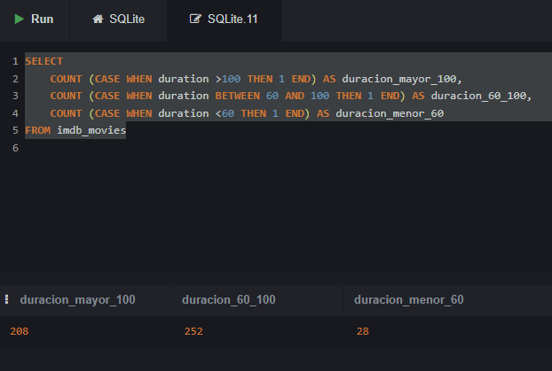

Otra forma de hacerlo es usando `CASE WHEN` en el `SELECT` y luego agrupando por el mismo `CASE WHEN` en el `GROUP BY`:

``` sql
SELECT 
    Case 
        WHEN imdb_movies.duration <60 THEN '<60'
        WHEN imdb_movies.duration BETWEEN 60 AND 100 THEN '60-100'
        WHEN imdb_movies.duration >100 THEN '>100'
        ELSE 'Duración desconocida' 
    END as rango_duracion
    ,COUNT(*) AS n
FROM imdb_movies
GROUP by 
    Case 
        WHEN imdb_movies.duration <60 THEN '<60'
        WHEN imdb_movies.duration BETWEEN 60 AND 100 THEN '60-100'
        WHEN imdb_movies.duration >100 THEN '>100'
    END ;
```

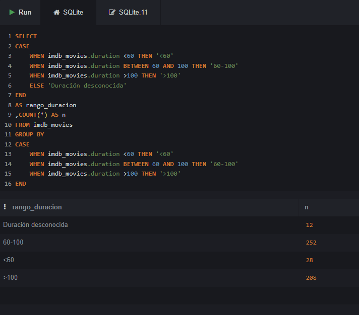

------------------------------------------------------------------------

## EJERCICIO 2: Películas de Acción Cortas

**Tabla:** `imdb_movies`

Filtra las películas del género acción que tengan una duración inferior a 60 minutos en la tabla `imdb_movies` .

-   **Contar:** ¿Cuántas películas de acción duran menos de 60 minutos?

    ``` sql
    SELECT
        COUNT (*)
    FROM imdb_movies
    WHERE 
            duration <60 
            AND gender LIKE '%Action%' ;
    ```

-   **Listar:** Obtén un listado completo con los títulos de dichas películas .

    ``` sql
    SELECT 
        duration
        ,movie_title
        ,gender
    FROM imdb_movies
    WHERE 
        duration <60 
        AND gender LIKE '%Action%' ;
    ```

    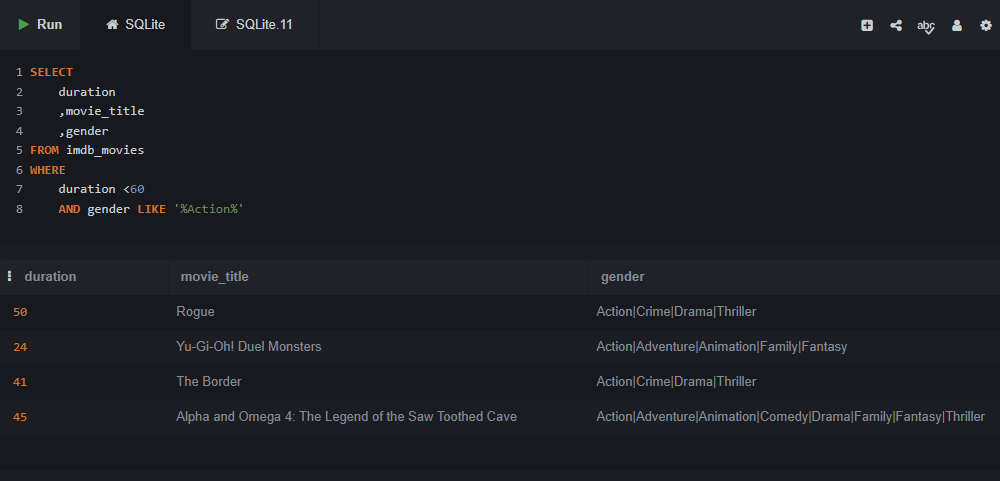

------------------------------------------------------------------------

## EJERCICIO 3: Bitcoin - Tendencia Alcista en 2018

**Tabla:** `bitcoin_daily_rates_formatdate`

Trabaja con la tabla `bitcoin_daily_rates_formatdate` para analizar el campo `High` durante el año 2018 .

-   **Mínimo de cotización:** ¿Cuál sería el día con la cotización más baja dentro de una tendencia alcista (campo `High`) en 2018?

    Nota: hacemos LIMIT 5 para asegurarnos de que no hay empate y por lo tanto más de un día con la mínima, pero luego seleccionaremos sólo el día que tenga el mínimo valor.\

    Podemos simplemente ordenar y ver cuál o cuáles son los valores más bajos

    ``` sql
    SELECT * 
    FROM bitcoin_daily_rates_formatdate
    WHERE 
        date BETWEEN '2018-00-00' AND '2018-99-99'
    ORDER BY high ASC
    LIMIT 5 ;
    ```

    O podemos usar la agregación MIN para conseguirlo

    ``` sql
    SELECT 
        date
        , min(high) as cotización_mínima
    FROM bitcoin_daily_rates_formatdate
    WHERE 
        date BETWEEN '2018-00-00' AND '2018-99-99' ;
    ```

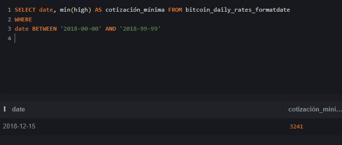

-   **Media ese día:** ¿Cuál es la media de cotización correspondiente a ese mismo día?

    ``` sql
    SELECT 
      date
      , min(high) as cotización_mínima 
      , (open + high +low + close )/4 AS media_cotización
    FROM bitcoin_daily_rates_formatdate
    WHERE 
      date BETWEEN '2018-00-00' AND '2018-99-99' ;
    ```

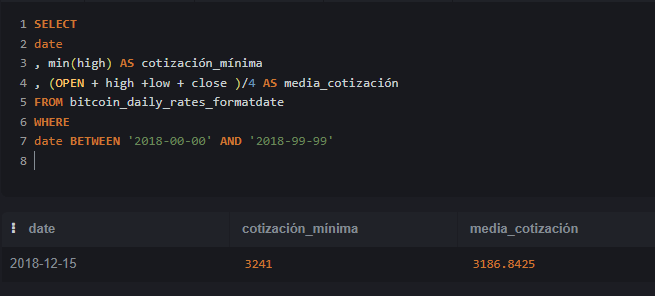

## EJERCICIO 4: Películas por Género y Votos

**Tabla:** `imdb_movies`

Muestra el número de películas por género y la película con mayor número de votos (`num_voted_users`) en cada caso . Respeta el orden indicado: `Action` | `Crime` | `Comedy` | `Drama` | `Romance` y asigna cada película al primero de estos géneros en los que aparezca. Ignora los demás géneros para las agregaciones.

-   Para cada género, indica el total de películas y el título con mayor número de votos.

    ``` sql
    SELECT 
       CASE 
          WHEN  gender LIKE '%Action%' THEN 'Action'
          WHEN  gender LIKE '%Crime%' THEN  'Crime' 
          WHEN  gender LIKE '%Comedy%' THEN 'Comedy'
          WHEN  gender LIKE '%Drama%' THEN  'Drama' 
          WHEN  gender LIKE '%Romance%' THEN 'Romance' 
       END AS primera_categoria   
       , MAX(num_voted_users) AS mas_votada  
       , COUNT(*) as n_pelis
       , movie_title

    FROM imdb_movies
    GROUP BY 
     CASE 
         WHEN  gender LIKE '%Action%' THEN 'Action'
         WHEN  gender LIKE '%Crime%' THEN  'Crime' 
         WHEN  gender LIKE '%Comedy%' THEN 'Comedy'
         WHEN  gender LIKE '%Drama%' THEN  'Drama' 
         WHEN  gender LIKE '%Romance%' THEN 'Romance' 
     END
    HAVING 
        primera_categoria != 'NULL'
    ORDER BY 
        num_voted_users DESC ;
    ```

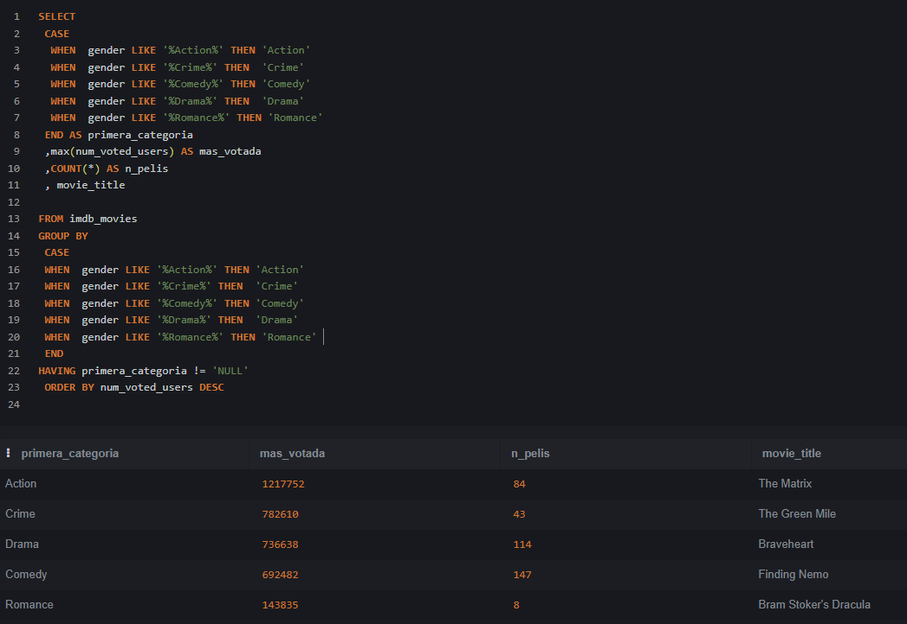

------------------------------------------------------------------------

## EJERCICIO 5: Personajes de Star Wars

**Tabla:** `star_wars_characters`

Usando la tabla `star_wars_characters`, agrupa los personajes por color de ojos (`eye_color`) y planeta de origen (`homeworld`) .

-   **Contar personajes:** Muestra cuántos personajes comparten el mismo color de ojos y planeta de origen .
-   **Filtrar datos:** Excluir colores de ojos `unknown` y planetas sin datos o nombre (`NA`).

El truco aquí está en que al pedirnos personajes que compartan color de ojos y planeta, tenemos que eliminar los que sean solo 1.

``` sql
SELECT 
    eye_color
    ,homeworld
    ,COUNT (*) AS N
FROM star_wars_characters_2 
WHERE 
    homeworld != 'NA' 
    AND eye_color != 'unknown'
GROUP BY 
    eye_color
    , homeworld
HAVING 
    count(*) >1
ORDER BY 
    COUNT(*) DESC ;
```

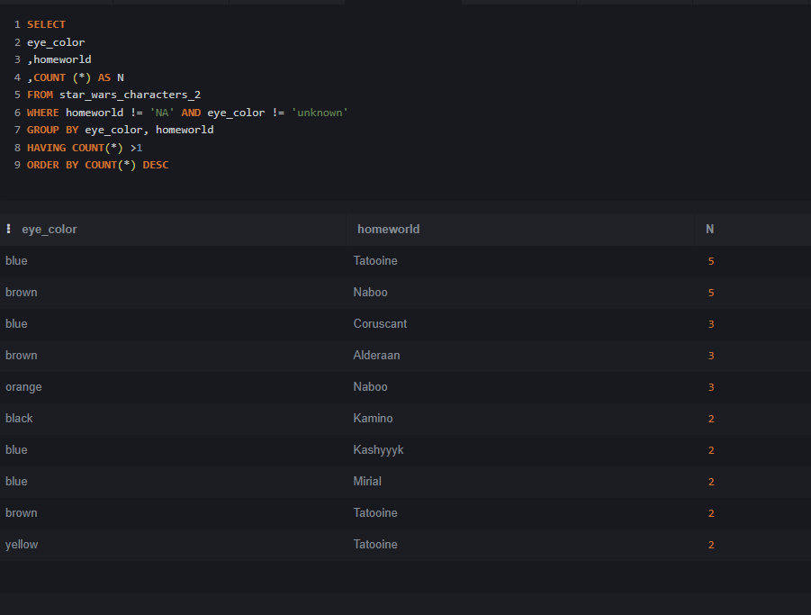

## EJERCICIO 6: James Bond - Presupuesto de Películas

**Tabla:** `jamesbond`

Identifica y calcula el presupuesto de las películas de la saga James Bond que cumplan las siguientes condiciones, usando la tabla `jamesbond` :

-   **Director:** Dirigidas por John Glen .
-   **Actor protagonista:** Protagonizadas por Timothy Dalton .
-   **Cálculo:** Calcula el presupuesto total de dichas películas.

``` sql
SELECT 
    director
    ,actor
    ,SUM(budget) as presupuesto_combinado
    ,COUNT(DISTINCT jamesbond.film) as películas
FROM jamesbond
WHERE 
    director = 'John Glen' 
    AND actor = 'Timothy Dalton' ;
```

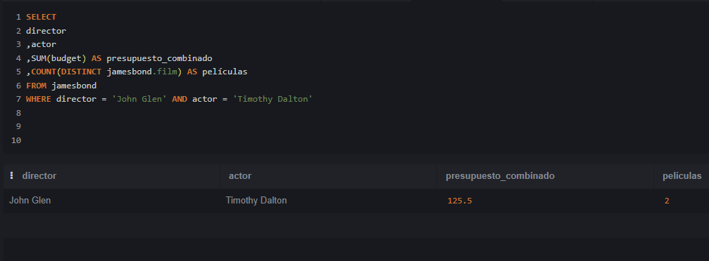

## EJERCICIO 7: Créditos por Estado Personal

**Tabla:** `loan-data`

Analiza la tabla `loan-data` para obtener información sobre los créditos según el estado personal del solicitante .

-   **Créditos otorgados:** ¿Cuál es la cantidad y el número de créditos concedidos, agrupados por estado personal?
-   **Créditos no otorgados:** ¿Cuál es la cantidad y el número de créditos denegados, agrupados por estado personal?

``` sql
SELECT 
    personal_status
    , class
    , SUM (credit_amount)
    , COUNT(*)
FROM LoanData
GROUP BY 
    personal_status
    , class ;
```

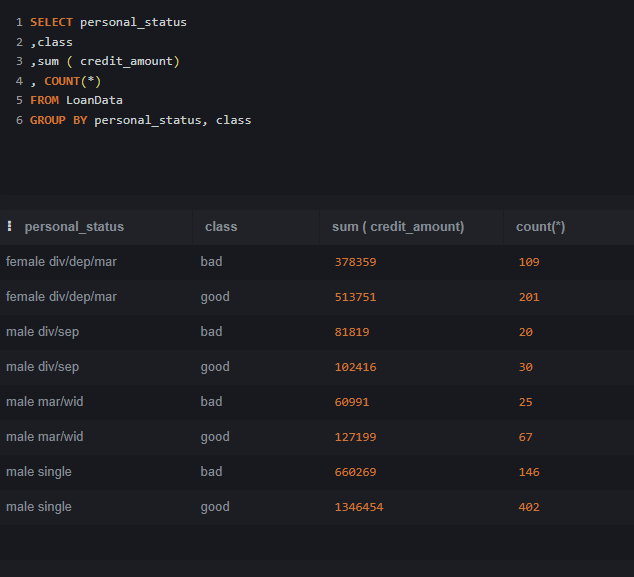

``` sql
SELECT 
    personal_status
    ,SUM (CASE WHEN class = 'good' THEN credit_amount END) AS prestamo_concedido
    ,SUM (CASE WHEN class = 'good' THEN 1 END) AS n_prestamos_concedidos
    ,SUM (CASE WHEN class = 'bad' THEN credit_amount END ) AS prestamo_rechazados
    ,SUM (CASE WHEN class = 'bad' THEN 1 END) AS n_prestamos_rechazados
FROM LoanData
GROUP BY personal_status ;
```

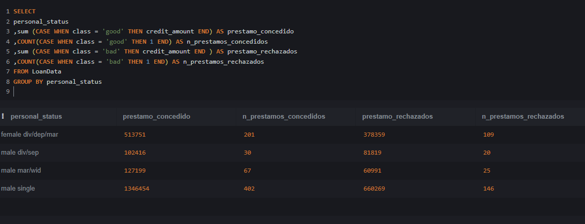

## EJERCICIO 8: Películas de Acción con Alta Valoración

**Tabla:** `imdb_movies`

Obtén un listado de películas de acción de la tabla `imdb_movies` que cumplan todos los criterios siguientes :

1.  **Likes del actor protagonista:** Más de 10.000 likes en Facebook .
2.  **Valoración en IMDb:** Puntuación de al menos 8 sobre 10 .
3.  **Fecha de estreno:** Películas con fecha anterior a 2012 .

``` sql
SELECT 
    movie_title
    , gender
    , imdb_score
    , actor_1_facebook
    , title_year 
FROM imdb_movies
WHERE   
    imdb_movies.actor_1_facebook > 10000
AND imdb_movies.imdb_score >=8
AND imdb_movies.title_year < 2012
AND imdb_movies.gender LIKE '%Action%' ;
```

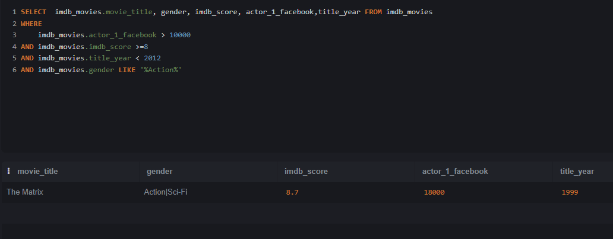

## EJERCICIO 9: Top 20 Películas por Presupuesto y Beneficio

**Tabla:** `imdb_movies`

Usando la tabla `imdb_movies`, obtén las 20 películas junto a su género en cada uno de los siguientes rankings :

-   **Mayor presupuesto:** Las 20 películas con el presupuesto más elevado y el género al que pertenecen .
-   **Mayor beneficio:** Las 20 películas con el mayor beneficio obtenido y el género al que pertenecen .

``` sql
SELECT 
    movie_title
    , gender AS genero
    , budget AS presupuesto
    , gross AS beneficio
FROM imdb_movies
ORDER BY budget DESC 
LIMIT 20 ;
```

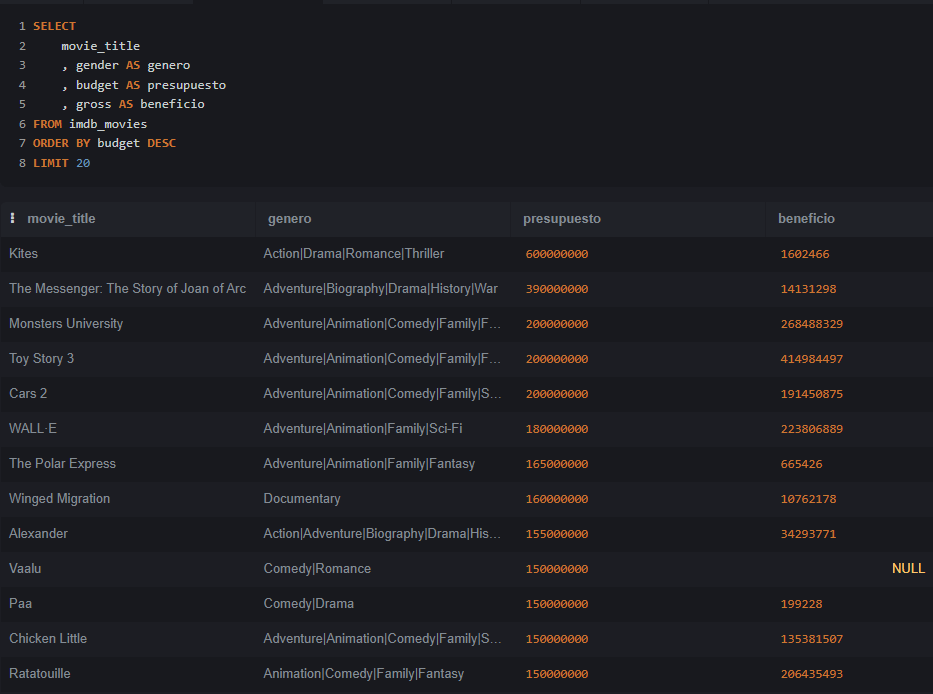

``` sql
SELECT 
    movie_title
    , gender AS genero
    , budget AS presupuesto
    , gross AS beneficio
FROM imdb_movies
ORDER BY gross DESC 
LIMIT 20 ;
```

------------------------------------------------------------------------

## Propuesta Adicional: ¡Regala un Ejercicio a tus Compañeros!

Como parte de esta práctica individual, cada estudiante deberá crear y proponer un ejercicio SQL original para compartir con el resto de la clase .

-   **Sé creativo:** Diseña una consulta interesante y retadora usando cualquiera de las tablas trabajadas .
-   **Comparte y aprende:** El intercambio de ejercicios enriquece el aprendizaje colectivo y refuerza los conceptos.

------------------------------------------------------------------------

## Ejercicios de los Alumnos:

Usando la tabla fortune:

Clasifica las empresas en tres categorías según su número de empleados (Employees):

-   Pequeña: Menos de 10.000 empleados.

-   Mediana: Entre 10.000 y 50.000 empleados.

-   Grande: Más de 50.000 empleados.

Muestra para cada categoría el número total de empresas, el beneficio total acumulado y el beneficio medio.

Filtra únicamente las empresas del sector *Financials* que pertenezcan a la industria *Commercial Banks* o *Diversified Financials*, Y cuyo volumen de ingresos (Revenue) sea superior a 20.000 millones.

``` sql
SELECT 
    CASE 
        WHEN Employees < 10000 THEN 'Pequeña (<10k)'
        WHEN Employees BETWEEN 10000 AND 50000 THEN 'Mediana (10k-50k)'
        WHEN Employees > 50000 THEN 'Grande (>50k)'
    END AS tamano_empresa,
    COUNT(*) AS total_empresas,
    ROUND(SUM(Profits),1) AS beneficio_total,
    ROUND(AVG(Profits),1) AS beneficio_medio

FROM fortune

WHERE Sector = 'Financials' 
  AND Industry IN ('Commercial Banks', 'Diversified Financials') 
  AND Revenue > 20000
  
GROUP BY 
    CASE 
        WHEN Employees < 10000 THEN 'Pequeña (<10k)'
        WHEN Employees BETWEEN 10000 AND 50000 THEN 'Mediana (10k-50k)'
        WHEN Employees > 50000 THEN 'Grande (>50k)'
    END
ORDER BY beneficio_medio DESC;
```

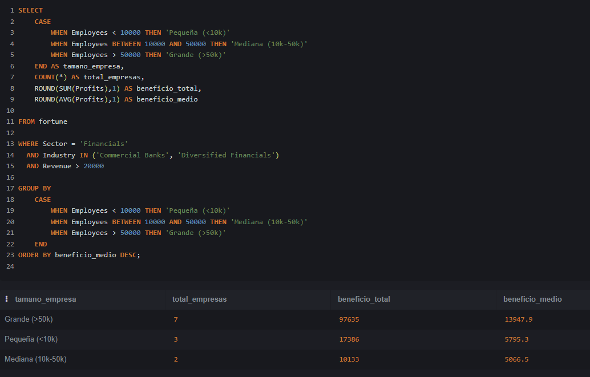

------------------------------------------------------------------------

Usando la tabla jamesbond:

¿Cuales son las 5 películas de James Bond con mayor margen sobre ingresos (% del beneficio)? Indicar película, director, actor y margen.

Antes de poder hacer esta query tenemos que explicar la fórmula del margen ya que no esperamos que el alumno la conozca:

La lógica del Margen (El "quesito" de las ganancias): El margen sobre ingresos responde a esta pregunta sencilla: "De cada 100 € que entran por taquilla, ¿cuántos euros nos quedan limpios en el bolsillo?"

Si analizamos Dr. No:

-   Ingresos (Boxoffice): 448,8 M€ (este es el 100% del dinero recaudado)

-   Gasto (Budget): 7,0 M€ (lo que costó hacerla)

-   Beneficio (Profit): 441,8 M€ (lo que queda limpio)

Si repartimos la tarta de esos 448,8 M€ recaudados:

-   Tan solo el 1,56% de la recaudación sirvió para cubrir los costes de producción ($7 / 448,8$).

-   El 98,44% restante ($441,8 / 448,8$) es beneficio puro.

En resumen: De cada 100 € que la gente se gastó en el cine para ver la película, 1,56 € sirvieron para pagar el presupuesto y 98,44 € fueron ganancia neta. De ahí sale ese 98,44%.

Si expresamos esto en una fórmula para poder aplicarlo a cada observación: $\frac{(\text{recaudación} - \text{coste}) \times 100}{\text{recaudación}}$

Otras formas de analizar el beneficio:

**Rentabilidad sobre el gasto (ROI)** o el **multiplicador de la inversión**:

|  |  |  |  |
|------------------|------------------|------------------|------------------|
| **Métrica** | **¿Qué pregunta responde?** | **Cálculo en Dr. No** | **Resultado** |
| **Margen sobre Ingresos** | De lo recaudado, ¿qué % es beneficio? | $441,8 / 448,8 \times 100$ | **98,44%** |
| **Rentabilidad (ROI)** | Del dinero invertido, ¿qué % hemos ganado? | $441,8 / 7,0 \times 100$ | **6.311%** |
| **Multiplicador** | ¿Por cuánto se multiplicó el presupuesto? | $448,8 / 7,0$ | **64,1 veces** |

``` sql
SELECT 
film
, director
, boxoffice
, budget
, round ((boxoffice - budget),0) as profit 
, round ((((boxoffice - budget)*100) /boxoffice),2)  as margen
FROM jamesbond
ORDER BY  margen DESC
LIMIT 5 ;
```

------------------------------------------------------------------------

Usando la tabla LoanData: Calcular la cantidad de créditos concedidos según hombres y mujeres, clasificados por tres grupos de edad: menos de 30 años, de 30 a 40 años y más de 40 años

Selecciona sólo aquellos que tienen un coche en propiedad y viven en la casa propia.

``` sql
SELECT 
    CASE 
        WHEN age <30 THEN '<30' 
        WHEN age <=40 THEN '30>=40' 
        ELSE '>40' 
    END AS grupo 
    ,COUNT(CASE WHEN class = 'good' THEN 1 END) AS concecidos 
    ,COUNT(CASE WHEN class = 'bad' THEN 1 END) AS denegados 
FROM LoanData 
WHERE housing = 'own' 
    AND property_magnitu = 'car' 
GROUP BY 
    CASE WHEN age <30 THEN '<30' 
         WHEN age <=40 THEN '30>=40' 
         ELSE '>40' 
    END  ;
```

------------------------------------------------------------------------

Tabla: gobierno_paro Muestra la cantidad de hombres y mujeres, entre 25 y 45 años de Galicia que están de paro desde marzo de 2018 y cuántos de ellos son del municipio 'Lugo'.

*NOTA: al importar la tabla los hombres de 25 a 45 años aparecen como ¨paro_hombre_edad_10¨ y las mujeres de 25 a 45 años aparecen como ¨paro_mujer_edad_13¨*

``` sql
SELECT 
    SUM(paro_hombre_edad_10) AS hombres25a45
  , SUM(paro_mujer_edad_13) AS mujeres25a45
  , sum (CASE WHEN municipio = 'Lugo' THEN paro_hombre_edad_10 END) aS hombres25a45_LugoMun
  , sum (CASE WHEN municipio = 'Lugo' THEN paro_mujer_edad_13 END) aS mujeres25a45_LugoMun
FROM gobierno_paro
WHERE 
    comunidad_autono = 'Galicia'
    AND codigo_mes >=201803 ;
```

------------------------------------------------------------------------

Utilizando la tabla bitcoin_daily_rates_formatdate

Analiza las cotizaciones desde el año 2016.

Para cada año muestra:

-   Número de días analizados.

-   Número de días alcistas, cuando Close es mayor que Open.

-   Número de días bajistas, cuando Close es menor que Open.

-   Número de días sin variación, cuando Close es igual a Open.

-   Valor medio de cierre.

-   Cotización máxima anual del campo High.

-   Cotización mínima anual del campo Low.

Muestra solamente los años que contengan al menos 50 días de datos y ordénalos cronológicamente.

``` sql
SELECT  
    count(DISTINCT bitcoin_daily_rates_formatdate.date) as dias
    ,SUM(CASE WHEN close > bitcoin_daily_rates_formatdate.open THEN 1 end) as alcistas
    ,SUM(CASE WHEN close < bitcoin_daily_rates_formatdate.open THEN 1 end) as bajistas
    ,SUM(CASE WHEN close = bitcoin_daily_rates_formatdate.open THEN 1 end) as no_variacion
    ,max (high) as cotizacion_maxima
    ,min (low) as cotizacion_minima 
    ,round(avg(close),2) as media_cierre
FROM bitcoin_daily_rates_formatdate
WHERE date > '2016-00-00'
group by STRFTIME('%Y', date) 
having count(DISTINCT bitcoin_daily_rates_formatdate.date) >=50
ORDER BY bitcoin_daily_rates_formatdate.date ;
```

------------------------------------------------------------------------

Obten de la tabla ‘jamesbond’:

Las películas de Sean Connery con una recaudación de taquilla de la siguiente manera:  - Mayor a 800=Recaudación_exitosa,

-   entre 800 y 500=Recaudación_normal y

-   menor a 500=Recaudación_baja

``` sql
SELECT film
,CASE WHEN  boxoffice >800 THEN 'exito'
 WHEN boxoffice between 500 and 800 THEN 'normal' 
 WHEN boxoffice < 500 THEN 'baja'
 END
 ,boxoffice
FROM jamesbond
WHERE actor= 'Sean Connery' ;
```

Utilizando la tabla fortune,

Utilizando la tabla videogames_games: Crea una consulta que muestre el nombre del videojuego, su plataforma, sus ventas en Europa y una columna nueva llamada categoría_éxito usando las siguientes condiciones : -superventas si son mayores a 3.0 millones -exitoso si están entre 1.0 y 3.0millones -venta moderada si son menor de 1.0 millones muestra únicamente el top15 de juegos con mayor venta en Europabetw |

``` sql
select 
videogames_games.name 
, platform_code 
, eu_sales 
,case WHEN eu_sales >3 THEN 'SUPERVENTAS' 
      WHEN eu_sales BETWEEN 1 AND 3 THEN 'EXITOSO' 
      WHEN eu_sales <1 THEN 'VENTA MODERADA' 
END as categoria_exito 
from videogames_games 
ORDER BY eu_sales DESC LIMIT 15
``` |

Utilizando la tabla videogames_games:

Queremos saber el nombre los videojuegos y plataforma que tuvieron mayor número de ventas global según su generación:

- Gen Y: Juegos lanzados entre 1989 y 1996.

- Gen Z: Juegos lanzados entre 1997 y 2012.

- Gen Alfa: Juegos lanzados a partir de 2013.

``` sql
select 
  name
, platform_code
, max(round(eu_sales + na_sales + jp_sales + other_sales, 2)) as total_ventas
,case 
  WHEN YEAR BETWEEN 1989 AND 1996 THEN 'GEN Y' 
  WHEN YEAR BETWEEN 1997 AND 2012 THEN 'GEN Z' 
  WHEN YEAR >2013 THEN 'GEN ALPHA' 
END as generacion
from videogames_games
group by 
  case 
    WHEN YEAR BETWEEN 1989 AND 1996 THEN 'GEN Y' 
    WHEN YEAR BETWEEN 1997 AND 2012 THEN 'GEN Z' 
    WHEN YEAR >=2013 THEN 'GEN ALPHA' 
  END 

ORDER BY eu_sales + na_sales + jp_sales + other_sales desc
```

::: nota-importante
Esta consulta solo va a funcionar en SQLite, dará error en los otros motores ya que los campos name y platform_code no están incluidos en la agregación y por lo tanto son 'bare columns' como ya vimos.

PostgreSQL, SQL Server y Oracle:

Darán ERROR. El estándar de SQL (ANSI SQL) exige estrictamente que cualquier columna que no esté dentro de una función de agregación (como MAX, SUM) DEBE estar en la cláusula GROUP BY. Al ver name y platform_code fuera del GROUP BY, la consulta directamente no se ejecutará.

MySQL:

Por defecto (con la regla ONLY_FULL_GROUP_BY activada desde MySQL 5.7), también te dará un error.

Si la regla está desactivada, la consulta se ejecutará pero te devolverá valores aleatorios/indeterminados para name y platform_code (no necesariamente los del juego con el máximo de ventas).

SQLite (Tu caso actual):

SQLite tiene una excepción documentada: cuando usas MAX() o MIN() sobre columnas no agrupadas, garantiza que los demás campos extraídos (name, platform_code) pertenezcan a la misma fila donde se encontró ese máximo. Es cómodo para prototipar, pero te genera "malos hábitos" si luego migras a PostgreSQL u otros.

Conseguir el mismo resultado en mySQL puede complicarse mucho y requiere funciones ventana que aún no hemos estudiado:

``` sql
WITH juegos_clasificados AS (
    SELECT 
        name,
        platform_code,
        ROUND(eu_sales + na_sales + jp_sales + other_sales, 2) AS total_ventas,
        CASE 
            WHEN year BETWEEN 1989 AND 1996 THEN 'GEN Y' 
            WHEN year BETWEEN 1997 AND 2012 THEN 'GEN Z' 
            WHEN year >= 2013 THEN 'GEN ALPHA' 
        END AS generacion,
        -- Numeramos los juegos de 1 a N dentro de cada generación, ordenados por ventas
        ROW_NUMBER() OVER (
            PARTITION BY 
                CASE 
                    WHEN year BETWEEN 1989 AND 1996 THEN 'GEN Y' 
                    WHEN year BETWEEN 1997 AND 2012 THEN 'GEN Z' 
                    WHEN year >= 2013 THEN 'GEN ALPHA' 
                END
            ORDER BY (eu_sales + na_sales + jp_sales + other_sales) DESC
        ) AS posicion
    FROM videogames_games
)
SELECT 
    name,
    platform_code,
    total_ventas,
    generacion
FROM juegos_clasificados
WHERE posicion = 1 AND generacion IS NOT NULL
ORDER BY total_ventas DESC;
```
:::

Más ejercicios desde internet:

<https://datalemur.com/questions/matching-skills>

``` sql
SELECT candidate_id
FROM candidates
WHERE skill IN ('Python', 'Tableau', 'PostgreSQL')
GROUP BY candidate_id
HAVING COUNT(skill) = 3
ORDER BY candidate_id;
```

<https://datalemur.com/questions/sql-page-with-no-likes>

``` sql
SELECT page_id 
FROM pages
WHERE page_id NOT IN  (SELECT page_id FROM page_likes) ;
```

| <https://datalemur.com/questions/tesla-unfinished-parts> |
|:-----------------------------------------------------------------------|
| <https://datalemur.com/questions/laptop-mobile-viewership> |
| `sql SELECT SUM(CASE WHEN device_type IN ('tablet','phone') THEN 1 END) AS 'mobile_views' ,SUM(CASE WHEN device_type = 'laptop' THEN 1 END) AS 'laptop_views' FROM viewership;` |

<https://datalemur.com/questions/sql-average-post-hiatus-1>

::: nota
nota: MySQL o PostGre no usan las fechas como SQLite, así que tendrás que asegurarte qué opciones tienes para manejar fechas en cada variante.
Por ejemplo en mySQL: 
-  Para calcular diferencia en días usa la función DATEDIFF()  `SELECT DATEDIFF('2026-12-31', '2026-12-25')`;
-  Para extraer el año de una fecha usa la función YEAR()  `SELECT YEAR('07/10/2021 12:00:00')`
:::

``` sql
SELECT 
    user_id
    ,DATEDIFF(max(post_date),min(post_date)) as days_between
FROM posts 
where YEAR(post_date) = 2021
group by user_id
having count(*) >1;
```

<https://datalemur.com/questions/teams-power-users>

NOTA, esta require subqueries que no hemos dado aún. <https://datalemur.com/questions/sql-histogram-tweets>

``` sql
select 
   t.posts as tweet_bucket ,count(*) as users_num 
   from ( SELECT count (*) as posts 
   FROM tweets where year(tweet_date) =2022 group by user_id ) as t group by posts 
```
