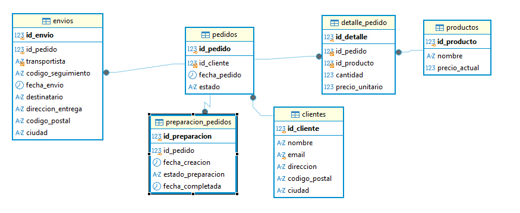
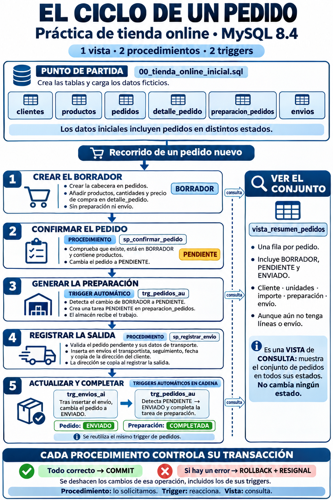
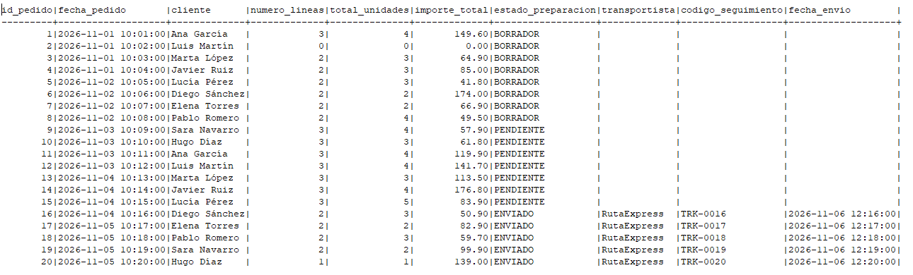

Práctica integradora de una tienda online

Guía para estudiantes \| IFCT0310 Administración de bases de datos \| MySQL 8.4.x

Construiremos una vista de consulta y automatizaremos la confirmación y el envío de pedidos mediante dos procedimientos y dos triggers. Partiremos de una base ya creada y alimentada por el script inicial que acompaña a esta guía.

# Objetivos de aprendizaje

- Relacionar los datos comerciales, las líneas de compra y la preparación de un pedido.
- Crear una vista con relaciones opcionales y cálculos agrupados.
- Validar operaciones mediante procedimientos y mensajes de error comprensibles.
- Coordinar triggers con transacciones y comprobar qué sucede cuando una operación falla.
- Demostrar los resultados con pruebas reproducibles y explicar las decisiones tomadas.

# Una tienda y sus documentos

Pensad en una tienda que trabaja con una hoja de compra, una orden para el almacén y un justificante de salida. La hoja se prepara antes de entregarla al almacén. Cuando sale el paquete, se anota quién lo transporta y cómo localizarlo. Nuestras tablas representan esos documentos; los procedimientos realizan las operaciones y los triggers coordinan los cambios automáticos.

El único código que recibís resuelto es el script inicial. Debéis escribir el SQL de los cinco objetos y el de vuestras pruebas. Las pistas de esta guía indican herramientas que podéis utilizar, pero no incluyen las soluciones.

# Entorno y forma de trabajo

Trabajaremos con MySQL Server 8.4.x y tablas InnoDB. MySQL Workbench es el cliente; su versión no es la versión del servidor. Anotad ambas versiones en la entrega. Las referencias a menús de Workbench deben verificarse contra la versión instalada.

Necesitáis una conexión de laboratorio con permisos para crear la base y las tablas, consultar y modificar sus datos, crear y ejecutar rutinas, crear vistas y crear triggers. Si aparece un error de permisos o el error 1419 relacionado con el registro binario, consultad al docente para preparar la cuenta del laboratorio.

El nombre de la base será `tienda_online_practica`. Respetad todos los nombres del script. No añadáis tablas, columnas, estados ni objetos adicionales para resolver las tareas obligatorias.

## Control de las transacciones

Ejecutad cada llamada a los procedimientos con autocommit activado y sin una transacción previa abierta. Cada procedimiento iniciará y terminará su propia transacción. MySQL no dispone de transacciones anidadas y un nuevo `START TRANSACTION` puede confirmar una transacción anterior.

Todas las operaciones de una llamada deben confirmarse juntas. Ante cualquier error SQL, el procedimiento debe deshacer sus cambios y volver a comunicar el error original. Los triggers participan en esa misma operación y no inician ni terminan transacciones.

## Qué debéis entregar

- Un archivo SQL con la vista, los dos triggers y los dos procedimientos, en un orden que permita instalarlos sobre la base inicial.
- Un segundo archivo SQL con las pruebas realizadas, identificadas con los códigos de esta guía.
- Un informe con resultados o capturas legibles, comparación con lo esperado y respuestas a las preguntas de razonamiento.

Los cambios habituales de estado se realizan mediante los procedimientos. La escritura directa en las tablas operativas queda reservada a la creación de borradores y a las pruebas controladas que se indican expresamente. Durante el laboratorio no editaremos líneas de pedidos ya confirmados.

# Estructura de la base de datos

Una clave primaria o PK identifica cada fila. Una clave foránea o FK exige que exista la fila referenciada. Todas las columnas son obligatorias salvo `preparacion_pedidos.fecha_completada`. Los campos identificadores se generan automáticamente cuando se omiten en una inserción.

## Tabla clientes

Nombre SQL exacto: `clientes`.

| Columna y tipo | Función y restricciones |
|------------------------------------|------------------------------------|
| `id_cliente INT` | PK autoincremental. Identifica al cliente. |
| `nombre VARCHAR(100)` | Nombre actual del cliente. |
| `email VARCHAR(150)` | Correo único. |
| `direccion VARCHAR(150)` | Calle y número actuales. |
| `codigo_postal CHAR(5)` | Texto de cinco caracteres. Conserva ceros iniciales. |
| `ciudad VARCHAR(80)` | Ciudad actual. |

## Tabla productos

Nombre SQL exacto: `productos`.

| Columna y tipo                | Función y restricciones                    |
|------------------------------------|------------------------------------|
| `id_producto INT`             | PK autoincremental.                        |
| `nombre VARCHAR(100)`         | Nombre del producto.                       |
| `precio_actual DECIMAL(10,2)` | Precio actual de catálogo. Mayor que cero. |

## Tabla pedidos

Nombre SQL exacto: `pedidos`.

| Columna y tipo | Función y restricciones |
|------------------------|-----------------------------------------------|
| `id_pedido INT` | PK autoincremental. |
| `id_cliente INT` | FK que referencia `clientes.id_cliente`. |
| `fecha_pedido DATETIME` | Fecha y hora. Por defecto, instante de creación. |
| `estado VARCHAR(10)` | `BORRADOR` por defecto. Solo admite `BORRADOR`, `PENDIENTE` o `ENVIADO`. |

## Tabla detalle pedido

Nombre SQL exacto: `detalle_pedido`.

| Columna y tipo | Función y restricciones |
|------------------------------------|------------------------------------|
| `id_detalle INT` | PK autoincremental. |
| `id_pedido INT` | FK que referencia `pedidos.id_pedido`. |
| `id_producto INT` | FK que referencia `productos.id_producto`. |
| `cantidad INT` | Número de unidades. Mayor que cero. |
| `precio_unitario DECIMAL(10,2)` | Precio aplicado en esa compra. Mayor que cero. |

## Tabla preparacion pedidos

Nombre SQL exacto: `preparacion_pedidos`.

| Columna y tipo | Función y restricciones |
|--------------------------|---------------------------------------------|
| `id_preparacion INT` | PK autoincremental. |
| `id_pedido INT` | FK a `pedidos.id_pedido` y valor único. |
| `fecha_creacion DATETIME` | Momento en que se genera la tarea. |
| `estado_preparacion VARCHAR(10)` | `PENDIENTE` o `COMPLETADA`. Por defecto `PENDIENTE`. |
| `fecha_completada DATETIME` | `NULL` mientras está `PENDIENTE`. Obligatoria cuando está `COMPLETADA`. |

## Tabla envios

Nombre SQL exacto: `envios`.

| Columna y tipo | Función y restricciones |
|--------------------------|---------------------------------------------|
| `id_envio INT` | PK autoincremental. |
| `id_pedido INT` | FK a `pedidos.id_pedido` y valor único. |
| `transportista VARCHAR(80)` | Nombre obligatorio y no vacío tras eliminar espacios exteriores. |
| `codigo_seguimiento VARCHAR(60)` | Código obligatorio y no vacío tras eliminar espacios exteriores. |
| `fecha_envio DATETIME` | Momento en que se registra la salida. |
| `destinatario VARCHAR(100)` | Copia del nombre actual del cliente al registrar la salida. |
| `direccion_entrega VARCHAR(150)` | Copia de `clientes.direccion` al registrar la salida. |
| `codigo_postal CHAR(5)` | Copia del código postal en ese momento. |
| `ciudad VARCHAR(80)` | Copia de la ciudad en ese momento. |

## Relaciones y límites

| Relación | Cardinalidad |
|---------------------------|--------------------------------------------|
| `clientes` con `pedidos` | Un cliente puede tener varios pedidos; cada pedido tiene un cliente. |
| `pedidos` con `detalle_pedido` | Un pedido puede tener cero o varias líneas; cada línea pertenece a un pedido. |
| `productos` con `detalle_pedido` | Un producto puede aparecer en varios pedidos. |
| `pedidos` con `preparacion_pedidos` | Un pedido tiene como máximo una tarea de preparación. |
| `pedidos` con `envios` | Un pedido tiene como máximo un envío. |

La combinación `id_pedido` e `id_producto` es única en `detalle_pedido`. Para comprar varias unidades del mismo producto utilizaremos `cantidad`. En `envios` es única la combinación `transportista` y `codigo_seguimiento`; dos transportistas distintos pueden utilizar el mismo código.

Las claves foráneas usan `RESTRICT`: no permiten eliminar una fila que todavía tenga filas relacionadas. Los controles `CHECK` impiden cantidades y precios no positivos y exigen coherencia entre el estado de preparación y su fecha de finalización.



# Reglas del proceso

| Estado del pedido | Preparación | Envío |
|------------------|----------------------------|--------------------------|
| `BORRADOR` | No debe tener tarea. | No debe tener envío. |
| `PENDIENTE` | Una tarea `PENDIENTE`, sin fecha de finalización. | No debe tener envío. |
| `ENVIADO` | Una tarea `COMPLETADA`, con fecha de finalización. | Un envío con todos sus datos. |

El recorrido permitido es `BORRADOR` a `PENDIENTE` y después `PENDIENTE` a `ENVIADO`.

No hay cancelaciones ni retrocesos.

Una actualización que mantiene el mismo estado no genera tareas ni las completa.

El trigger de pedidos rechazará cualquier otro cambio de estado.

Primero se crea la cabecera en `BORRADOR` y se añaden sus líneas. *Confirmar* significa que el almacén ya puede trabajar con el pedido. *Registrar* el envío representa la salida del paquete en esta simulación; no contacta con una empresa de transporte.

El importe será la suma de `cantidad` por `precio_unitario` de sus líneas. No calcularemos impuestos, descuentos, gastos de envío, pagos ni existencias. El estado del pedido y el de la preparación son campos distintos y utilizan sus propios valores.

](images/tienda_online.png)

# Preparar y comprobar los datos iniciales

Abrid `tienda_online_inicial.sql` en la conexión de laboratorio. Comprobad que la base `tienda_online_practica` todavía no existe.

Ejecutad el archivo completo y deteneos ante el primer error. No continuéis una carga parcialmente fallida ni sustituyáis `CREATE` por `IF NOT EXISTS` para ignorar el problema.

Revisad los resultados de las comprobaciones que el propio script muestra al final. Actualizad la lista de esquemas del cliente si no aparece la base. Verificar el control de actualización contra la versión instalada.

Confirmad que todavía no hay vistas, procedimientos ni triggers de esta práctica. Los registros históricos se han insertado directamente durante la carga inicial.

| Tabla                 | Filas iniciales |
|-----------------------|-----------------|
| `clientes`            | 10              |
| `productos`           | 15              |
| `pedidos`             | 20              |
| `detalle_pedido`      | 45              |
| `preparacion_pedidos` | 12              |
| `envios`              | 5               |

| Pedidos | Situación inicial                       |
|---------|-----------------------------------------|
| 1 a 8   | `BORRADOR`. El pedido 2 está vacío.     |
| 9 a 15  | `PENDIENTE` con su tarea pendiente.     |
| 16 a 20 | `ENVIADO` con tarea completada y envío. |

Hay 8 borradores, 7 pendientes y 5 enviados. Crear un trigger no lo ejecuta sobre filas antiguas: por eso el script ya incorpora las preparaciones y los envíos históricos necesarios.

La carga inicial no borra una base previa y no está diseñada para repetirse sobre una base existente. Para reiniciar, guardad vuestro SQL y pedid al docente restaurar el punto inicial; eliminar la base también elimina los objetos que habéis creado.

# Crear la vista de resumen

Cread `vista_resumen_pedidos`. Debe devolver exactamente una fila por pedido, incluyendo los que están en `BORRADOR`, los vacíos y los que aún no tienen envío. No debe filtrar por estado.

| Columna de la vista | Contenido obligatorio |
|------------------------------------|------------------------------------|
| `id_pedido` | Identificador del pedido. |
| `fecha_pedido` | Fecha de su cabecera. |
| `cliente` | Nombre actual del cliente. |
| `estado_pedido` | Estado de `pedidos.estado`. |
| `numero_lineas` | Número de filas reales de detalle. Cero si está vacío. |
| `total_unidades` | Suma de cantidades. Cero si está vacío. |
| `importe_total` | Suma de cantidad por `precio_unitario`. Cero si está vacío. |
| `estado_preparacion` | Estado de la tarea; `NULL` si todavía no existe. |
| `transportista` | Transportista del envío; `NULL` si no existe. |
| `codigo_seguimiento` | Código del envío; `NULL` si no existe. |
| `fecha_envio` | Fecha de salida; `NULL` si no existe. |

Conservad estos nombres y este orden de columnas. Los importes se expresan en euros y se comparan con dos decimales. Los datos de preparación y envío ausentes se mantienen como `NULL`; no los sustituyáis por textos como «sin envío».

Ayuda: partiendo de `pedidos`, utilizad `LEFT JOIN` en las relaciones que pueden no existir. El cliente siempre existe por la FK. Revisad `COUNT` sobre una columna del detalle, `SUM`, `COALESCE` y `GROUP BY`. La vista es de consulta y no se utilizará para actualizar pedidos.

``` sql
-- tienda_online_practica.vista_resumen_pedidos source
CREATE OR REPLACE VIEW tienda_online_practica.vista_resumen_pedidos AS
select
    p.id_pedido AS id_pedido,
    p.fecha_pedido AS fecha_pedido,
    c.nombre AS cliente,
    count(d.id_detalle) AS numero_lineas,
    coalesce(sum(d.cantidad), 0) AS total_unidades,
    coalesce(sum((d.cantidad * d.precio_unitario)), 0) AS importe_total,
    p.estado AS estado_preparacion,
    e.transportista AS transportista,
    e.codigo_seguimiento AS codigo_seguimiento,
    e.fecha_envio AS fecha_envio
from
    (((tienda_online_practica.pedidos p
left join tienda_online_practica.clientes c on
    ((p.id_cliente = c.id_cliente)))
left join tienda_online_practica.detalle_pedido d on
    ((p.id_pedido = d.id_pedido)))
left join tienda_online_practica.envios e on
    ((p.id_pedido = e.id_pedido)))
group by
    p.id_pedido,
    p.fecha_pedido,
    p.estado,
    e.transportista,
    e.codigo_seguimiento,
    e.fecha_envio,
    c.nombre;
```



# Crear los dos triggers

Cread ambos triggers antes de probar los procedimientos. Sus nombres obligatorios son `trg_pedidos_au` y `trg_envios_ai`. Cada uno se ejecutará por cada fila afectada.

## Trigger sobre pedidos

`trg_pedidos_au` se ejecutará después de una actualización de `pedidos`. Comparará el estado anterior y el nuevo. Debe realizar estas actuaciones:

- Si el estado no cambia, no realiza ninguna actuación.
- Si pasa de `BORRADOR` a `PENDIENTE`, inserta una tarea para ese pedido con fecha de creación actual, estado `PENDIENTE` y `fecha_completada` `NULL`.
- Si pasa de `PENDIENTE` a `ENVIADO`, actualiza su tarea pendiente a `COMPLETADA` y establece la `fecha_completada` actual. Debe afectar exactamente a una tarea. Si no la encuentra, genera `SQLSTATE 45000` con el mensaje `El pedido no tiene una preparacion pendiente.`
- Cualquier otro cambio de estado se rechaza con `SQLSTATE 45000` y el mensaje `Transicion de estado no permitida.`

Ayuda: `AFTER UPDATE`, `OLD`, `NEW`, `IF` y `ELSEIF` permiten distinguir los casos. `ROW_COUNT` permite comprobar la actualización de la tarea. No eliminéis tareas completadas y no ocultéis duplicados con `IGNORE`: un fallo debe llegar al procedimiento.

``` sql
DELIMITER //

CREATE TRIGGER trg_pedidos_au
BEFORE UPDATE ON pedidos
FOR EACH ROW
BEGIN
    
    -- Solo validamos y actuamos si el estado realmente cambia
    IF OLD.estado <> NEW.estado THEN
    
        -- 1. Validación de transiciones permitidas
        IF NOT (
            (OLD.estado = 'BORRADOR' AND NEW.estado = 'PENDIENTE') 
            OR 
            (OLD.estado = 'PENDIENTE' AND NEW.estado = 'ENVIADO')
        ) THEN  
            SIGNAL SQLSTATE '45000' SET MESSAGE_TEXT = 'Cambio de estado no autorizado';
        END IF; 

        -- 2. Acciones según la transición
        IF OLD.estado = 'BORRADOR' AND NEW.estado = 'PENDIENTE' 
        THEN
            INSERT INTO preparacion_pedidos (
                id_pedido,   
                estado_preparacion,
                fecha_completada
            )
            VALUES (NEW.id_pedido, 'PENDIENTE', NULL);
            
        ELSEIF 
            OLD.estado = 'PENDIENTE' AND NEW.estado = 'ENVIADO' 
        THEN
            UPDATE preparacion_pedidos 
            SET estado_preparacion = 'COMPLETADA',
                fecha_completada = CURRENT_TIMESTAMP
            WHERE id_pedido = NEW.id_pedido;    

            IF ROW_COUNT()<>1 THEN 
             	SIGNAL SQLSTATE '45000' SET MESSAGE_TEXT ='La actualización no se ha realizado con éxito';    
        	END IF;
    
        END IF; 

    END IF; 

END //

DELIMITER ;
```

## Trigger sobre envios

`trg_envios_ai` se ejecutará después de insertar un envío. Cambiará a `ENVIADO` el pedido indicado en la nueva fila, únicamente si ese pedido se encuentra en `PENDIENTE`. Si no se actualiza exactamente un pedido, generará `SQLSTATE 45000` y el mensaje `Solo se pueden enviar pedidos pendientes.`

Ese cambio activará el trigger anterior, que completará la preparación. Este segundo trigger no actualiza ni vuelve a insertar la fila de `envios`. Ayuda: `AFTER INSERT`, `NEW` y una actualización condicionada por el identificador y el estado.

En ninguno de los triggers se iniciará ni se terminará una transacción. Si falla un trigger con estas tablas InnoDB, debe fallar también la sentencia que lo activó.

``` sql
DELIMITER //

CREATE TRIGGER trg_envios_ai
AFTER INSERT ON envios
FOR EACH ROW
BEGIN      
   
    IF (SELECT estado FROM pedidos WHERE id_pedido = NEW.id_pedido) <> 'PENDIENTE'
    THEN  
            SIGNAL SQLSTATE '45000' SET MESSAGE_TEXT = 'Solo se pueden enviar pedidos pendientes';     
    ELSE 
        UPDATE pedidos 
        SET estado = 'ENVIADO'
        WHERE id_pedido = NEW.id_pedido ;
        IF ROW_COUNT()<>1 THEN 
             	SIGNAL SQLSTATE '45000' SET MESSAGE_TEXT ='La actualización no se ha realizado con éxito';    
        	END IF;
    END IF; 

END //

DELIMITER ;
```

# Crear los procedimientos

## Reglas comunes

Los dos procedimientos usarán `SQL SECURITY INVOKER` y `MODIFIES SQL DATA`. No recibirán parámetros `OUT` ni `INOUT` y no devolverán conjuntos de resultados. Una llamada correcta termina sin error; los efectos se comprobarán consultando las tablas o la vista.

Cada procedimiento iniciará una transacción propia y confirmará solo cuando todo haya terminado correctamente. Un manejador `EXIT` para `SQLEXCEPTION` debe ejecutar la reversión y volver a propagar el error mediante `RESIGNAL`.

Bloquead la fila del pedido durante la comprobación y la modificación mediante `FOR UPDATE`. Controlad expresamente el caso de una búsqueda sin resultados; `SELECT INTO` sin fila puede producir `NOT FOUND`.

Los errores de validación indicados usarán `SQLSTATE 45000` y los mensajes especificados. Los errores de restricciones se propagarán con su código original; no se convertirán en un mensaje de éxito.

## Procedimiento de confirmación

Nombre: `sp_confirmar_pedido`. Recibe un único parámetro de entrada `p_id_pedido` de tipo `INT`.

Realizad las comprobaciones en este orden:

| Orden | Comprobación y mensaje si falla |
|----------------------------------------------------------------------------------------------------|-----------------------------------------------------------------------------------------------------------------------------------------------------------------------------------------------------------------------------------------------------------------------------------------------------------------------------------------------------------------------------------------------------------------------------------------------------------------------|
| 1 | El identificador no puede ser `NULL`, cero ni negativo. Mensaje: `Identificador de pedido no valido.` |
| 2 | El pedido debe existir. Mensaje: `El pedido no existe.` |
| 3 | Debe estar en `BORRADOR`. Mensaje: `Solo se pueden confirmar pedidos en BORRADOR.` |
| 4 | Debe contener al menos una línea. Mensaje: `No se puede confirmar un pedido sin productos.` |

Si supera las comprobaciones, modificad únicamente el estado del pedido a `PENDIENTE`. El procedimiento no insertará directamente la tarea; esa actuación pertenece al trigger. Tras completarse correctamente, confirmad la transacción.

Ayuda: una consulta `COUNT` sin agrupación permite obtener cero para un pedido sin líneas. Usad variables locales para el estado y el número de líneas. No mezcléis una agregación con columnas sin agrupar.

``` sql
DELIMITER //

CREATE PROCEDURE sp_confirmar_pedido (IN p_id_pedido INT)
SQL SECURITY INVOKER
MODIFIES SQL DATA
BEGIN
    # Declaramos variables locales  
    DECLARE v_estado VARCHAR(10) DEFAULT NULL;  
    DECLARE v_lineas INT DEFAULT 0; 
    DECLARE v_mensaje VARCHAR(255) DEFAULT '';
    
    # Declaramos un unico manejador para todos los errores  
    DECLARE EXIT HANDLER FOR SQLEXCEPTION   
    BEGIN   
        GET DIAGNOSTICS CONDITION 1 
        v_mensaje = MESSAGE_TEXT;   
        ROLLBACK;   
        RESIGNAL    
            SET MESSAGE_TEXT = v_mensaje;   
    END;    
    
    START TRANSACTION;
        
    IF p_id_pedido >0   
    THEN    
        SELECT  
            TRIM(UPPER(p.estado))
            ,count(d.id_detalle) AS lineas  
        INTO v_estado, v_lineas 
        FROM pedidos p  
        LEFT JOIN detalle_pedido d  
        USING (id_pedido)   
        WHERE   
            p.id_pedido = p_id_pedido   
        GROUP BY p.id_pedido    
        FOR UPDATE; #bloqueamos la fila.    
    
        #capturamos los posibles fallos.    
        IF v_estado IS NULL 
        THEN    
            SIGNAL SQLSTATE '45000' 
            SET MESSAGE_TEXT= 'El pedido no existe.';   
        ELSEIF v_estado != 'BORRADOR'   
        THEN    
            SIGNAL SQLSTATE '45000'     
            SET MESSAGE_TEXT= 'Solo se pueden confirmar los pedidos en BORRADOR';   
        ELSEIF v_lineas =0  
        THEN    
            SIGNAL SQLSTATE '45000' 
            SET MESSAGE_TEXT= 'No se puede confirmar un pedido sin productos.'; 
        END IF;
            
        UPDATE pedidos  
            SET estado = 'PENDIENTE'    
        WHERE id_pedido = p_id_pedido;      
        # ultima verificacion por si falla todo lo demás
        IF ROW_COUNT() <>1  
            THEN    
            SIGNAL SQLSTATE '45000' 
            SET MESSAGE_TEXT= 'No se ha podido realizar el cambio de estado';   
        END IF;
            
        SELECT "Pedido actualizado";
        
        COMMIT;
        
    ELSE    
        SIGNAL SQLSTATE '45000' 
        SET MESSAGE_TEXT= 'Identificador de pedido no valido.'; 
    END IF;
END //
DELIMITER ;
```

## Procedimiento de registro del envío

Nombre: `sp_registrar_envio`. Los tres parámetros serán de entrada y tendrán este orden:

| Parámetro              | Tipo          | Contenido                             |
|-------------------------------------------------------------------|-------------------------------------------------------------------|-------------------------------------------------------------------------------------------------------------------------------------------------------------------------------------------------------------------------------------------------------------------------------------------------------------------------------------------------------------------------------------------------------------------------------------------------------------|
| `p_id_pedido`          | `INT`         | Identificador del pedido.             |
| `p_transportista`      | `VARCHAR(80)` | Nombre de quien transporta el pedido. |
| `p_codigo_seguimiento` | `VARCHAR(60)` | Código del envío.                     |

Comprobad, en este orden:

| Orden | Comprobación y mensaje si falla |
|----------------------------------------------------|-----------------------------------------------------------------------------------------------------------------------------------------------------------------------------------------------------------------------------------------------------------------------------------------------------------------------------------------------------------------------------------------------------------------------------------------------------------------------------------------------------------------------------|
| 1 | Identificador no nulo y mayor que cero. Mensaje: `Identificador de pedido no valido.` |
| 2 | Transportista no `NULL` ni vacío tras quitar espacios exteriores. Mensaje: `El transportista es obligatorio.` |
| 3 | Seguimiento no `NULL` ni vacío tras quitar espacios exteriores. Mensaje: `El codigo de seguimiento es obligatorio.` |
| 4 | Pedido existente. Mensaje: `El pedido no existe.` |
| 5 | Estado `PENDIENTE`. Mensaje: `Solo se pueden enviar pedidos pendientes.` |
| 6 | Si ya existe envío previo para ese pedido. Mensaje: `El pedido ya tiene un envio.` |
| 7 | Existencia de exactamente una tarea `PENDIENTE`. Mensaje: `El pedido no tiene una preparacion pendiente.` |

Después obtened los datos actuales del cliente del pedido y guardadlos en variables locales. Insertad en `envios` el pedido, el transportista y el seguimiento sin espacios exteriores, la fecha actual y las copias de nombre, dirección, código postal y ciudad. La copia de la dirección se toma al registrar la salida, no al confirmar la compra.

El procedimiento no actualizará directamente `pedidos` ni `preparacion_pedidos`. Esa coordinación corresponde a los triggers. Confirmad la transacción después de que termine correctamente la inserción y sus efectos automáticos.

Ayuda: utilizad `TRIM` y una comprobación explícita de `NULL`. Para la inserción, preparad antes las variables y utilizad `VALUES`. Evitad obtener los datos desde `pedidos` dentro de un `INSERT SELECT` que active un trigger que modifica esa misma tabla: MySQL restringe ese uso y puede generar el error 1442.

```sql

DELIMITER //

CREATE PROCEDURE sp_registrar_envio (IN p_id_pedido INT, IN p_transportista VARCHAR(80),IN p_codigo_seguimiento VARCHAR(60)) SQL SECURITY INVOKER MODIFIES SQL DATA BEGIN \# Declaramos variables locales\
DECLARE v_estado VARCHAR(10) DEFAULT NULL; SP DECLARE v_mensaje VARCHAR(255) DEFAULT '';\
DECLARE v_destinatario VARCHAR(150); DECLARE v_direccion VARCHAR(255); DECLARE v_cp VARCHAR(20); DECLARE v_ciudad VARCHAR(100);

     
# Declaramos un unico manejador para todos los errores  
DECLARE EXIT HANDLER FOR SQLEXCEPTION   
BEGIN   
    GET DIAGNOSTICS CONDITION 1 
    v_mensaje = MESSAGE_TEXT;   
    ROLLBACK;   
    RESIGNAL    
        SET MESSAGE_TEXT = v_mensaje;   
END;    

START TRANSACTION;

IF p_transportista IS NULL OR TRIM(p_transportista) = '' THEN 
    SIGNAL SQLSTATE '45000'
    SET MESSAGE_TEXT = 'El transportista es obligatorio.' ;
ELSEIF  p_codigo_seguimiento IS NULL OR TRIM(p_codigo_seguimiento) = '' THEN 
    SIGNAL SQLSTATE '45000'
    SET MESSAGE_TEXT = 'El código de seguimiento es obligatorio.' ;
END IF;

IF p_id_pedido >0   
THEN    
    SELECT  
        TRIM(UPPER(p.estado))               
    INTO v_estado
    FROM pedidos p          
    WHERE   
        p.id_pedido = p_id_pedido;  

    #capturamos los posibles fallos.    
    IF v_estado IS NULL 
    THEN    
        SIGNAL SQLSTATE '45000' 
        SET MESSAGE_TEXT= 'El pedido no existe.';   
    ELSEIF v_estado != 'PENDIENTE'  
    THEN    
        SIGNAL SQLSTATE '45000'     
        SET MESSAGE_TEXT= 'Solo se pueden enviar pedidos pendientes';   
    ELSEIF EXISTS ( SELECT 1  FROM envios  WHERE id_pedido = p_id_pedido) 
    THEN
        SIGNAL SQLSTATE '45000'
        SET MESSAGE_TEXT = 'El pedido ya tiene un envio.';      
    ELSEIF (SELECT count(*) FROM preparacion_pedidos WHERE id_pedido = p_id_pedido AND estado_preparacion ='PENDIENTE') <>1
    THEN
        SIGNAL SQLSTATE '45000'     
        SET MESSAGE_TEXT= 'El pedido no tiene una preparacion pendiente.';  
    END IF;             

    SELECT
        c.nombre,
        c.direccion,
        c.codigo_postal,
        c.ciudad
    INTO v_destinatario, v_direccion, v_cp, v_ciudad
    FROM clientes c
    INNER JOIN pedidos p
        ON c.id_cliente = p.id_cliente
    WHERE p.id_pedido = p_id_pedido;

    INSERT INTO envios (
        id_pedido,
        transportista,
        codigo_seguimiento,
        destinatario,
        direccion_entrega,
        codigo_postal,
        ciudad
    )
    VALUES (
        p_id_pedido,
        p_transportista,
        p_codigo_seguimiento,
        v_destinatario,
        v_direccion,
        v_cp,
        v_ciudad
    );  

    IF ROW_COUNT() <>1  
        THEN    
        SIGNAL SQLSTATE '45000' 
        SET MESSAGE_TEXT= 'No se ha podido registrar el envío'; 
    END IF;         
    
    COMMIT;
    SELECT "Envio actualizado";
    
ELSE    
    SIGNAL SQLSTATE '45000' 
    SET MESSAGE_TEXT= 'Identificador de pedido no valido.'; 
END IF;


END // DELIMITER ;

SHOW PROCEDURE STATUS WHERE Db='tienda_online_practica';
```
# Plan obligatorio de pruebas

Partid de los datos iniciales e instalad los cinco objetos. Ejecutad las pruebas P01 a P17 en este orden, una operación cada vez. Un error esperado cuenta como resultado correcto cuando aparece el rechazo y se conservan los datos indicados. No ejecutéis todas las llamadas con error esperado de golpe si el cliente se detiene en la primera.

## P01 Consultar la vista inicial

- **Operación:** Consultar la vista inicial.
- **Resultado esperado:** 20 filas. Comprobad los cinco pedidos de referencia del apartado 5 y los valores `NULL`.


## P02 Confirmar el pedido 1

- **Operación:** Confirmar el pedido 1.
- **Resultado esperado:** Pasa a `PENDIENTE`. Se crea exactamente una tarea `PENDIENTE`. Todavía no existe envío.

## P03 Confirmar el pedido 2

- **Operación:** Confirmar el pedido 2.
- **Resultado esperado:** Rechazo por pedido sin productos. Sigue en `BORRADOR`, sin preparación ni envío.

## P04 Volver a confirmar el pedido 1

- **Operación:** Volver a confirmar el pedido 1.
- **Resultado esperado:** Rechazo por estado distinto de `BORRADOR`. Sigue con una única tarea.

## P05 Confirmar el pedido 9999 y, en una operación separada, confirmar un identificador NULL

- **Operación:** Confirmar el pedido 9999 y, en una operación separada, confirmar un identificador `NULL`.
- **Resultado esperado:** Primer caso: `El pedido no existe.` Segundo: `Identificador de pedido no valido.` No aparecen nuevas filas.

## P06 Registrar envío del pedido 1 con transportista « AulaLogistica » y código « AULA-0001 »

- **Operación:** Registrar envío del pedido 1 con transportista « AulaLogistica » y código « AULA-0001 ».
- **Resultado esperado:** Se guardan `AulaLogistica` y `AULA-0001` sin espacios exteriores. Pedido `ENVIADO` y preparación `COMPLETADA` con fecha.

## P07 Intentar registrar otro envío del pedido 1 con código AULA-REPETIDO

- **Operación:** Intentar registrar otro envío del pedido 1 con código `AULA-REPETIDO`.
- **Resultado esperado:** Rechazo por estado. Se mantiene el único envío `AULA-0001`.

## P08 Intentar enviar el pedido 4 con AulaLogistica y AULA-0004

- **Operación:** Intentar enviar el pedido 4 con `AulaLogistica` y `AULA-0004`.
- **Resultado esperado:** Rechazo: sigue en `BORRADOR` y no se crea envío ni preparación.

## P09 Intentar enviar el pedido 9 con transportista formado por tres espacios y seguimiento AULA-0009

- **Operación:** Intentar enviar el pedido 9 con transportista formado por tres espacios y seguimiento `AULA-0009`.
- **Resultado esperado:** Rechazo: `El transportista es obligatorio.` Pedido y preparación siguen `PENDIENTE`.

## P10 Intentar enviar el pedido 9 con AulaLogistica y seguimiento NULL

- **Operación:** Intentar enviar el pedido 9 con `AulaLogistica` y seguimiento `NULL`.
- **Resultado esperado:** Rechazo: `El codigo de seguimiento es obligatorio.` No se crea envío.

## P11 Intentar enviar el identificador 0 con AulaLogistica y AULA-CERO

- **Operación:** Intentar enviar el identificador 0 con `AulaLogistica` y `AULA-CERO`.
- **Resultado esperado:** Rechazo: `Identificador de pedido no valido.`

## P12 Intentar enviar el pedido 10 con RutaExpress y TRK-0016

- **Operación:** Intentar enviar el pedido 10 con `RutaExpress` y `TRK-0016`.
- **Resultado esperado:** Fallo de unicidad porque esa pareja ya identifica el envío del pedido 16. Pedido 10 y su tarea siguen `PENDIENTE`; sin envío nuevo.

## P13 Enviar el pedido 9 con AulaLogistica y AULA-0009

- **Operación:** Enviar el pedido 9 con `AulaLogistica` y `AULA-0009`.
- **Resultado esperado:** Un envío nuevo, pedido `ENVIADO` y preparación `COMPLETADA`. Dirección copiada del cliente 9.

## P14 Actualizar directamente el estado del pedido 6 de BORRADOR a ENVIADO

- **Operación:** Actualizar directamente el estado del pedido 6 de `BORRADOR` a `ENVIADO`.
- **Resultado esperado:** Rechazo del trigger: `Transicion de estado no permitida.` Sigue en `BORRADOR`.

## P15 Provocar y corregir un fallo durante la confirmación del pedido 3

- **Operación:** Provocar y corregir un fallo durante la confirmación del pedido 3.
- **Resultado esperado:** Seguid las instrucciones detalladas posteriores. Se demuestra la reversión del cambio de estado.

El pedido 3 continúa en `BORRADOR` y no tiene preparación. Insertad deliberadamente una tarea de preparación para él con estado `PENDIENTE`, fecha de creación actual y `fecha_completada` `NULL`. Confirmad esa inserción como una operación independiente antes de llamar al procedimiento.

Intentad confirmar el pedido 3. La validación de productos será correcta, pero el trigger intentará crear otra tarea y chocará con la restricción de pedido único. Debe propagarse el error de duplicado y el pedido debe permanecer en `BORRADOR`. La tarea que insertasteis antes de la llamada debe seguir existiendo, pues no pertenece a la transacción revertida.

Después de comprobarlo, eliminad únicamente esa tarea del pedido 3 y confirmad la limpieza. Dejad el pedido 3 en `BORRADOR` y sin preparación. Esta fila incoherente se introduce solo para comprobar el tratamiento de errores.

## P16 Insertar directamente un envío para el pedido 4 en BORRADOR

- **Operación:** Insertar directamente un envío para el pedido 4 en `BORRADOR`.
- **Resultado esperado:** Seguid las instrucciones posteriores. Falla el trigger y se revierte la fila del envío.

Insertad una fila de `envios` para el pedido 4 con transportista `AulaLogistica`, código `PRUEBA-DIRECTA-0004` y fecha actual. Completad el destinatario y la dirección con los datos del cliente 4. Realizad la inserción de forma independiente, con autocommit activado.

El trigger debe rechazar la operación porque el pedido está en `BORRADOR`. No debe quedar ninguna fila de `envios` para el pedido 4 ni generarse preparación. Esta prueba verifica que una inserción también puede fallar después de activarse un trigger.

## P17 Crear y tramitar el pedido nuevo 21

- **Operación:** Crear y tramitar el pedido nuevo 21.
- **Resultado esperado:** Seguid los datos posteriores. Termina `ENVIADO` con dos líneas, tres unidades e importe 54,90.

Cread expresamente el pedido con `id_pedido` 21 para el cliente 10, fecha actual y estado `BORRADOR`. Añadid el producto 2 con cantidad 1 y `precio_unitario` 29,90; añadid el producto 5 con cantidad 2 y `precio_unitario` 12,50. No añadáis manualmente preparación ni envío.

Comprobad primero en la vista las dos líneas, las tres unidades y los 54,90 euros. Confirmadlo mediante el procedimiento y registrad su salida con `AulaLogistica` y `AULA-0021`. Comprobad las tres tablas operativas y la vista. Los demás identificadores autoincrementales pueden tener saltos; no supongáis valores concretos para ellos.

## Balance final tras P01 a P17

| Dato                             | Resultado final                          |
|--------------------------------|---------------------------------------|
| `clientes` / `productos`         | 10 / 15                                  |
| `pedidos` / `detalle_pedido`     | 21 / 47                                  |
| `preparacion_pedidos` / `envios` | 14 / 8                                   |
| Estados de pedidos               | 7 `BORRADOR`, 6 `PENDIENTE`, 8 `ENVIADO` |
| Estados de preparación           | 6 `PENDIENTE`, 8 `COMPLETADA`            |
| Filas de la vista                | 21                                       |

El balance presupone que habéis limpiado la tarea de P15 y que no habéis ejecutado todavía las comprobaciones opcionales.

# Comprobaciones opcionales

- **Concurrencia:** en una sesión, iniciad una transacción y bloquead la fila del pedido 7 sin modificarla. En otra sesión, intentad confirmarlo mediante el procedimiento. Debe esperar hasta que la primera termine. Después debe confirmarse una sola vez. Restaurad el punto inicial si queréis repetir el plan obligatorio.
- **Dirección histórica:** después de P17, cambiad temporalmente la dirección del cliente 10, guardad el cambio y consultad el envío del pedido 21. Su dirección debe conservar la copia anterior. Restaurad la dirección del cliente para continuar con los datos originales.

Estos ejercicios añaden operaciones fuera del balance obligatorio. Guardad sus evidencias por separado.

# Errores comunes y buenas prácticas

| Qué falla | Por qué y cómo corregirlo |
|------------------------------------|------------------------------------|
| La vista pierde pedidos. | Se ha usado una unión obligatoria donde la relación es opcional. Revisad `LEFT JOIN`. |
| El pedido vacío tiene una línea. | `COUNT` de todas las filas cuenta la fila conservada por la unión. Contad la clave real del detalle. |
| El importe cambia al cambiar el catálogo. | Se está usando el precio actual del producto. Utilizad el precio histórico de `detalle_pedido`. |
| Se intenta crear dos veces la tarea. | Procedimiento y trigger repiten la misma actuación. Cada cambio debe tener un responsable definido. |
| Aparece el error 1442. | La sentencia que activa el trigger usa una tabla que el trigger intenta modificar. Obtened antes los datos en variables y usad `VALUES`. |
| El procedimiento parece terminar bien tras fallar. | Un manejador está ocultando el error. Revisad la reversión y `RESIGNAL`. |
| Una llamada afecta a trabajo anterior. | Había una transacción abierta. Ejecutad estas rutinas sin trabajo previo pendiente. |
| Falla el alta de una rutina por sintaxis. | Revisad el orden de las declaraciones y el delimitador usado en el cliente. `DELIMITER` es una instrucción del cliente. |
| Los recuentos finales no coinciden. | Se han repetido pruebas que modifican datos o falta limpiar P15. Revisad las evidencias en orden. |

# Preguntas de razonamiento

1.  ¿Por qué el pedido necesita estar en `BORRADOR` mientras se añaden sus productos?
2.  ¿Qué pedidos desaparecerían de la vista si se utilizase `INNER JOIN` con `envios`? ¿Y con `detalle_pedido`?
3.  ¿Por qué contar filas con `COUNT(*)` puede dar una línea a un pedido vacío después de un `LEFT JOIN`?
4.  ¿Por qué el importe utiliza `detalle_pedido.precio_unitario` y no `productos.precio_actual`?
5.  ¿Por qué el trigger debe comparar el estado anterior con el nuevo y no comprobar únicamente que el nuevo sea `PENDIENTE`?
6.  ¿Qué diferencia hay entre rechazar una confirmación mediante `SIGNAL` y que falle el `INSERT` automático por una restricción `UNIQUE`?
7.  En la prueba de fallo provocado, ¿por qué permanece la tarea que insertamos antes de llamar al procedimiento, aunque se haga `ROLLBACK`?
8.  ¿Por qué un trigger no debe ejecutar `COMMIT` o `ROLLBACK`? ¿Quién controla la transacción en esta práctica?
9.  ¿Qué problema evita el bloqueo del pedido con `FOR UPDATE` cuando dos sesiones intentan confirmarlo a la vez?
10. ¿Por qué guardamos la dirección dentro de `envios`? ¿En qué momento se toma esa copia?
11. ¿Los dos triggers impiden por sí solos cualquier modificación incorrecta realizada directamente sobre todas las tablas? Razonad la respuesta.
12. ¿Por qué no se debe exigir que los identificadores autoincrementales sean consecutivos después de las pruebas fallidas?

# Revisión final de la entrega

- La base inicial contiene las seis tablas y los recuentos indicados.
- La vista devuelve una fila por pedido, con importes históricos y ausencias correctamente representadas.
- Los dos procedimientos y los dos triggers respetan las responsabilidades establecidas.
- Las pruebas muestran tanto operaciones correctas como rechazos y reversión de cambios.
- Los archivos pueden ejecutarse sobre una base recién cargada y las evidencias identifican el pedido afectado.
- Las respuestas explican el porqué de los resultados, además de describir lo que aparece en pantalla.

Puntos clave: una vista reúne datos para consultarlos; un procedimiento realiza y valida una operación solicitada; un trigger reacciona automáticamente a un cambio; una transacción mantiene unidos los efectos que deben confirmarse o deshacerse juntos.
--------------------------
Archivo con las soluciones del profesor: [tienda_online_SOLUCIONES.sql](tienda_online_SOLUCIONES.sql)