Esta práctica permite comprender cómo se utilizan las transacciones en MySQL y qué sucede cuando dos conexiones acceden a los mismos datos. Se realizarán operaciones bancarias y modificaciones de productos, observando sus resultados desde dos sesiones independientes.

La duración orientativa es de dos sesiones de tres horas. Se utilizará MySQL 8.4 con tablas InnoDB. La creación de la base de datos y de las tablas, así como la carga inicial, se preparará por separado. Los comandos de esta guía se ejecutarán una vez que esas estructuras estén disponibles.

# Objetivo y escenario de la práctica

Se trabajará con una entidad bancaria que realiza transferencias y con una tienda en la que varios empleados consultan y modifican productos.

Al finalizar, el estudiante deberá ser capaz de realizar las siguientes tareas:

- Identificar las operaciones que forman una transacción.
- Confirmar o deshacer sus cambios.
- Explicar qué observa otra conexión mientras una transacción sigue abierta.
- Reconocer las operaciones que provocan bloqueos.
- Utilizar puntos de guardado para realizar reversiones parciales.
- Comparar los niveles de aislamiento.
- Diferenciar una espera normal de un interbloqueo.

## Tablas que se utilizarán posteriormente

La base de datos de referencia se llamará `laboratorio_transacciones`.

| Tabla | Campos necesarios | Requisitos |
|:---------------|:-------------------|:------------------------------------|
| `cuentas` | `id_cuenta`, `titular`, `saldo` | InnoDB; `id_cuenta` como clave primaria; `saldo` DECIMAL. |
| `productos` | `id_producto`, `nombre`, `precio`, `stock` | InnoDB; `id_producto` como clave primaria; `precio` DECIMAL y `stock` entero. |

### Datos de referencia de cuentas

| id_cuenta | titular | saldo   |
|:----------|:--------|:--------|
| 1         | Ana     | 1000.00 |
| 2         | Luis    | 500.00  |

### Datos de referencia de productos

| id_producto | nombre  | precio | stock |
|:------------|:--------|:-------|:------|
| 1           | Teclado | 20.00  | 1     |
| 2           | Ratón   | 30.00  | 10    |
| 3           | Monitor | 40.00  | 5     |

::: nota
La cuenta 9999 no debe existir. Cada estudiante dispondrá de su propia base de datos o servidor. Sus dos conexiones utilizarán los mismos datos, pero otros estudiantes no deberán modificarlos.
:::

# Preparación de la base de datos

Se ha facilitado un script para crear y cargar datos de prueba en la base de datos de esta práctica. "[laboratorio_transacciones.sql](laboratorio_transacciones.sql)"

```         
scp C:\Users\nombre_usuario\Downloads\laboratorio_transacciones.sql sysadmin@10.0.20.100:/home/sysadmin/
```

Para ejecutarlo desde la consola de linux:

``` bash
sudo mysql < laboratorio_transacciones.sql
```

O desde mysql:

``` sql
sql SOURCE /home/sysadmin/laboratorio_transacciones.sql;
```

# Preparar las dos sesiones

## Paso 1: Abrir dos conexiones independientes

Abrir dos terminales y conectarse a MySQL en cada una. Si se utiliza un servidor Ubuntu con acceso administrativo local, se podrá ejecutar:

``` bash
sudo mysql
```

Si se dispone de una cuenta de prácticas, se utilizará:

``` bash
mysql -u USUARIO -p
```

Sustituir `USUARIO` por la cuenta facilitada por el docente. Identificar las ventanas como **Sesión A** y **Sesión B**.

::: nota
Dos pestañas de un editor no garantizan que existan conexiones distintas. Por este motivo, se comprobará el identificador de cada conexión. La cuenta deberá disponer de los permisos necesarios para consultar y modificar los datos; la demostración de bloqueo de tabla requerirá además `LOCK TABLES`.
:::

Como ver las sesiones activas en el servidor

``` sql
 SHOW PROCESSLIST;
```

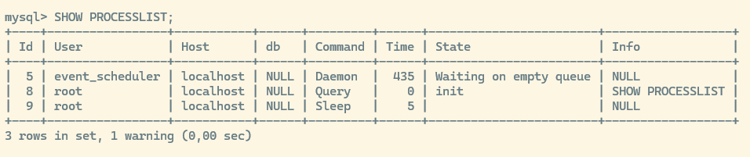

Ver el número total de conexiones activas:

``` sql
SHOW STATUS WHERE variable_name = 'Threads_connected';
```

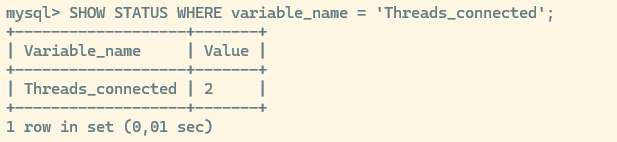

O desde la terminal de linux, sin entrar en mysql:

``` bash
bash mysqladmin -u root -p processlist
```

## Paso 2: Seleccionar la base de datos en ambas sesiones

``` sql
USE laboratorio_transacciones;
```

## Paso 3: Identificar las conexiones y su configuración

Ejecutar en ambas sesiones:

``` sql
SELECT 
    CONNECTION_ID() AS conexion,
    CURRENT_USER() AS cuenta_mysql,
    @@session.autocommit AS autocommit,
    @@session.transaction_isolation AS aislamiento;
```

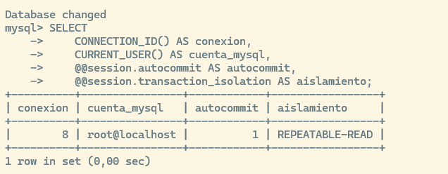

**Resultado esperado:** los identificadores de conexión serán diferentes, aunque la cuenta MySQL puede ser la misma.

::: nota
**Explicación:** cada transacción pertenece a una sesión. Una misma cuenta puede mantener transacciones independientes mediante conexiones distintas.
:::

## Paso 4: Comprobar el motor de las tablas en A

``` sql
SELECT TABLE_NAME, ENGINE
FROM information_schema.TABLES
WHERE TABLE_SCHEMA = DATABASE() 
  AND TABLE_NAME IN ('cuentas', 'productos');
```

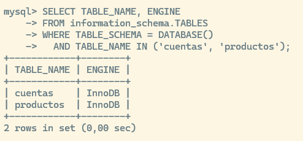

Ambas tablas deberán utilizar InnoDB para reproducir los comportamientos de la guía.

# Preparación común antes de cada ejercicio

::: nota-importante
Aplicar esta preparación antes de cada ejercicio. En el ejercicio 11, repetirla antes de cada una de las cuatro pruebas de aislamiento. No ejecutar la preparación entre los pasos de un mismo ejercicio ni antes de comprobar la durabilidad en la ultima comprobación.
:::

### Primero en ambas sesiones

``` sql
ROLLBACK;
SET SESSION autocommit = 1;
SET SESSION TRANSACTION ISOLATION LEVEL REPEATABLE READ;
SET SESSION innodb_lock_wait_timeout = 300;
```

::: nota
**Explicación de las instrucciones:**

\- `ROLLBACK` cancela los cambios pendientes de una prueba anterior.

\- `autocommit = 1` establece una configuración inicial conocida.

\- `REPEATABLE READ` establece el aislamiento utilizado, salvo que el ejercicio indique otro.

- `innodb_lock_wait_timeout = 300` concede hasta cinco minutos de espera para los bloqueos de fila. No es el límite de espera de los bloqueos explícitos de tabla.
:::

Si una sentencia ya está esperando, liberar primero el bloqueo desde la otra sesión. Antes de aplicar esta preparación, los bloqueos explícitos de tabla de una prueba anterior deberán haberse liberado con `UNLOCK TABLES`.

### Después solo en A

``` sql
UPDATE cuentas
SET saldo = CASE id_cuenta
    WHEN 1 THEN 1000.00
    WHEN 2 THEN 500.00
END
WHERE id_cuenta IN (1, 2);

UPDATE productos
SET 
    precio = CASE id_producto
        WHEN 1 THEN 20.00
        WHEN 2 THEN 30.00
        WHEN 3 THEN 40.00
    END,
    stock = CASE id_producto
        WHEN 1 THEN 1
        WHEN 2 THEN 10
        WHEN 3 THEN 5
    END
WHERE id_producto IN (1, 2, 3);

SELECT * FROM cuentas ORDER BY id_cuenta;
SELECT * FROM productos ORDER BY id_producto;
```

Estas instrucciones restablecen los registros existentes; no crean tablas ni insertan filas. Como `autocommit` está activado y no hay una transacción explícita, los cambios de preparación quedan confirmados.

::: nota
**Forma de trabajo:** ejecutar los pasos por orden. Cuando se indique que no se debe confirmar todavía, detener la ejecución y cambiar a la otra sesión. No pegar de una vez todos los bloques de un ejercicio que requiera alternar entre A y B.
:::

# Ejercicio 1. Comprobar qué significa autocommit

**Objetivo:** observar que un cambio puede quedar confirmado sin escribir `COMMIT`.

## Paso 1: Sesión A — Comprobar la configuración

``` sql
SELECT @@session.autocommit;
```

El resultado deberá ser `1`.

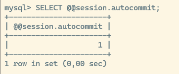

## Paso 2: Sesión A — Modificar un precio sin iniciar una transacción explícita

``` sql
UPDATE productos
SET precio = 25.00
WHERE id_producto = 1;
```

## Paso 3: Sesión B — Consultar el producto

``` sql
SELECT id_producto, precio
FROM productos
WHERE id_producto = 1;
```

**Resultado esperado:** precio `25.00`.


## Paso 4: Sesión A — Intentar deshacer el cambio

``` sql
ROLLBACK;
```

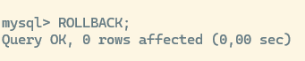

## Paso 5: Sesión B — Volver a consultar

``` sql
SELECT id_producto, precio
FROM productos
WHERE id_producto = 1;
```

El precio continúa en `25.00`.

::: nota
**Explicación:** el `UPDATE` quedó confirmado automáticamente. Un `ROLLBACK` posterior no recupera el valor anterior de una operación ya confirmada.
:::

**Pregunta de razonamiento:** ¿por qué escribir `ROLLBACK` después de cualquier modificación no garantiza que esa modificación se deshaga?

# Ejercicio 2. Iniciar y confirmar una transferencia

**Objetivo:** agrupar dos modificaciones que deben confirmarse conjuntamente.

## Paso 1: Sesión A — Iniciar la transacción

``` sql
START TRANSACTION;
```

Se establece una unidad de trabajo que incluirá el descuento en una cuenta y el ingreso en la otra. Aunque `@@session.autocommit` continúe mostrando `1`, los cambios de esta transacción explícita no se confirman después de cada `UPDATE`.

## Paso 2: Sesión A — Descontar 100 euros de Ana

Recordamos el balance de las cuentasantes de esta operación:

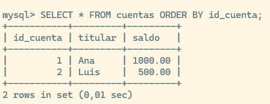

``` sql
UPDATE cuentas
SET saldo = saldo - 100.00
WHERE id_cuenta = 1;
```

## Paso 3: Sesión A — Consultar los saldos

``` sql
SELECT id_cuenta, titular, saldo
FROM cuentas
ORDER BY id_cuenta;
```

| Cuenta | Saldo visible en A |
|:-------|:-------------------|
| Ana    | 900.00             |
| Luis   | 500.00             |

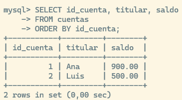

No ejecutar `COMMIT` todavía.

## Paso 4: Sesión B — Consultar los saldos

``` sql
SELECT id_cuenta, titular, saldo
FROM cuentas
ORDER BY id_cuenta;
```

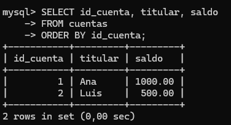

B verá `1000.00` y `500.00`. A ve su propia modificación pendiente; B consulta una versión confirmada disponible para su lectura.

## Paso 5: Sesión A — Ingresar los 100 euros en Luis

``` sql
UPDATE cuentas
SET saldo = saldo + 100.00
WHERE id_cuenta = 2;
```

Comprobar los saldos y su suma:

``` sql
SELECT id_cuenta, saldo
FROM cuentas
ORDER BY id_cuenta;

SELECT SUM(saldo) AS saldo_total
FROM cuentas;
```

A verá `900.00`, `600.00` y un total de `1500.00`.

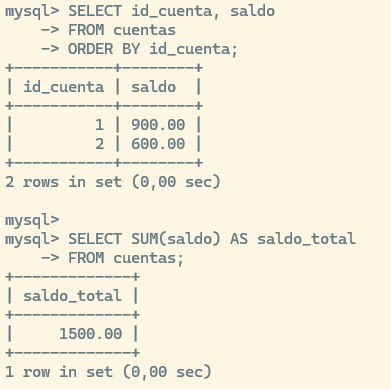

## Paso 6: Sesión A — Confirmar la operación

``` sql
COMMIT;
```

## Paso 7: Sesión B — Consultar de nuevo

``` sql
SELECT id_cuenta, titular, saldo
FROM cuentas
ORDER BY id_cuenta;
```

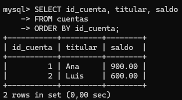

Ahora B verá `900.00` y `600.00`. `COMMIT` finaliza la transacción y confirma sus cambios.

## Paso 8: Sesión A — Intentar una reversión posterior

``` sql
ROLLBACK;

SELECT id_cuenta, saldo
FROM cuentas
ORDER BY id_cuenta;
```

Los saldos no cambian, porque la transferencia ya se había confirmado.

**Pregunta de razonamiento:** ¿por qué se necesita una transacción para esta transferencia si los dos `UPDATE` son correctos por separado?

# Ejercicio 3. Cancelar una transferencia con ROLLBACK

**Objetivo:** comprobar que pueden deshacerse varias operaciones conjuntamente.

## Paso 1: Sesión A — Iniciar otra transferencia

``` sql
START TRANSACTION;

UPDATE cuentas
SET saldo = saldo - 200.00
WHERE id_cuenta = 1;

UPDATE cuentas
SET saldo = saldo + 200.00
WHERE id_cuenta = 2;
```

## Paso 2: Sesión A — Consultar los saldos

``` sql
SELECT id_cuenta, saldo
FROM cuentas
ORDER BY id_cuenta;
```

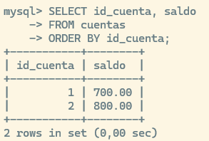

A verá `800.00` y `700.00`.

## Paso 3: Sesión B — Consultar los saldos

``` sql
SELECT id_cuenta, saldo
FROM cuentas
ORDER BY id_cuenta;
```

B seguirá viendo `1000.00` y `500.00`.

## Paso 4: Sesión A — Cancelar la transacción

``` sql
ROLLBACK;
```

## Paso 5: Ambas sesiones — Consultar de nuevo

``` sql
SELECT id_cuenta, saldo
FROM cuentas
ORDER BY id_cuenta;
```

Ambas verán `1000.00` y `500.00`.

::: nota
**Explicación:** se han deshecho los dos cambios de la transacción. No es necesario escribir una operación inversa para cada modificación.
:::

**Pregunta de razonamiento:** si la transferencia tuviera cinco modificaciones, ¿harían falta cinco instrucciones `ROLLBACK`?

# Ejercicio 4. Comprobar las reglas del negocio

**Objetivo:** descubrir que una sentencia puede ejecutarse correctamente sin realizar la operación esperada.

Antes de proceder con este ejercicio reiniciamos los datos como se explica en la sección "Preparación común antes de cada ejercicio"

## Paso 1: Sesión A — Iniciar una transferencia

``` sql
START TRANSACTION;

UPDATE cuentas
SET saldo = saldo - 100.00
WHERE id_cuenta = 1;
```

## Paso 2: Sesión A — Intentar ingresar el dinero en una cuenta inexistente

``` sql
UPDATE cuentas
SET saldo = saldo + 100.00
WHERE id_cuenta = 9999;
```


## Paso 3: Sesión A — Comprobar inmediatamente las filas afectadas

La función `ROW_COUNT()` de MySQL devuelve el número de filas afectadas por la **última sentencia SQL ejecutada dentro de la misma sesión**.

Cuando ejecutas un `SELECT`, la función `ROW_COUNT()` **no cuenta filas seleccionadas**, sino que devuelve `-1`

``` sql
SELECT ROW_COUNT() AS filas_afectadas;
```

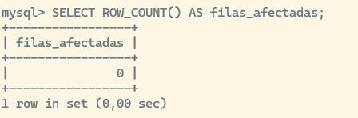

El resultado deberá ser `0`. El `UPDATE` es válido, pero no encuentra la cuenta de destino. No se produce un error SQL que automáticamente invalide la transferencia.

::: extra
`ROW_COUNT()`muestra resultados solo del **último comando**: Si necesitas guardar o procesar el valor devuelto por `ROW_COUNT()`, debes capturarlo en una variable inmediatamente después del `INSERT`, `UPDATE` o `DELETE`:

``` sql
UPDATE productos SET stock = stock - 1 WHERE id_producto = 1 AND stock > 0;
SET @filas_afectadas = ROW_COUNT();

-- Ahora puedes hacer consultas sin perder el valor guardado
SELECT @filas_afectadas;
```

**Para contar resultados de un `SELECT`:** Si lo que quieres es saber cuántas filas devolvió una consulta `SELECT`, debes usar la función `FOUND_ROWS()` (o `COUNT(*)`), no `ROW_COUNT()`.
:::

## Paso 4: Sesión A — Comprobar el saldo pendiente

``` sql
SELECT id_cuenta, saldo
FROM cuentas
ORDER BY id_cuenta;
```

Ana tiene `900.00` y Luis sigue con `500.00`.

## Paso 5: Sesión A — Cancelar la operación

``` sql
ROLLBACK;
```

::: nota
**Explicación:** como no se ha ingresado el dinero en una cuenta de destino, no debe confirmarse el descuento. La aplicación debe comprobar que las cuentas existen, que hay saldo suficiente y que se han realizado las operaciones previstas.
:::

::: nota-importante
**Importante:** `ROW_COUNT()` se consulta inmediatamente después de la sentencia que interesa. Si se ejecuta otra sentencia antes, el resultado ya puede corresponder a esa otra operación.
:::

**Pregunta de razonamiento:** ¿qué habría ocurrido si se hubiese ejecutado `COMMIT` sin comprobar la cuenta de destino?

# Ejercicio 5. Trabajar con autocommit desactivado

**Objetivo:** distinguir entre iniciar una transacción explícita y cambiar el comportamiento de la sesión.

## Paso 1: Sesión A — Desactivar autocommit

``` sql
SET SESSION autocommit = 0;
```

## Paso 2: Sesión A — Modificar el precio

``` sql
UPDATE productos
SET precio = 25.00
WHERE id_producto = 1;
```

## Paso 3: Sesión B — Consultar el precio

``` sql
SELECT precio
FROM productos
WHERE id_producto = 1;
```

B verá `20.00`.

## Paso 4: Sesión A — Confirmar el cambio

``` sql
COMMIT;
```

Al repetir su consulta, B verá `25.00`.

## Paso 5: Sesión A — Realizar otra modificación

``` sql
UPDATE productos
SET precio = 30.00
WHERE id_producto = 1;
```

## Paso 6: Sesión A — Cancelar la segunda modificación

``` sql
ROLLBACK;

SELECT precio
FROM productos
WHERE id_producto = 1;
```

El precio será `25.00`. El `COMMIT` anterior confirmó el primer cambio; el `ROLLBACK` posterior solo canceló el segundo.

## Paso 7: Sesión A — Comprobar que autocommit sigue desactivado

``` sql
SELECT @@session.autocommit;
```

El resultado será `0`. Finalizar una transacción no modifica esta configuración de la sesión.

## Paso 8: Sesión A — Observar una confirmación implícita

``` sql
UPDATE productos
SET precio = 35.00
WHERE id_producto = 1;
```

Sin ejecutar `COMMIT`, activar `autocommit` y después intentar cancelar:

``` sql
SET SESSION autocommit = 1;
ROLLBACK;
```

En B, consultar:

``` sql
SELECT precio
FROM productos
WHERE id_producto = 1;
```

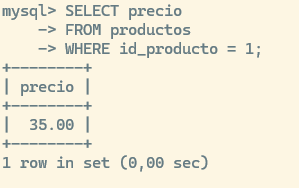

El precio será `35.00`.

::: nota
**Explicación:** cambiar `autocommit` de `0` a `1` confirma la transacción pendiente. Conviene decidir primero si se debe ejecutar `COMMIT` o `ROLLBACK` y después cambiar la configuración.
:::

**Pregunta de razonamiento:** ¿finalizar una transacción con `COMMIT` activa automáticamente `autocommit` cuando se había desactivado mediante `SET`?

# Ejercicio 6. Utilizar puntos de guardado

**Objetivo:** deshacer una parte del trabajo y conservar otra sin finalizar la transacción.

## Paso 1: Sesión A — Iniciar y modificar el precio

``` sql
START TRANSACTION;

UPDATE productos
SET precio = 25.00
WHERE id_producto = 1;
```

## Paso 2: Sesión A — Crear un punto de guardado

``` sql
SAVEPOINT precio_revisado;
```

Se marca el punto al que se podrá volver si las modificaciones posteriores no interesan.

## Paso 3: Sesión A — Realizar dos cambios posteriores

``` sql
UPDATE productos
SET precio = 30.00
WHERE id_producto = 1;

UPDATE productos
SET stock = 0
WHERE id_producto = 1;

SELECT precio, stock
FROM productos
WHERE id_producto = 1;
```

A verá precio `30.00` y stock `0`.

## Paso 4: Sesión A — Volver al punto de guardado

``` sql
ROLLBACK TO SAVEPOINT precio_revisado;

SELECT precio, stock
FROM productos
WHERE id_producto = 1;
```

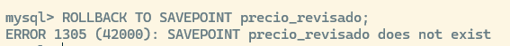

A verá precio `25.00` y stock `1`. Se conserva el cambio realizado antes del punto y se deshacen los dos posteriores.

## Paso 5: Sesión B — Consultar los valores

``` sql
SELECT precio, stock
FROM productos
WHERE id_producto = 1;
```


B verá precio `20.00` y stock `1`. Volver a un punto de guardado no confirma la transacción.

## Paso 6: Sesión A — Eliminar la marca

``` sql
RELEASE SAVEPOINT precio_revisado;
```

Esta instrucción no confirma ni deshace cambios; elimina la marca nombrada.

## Paso 7: Sesión A — Continuar trabajando

``` sql
UPDATE productos
SET stock = 0
WHERE id_producto = 1;
```

## Paso 8: Sesión A — Confirmar

``` sql
COMMIT;
```

Al repetir su consulta, B verá precio `25.00` y stock `0`.

## Paso 9: Sesión A — Intentar volver al punto eliminado

``` sql
ROLLBACK TO SAVEPOINT precio_revisado;
```


Se producirá un error indicando que el punto no existe. Los puntos de guardado pertenecen a la transacción y no son copias de seguridad. Una reversión parcial tampoco garantiza que se liberen todos los bloqueos adquiridos.

**Pregunta de razonamiento:** ¿qué resultado habría quedado si, en el paso 8, se hubiese ejecutado `ROLLBACK` en lugar de `COMMIT`?

# Ejercicio 7. Observar bloqueos de fila entre dos sesiones

**Objetivo:** comprobar que modificar una fila puede bloquear otra modificación sobre esa misma fila, sin impedir necesariamente trabajar con otra.

## Paso 1: Sesión A — Modificar el producto 1

``` sql
START TRANSACTION;

UPDATE productos
SET stock = stock - 1
WHERE id_producto = 1;
```

Mantener la transacción abierta sin confirmar.

## Paso 2: Sesión B — Consultar normalmente el producto 1

``` sql
SELECT id_producto, stock
FROM productos
WHERE id_producto = 1;
```

B verá stock `1` y la consulta terminará. Con el aislamiento utilizado, esta lectura normal consulta una versión confirmada del dato.

## Paso 3: Sesión B — Modificar otra fila

``` sql
START TRANSACTION;

UPDATE productos
SET stock = stock - 1
WHERE id_producto = 2;
```

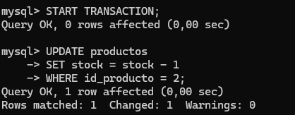

La sentencia termina porque trabaja con otra fila.

## Paso 4: Sesión B — Intentar modificar el producto 1

``` sql
UPDATE productos
SET stock = stock - 1
WHERE id_producto = 1;
```

**Resultado esperado:** B queda esperando. No introducir más instrucciones en B mientras espere.

## Paso 5: Sesión A — Cancelar y liberar el bloqueo

``` sql
ROLLBACK;
```

## Paso 6: Sesión B — Consultar después de finalizar el UPDATE pendiente

``` sql
SELECT id_producto, stock
FROM productos
WHERE id_producto IN (1, 2)
ORDER BY id_producto;
```

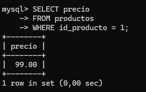

## Paso 7: Sesión B — Cancelar las modificaciones

``` sql
ROLLBACK;
```

Los valores confirmados vuelven a ser `1` y `10`.

::: nota
**Explicación:** se ha observado el bloqueo de un registro concreto, buscado por su clave primaria. En consultas por rangos o con otros accesos, el alcance puede ser mayor. No debe deducirse que cualquier `UPDATE` bloquea exactamente una fila.
:::

**Pregunta de razonamiento:** ¿por qué B pudo modificar el producto 2 y tuvo que esperar para modificar el producto 1?

# Ejercicio 8. Comparar bloqueos compartidos y exclusivos

**Objetivo:** observar la compatibilidad entre lecturas con bloqueo y modificaciones.

### Primera prueba: Dos bloqueos compartidos

## Paso 1: Sesión A — Solicitar un bloqueo compartido

``` sql
START TRANSACTION;

SELECT id_producto, stock
FROM productos
WHERE id_producto = 1
FOR SHARE;
```

## Paso 2: Sesión B — Solicitar otro bloqueo compartido

``` sql
START TRANSACTION;

SELECT id_producto, stock
FROM productos
WHERE id_producto = 1
FOR SHARE;
```

Ambas consultas terminan. Dos transacciones pueden mantener bloqueos compartidos compatibles sobre el mismo registro.

## Paso 3: Sesión B — Finalizar la lectura e intentar modificar

``` sql
ROLLBACK;

START TRANSACTION;

UPDATE productos
SET stock = 0
WHERE id_producto = 1;
```

El `UPDATE` espera porque A conserva su bloqueo compartido.

## Paso 4: Sesión A — Liberar el bloqueo

``` sql
ROLLBACK;
```

El `UPDATE` de B termina.

## Paso 5: Sesión B — Cancelar su modificación

``` sql
ROLLBACK;
```

### Segunda prueba: Bloqueo exclusivo mediante FOR UPDATE

## Paso 6: Sesión A — Solicitar un bloqueo exclusivo

``` sql
START TRANSACTION;

SELECT id_producto, stock
FROM productos
WHERE id_producto = 1
FOR UPDATE;
```

Todavía no se ha modificado el stock, pero se ha adquirido un bloqueo exclusivo.

## Paso 7: Sesión B — Ejecutar una consulta normal

``` sql
SELECT id_producto, stock
FROM productos
WHERE id_producto = 1;
```

La consulta termina.

## Paso 8: Sesión B — Solicitar una lectura compartida con bloqueo

``` sql
START TRANSACTION;

SELECT id_producto, stock
FROM productos
WHERE id_producto = 1
FOR SHARE;
```

Ahora B espera.

## Paso 9: Sesión A — Liberar el bloqueo y después finalizar B

En A:

``` sql
ROLLBACK;
```

Cuando la lectura de B termine, ejecutar en B:

``` sql
ROLLBACK;
```

Las lecturas `FOR SHARE` y `FOR UPDATE` protegen los datos dentro de una transacción. Una lectura consistente normal tiene un comportamiento diferente.

| Bloqueo mantenido por otra transacción | Solicitud compartida | Solicitud exclusiva |
|:-----------------------|:-----------------------|:-----------------------|
| **Compartido** | Compatible | Debe esperar |
| **Exclusivo** | Debe esperar | Debe esperar |

**Pregunta de razonamiento:** ¿por qué `FOR UPDATE` puede bloquear a otra sesión aunque todavía no se haya ejecutado ningún `UPDATE`?

# Ejercicio 9. Evitar vender dos veces la última unidad

**Objetivo:** combinar una transacción, un bloqueo y una condición de negocio.

## Paso 1: Sesión A — Intentar vender una unidad

``` sql
START TRANSACTION;

UPDATE productos
SET stock = stock - 1
WHERE id_producto = 1 
  AND stock > 0;

SELECT ROW_COUNT() AS productos_modificados;
```

El resultado deberá ser `1`. No confirmar todavía.

## Paso 2: Sesión B — Intentar vender el mismo producto

``` sql
START TRANSACTION;

UPDATE productos
SET stock = stock - 1
WHERE id_producto = 1 
  AND stock > 0;
```

B queda esperando.

## Paso 3: Sesión A — Confirmar la primera venta

``` sql
COMMIT;
```

## Paso 4: Sesión B — Consultar inmediatamente las filas afectadas

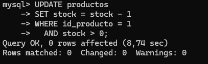

Cuando termine su `UPDATE`, ejecutar:

``` sql
SELECT ROW_COUNT() AS productos_modificados;
```

El resultado deberá ser `0`. Al continuar B, el stock ya es `0`; la condición `stock > 0` no se cumple y no se descuenta otra unidad.

## Paso 5: Sesión B — Cancelar el intento de venta

``` sql
ROLLBACK;
```

## Paso 6: Ambas sesiones — Consultar el stock

``` sql
SELECT id_producto, stock
FROM productos
WHERE id_producto = 1;
```

El stock confirmado es `0`.

::: nota
**Explicación:** consultar el stock y decidir mucho después permite que otra sesión lo modifique entre ambas operaciones. Aquí la comprobación y el descuento se realizan en el mismo `UPDATE`.
:::

**Pregunta de razonamiento:** si A hubiese ejecutado `ROLLBACK`, ¿cuántas filas habría modificado el `UPDATE` de B? Explicar el motivo.

# Ejercicio 10. Demostrar una actualización perdida

**Objetivo:** observar un error causado por guardar un valor calculado a partir de una lectura antigua.

Se utilizará el producto 2, cuyo stock inicial es 10.

## Paso 1: Ambas sesiones — Consultar el stock antes de modificarlo

``` sql
SELECT stock
FROM productos
WHERE id_producto = 2;
```

Ambas sesiones ven `10`. Cada empleado calcula que después de su venta deben quedar 9 unidades.

## Paso 2: Sesión A — Actualizar el stock

Basándonos en la lectura de stock del paso anterior queremos descontar una unidad, para eso actualizamos el stock a 9.

``` sql
UPDATE productos
SET stock = 9
WHERE id_producto = 2;
```

El cambio se confirma por `autocommit`.

## Paso 3: Sesión B — Actualizar también el stock

Basándonos en la lectura de stock que hicimos anteriormente queremos descontar una unidad, y actualizamos el stock a 9.

``` sql
UPDATE productos
SET stock = 9
WHERE id_producto = 2;
```

## Paso 4: Consultar el resultado

``` sql
SELECT stock
FROM productos
WHERE id_producto = 2;
```

El resultado es `9`, aunque se pretendían registrar dos ventas. B ha utilizado una lectura antigua y ha escrito un valor absoluto que no refleja las dos operaciones.

## Paso 5: Sesión A — Restablecer el stock del producto 2

``` sql
UPDATE productos
SET stock = 10
WHERE id_producto = 2;
```

## Paso 6: Sesión A — Registrar una venta mediante un descuento relativo

Para evitar este problema si queremos retirar una unidad de stock no lo hacemos actualizando el valor de forma absoluta después de hacer un select, sino que lo actualizamos de forma relativa al stock actual en el momento del update.

``` sql
UPDATE productos
SET stock = stock - 1
WHERE id_producto = 2 
  AND stock > 0;
```

## Paso 7: Sesión B — Registrar otra venta con la misma operación

``` sql
UPDATE productos
SET stock = stock - 1
WHERE id_producto = 2 
  AND stock > 0;
```

## Paso 8: Consultar el resultado

``` sql
SELECT stock
FROM productos
WHERE id_producto = 2;
```

El resultado es `8`.

**Pregunta de razonamiento:** ¿qué diferencia hay entre guardar 9 y restar 1 al valor que corresponda cuando se ejecute la operación?

# Ejercicio11. Comparar los cuatro niveles de aislamiento

**Objetivo:** observar qué datos puede leer una transacción mientras otra trabaja sobre ellos.

::: nota-importante
Las cuatro pruebas son independientes. Aplicar la preparación común antes de cada una. El nivel de aislamiento se configura antes de iniciar la transacción correspondiente.
:::

Para conocer nuestro estado actual de aislamiento:

``` sql
SELECT @@transaction_isolation;
```

## Prueba A: READ UNCOMMITTED

### Paso 1: Sesión B — Configurar el aislamiento e iniciar una transacción

``` sql
SET SESSION TRANSACTION ISOLATION LEVEL READ UNCOMMITTED;
START TRANSACTION;
```

comprobamos:

``` sql
SELECT 
    CONNECTION_ID() AS conexion,
    CURRENT_USER() AS cuenta_mysql,
    @@session.autocommit AS autocommit,
    @@session.transaction_isolation AS aislamiento;
```

### Paso 2: Sesión A — Modificar sin confirmar

``` sql
START TRANSACTION;

UPDATE productos
SET precio = 99.00
WHERE id_producto = 1;
```

### Paso 3: Sesión B — Consultar el precio

``` sql
SELECT precio
FROM productos
WHERE id_producto = 1;
```

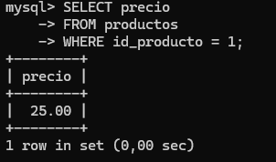

B verá `99.00` aunque la operación de UPDATE no se ha confirmado aún.

### Paso 4: Sesión A — Cancelar

``` sql
ROLLBACK;
```

### Paso 5: Sesión B — Repetir la consulta y finalizar

``` sql
SELECT precio
FROM productos
WHERE id_producto = 1;

ROLLBACK;
```

Ahora verá `20.00`. Se ha observado una **lectura sucia**: B utilizó un dato que nunca llegó a confirmarse.

## Prueba B: READ COMMITTED

### Paso 1: Sesión B — Configurar, iniciar y consultar

``` sql
SET SESSION TRANSACTION ISOLATION LEVEL READ COMMITTED;
START TRANSACTION;

SELECT precio
FROM productos
WHERE id_producto = 1;
```

El resultado será `20.00`.

### Paso 2: Sesión A — Cambiar y confirmar el precio

``` sql
START TRANSACTION;

UPDATE productos
SET precio = 25.00
WHERE id_producto = 1;

COMMIT;
```

### Paso 3: Sesión B — Volver a consultar sin finalizar su transacción

``` sql
SELECT precio
FROM productos
WHERE id_producto = 1;
```

El resultado será `25.00`. Finalizar B:

``` sql
ROLLBACK;
```

Se ha observado una **lectura no repetible**: la misma fila presenta valores distintos en dos consultas de una misma transacción.

## Prueba C: REPEATABLE READ

### Paso 1: Sesión B — Configurar, iniciar y consultar

``` sql
SET SESSION TRANSACTION ISOLATION LEVEL REPEATABLE READ;
START TRANSACTION;

SELECT precio
FROM productos
WHERE id_producto = 1;
```

El resultado será `20.00`. Esta primera lectura consistente establece la instantánea utilizada en la prueba.

### Paso 2: Sesión A — Modificar y confirmar

``` sql
START TRANSACTION;

UPDATE productos
SET precio = 25.00
WHERE id_producto = 1;

COMMIT;
```

### Paso 3: Sesión B — Repetir la consulta dentro de la misma transacción

``` sql
SELECT precio
FROM productos
WHERE id_producto = 1;
```

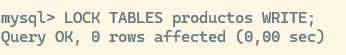

Continúa viendo `20.00`.

### Paso 4: Sesión B — Finalizar y consultar de nuevo

``` sql
COMMIT;

SELECT precio
FROM productos
WHERE id_producto = 1;
```


Ahora verá `25.00`.

::: nota
**Explicación:** `READ COMMITTED` utiliza una instantánea nueva en cada lectura consistente. `REPEATABLE READ` conserva la instantánea establecida dentro de la transacción. Este comportamiento no se debe trasladar automáticamente a un `UPDATE` o a una lectura con bloqueo.
:::

## Prueba D: SERIALIZABLE

### Paso 1: Sesión B — Configurar, iniciar y consultar

``` sql
SET SESSION TRANSACTION ISOLATION LEVEL SERIALIZABLE;
START TRANSACTION;

SELECT precio
FROM productos
WHERE id_producto = 1;
```

### Paso 2: Sesión A — Intentar modificar el precio

``` sql
START TRANSACTION;

UPDATE productos
SET precio = 25.00
WHERE id_producto = 1;
```

A queda esperando.

### Paso 3: Sesión B — Finalizar su transacción

``` sql
COMMIT;
```

A puede terminar su `UPDATE`.

### Paso 4: Sesión A — Cancelar el cambio

``` sql
ROLLBACK;
```

En esta transacción explícita con `SERIALIZABLE`, el `SELECT` de B se comporta como una lectura compartida con bloqueo.

## Comparación de lo observado

| Nivel | Resultado de la prueba |
|:-----------------------|:-----------------------------------------------|
| **READ UNCOMMITTED** | Se leyó un cambio pendiente que después se canceló. |
| **READ COMMITTED** | Una segunda lectura vio un cambio confirmado por otra sesión. |
| **REPEATABLE READ** | Las lecturas consistentes conservaron la instantánea. |
| **SERIALIZABLE** | La lectura dentro de la transacción impidió temporalmente una modificación concurrente. |

**Pregunta de razonamiento:** ¿por qué establecer más aislamiento puede aumentar las esperas entre sesiones?

# Ejercicio 12. Comparar un bloqueo de fila con uno de tabla

**Objetivo:** comprobar que la granularidad del bloqueo afecta a la concurrencia.

::: nota-importante
Esta demostración requiere el permiso `LOCK TABLES`. Podrá realizarla el docente si las cuentas de prácticas no disponen de dicho permiso.
:::

## Paso 1: Sesión A — Bloquear explícitamente la tabla

Con las pruebas anteriores finalizadas:

``` sql
SET SESSION autocommit = 0;
LOCK TABLES productos WRITE;
```


No ejecutar `START TRANSACTION` después de `LOCK TABLES`.

## Paso 2: Sesión B — Intentar consultar otro producto

``` sql
SELECT id_producto, stock
FROM productos
WHERE id_producto = 2;
```

B queda esperando. En la prueba de bloqueo de fila pudo trabajar con el producto 2; aquí incluso esa consulta espera porque está bloqueada toda la tabla.

## Paso 3: Sesión A — Liberar el bloqueo y restaurar autocommit

``` sql
UNLOCK TABLES;
SET SESSION autocommit = 1;
```

La consulta de B termina.

:::: nota
**Explicación:** `LOCK TABLES ... WRITE` impide el acceso de otras sesiones a esa tabla mientras se mantiene.

::: nota-importante
`LOCK TABLES` confirma implícitamente una transacción previa, y `START TRANSACTION` libera los bloqueos explícitos de tabla.
:::

Por eso esta demostración se realiza por separado y no se utiliza como paso obligatorio de las demás transacciones.
::::

**Pregunta de razonamiento:** ¿qué opción permite normalmente mayor concurrencia, bloquear un registro concreto o bloquear toda la tabla?

# Ejercicio 13. Provocar y reconocer un interbloqueo

**Objetivo:** distinguir una espera normal de una situación en la que dos transacciones se esperan mutuamente.

## Paso 1: Sesión A — Comprobar la detección de interbloqueos

``` sql
SELECT @@global.innodb_deadlock_detect;
```

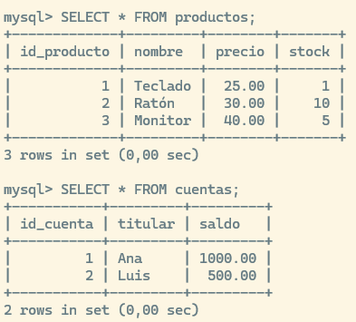

El resultado deberá ser `1`. Si está desactivada, el docente deberá adaptar la prueba.

## Paso 2: Sesión A — Modificar la cuenta 1

``` sql
START TRANSACTION;

UPDATE cuentas
SET saldo = saldo - 10.00
WHERE id_cuenta = 1;
```

A mantiene un bloqueo sobre la cuenta 1.

## Paso 3: Sesión B — Modificar la cuenta 2

``` sql
START TRANSACTION;

UPDATE cuentas
SET saldo = saldo - 20.00
WHERE id_cuenta = 2;
```

B mantiene un bloqueo sobre la cuenta 2.

## Paso 4: Sesión A — Intentar modificar la cuenta 2

``` sql
UPDATE cuentas
SET saldo = saldo + 10.00
WHERE id_cuenta = 2;
```

A queda esperando a B.

## Paso 5: Sesión B — Intentar modificar la cuenta 1

Sin dejar que se agote el tiempo de espera de A:

``` sql
UPDATE cuentas
SET saldo = saldo + 20.00
WHERE id_cuenta = 1;
```

A necesita un recurso bloqueado por B y B necesita otro bloqueado por A.

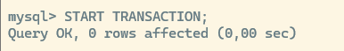

**Resultado esperado:** una de las sesiones recibirá el error `1213`, asociado a un interbloqueo. No se debe suponer de antemano cuál será la elegida. InnoDB cancela completamente una de las transacciones y permite que la otra continúe.

## Paso 6: Ambas sesiones — Cancelar cuando sus sentencias hayan terminado

``` sql
ROLLBACK;
```

Así se cancela también la transacción que haya continuado.

## Paso 7: Consultar los saldos

``` sql
SELECT id_cuenta, saldo
FROM cuentas
ORDER BY id_cuenta;
```

Los saldos deberán ser `1000.00` y `500.00`.

::: nota
**Explicación:** acceder a los recursos en el mismo orden, por ejemplo primero a la cuenta 1 y después a la 2, reduce la posibilidad de formar ciclos de espera. Ante un interbloqueo, la aplicación debe estar preparada para reintentar la transacción completa.
:::

**Pregunta de razonamiento:** ¿por qué aumentar el tiempo máximo de espera no resuelve por sí solo un interbloqueo?

# Ejercicio 14. Comprobar que un error no siempre cancela toda la transacción

**Objetivo:** evitar la idea de que cualquier error equivale automáticamente a un `ROLLBACK` completo.

## Paso 1: Sesión A — Realizar un cambio válido

``` sql
START TRANSACTION;

UPDATE productos
SET precio = 25.00
WHERE id_producto = 1;
```

## Paso 2: Sesión A — Ejecutar una sentencia incorrecta deliberadamente

``` sql
UPDATE productos
SET columna_inexistente = 100
WHERE id_producto = 1;
```

MySQL devolverá un error de columna desconocida.

## Paso 3: Sesión A — Consultar el precio

``` sql
SELECT precio
FROM productos
WHERE id_producto = 1;
```

A seguirá viendo 25.00.

## Paso 4: Sesión B — Consultar el precio en ambas sesiones

``` sql
SELECT precio
FROM productos
WHERE id_producto = 1;
```

B verá 20.00.

A verá 25.00. La sentencia incorrecta no se ejecutó, pero el cambio anterior sí, aunque continúa pendiente.

## Paso 5: Sesión A — Cancelar explícitamente

``` sql
ROLLBACK;
```

::: nota
**Explicación:** InnoDB trata los errores según su naturaleza. Un interbloqueo cancela la transacción completa. Un tiempo de espera de bloqueo agotado, con la configuración predeterminada, cancela la sentencia que esperaba, no necesariamente toda la transacción.
:::

**Pregunta de razonamiento:** ¿por qué una aplicación debe gestionar los errores y decidir qué hacer con la transacción?

# Ejercicio 15. Comprobar que las transacciones no se anidan

**Objetivo:** entender por qué otro `START TRANSACTION` no crea una transacción dentro de la primera.

## Paso 1: Sesión A — Iniciar y modificar

``` sql
START TRANSACTION;

UPDATE productos
SET precio = 25.00
WHERE id_producto = 1;
```

## Paso 2: Sesión A — Volver a iniciar una transacción

``` sql
START TRANSACTION;
```

## Paso 3: Sesión A — Cancelar

``` sql
ROLLBACK;
```

## Paso 4: Sesión B — Consultar el precio

``` sql
SELECT precio
FROM productos
WHERE id_producto = 1;
```

El precio será `25.00`.

::: nota
**Explicación:** el segundo `START TRANSACTION` confirmó implícitamente la transacción anterior antes de iniciar otra. El `ROLLBACK` posterior no deshace aquel cambio. Sentencias como `ALTER TABLE` o `TRUNCATE TABLE` también provocan confirmaciones implícitas; no deben introducirse suponiendo que después podrán deshacerse con `ROLLBACK`.
:::

**Pregunta de razonamiento:** ¿qué mecanismo permite marcar un punto intermedio dentro de una transacción sin iniciar otra?

# Ejercicio 16. Actividad final: Realizar una operación completa

**Objetivo:** aplicar los conocimientos sin disponer de todas las instrucciones resueltas.

::: nota-importante
Aplicar la preparación común antes de empezar.
:::

### Situación

1.  Transferir 150.00 euros de Ana a Luis.
2.  Crear un punto de guardado después de completar la transferencia.
3.  Cambiar el precio del teclado de 20.00 a 22.00.
4.  Registrar una venta descontando una unidad solo si existe stock.
5.  Cancelar los cambios del teclado y mantener la transferencia.
6.  Confirmar lo que queda pendiente.

## Paso 1: Consultar los datos iniciales

Anotar los saldos, el precio y el stock antes de comenzar.

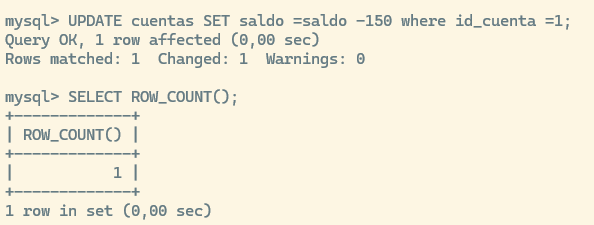

## Paso 2: Iniciar una transacción en A

Utilizar la instrucción adecuada para agrupar las operaciones.


## Paso 3: Realizar las dos modificaciones de la transferencia

Transferir 150.00 euros de Ana a Luis. Comprobar inmediatamente las filas afectadas después de cada `UPDATE`. Si una operación no modifica la cuenta prevista, no confirmar la transferencia.


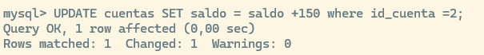

## Paso 4: Verificar la suma de los saldos


El total deberá continuar siendo `1500.00`.

## Paso 5: Crear un punto de guardado

Utilizar el nombre `transferencia_completa`.


## Paso 6: Modificar el precio y descontar el stock

Cambiar el precio del teclado a 22.00.

Registrar una venta descontando una unidad solo si existe stock.

Utilizar una condición que impida vender si no quedan unidades.

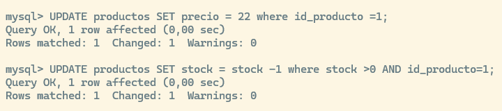

## Paso 7: Consultar en A y en B antes de confirmar

Explicar por qué los resultados son distintos.

## Paso 8: Volver al punto transferencia_completa

Utilizar una reversión parcial.

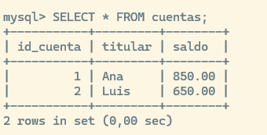

## Paso 9: Comprobar qué cambios permanecen dentro de A

Verificar que se conserva la transferencia y se han deshecho las modificaciones del teclado.

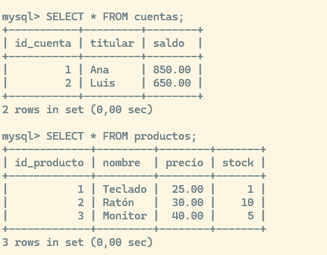

## Paso 10: Confirmar la transacción y consultar desde B

| Dato                   | Resultado final esperado |
|:-----------------------|:-------------------------|
| **Saldo de Ana**       | 850.00                   |
| **Saldo de Luis**      | 650.00                   |
| **Total de saldos**    | 1500.00                  |
| **Precio del teclado** | 20.00                    |
| **Stock del teclado**  | 1                        |

::: nota


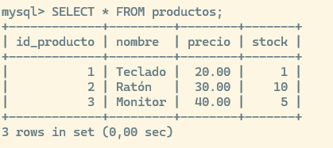

**Justificación que debe entregar el estudiante:** explicar por qué quedó confirmada la transferencia y no las modificaciones del teclado.
:::

# Ejercicio 17. Relacionar la práctica con ACID

| Propiedad | Relación con lo practicado |
|:-------------------|:---------------------------------------------------|
| **Atomicidad** | La transferencia puede confirmarse o cancelarse como una unidad. |
| **Consistencia** | Se comprueban reglas del negocio, como conservar el total transferido y no vender sin stock. |
| **Aislamiento** | Se observa qué datos ve cada sesión y cuándo una operación debe esperar. |
| **Durabilidad** | Los cambios confirmados permanecen disponibles después de finalizar la conexión. |

## Comprobación de la persistencia tras cerrar el cliente

Después de confirmar la actividad final y sin restablecer los datos:

1.  Cerrar B mediante `exit`.
2.  Abrir una nueva conexión.
3.  Seleccionar `laboratorio_transacciones`.
4.  Consultar los saldos de las cuentas.

Los saldos deberán continuar siendo `850.00` y `650.00`. Esta comprobación demuestra que los cambios sobreviven al cierre del cliente. No constituye una prueba de recuperación frente a un fallo eléctrico o de almacenamiento.

# Cierre y evidencias de la práctica

Al finalizar, ejecutar en ambas sesiones:

``` sql
ROLLBACK;
SET SESSION autocommit = 1;
SET SESSION TRANSACTION ISOLATION LEVEL REPEATABLE READ;
```

Si se han utilizado bloqueos explícitos de tabla, deberán haberse liberado mediante `UNLOCK TABLES`. Los cambios de configuración realizados con `SET SESSION` no modifican el valor global del servidor y dejan de aplicarse al cerrar la conexión.

## Evidencias que debe entregar cada estudiante

- Identificadores de las sesiones A y B.
- Un cambio pendiente visible en A y todavía no visible en B.
- Confirmación de una operación mediante `COMMIT`.
- Cancelación de una operación mediante `ROLLBACK`.
- Reversión parcial mediante `SAVEPOINT`.
- Explicación de un bloqueo observado.
- Comparación entre `READ COMMITTED` y `REPEATABLE READ`.
- Resultado y justificación de la actividad final.

Para cada evidencia, indicar qué se ejecutó, qué se observó y por qué ocurrió.

## Documentación de consulta

Las referencias siguientes corresponden al manual oficial de MySQL 8.4 y permiten ampliar los conceptos utilizados en la práctica.

- Autocommit, COMMIT y ROLLBACK
- Lecturas con bloqueo
- Tipos de bloqueo en InnoDB
- Puntos de guardado
- Niveles de aislamiento
- Lecturas consistentes
- Bloqueos explícitos de tabla
- Ejemplo de interbloqueo
- Gestión de errores
- Confirmaciones implícitas

------------------------------------------------------------------------

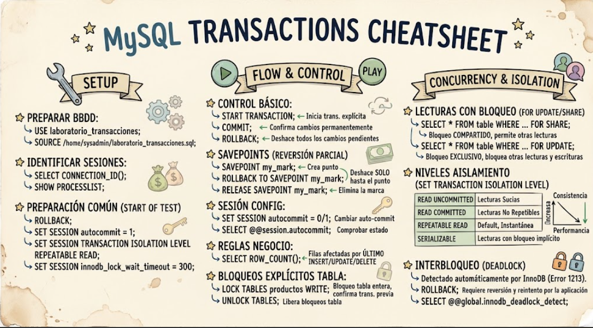