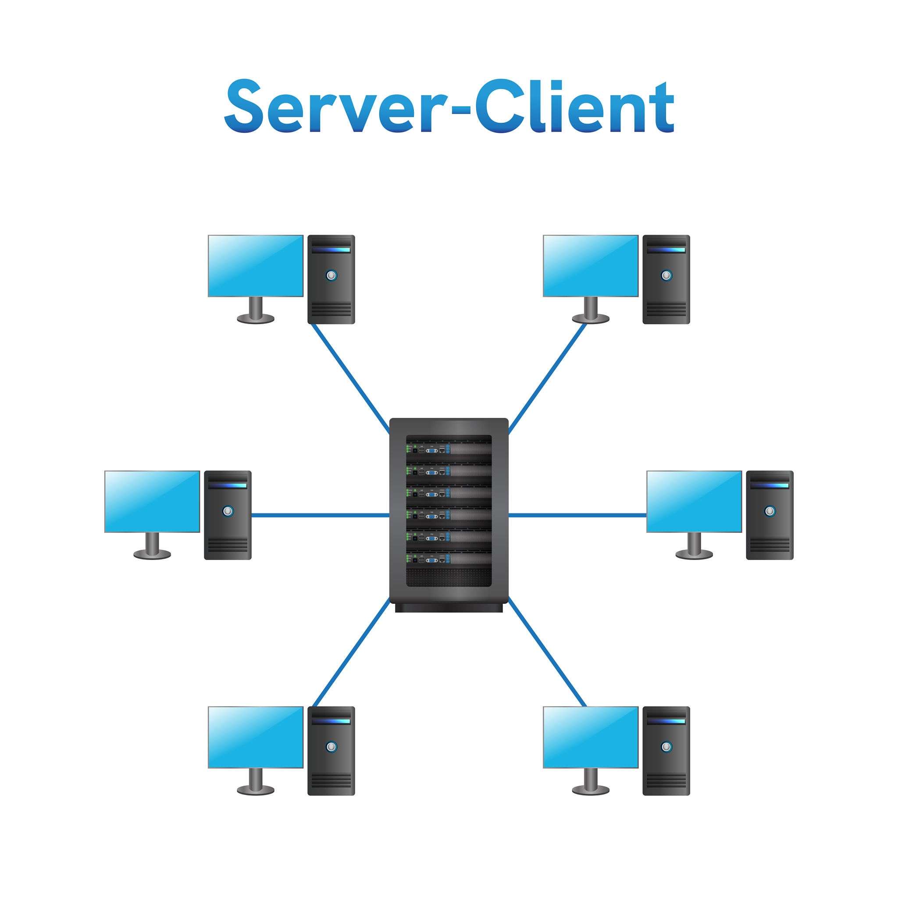
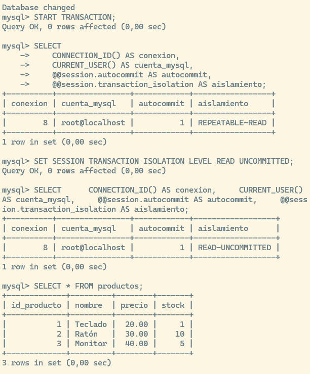

# Arquitectura Cliente - Servidor en SGBD

Esta lección teórica va acompañada de las prácicas: [Práctica guiada: Instalación de MySQL 8.4 en Ubuntu Server 26.04](mysqlubuntu.html) y [Práctica guiada: Aplicación web con MySQL y PHP](practica_guiada_aplicaci_n_web_mysql_php.html)

En los Sistemas de Gestión de Bases de Datos Relacionales (SGBDR), el software no se ejecuta como una aplicación aislada de un solo bloque, sino bajo una **arquitectura distribuida cliente-servidor**

{width="424"}

## El Servidor de Base de Datos (*Database Engine / Daemon*)

- Es el proceso o servicio que se ejecuta continuamente en segundo plano (ejemplo: `mysqld` en Linux).

- Administra el almacenamiento físico en disco, la concurrencia de accesos, las transacciones, los permisos de seguridad y el procesamiento de sentencias SQL.

- Requiere un equipo o sistema operativo activo para escuchar y responder a peticiones de red.

## El Cliente de Base de Datos

- Es la herramienta o programa que envía instrucciones SQL al servidor a través de la red y recibe los resultados estructurados.

- **Tipos de clientes más habituales:**

  1.  **Clientes CLI (Línea de comandos):** `mysql`, `mysqlsh`.

  2.  **Interfaces Gráficas (GUI):** DBeaver, MySQL Workbench, phpMyAdmin.

  3.  **Aplicaciones o conectores de código:** Scripts y programas en PHP (PDO), Python (mysql-connector), Java (JDBC) o Node.js.

### Aclaración Clave: El cliente y el servidor en la misma máquina

Estar en el mismo equipo **no elimina la relación cliente-servidor**. Cuando instalamos un servidor en Linux y ejecutamos en la consola `sudo mysql` o `mysql -u root -p`, estamos arrancando un **programa cliente** que se conecta al **servicio servidor** (`mysqld`).

Aunque no haya un cable de red de por medio, ambos programas son procesos independientes que se comunican internamente mediante la red local de *loopback* (`127.0.0.1`) o mediante un archivo de *socket* UNIX.

#### El cliente avanzado: MySQL Shell (`mysqlsh`)

Además del cliente clásico de línea de comandos (`mysql`), MySQL incluye **MySQL Shell (`mysqlsh`)**, una aplicación cliente avanzada y moderna de interfaz de línea de comandos.

- **Instalación independiente:** Al igual que cualquier otro cliente, `mysqlsh` **no viene incluido en el servidor por defecto** y debe instalarse de forma explícita en la máquina (equipo cliente) desde la cual el administrador o desarrollador se va a conectar al servidor de bases de datos.
- **Modos de trabajo:** Permite trabajar de manera interactiva utilizando SQL, pero también soporta lenguajes de scripting como **JavaScript** y **Python**, y es la herramienta estándar para la administración de arquitecturas avanzadas como *MySQL InnoDB Cluster*.

#### Requisitos y configuración para la conexión remota con clientes CLI (`mysql` o `mysqlsh`)

Para que una máquina cliente pueda conectarse con éxito a un servidor remoto utilizando herramientas como `mysql` o `mysqlsh`, se deben cumplir y configurar los siguientes aspectos previos:

1.  **Autorización del Host en la cuenta (`'usuario'@'host'`):** Como se detalla en el principio de bidimensionalidad de usuarios, el usuario con el que intentemos conectar **debe estar creado expresamente con el Host autorizado** coincidiendo con la IP de la máquina cliente (o un comodín/subred válido), y no solo para `localhost`.

2.  **Configuración de red del servidor (`bind-address`):** Por defecto, muchos servidores vienen configurados para escuchar solo peticiones locales (`127.0.0.1`). Para aceptar conexiones desde fuera, el parámetro `bind-address` en el archivo de configuración del servidor (`mysqld.cnf`) debe permitir la IP de la red o configurarse como `0.0.0.0` (todas las interfaces). [en la práctica Instalando y Configurando MySQL en Ubuntu vemos cómo hacerlo en la práctica](mysqlubuntu.html#configurar-mysql-para-aceptar-conexiones-desde-la-red)

3.  **Apertura de Puertos (Firewall / Red):** El puerto de servicio de MySQL (**TCP 3306**) debe estar abierto y accesible a través de la red (red local o VPN) entre ambas máquinas, asegurándose de que los cortafuegos (*firewalls* como `ufw` en Ubuntu) no bloqueen el tráfico entrante a dicho puerto.

#### Ejemplos de uso de `mysqlsh`

- **Entrando por defecto:** Si ejecutas mysqlsh a secas (o solo con el usuario/host):

  ``` bash
  mysqlsh -u root -p
  ```

  Por defecto, `mysqlsh` arranca en modo JavaScript (el prompt cambiará a algo como JS\>). Una vez dentro, para poder lanzar consultas de bases de datos, tienes que escribir el comando de cambio de modo: `\sql`

  ``` javascript
  JS> \sql
  ```

  A partir de ahí, la consola cambia a modo SQL (SQL\>).

Iniciar directamente la herramienta indicándolo mediante `--sql`:

- **Conexión local básica (modo SQL directo):**

  ``` bash
  mysqlsh --sql -u root -p
  ```

- **Conexión remota especificando el host (-h o --host), usuario y puerto:** `bash   mysqlsh --sql -h 192.168.1.50 -P 3306 -u museo_app -p` (Donde -P en mayúsculas indica el puerto TCP si es diferente al predeterminado).

- **Conexión mediante URI (Connection String):** Una de las ventajas de mysqlsh es permitir conexiones limpias mediante cadenas URI:

  ``` bash
  mysqlsh museo_app@192.168.1.50:3306 --sql
  ```

### La Arquitectura Multicapa en Aplicaciones Web

Cuando introducimos un servidor web (Apache2) y un lenguaje de programación (PHP), el cliente del SGBD ya no es el navegador del usuario final, sino la propia aplicación PHP.

```         
[ Navegador Cliente ]
         |
         | (Petición HTTP / Port 80)
         v
[ Servidor Web: Apache2 ]
         |
         | (Ejecución del script)
         v
[ Lenguaje: PHP (Módulo PDO) ]  <-- Funciona como CLIENTE de MySQL
         |
         | (Protocolo MySQL / TCP 3306 ó Socket)
         v
[ Servidor SGBD: MySQL 8.4 (mysqld) ]
         |
         v
[ Disco / Base de Datos: 'museo' ]
```

🔗 **Enlace a la Práctica:** Puedes consultar la implementación real de esta arquitectura multicapa y el flujo completo de datos de un formulario en la sección **"[Idea general y arquitectura](practica_guiada_aplicaci_n_web_mysql_php.html#Idea-general-y-arquitectura)"** de la *Práctica Guiada: Aplicación web con Apache2, PHP y MySQL*.

# Instalación Inicial, Usuarios por Defecto y Primer Acceso

Al instalar MySQL 8.4 por primera vez en un sistema operativo como Ubuntu Server, el proceso de instalación crea de forma automática una cuenta de administración por defecto:

## El Usuario Administrador por Defecto (`root`)

- **Identidad:** `'root'@'localhost'`.

- **Método de Autenticación (`auth_socket`):** Por defecto en Ubuntu, la cuenta `root` de MySQL no utiliza contraseña al principio, sino el plugin `auth_socket`. Este plugin delega la autenticación en el propio sistema operativo: solo el usuario root del sistema de archivos (o alguien que ejecute `sudo`) puede entrar al cliente de MySQL ejecutando únicamente:

``` bash
sudo mysql
```

Esto conectará el usuario root desde localhost al cliente de mysql que está dentro del servidor.

- **Rol en el sistema:** Es el superusuario con todos los privilegios (`ALL PRIVILEGES`) sobre todo el motor.

## Flujo habitual de administración:

1.  **Paso 1:** Se instala el servidor de base de datos (`sudo apt install mysql-server`).

2.  **Paso 2:** Se accede al servidor utilizando el cliente CLI con elevación de privilegios (`sudo mysql`).

3.  **Paso 3:** Desde el cliente, el administrador crea la estructura de la base de datos y define **nuevos usuarios específicos** limitados para las aplicaciones finales.

# Introducción a Usuarios, Host y Seguridad {#permisosIntro}

A diferencia de los sistemas operativos tradicionales, donde un usuario se identifica únicamente por su nombre, en motores como MySQL la identidad de una cuenta es **bidimensional**:

$$\text{Cuenta} = \text{'Usuario'}@\text{'Host'}$$

| Componente | Definición | Ejemplo |
|:-----------------------|:-----------------------|:-----------------------|
| **Usuario** | Nombre de la cuenta o aplicación. | `'root'`, `'museo_app'` |
| **Host** | La dirección IP o interfaz desde la cual tiene permitido conectar. | `'localhost'`, `'127.0.0.1'`, `'192.168.1.50'`, `'%'` |

: Componentes de autenticación de usuarios en SQL

## Los tipos de Host más comunes

- `'localhost'`: Permite el acceso únicamente desde el propio equipo mediante el archivo de socket UNIX local.

- `'127.0.0.1'`: Obliga a realizar la conexión mediante la interfaz TCP/IP de *loopback* local.

- `'192.168.X.X'`: Restringe la autenticación a una máquina específica de la red local.

- `'%'`: Comodín (*wildcard*) que permite al usuario conectarse desde cualquier dirección IP remota.

## El Principio de Mínimo Privilegio (*Least Privilege*)

Nunca se deben utilizar las credenciales del usuario `root` para conectar una aplicación web (PHP, Python, Java) a la base de datos. Si un atacante lograra explotar una vulnerabilidad en la aplicación web, obtendría control total sobre todo el motor de bases de datos.

Lo correcto es crear un usuario dedicado para la aplicación, restringido a su IP de origen y con permisos (*Grants*) estrictamente limitados a las operaciones requeridas.

> 🔗 **Enlace a la Práctica:** En la sección **"[Crear un usuario específico para la aplicación](practica_sql_base_de_datos_con_carga_de_datos_desde_csv.html#crear-usuario-administrador-espec%C3%ADfico)"** de la práctica guiada, se muestra el ejemplo práctico de cómo crear el usuario `'museo_app'@'127.0.0.1'` con contraseña y cómo limitarle los permisos otorgando únicamente las operaciones `SELECT` e `INSERT` sobre la tabla `Objetos`:
>
> ``` sql
> CREATE USER 'museo_app'@'127.0.0.1' IDENTIFIED BY 'ContraseñaSegura';
> GRANT SELECT, INSERT ON museo.Objetos TO 'museo_app'@'127.0.0.1';
> ```

Para interactuar con la base de datos con el nuevo usuario:

``` bash
mysql -u museo_app -p
```

donde `-u` significa usuario y `-p` indica que se autentica por password.

Como solo le hemos dado a este usuario acceso desde la dirección lookback, sólo podremos conectarnos desde el servidor. Si estamos en otra máquina, primero tendremos que conectarnos al servidor mediante SSH para poder usar ese usuario.

Si creamos un usuario con acceso desde cualquier dirección de la red 10.0.20.0/24:

``` sql
CREATE USER 'museo_app'@'10.0.20.0/24' IDENTIFIED BY 'mypassword_here';
GRANT SELECT, INSERT ON museo.Objetos TO 'museo_app'@'10.0.20.0/24';
```

Esta instrucción crea una nueva cuenta de usuario en el servidor de bases de datos. Sus componentes son:

- `CREATE USER`: Es la orden principal de SQL para dar de alta una nueva identidad en el sistema de seguridad de MySQL.

- `'museo_app'` (El Usuario): Es el nombre con el que se identificará la cuenta o aplicación que va a conectarse.

- `'10.0.20.0/24'` Define la subred de origen permitida. Mediante notación CIDR (/24), se indica que este usuario exclusivamente podrá intentar conectarse desde cualquier dirección IP comprendida en el rango de la red local 10.0.20.1 hasta la 10.0.20.254. Si se intentara conectar desde fuera de esta subred, el servidor rechazaría la conexión de inmediato, incluso sabiendo la contraseña.

- IDENTIFIED BY: Es la cláusula que indica que la autenticación se realizará mediante una contraseña tradicional de texto (que luego el motor encripta internamente).

- ***'**mypassword_here**'***: Es la contraseña que la aplicación o el usuario deberá proporcionar obligatoriamente al autenticarse.

- **`GRANT`**: Es la orden SQL utilizada para conceder permisos o privilegios (*privileges*) a una cuenta de usuario.

- **`SELECT, INSERT` (Los Privilegios):**

  - `SELECT`: Permite consultar/leer registros de la tabla (equivalente a operaciones de lectura o búsquedas).

  - `INSERT`: Permite añadir nuevos registros o filas a la tabla (equivalente a operaciones de creación o guardado).

  - *(Nota: Al separar por comas, se le están concediendo exclusivamente estos dos permisos y se le niegan por completo otros como `UPDATE`, `DELETE` o permisos administrativos, cumpliendo estrictamente el principio de mínimo privilegio).*

- **`ON museo.Objetos` (El Objeto de la base de datos):** Especifica el ámbito exacto sobre el que aplican los permisos anteriores. En este caso, se restringen únicamente a la tabla `Objetos` que se encuentra dentro de la base de datos `museo`. No tiene acceso a ninguna otra tabla ni base de datos del servidor.

- **`TO`**: Cláusula que indica a qué usuario van destinados esos privilegios.

- **`'museo_app'@'10.0.20.0/24'` :** El Usuario y Host de origen (ip desde la que se conecta)Identifica de forma unívoca a la cuenta receptora de los permisos.

Ahora podremos usar el CLI en la máquina del usuario para conectarnos a la base de datos:

``` bash
mysql -h 10.0.20.101 -u museo_app -p
```

donde `-h` significa host y a continuación ponemos la ip del servidor al que nos estamos conectando.

::: nota
Es importante notar que si hacemos exactamente esto y creamos dos usuarios con el mismo nombre de usuario pero distinta dirección de conexión, actúan como usuarios totalmente distintos, con privilegios distintos.
:::

## El plugin de autenticación por defecto en MySQL 8.4 (`caching_sha256_password`)

A diferencia de versiones anteriores de MySQL (donde el método clásico por defecto era `mysql_native_password`), **MySQL 8.4** utiliza por defecto **`caching_sha256_password`** para la autenticación de usuarios basada en contraseña.

- **¿Por qué importa?** Este plugin ofrece un nivel de seguridad criptográfica muy superior (basado en SHA-256 con caché de claves), pero puede generar incompatibilidades si intentas conectar aplicaciones con librerías, conectores de PHP/PDO, Python o Java que estén desactualizados.
- **El error típico:** Si el cliente no soporta este mecanismo de forma nativa, la conexión fallará arrojando un error del tipo: `The server requested authentication method unknown to the client`.

### Forzar compatibilidad con clientes antiguos (si fuera necesario)

Si en algún escenario de prácticas o entorno heredado necesitas que un usuario utilice el método clásico compatible con cualquier conector antiguo, puedes indicarlo explícitamente al crearlo:

``` sql
CREATE USER 'museo_app'@'192.168.1.50' IDENTIFIED WITH mysql_native_password BY 'ContraseñaSegura';
```

# Interfaces de Escucha y Red (`bind-address` y Puertos)

Para poder acceder a un servidor de base de datos desde otra máquina, no basta con configurar el usuario, el motor debe estar **escuchando** en la interfaz de red correcta y en el puerto adecuado.

El parámetro bind-address configura la IP propia del servidor (el equipo donde corre la base de datos), no el rango de IPs de los clientes.

Cómo funciona exactamente: - El Servidor (bind-address): Le dices al servicio de base de datos que abra el puerto únicamente en la tarjeta de red que tiene la IP de tu servidor en esa red local (por ejemplo, 10.0.20.50).

- Los Clientes (10.0.20.0/24): Como el servidor está escuchando en esa IP, cualquier equipo que esté dentro de ese rango de la red local podrá enviar paquetes a esa dirección y llegar al puerto.

Para que el servidor acepte o rechace conexiones de red, entran en juego los parámetros del protocolo TCP/IP:

- **Puerto de Servicio:** Punto lógico de comunicación. Por defecto, MySQL escucha en el puerto **TCP 3306**.

- **Dirección de Escucha (`bind-address`):** Indica qué tarjetas de red o interfaces del servidor procesarán tráfico entrante:

  - `127.0.0.1` (**Loopback**): El servidor ignora las peticiones que vengan del exterior y solo escucha las internas de la propia máquina. Esta es la configuración predeterminada en Ubuntu Server.

  - `0.0.0.0` (**Todas las interfaces**): Permite recibir peticiones procedentes de cualquier tarjeta de red o IP pública/privada configurada.

  - `10.0.20.50` (**IP específica**): Permite conexiones desde la red local, en este ejemplo 10.0.20.0/24. Bind-address No acepta rangos con barra (/24), solo IPs individuales de la propia máquina. El servidor escucha en una IP específica, limitando las conexiones a aquellas que lleguen a esa dirección concreta, aunque el cliente puede estar en cualquier otra IP de la red local.

  - **Múltiples Direcciones o Redes**: Algunos sistemas gestores permiten enlazar a más de una interfaz de red explícitamente para aislar el tráfico. bind-address = 127.0.0.1, 10.0.20.50 MySQL en versiones antiguas no permite configurar varias direcciones de escucha en el mismo archivo de configuración. Si se requiere que el servidor escuche en varias interfaces, se debe configurar un **proxy inverso** o un **firewall** que redirija el tráfico a la IP del servidor.

  - **Redes Particulares y VPNs (Entornos Empresariales / Cloud)** : Si estás utilizando redes privadas virtuales o túneles seguros (como WireGuard, OpenVPN o VPCs en la nube), el bind-address se vincula a la IP del adaptador virtual. Ejemplo con interfaz VPN (ej. 10.8.0.1 o 172.16.0.x):

  ```         
  bind-address = 10.8.0.1
  ```

  ::: nota
  **La diferencia clave para no confundirse**

  - bind-address (Servidor): Define dónde se abre el servicio (en qué IP de la máquina propia). No acepta rangos con barra (/24), solo IPs individuales de la propia máquina (o 0.0.0.0 para todas).

  - Control de acceso de Clientes (Host): Es donde sí usas el rango o comodines para decir quién puede entrar (por ejemplo, configurando al usuario con el host '10.0.20.%').
  :::

::: extra
Seguridad en las Conexiones Remotas (Cifrado SSL/TLS)

Cuando configuras accesos remotos mediante IP (permitiendo que un cliente se conecte desde otra máquina de la red local), **todo el tráfico de red viaja en texto plano de forma predeterminada**. Esto incluye las credenciales de autenticación y los datos transmitidos, lo que expone el sistema a posibles ataques de escucha en la red (*sniffing*).

### Consideraciones clave:

- **Cifrado nativo en MySQL 8.4:** Las versiones modernas de MySQL generan certificados SSL/TLS autofirmados automáticamente durante la instalación inicial, por lo que el servidor está preparado para aceptar canales cifrados sin requerir configuraciones complejas adicionales de certificados manuales.

- **Forzar el uso de SSL por usuario:** Si deseas garantizar que un usuario remoto específico nunca pueda conectarse a través de una red abierta sin cifrado, puedes exigirlo explícitamente al crearlo o modificarlo mediante la cláusula `REQUIRE SSL`:

  ``` sql
  CREATE USER 'museo_app'@'192.168.1.50' IDENTIFIED BY 'ContraseñaSegura' REQUIRE SSL;
  ```

  Modos habituales: `PREFERRED` intenta cifrar si el servidor lo soporta, mientras que `REQUIRED` exige obligatoriamente que el canal esté cifrado o abortará la conexión)

  **Conexión segura desde el cliente:** Al conectarse utilizando el cliente de línea de comandos, puedes forzar el uso del canal seguro mediante el parámetro `--ssl-mode`:

  ``` bash
  mysql --ssl-mode=REQUIRED -h 192.168.1.50 -u museo_app -p
  ```
:::

# Archivos de Configuración y Protección de Credenciales

Un SGBD y sus aplicaciones asociadas utilizan archivos de texto plano para ajustar sus parámetros.

## Configuración del Servidor SGBD

- En sistemas Linux/Ubuntu, los archivos de configuración se estructuran modularmente en `/etc/mysql/` (por ejemplo, `mysqld.cnf`).

- Cualquier modificación en estos archivos requiere reiniciar el demonio (`sudo systemctl restart mysql`) para aplicar los cambios.

## Configuración de la Aplicación y Seguridad en el Sistema de Archivos

Cuando un script de backend (como PHP) necesita guardar la contraseña de la base de datos, el archivo de configuración nunca debe alojarse en la carpeta pública del servidor web (como `/var/www/html/`). Si el motor de PHP fallase o fuera malconfigurado, Apache podría servir la contraseña como texto plano a cualquier visitante en Internet.

Por ello, se utiliza la regla de **almacenamiento externo y permisos octales reducidos** en Linux:

1.  Guardar el archivo en `/etc/` (ejemplo: `/etc/museo/config.php`).

2.  Asignar la propiedad a `root` y al grupo del servidor web (`www-data`).

3.  Aplicar permisos de lectura estricta (`chmod 640`):

    - **Propietario (`root` - 6):** Lectura y escritura.

    - **Grupo (`www-data` - 4):** Solo lectura (para que el servidor web pueda ejecutar la conexión).

    - **Otros (0):** Sin ningún tipo de acceso.

> 🔗 **Enlace a la Práctica:** Consulta el apartado **"[Crear la conexión con MySQL mediante PDO](practica_guiada_aplicaci_n_web_mysql_php.html#crear-la-conexi%C3%B3n-con-mysql-mediante-pdo)"** de la práctica para ver la aplicación técnica de `chown root:www-data` y `chmod 640` sobre el archivo de credenciales.

::: extra
# Herramientas de Diagnóstico Rápido y Monitorización de Accesos

Una vez configurados los usuarios y la red, como administrador necesitarás comprobar rápidamente si el servicio responde o quién está conectado sin necesidad de iniciar sesión completa en la consola interactiva de SQL.

### Diagnóstico del sistema con `mysqladmin`

Desde la línea de comandos de tu sistema operativo (Ubuntu), puedes utilizar la utilidad `mysqladmin` para comprobar el estado del demonio:

- **Comprobar si el servidor está activo y responde:**

  ``` bash
  sudo mysqladmin ping
  ```

(Si el servicio está operativo, devolverá un mensaje indicando que `mysqld is alive`).

- Consultar el estado general y conexiones activas:

  ``` bash
  sudo mysqladmin -u root -p status
  ```
:::

# Estructura Interna: Bases de Datos de Sistema y de Usuario

Al instalar el motor, este crea de forma automática un catálogo del sistema con metadatos indispensables para su funcionamiento:

## Esquemas del Sistema

- `mysql`: Contiene las tablas internas del motor, como `mysql.user` (donde se guardan los usuarios, sus contraseñas encriptadas y sus permisos globales).

- `information_schema` y `performance_schema`: Vistas de solo lectura con metadatos sobre la estructura de tablas, tipos de datos, índices y métricas de rendimiento en tiempo real.

## Esquemas de Usuario

Son las bases de datos creadas explícitamente para almacenar los datos de un negocio o aplicación (ejemplo: `CREATE DATABASE museo;`).

# Modelado de Datos y Restricciones de Integridad

En la capa teórica del diseño de tablas, la base de datos es la encargada de mantener la **integridad de los datos** mediante restricciones (*constraints*). Las comprobaciones de las aplicaciones web (validaciones de formularios) ayudan al usuario, pero **la base de datos es la última línea de defensa**.

## Resumen Teórico de Restricciones y Tipos de Datos Avanzados

| Restricción / Tipo | Función Teórica | Aplicación en el Modelo del Museo |
|:-----------------------|:-----------------------|:-----------------------|
| `PRIMARY KEY` | Identificador único irrepetible de cada fila. Garantiza que no haya duplicados y crea un índice primario de búsqueda rápida. | `id_objeto INT UNSIGNED AUTO_INCREMENT` |
| `UNIQUE` | Garantiza que no existan dos filas con el mismo valor en una columna clave alternativa. | `codigo_inventario VARCHAR(50)` (ej. 'MED-0001') |
| `CHECK` | Expresión lógica que debe cumplirse obligatoriamente para que el `INSERT` o `UPDATE` sea aceptado. | `CHECK (mes_inicio BETWEEN 1 AND 12)` |
| `ENUM` | Lista cerrada de valores permitidos. Cualquier otro texto es rechazado. | `era ENUM('a.C.', 'd.C.')` |
| `NULL` | Representa la **ausencia de valor** o información desconocida (se diferencia claramente de `0` o de una cadena vacía `""`). | Campos opcionales de datación histórica. |

> 🔗 **Enlace a la Práctica:** Revisa la sentencia SQL de creación de la tabla en el apartado **"[Crear la base de datos y la tabla Objetos](practica_guiada_aplicaci_n_web_mysql_php.html#crear-la-base-de-datos-y-la-tabla-objetos)"** de la práctica para observar cómo se traducen estos conceptos en una tabla real de MySQL.

# Interacción Segura mediante PDO y Consultas Preparadas

Cuando un script de backend envía consultas a la base de datos con información que proviene del usuario final, existe un grave riesgo de **Inyección SQL (SQLi)** si se concatenan cadenas de texto directamente.

## ¿Qué son las Consultas Preparadas?

Una consulta preparada compila la estructura lógica de la sentencia SQL en el servidor de base de datos **antes** de recibir los valores introducidos por el usuario. De esta forma, el motor trata los datos únicamente como valores literales, impidiendo que código malicioso altere la orden SQL original.

```         
1. Preparación (SQL estático):   INSERT INTO Objetos (nombre) VALUES (:nombre)
2. Asignación de Parámetros:  :nombre = "Manuscrito' OR '1'='1"
3. Ejecución Segura:           El motor inserta el texto exacto sin interpretar la comilla.
```

> 🔗 **Enlace a la Práctica:**
>
> - [Ver el script **`guardar.php`**](practica_guiada_aplicaci_n_web_mysql_php.html#programar-la-inserción-en-mysql)para comprender la inserción de datos usando `PDO::prepare()` y la conversión de campos vacíos a `NULL`.
>
> - [Ver el script **`buscar.php`**](practica_guiada_aplicaci_n_web_mysql_php.html#crear-la-página-de-búsqueda)para observar cómo se realizan búsquedas dinámicas con `bindValue()` filtrando por clave primaria (`id_objeto`) o clave única (`codigo_inventario`).

# Resumen Integrado de Conceptos

```         
┌────────────────────────────────────────────────────────────────────────┐
│                        UBUNTU SERVER 26.04                             │
│                                                                        │
│  [ Servidor Web Apache2 ]                                              │
│        │                                                               │
│        ├─► /var/www/html/museo/ (Archivos públicos: index, html, css)  │
│        │                                                               │
│  [ Módulo PHP + PDO ]                                                  │
│        │                                                               │
│        ├─► /etc/museo/config.php (Credenciales protegidas: chmod 640)  │
│        │                                                               │
│        ▼ (Conexión TCP/IP 127.0.0.1:3306)                              │
│                                                                        │
│  [ SGBD MySQL 8.4 (mysqld) ]                                           │
│        │                                                               │
│        ├─► Usuario App: 'museo_app'@'127.0.0.1' (Permisos SELECT, INSERT)
│        └─► Base de Datos: 'museo' ──► Tabla: 'Objetos'                 │
└────────────────────────────────────────────────────────────────────────┘
```

------------------------------------------------------------------------


