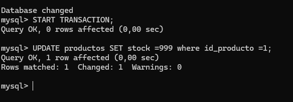
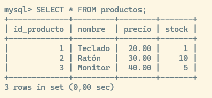
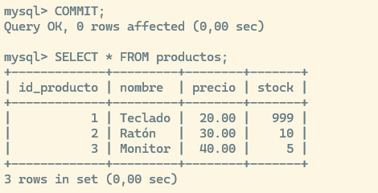

# Objetivos

- **Entender la concurrencia:** Comprender cómo múltiples sesiones leen y modifican la misma base de datos simultáneamente.
- **Interpretar bloqueos:** Distinguir los diferentes tipos de bloqueos y saber qué operación continúa y cuál queda en espera.
- **Controlar transacciones:** Abrir una transacción, confirmar cambios (`COMMIT`), deshacerlos totalmente (`ROLLBACK`) o de forma parcial (`SAVEPOINT`).
- **Conocer mecanismos internos y niveles de aislamiento:** Dominar el comportamiento de MVCC, Undo Log, Read Views y anomalías de lectura.

------------------------------------------------------------------------

# El problema: Concurrencia y Bloqueos

En un entorno multiusuario, varias sesiones comparten una misma base de datos y pueden ejecutar operaciones sobre la misma tabla al mismo tiempo. Esto genera el reto de garantizar la consistencia de la información sin penalizar excesivamente el rendimiento.

- **Usuario vs. Sesión:** Un usuario autenticado en el sistema puede abrir varias sesiones simultáneas (por ejemplo, múltiples conexiones desde una aplicación web o la CLI). Cada sesión maneja sus propias transacciones activas de forma independiente.
- **Riesgo de Incompatibilidad:** Si dos sesiones intentan modificar el mismo registro de forma concurrente, una escritura basada en datos obsoletos o en proceso de modificación por otra sesión provocaría **pérdida de actualizaciones** o **inconsistencias de integridad**.

Para gestionar esto, MySQL (a través del motor **InnoDB**) combina dos estrategias principales:

1.  **Bloqueos (Locking):** Impiden o coordinan accesos concurrentes conflictivos a nivel de fila o tabla.

2.  **Control de Concurrencia Multiversión (MVCC):** Permite lecturas consistentes sin necesidad de bloquear los registros durante un `SELECT`.

# Transacciones

Una **transacción** es un conjunto de una o más sentencias SQL de manipulación de datos (**DML**) que se ejecutan como una **única unidad lógica de trabajo**.

Por defecto, MySQL opera en modo **`autocommit = 1`** (activado). En este modo, cada sentencia DML (`INSERT`, `UPDATE`, `DELETE`) ejecutada de forma individual **se confirma implícita y automáticamente como una transacción independiente**.

Para agrupar varias operaciones en una sola unidad transaccional:

\- Iniciar un bloque explícito con **`START TRANSACTION;`** (o `BEGIN;`).

\- O bien desactivar el comportamiento automático para la sesión actual mediante:

``` sql
SET autocommit = 0;
-- o su se consigue exactamente lo mismo:
SET SESSION autocommit =0;
```

Para modificar el comportamiento global para todas las sessiones

``` sql
SET GLOBAL autocommit = 0;
```

::: nota
**Nota:** Cambiar la variable a nivel `GLOBAL` no modifica el valor de las sesiones que ya están abiertas actualmente, solo afectará a las conexiones entrantes futuras. Si el servidor se reinicia, volverá a su valor predeterminado a menos que modifiques el archivo de configuración (`my.cnf` o `my.ini`).
:::

El objetivo de las transacciones es garantizar la integridad de los datos siguiendo las propiedades **ACID** (Atomaticidad, Consistencia, Aislamiento y Durabilidad). En términos prácticos: **o se aplican con éxito todas las operaciones del grupo, o no se aplica ninguna**.

El objetivo fundamental de las transacciones es garantizar la integridad de los datos cumpliendo las 4 propiedades ACID:

## Propiedades ACID

- **Atomicidad** (Atomicity): Principio del "todo o nada". O se aplican con éxito todas las sentencias del bloque transaccional o se deshacen por completo.

- **Consistencia** (Consistency): La base de datos pasa de un estado válido a otro estado válido. Ninguna transacción puede dejar los datos violando restricciones (CHECK, FOREIGN KEY, UNIQUE, etc.).

- **Aislamiento** (Isolation): Las operaciones de una transacción son invisibles para el resto de transacciones concurrentes hasta que se confirman.

- **Durabilidad** (Durability): Una vez ejecutado el COMMIT, los cambios persistidos no se perderán, incluso ante fallos graves del sistema o cortes de energía (garantizado en InnoDB mediante el Redo Log).

# Sentencias de Control de Transacciones (TCL) y Savepoints

+---------------------------------------+-------------------------------------------------------------------------------------------------------------+
|                                       |                                                                                                             |
+=======================================+=============================================================================================================+
| **Comando**                           | **Descripción**                                                                                             |
+---------------------------------------+-------------------------------------------------------------------------------------------------------------+
| **`START TRANSACTION`** / **`BEGIN`** | Inicia explícitamente un bloque de transacción.                                                             |
+---------------------------------------+-------------------------------------------------------------------------------------------------------------+
| **`COMMIT`**                          | Confirma permanentemente en disco todos los cambios realizados durante la transacción.                      |
+---------------------------------------+-------------------------------------------------------------------------------------------------------------+
| **`ROLLBACK`**                        | Cancela y revierte todos los cambios DML de la transacción actual.                                          |
+---------------------------------------+-------------------------------------------------------------------------------------------------------------+
| **`SAVEPOINT nombre`**                | Establece un punto de guardado intermedio dentro de la transacción.                                         |
+---------------------------------------+-------------------------------------------------------------------------------------------------------------+
| **`ROLLBACK TO SAVEPOINT nombre`**    | Revierte las operaciones DML ejecutadas después del savepoint indicado, manteniendo la transacción abierta. |
+---------------------------------------+-------------------------------------------------------------------------------------------------------------+
| **`RELEASE SAVEPOINT nombre`**        | Elimina un punto de guardado previamente definido (sin deshacer cambios).                                   |
+---------------------------------------+-------------------------------------------------------------------------------------------------------------+

## Sintaxis y Ejemplo Práctico

Imaginemos un proceso donde trasladamos un objeto de sala y registramos el movimiento en una tabla de auditoría:

``` sql
-- 1. Iniciamos la transacción
START TRANSACTION;

-- 2. Actualizamos la ubicación del objeto
UPDATE objetos 
SET ubicacion_actual = 'Sala 4 - Vitrina A'
WHERE codigo_inventario = 'ROM-0001';

-- 3. Insertamos el registro de auditoría
INSERT INTO historial_movimientos (codigo_inventario, nueva_ubicacion, fecha)
VALUES ('ROM-0001', 'Sala 4 - Vitrina A', NOW());

-- 4. Si todo ha salido bien, confirmamos permanentemente los cambios
COMMIT;
```

Si durante el proceso se detecta un error o una validación falla:

``` sql
-- Si algo falla antes del COMMIT, cancelamos todo:
ROLLBACK;
```

Ejemplo práctico con Savepoints

``` sql
START TRANSACTION;

-- 1. Actualizamos la ubicación del objeto
UPDATE objetos 
SET ubicacion_actual = 'Sala 4 - Vitrina A'
WHERE codigo_inventario = 'ROM-0001';

-- Definimos un punto de guardado
SAVEPOINT sp_ubicacion_actualizada;

-- 2. Intentamos registrar en la auditoría
INSERT INTO historial_movimientos (codigo_inventario, nueva_ubicacion, fecha)
VALUES ('ROM-0001', 'Sala 4 - Vitrina A', NOW());

-- Supongamos que la inserción de auditoría tuvo un error de validación
-- Revertimos solo hasta el Savepoint: la reubicación en `objetos` se mantiene
ROLLBACK TO SAVEPOINT sp_ubicacion_actualizada;

-- Corregimos la auditoría o ejecutamos una alternativa
INSERT INTO historial_movimientos (codigo_inventario, nueva_ubicacion, fecha, observaciones)
VALUES ('ROM-0001', 'Sala 4 - Vitrina A', NOW(), 'Registro manual tras ajuste');

-- Confirmamos los cambios
COMMIT;
```

::: {#nota}
Cuando ya necesitas un savepoint es recomendable eliminar el punto para que no se quede ocupando memoria.

El comando `RELEASE SAVEPOINT nombre_savepoint` sirve para **eliminar manualmente un savepoint mientras la transacción sigue abierta**, sin deshacer ninguna de las operaciones DML ejecutadas.

\
Cuando ejecutas un **`COMMIT`** o un **`ROLLBACK`**, la transacción entera se da por finalizada. En ese momento, **MySQL elimina de forma automática todos los savepoints** que hubieras creado dentro de esa transacción y libera la memoria asociada a ellos.

Hacer un `ROLLBACK TO SAVEPOINT` **no elimina** el savepoint utilizado ni los anteriores a él. La transacción permanece abierta, por lo que podrías volver a hacer `ROLLBACK TO SAVEPOINT punto_1` más adelante si hicieras más cambios.
:::

:::: nota-importante
## DML y DCL vs. DDL en Transacciones

Las transacciones en MySQL están diseñadas principalmente para sentencias de manipulación de datos (**DML**).

- **Sentencias DML (`INSERT`, `UPDATE`, `DELETE`):** Se pueden deshacer con un `ROLLBACK` si están dentro de un bloque de transacción.

- **Sentencias DDL (`CREATE`, `ALTER`, `DROP`, `TRUNCATE`):** Provocan un **`COMMIT` implícito**.

- Sentencias DCL (Data Control Language) `GRANT` `REVOKE` `DENY`: funcionan igual que DDL haciendo un **`COMMIT` implícito.**

> **Advertencia:** Si ejecutas una sentencia DDL o DCL como un `CREATE TABLE` o un `TRUNCATE TABLE` en medio de una transacción, MySQL guardará automáticamente todo el trabajo DML anterior y cerrará la transacción activa. **Un `ROLLBACK` posterior no podrá deshacer las sentencias DDL ni las DML anteriores a ella.**

Ejemplo.

``` sql
START TRANSACTION;

-- 1. Esto es DML
UPDATE objetos SET estado_conservacion = 'Malo' WHERE id_objeto = 1;

-- 2. Al ejecutar esto (DDL), MySQL ejecuta un COMMIT automático de la línea anterior
ALTER TABLE objetos ADD COLUMN notas VARCHAR(250);

-- 3. Intentamos hacer ROLLBACK
ROLLBACK;
```

¿ Puedes hacer un `ALTER TABLE` dentro de una transacción y luego un `ROLLBACK` ? **En MySQL (con el motor InnoDB), NO se puede.**

En el momento exacto en que ejecutas un `ALTER TABLE` (o cualquier comando DDL):

1.  MySQL detecta que vas a cambiar la estructura física de la base de datos.

2.  De forma automática e imperativa, ejecuta un **`COMMIT` implícito** de todo lo que hayas hecho antes en la transacción.

3.  Aplica el cambio de estructura.

4.  Finaliza la transacción.

Si ejecutas un `ROLLBACK` justo después del `ALTER TABLE`, **ya no habrá transacción activa que deshacer** (o solo deshará lo que hagas *después* del `ALTER`).

- El `UPDATE` **NO** se deshace (se guardó permanentemente por el `COMMIT` automático provocado por el `ALTER`).

- La nueva columna `notas` **NO** se elimina (los cambios DDL no son reversibles con `ROLLBACK` en MySQL).

Aunque en **MySQL** las sentencias DDL y DCL hacen `COMMIT` implícito y rompen el `ROLLBACK`, existen otros motores de bases de datos como **PostgreSQL** o **SQLite** que sí soportan *Transactional DDL* (es decir, permiten meter un `ALTER TABLE` dentro de un `START TRANSACTION` y hacer `ROLLBACK` de la estructura). Pero en el estándar y comportamiento de **MySQL / MariaDB**, el DDL no es transaccional.

::: nota
En **MySQL (motor InnoDB)**, el comportamiento con las tablas temporales (`TEMPORARY TABLE`) presenta una excepción respecto a las tablas normales.\
`REATE TEMPORARY TABLE` y `DROP TEMPORARY TABLE`

- **No provocan un `COMMIT` implícito:** A diferencia de las tablas permanentes, la creación o eliminación de una tabla temporal **NO rompe ni confirma la transacción activa**. Puedes ejecutar un `CREATE TEMPORARY TABLE` a mitad de una transacción sin que se haga `COMMIT` automático de los cambios anteriores (`INSERT`, `UPDATE`, `DELETE`).

- **No forman parte del `ROLLBACK`:** El ciclo de vida de la definición DDL de la propia tabla temporal (su estructura) no se puede deshacer con un `ROLLBACK`. Si creas una tabla temporal dentro de una transacción y luego ejecutas un `ROLLBACK`:

  1.  Los datos DML insertados en la tabla temporal durante la transacción **sí se deshacen**.

  2.  La tabla temporal **sigue existiendo en la sesión** (el comando `CREATE` no se revierte).

  ``` sql
  START TRANSACTION;

  -- 1. Insertamos un registro en una tabla permanente
  INSERT INTO clientes (nombre) VALUES ('Ana');

  -- 2. Creamos una tabla temporal (NO hace COMMIT implícito)
  CREATE TEMPORARY TABLE temp_calculos (
      id INT,
      total DECIMAL(10, 2)
  );

  -- 3. Insertamos datos en la tabla temporal
  INSERT INTO temp_calculos VALUES (1, 150.00);

  -- 4. Ejecutamos ROLLBACK
  ROLLBACK;
  ```

**Resultado tras el `ROLLBACK`:**

- **`clientes`:** El registro 'Ana' **se deshace** correctamente (porque el `CREATE TEMPORARY TABLE` no forzó un `COMMIT` implícito).

- **`temp_calculos`:** La tabla **sigue existiendo** en la sesión, pero está **vacía** (la estructura no se revirtió, pero el `INSERT` dentro de la tabla sí se deshizo).
:::
::::

# Bloqueos en MySQL (InnoDB)

Un **bloqueo** es simplemente un mecanismo de protección que pone la base de datos sobre un recurso (una fila, una página o una tabla entera) para evitar que dos personas intenten escribir sobre el mismo dato a la vez y destruyan la información. Un bloqueo coordina operaciones concurrentes sobre los datos.

- Una operación de UPDATE o DELETE solicita bloqueos automáticamente. Si existe incompatibilidad puede esperar a otra transacción.

- COMMIT/ ROLLBACK: Finaliza la transacción. Libera los bloqueos transaccionales.

InnoDB implementa granularidad a **nivel de fila** (row-level locking), lo que permite que múltiples sesiones modifiquen diferentes filas de la misma tabla simultáneamente.

## Comportamiento por defecto:

Supongamos que tenemos una tabla `empleados` con el empleado `Juan` (`id = 1`) que cobra `2000`.

Tú abres una transacción y haces un `UPDATE` o un `DELETE` sobre la fila de Juan, **pero aún no haces `COMMIT` ni `ROLLBACK`**:

``` sql
-- Tu Sesión (Sesión A)
START TRANSACTION;

UPDATE empleados 
SET salario = 2500 
WHERE id = 1;

-- ¡Atención! Aún NO has hecho COMMIT ni ROLLBACK.
```

Al ejecutar ese `UPDATE`, MySQL/InnoDB pone automáticamente un **bloqueo exclusivo (X)** sobre la fila de `Juan` (`id = 1`).

¿Qué pasa con los **otros usuarios** (Sesión B) que intentan interactuar con la fila de Juan?

Depende de **qué operación** intente hacer el otro usuario:

### Si el otro usuario intenta MODIFICAR o BORRAR la misma fila (`UPDATE` / `DELETE`)

``` sql
-- Sesión B (Otro usuario)
UPDATE empleados SET salario = 3000 WHERE id = 1;
```

- **Comportamiento:** La consulta del otro usuario **se queda congelada / en espera**. No devuelve error de inmediato; MySQL la deja esperando a que la sessión A libere el bloqueo.

- **¿Qué ocurre después?**

  - **Si tú haces `COMMIT`:** Tu cambio se guarda. El `UPDATE` de la Sesión B se desbloquea al instante y se ejecuta sobre el nuevo valor.

  - **Si tú haces `ROLLBACK`:** Tu cambio se deshace. El `UPDATE` de la Sesión B se desbloquea al instante y se ejecuta sobre el valor original.

  - **Si tardas demasiado tiempo en responder:** La Sesión B fallará con el error:

    `ERROR 1205 (HY000): Lock wait timeout exceeded; try restarting transaction`

### Si el otro usuario intenta LEER la misma fila con un `SELECT` normal

``` sql
-- Sesión B (Otro usuario)
SELECT salario FROM empleados WHERE id = 1;
```

- **Comportamiento:** NO se bloquea y responde INMEDIATAMENTE.

- **¿Qué valor lee la Sesión B?**

  Lee el valor **anterior al `UPDATE`** (`2000`). Esto ocurre gracias al mecanismo **MVCC (Multi-Version Concurrency Control)** e **Undo Log** de InnoDB: MySQL acude al registro de cambios en segundo plano y le construye al usuario B una "foto" del dato tal y como estaba antes de que tú iniciaras tu modificación.

- **Ventaja:** En MySQL, **las lecturas normales nunca bloquean a las escrituras, ni las escrituras bloquean a las lecturas normales**.

## Bloqueos Básicos de Fila

La diferencia fundamental entre el **Bloqueo Compartido (S)** y el **Bloqueo Exclusivo (X)** radica en la **intención**: ¿quiero garantizar que el dato no cambie mientras lo leo o voy a modificarlo yo mismo?

### Bloqueo Compartido (Shared / `S`)

- **Concepto:** Es un bloqueo de **"solo lectura garantizada"**. Varias sesiones pueden poner un bloqueo `S` sobre la misma fila simultáneamente (por eso se llama *compartido*).

- **Lo que SÍ permite:** Permite que otras sesiones lean la fila e incluso que otras sesiones soliciten también un bloqueo `S` sobre ella.

- **Lo que IMPIDE:** Impide que cualquier sesión (incluida la tuya, si otros también la han bloqueado) modifique o elimine la fila (`UPDATE` o `DELETE`), y evita que alguien pida un bloqueo exclusivo (`X`).

- **Sintaxis SQL en MySQL:**

  ``` sql
  SELECT * FROM productos WHERE id = 10 FOR SHARE;
  -- (En versiones antiguas de MySQL se usaba LOCK IN SHARE MODE)
  ```

**Ejemplo práctico del mundo real:**

Imagina un sistema de reservas de billetes de avión.

1.  Un cliente inicia el proceso de compra. El sistema lee el precio del billete y comprueba si hay plazas libres ejecutando un `SELECT ... FOR SHARE`.

2.  Al poner el bloqueo `S`, el sistema asegura que **nadie cambie el precio del billete ni cancele el vuelo** mientras el cliente está introduciendo los datos de su tarjeta de crédito.

3.  Si otro usuario entra al mismo tiempo a consultar la disponibilidad de ese vuelo, **también puede leerlo** y solicitar otro bloqueo `S` sin quedarse colgado.

4.  Pero si un administrador intenta hacer un `UPDATE` para subir el precio de ese billete, **tendrá que esperar** a que todos los bloqueos `S` se liberen.

### Bloqueo Exclusivo (Exclusive / `X`)

- **Concepto:** Es un bloqueo de **"propiedad absoluta"**. Solo **una única transacción** puede tener un bloqueo `X` sobre una fila.

- **Lo que SÍ permite:** Permite a la transacción poseedora del bloqueo modificar (`UPDATE`), eliminar (`DELETE`) o leer la fila.

- **Lo que IMPIDE:** Ninguna otra sesión puede modificar la fila, ni tampoco pedir sobre ella un bloqueo `S` (`FOR SHARE`) o `X` (`FOR UPDATE`). *(Nota: Como vimos con MVCC, otros usuarios **sí podrán seguir haciendo `SELECT` normales sin bloqueo**, leyendo la versión anterior desde la Undo Log).*

  ``` sql
  -- Invocado explícitamente:
  SELECT * FROM productos WHERE id = 10 FOR UPDATE;

  -- Invocado automáticamente por MySQL:
  UPDATE productos SET stock = stock - 1 WHERE id = 10;
  DELETE FROM productos WHERE id = 10;
  ```

  **Ejemplo práctico del mundo real:**

  Siguiendo con el sistema de billetes de avión:

  1.  El cliente pulsa "Pagar y Confirmar Reserva".

  2.  La aplicación ejecuta un `SELECT ... FOR UPDATE` o un `UPDATE vuelos SET plazas = plazas - 1 WHERE id = 10`.

  3.  MySQL coloca inmediatamente un **bloqueo exclusivo (`X`)** sobre ese vuelo.

  4.  Si en ese mismo milisegundo otro proceso de compra intenta restar una plaza del mismo vuelo, **se queda congelado en espera** hasta que la primera transacción haga `COMMIT` o `ROLLBACK`. Así se evita vender dos veces la misma plaza (el famoso *overbooking* por condición de carrera).

::: nota
**Bloqueo Compartido (Shared / `S`):** Permite leer el registro a múltiples transacciones. Impide modificaciones (`UPDATE`/`DELETE`).

**Bloqueo Exclusivo (Exclusive / `X`):** Bloquea la fila para escritura. Ninguna otra transacción puede leer con bloqueo ni modificar dicha fila.

### Matriz de Compatibilidad entre Bloqueos

Esta tabla resume qué ocurre cuando la **Sesión 1** ya tiene un bloqueo sobre una fila y la **Sesión 2** intenta solicitar otro bloqueo sobre esa **misma fila**:

+------------------------------+----------------------------------------------+-----------------------------------------------------------------+
|                              |                                              |                                                                 |
+==============================+==============================================+=================================================================+
| **Si la Sesión 1 tiene...**  | **Y la Sesión 2 pide Bloqueo S (FOR SHARE)** | **Y la Sesión 2 pide Bloqueo X (FOR UPDATE / UPDATE / DELETE)** |
+------------------------------+----------------------------------------------+-----------------------------------------------------------------+
| **Bloqueo `S` (Compartido)** | **COMPATIBLE**                               | **INCOMPATIBLE**                                                |
|                              |                                              |                                                                 |
|                              | *(La Sesión 2 entra sin esperar)*            | *(La Sesión 2 se queda en espera)*                              |
+------------------------------+----------------------------------------------+-----------------------------------------------------------------+
| **Bloqueo `X` (Exclusivo)**  | **INCOMPATIBLE**                             | **INCOMPATIBLE**                                                |
|                              |                                              |                                                                 |
|                              | *(La Sesión 2 se queda en espera)*           | *(La Sesión 2 se queda en espera)*                              |
+------------------------------+----------------------------------------------+-----------------------------------------------------------------+
:::

## Bloqueos explícitos de tablas (`LOCK TABLES` y `UNLOCK TABLES`)

En MySQL, el motor InnoDB gestiona los bloqueos a nivel de fila (*row-level locking*) de forma automática durante las transacciones. Sin embargo, MySQL también permite solicitar **bloqueos explícitos sobre tablas completas** mediante las sentencias `LOCK TABLES` y `UNLOCK TABLES`.

::: nota-importante
### Impacto en la concurrencia y transacciones

1.  **Reduce drásticamente la concurrencia:** Bloquear una tabla completa impide que otros usuarios trabajen sobre filas diferentes de esa misma tabla.
2.  **Confirmación implícita:** Ejecutar `LOCK TABLES` realiza un `COMMIT` implícito de cualquier transacción abierta antes de adquirir el bloqueo.
3.  **Liberación con `START TRANSACTION`:** Iniciar una transacción explícita (`START TRANSACTION`) liberará inmediatamente cualquier bloqueo de tabla activo obtenido previamente con `LOCK TABLES`.
:::

Sintaxis básica

``` sql
-- Bloquear una o varias tablas
LOCK TABLES 
    nombre_tabla1 { READ [LOCAL] | WRITE },
    [nombre_tabla2 { READ [LOCAL] | WRITE }];

-- Liberar todos los bloqueos de tablas de la sesión actual
UNLOCK TABLES;
```

### Tipos de bloqueos de tabla

+-------------------------+---------------------------------------------------+----------------------------------------------------------------------------------------+
|                         |                                                   |                                                                                        |
+=========================+===================================================+========================================================================================+
| **Tipo de Bloqueo**     | **Sesión que solicita el bloqueo**                | **Otras sesiones (concurrencia)**                                                      |
+-------------------------+---------------------------------------------------+----------------------------------------------------------------------------------------+
| **`READ`** (Compartido) | Puede **leer** la tabla, pero **no modificarla**. | Pueden **leer** la tabla. Si intentan **modificarla**, quedan en espera (*lock wait*). |
+-------------------------+---------------------------------------------------+----------------------------------------------------------------------------------------+
| **`WRITE`** (Exclusivo) | Puede **leer y modificar** la tabla.              | No pueden **ni leer ni modificar** la tabla; quedan totalmente bloqueadas en espera.   |
+-------------------------+---------------------------------------------------+----------------------------------------------------------------------------------------+

### Ejemplos de uso paso a paso

#### Ejemplo 1: Bloqueo de lectura (`READ`)

Permite lecturas concurrentes pero congela cualquier intento de escritura hasta que la sesión origen libere el bloqueo.

``` sql
-- Sesión A: Bloquea la tabla productos para lectura
LOCK TABLES productos READ;

-- Sesión A: Puede consultar los datos
SELECT * FROM productos WHERE id_producto = 1;

-- Sesión A: Intentar modificar fallará inmediatamente en la propia sesión
-- Error 1099: Table 'productos' was locked with a READ lock and can't be updated
UPDATE productos SET precio = 25.00 WHERE id_producto = 1;

-- Sesión B: Puede consultar la tabla sin problemas
SELECT * FROM productos WHERE id_producto = 1;

-- Sesión B: Intentar modificar se quedará ESPERANDO hasta que A ejecute UNLOCK TABLES
UPDATE productos SET stock = stock - 1 WHERE id_producto = 1;

-- Sesión A: Libera la tabla
UNLOCK TABLES;
```

#### Ejemplo 2: Bloqueo de escritura (`WRITE`)

Garantiza acceso exclusivo absoluto a una tabla mientras se realiza una operación crítica (como un mantenimiento estructurado o un proceso masivo).

``` sql
-- Sesión A: Bloquea la tabla cuentas de forma exclusiva
LOCK TABLES cuentas WRITE;

-- Sesión A: Puede leer y actualizar
UPDATE cuentas SET saldo = saldo + 100 WHERE id_cuenta = 1;

-- Sesión B: Intentar cualquier SELECT o UPDATE sobre 'cuentas' quedará en espera
SELECT * FROM cuentas; -- Queda esperando...

-- Sesión A: Finaliza y libera la tabla
UNLOCK TABLES;

-- Sesión B: En cuanto A ejecuta UNLOCK TABLES, su SELECT finaliza y devuelve el resultado.
```

### Utilidad y Casos de Uso

A pesar de que en InnoDB se prefiere el uso de transacciones con bloqueos de fila (`SELECT ... FOR UPDATE` o `SELECT ... FOR SHARE`), `LOCK TABLES` resulta útil en los siguientes contextos:

1.  **Copias de seguridad sólidas (*Logical Backups*):** Asegurar consistencia al exportar datos de tablas (aunque herramientas como `mysqldump --single-transaction` evitan su uso para tablas InnoDB).

2.  **Tablas con motor MyISAM:** Motors antiguos que no soportan transacciones ni bloqueos a nivel de fila requieren `LOCK TABLES` para garantizar atomicidad en operaciones compuestas.

3.  **Mantenimiento masivo y procesamiento por lotes (*Batch operations*):** Evitar interferencias o inconsistencias mientras se ejecutan scripts de migración, reorganización o mantenimiento masivo sobre una tabla.

## Interbloqueo o Abrazo Mortal (*Deadlock*).

Ocurre cuando dos (o más) transacciones se bloquean mutuamente porque **cada una tiene reservado un recurso que la otra necesita** para continuar, creando un bucle de espera infinito.

### Ejemplo Clásico de *Deadlock*

Imagina dos filas en la base de datos: `Fila 1` y `Fila 2`.

1.  **Sesión A:** Ejecuta un `UPDATE` sobre la `Fila 1`. *(Sesión A obtiene el bloqueo exclusivo `X` de la `Fila 1`)*.

2.  **Sesión B:** Ejecuta un `UPDATE` sobre la `Fila 2`. *(Sesión B obtiene el bloqueo exclusivo `X` de la `Fila 2`)*.

3.  **Sesión A:** Intenta hacer un `UPDATE` sobre la `Fila 2`. *(Se queda congelada en espera porque la `Fila 2` está bloqueada por B)*.

4.  **Sesión B:** Intenta hacer un `UPDATE` sobre la `Fila 1`. *(Se queda congelada en espera porque la `Fila 1` está bloqueada por A)*.

En este punto, **ninguna de las dos puede avanzar** ni liberar sus propios bloqueos porque ambas están esperando a que la otra termine.

### ¿Cómo lo resuelve MySQL (InnoDB)?

Si MySQL no hiciera nada, ambas sesiones se quedarían colgadas indefinidamente hasta que expirase el tiempo de espera (*lock wait timeout*).

Sin embargo, InnoDB cuenta con un **detector automático de *deadlocks*** (*Deadlock Detector*).

Para comprobar su estado:

``` sql
SELECT @@global.innodb_deadlock_detect;
```

1.  **Detección:** MySQL monitoriza el grafo de bloqueos en tiempo real y detecta la dependencia circular inmediatamente.

2.  **Víctima (*Victima Rollback*):** MySQL elige automáticamente a una de las dos transacciones (normalmente la que haya realizado menos modificaciones o sea más "barata" de revertir) y la **cancela forzosamente** ejecutando un `ROLLBACK`.

3.  **Resolución:**

    - La sesión anulada recibe el error:

      `ERROR 1213 (40001): Deadlock found when trying to get lock; try restarting transaction`.

    - La otra sesión se desbloquea al instante, obtiene el recurso libre y **continúa su ejecución con éxito**.

### Buenas Prácticas para Evitarlos

- **Mantener un orden constante:** Acceder a las tablas y filas siempre en el mismo orden dentro de la aplicación (por ejemplo, ordenar siempre los `UPDATE` por la clave primaria `id`).

- **Transacciones cortas:** Hacer `COMMIT` lo antes posible para no retener bloqueos durante mucho tiempo.

- **Actualizar todo de golpe:** Si vas a modificar varias filas, intenta hacerlo en un único comando SQL en lugar de múltiples sentencias individuales dentro del mismo bloque.

------------------------------------------------------------------------

# Referencia Comparativa con Otros Motores de BBDD

Aunque los conceptos ACID y la sintaxis SQL estándar son comunes, los detalles de implementación varían notablemente entre los principales motores RDBMS:

+-------------------------------------------+---------------------------------------------------------+-----------------------------------------------------------------------------------------+-----------------------------------------------------------------+----------------------------------------------------------------------------+---------------------------------------------------+
|                                           |                                                         |                                                                                         |                                                                 |                                                                            |                                                   |
+===========================================+=========================================================+=========================================================================================+=================================================================+============================================================================+===================================================+
| **Característica / Motor**                | **MySQL (InnoDB)**                                      | **PostgreSQL**                                                                          | **Oracle Database**                                             | **Microsoft SQL Server**                                                   | **SQLite**                                        |
+-------------------------------------------+---------------------------------------------------------+-----------------------------------------------------------------------------------------+-----------------------------------------------------------------+----------------------------------------------------------------------------+---------------------------------------------------+
| **Nivel por defecto**                     | `REPEATABLE READ`                                       | `READ COMMITTED`                                                                        | `READ COMMITTED`                                                | `READ COMMITTED`                                                           | `SERIALIZABLE`                                    |
+-------------------------------------------+---------------------------------------------------------+-----------------------------------------------------------------------------------------+-----------------------------------------------------------------+----------------------------------------------------------------------------+---------------------------------------------------+
| **Transactional DDL**                     | No *(hace `COMMIT` implícito)*                          | Sí *(permite `ROLLBACK` de `CREATE/ALTER`)*                                             | No *(hace `COMMIT` implícito)*                                  | Sí *(permite `ROLLBACK` de DDL)*                                           | Sí                                                |
+-------------------------------------------+---------------------------------------------------------+-----------------------------------------------------------------------------------------+-----------------------------------------------------------------+----------------------------------------------------------------------------+---------------------------------------------------+
| **Mecanismo MVCC**                        | Undo Log en espacio separado (ibdata/undo tablespaces). | Mantiene múltiples versiones de filas dentro de la **misma tabla** (requiere `VACUUM`). | Undo Tablespace separado para construir lecturas pasadas.       | Basado en `tempdb` (cuando está activo el modo RCSI).                      | Vía archivo WAL (*Write-Ahead Logging*).          |
+-------------------------------------------+---------------------------------------------------------+-----------------------------------------------------------------------------------------+-----------------------------------------------------------------+----------------------------------------------------------------------------+---------------------------------------------------+
| **Bloqueo por defecto en Lectura**        | Sin bloqueos mediante MVCC (consistent read).           | Sin bloqueos mediante MVCC.                                                             | Sin bloqueos mediante MVCC.                                     | Por defecto usa bloqueos `S` de lectura (se pueden evitar activando RCSI). | Bloquea el archivo completo durante la escritura. |
+-------------------------------------------+---------------------------------------------------------+-----------------------------------------------------------------------------------------+-----------------------------------------------------------------+----------------------------------------------------------------------------+---------------------------------------------------+
| **Lectura Fantasma en `REPEATABLE READ`** | Prevenida por MVCC + Next-Key Locks.                    | Prevenida completamente por la implementación propia de MVCC.                           | N/A *(no implementa `REPEATABLE READ`, pasa a `SERIALIZABLE`)*. | Puede ocurrir *(requiere nivel `SERIALIZABLE` o `SNAPSHOT`)*.              | Prevenida (aislamiento estricto por archivo).     |
+-------------------------------------------+---------------------------------------------------------+-----------------------------------------------------------------------------------------+-----------------------------------------------------------------+----------------------------------------------------------------------------+---------------------------------------------------+

::: extra
## La gran diferencia entre MySQL y SQL Server

Por defecto, en SQL Server los `SELECT` normales SÍ bloquean y se quedan bloqueados, a menos que uses `WITH (NOLOCK)`.

**El comportamiento por defecto de SQL Server (`READ COMMITTED` tradicional)**

A diferencia de MySQL (que usa MVCC con *Undo Log* por defecto para leer versiones antiguas sin bloquear), el motor tradicional de SQL Server utiliza un **mecanismo basado exclusivamente en bloqueos de lectura**:

- Cuando ejecutas un `SELECT` en SQL Server, la consulta solicita un **bloqueo compartido (`S`)** sobre los registros.

- Si otra persona está haciendo un `UPDATE` o `DELETE` sobre esos registros, esa transacción tiene un **bloqueo exclusivo (`X`)**.

- **El conflicto:** Como un bloqueo `S` es **incompatible** con un bloqueo `X`, tu `SELECT` **se queda congelado en espera** hasta que la otra persona haga `COMMIT` o `ROLLBACK`.

- En bases de datos muy transaccionales (con miles de escrituras por segundo), esto provoca que los informes y consultas de lectura **colapsen el sistema**, creando colas de espera masivas y bloqueos en cadena (*blocking*).

### Lectura sin bloqueo `WITH (NOLOCK)`

Añadir `WITH (NOLOCK)` al final de una tabla en T-SQL le dice al motor: *"Lee los datos directamente de la memoria sin pedir bloqueos compartidos y sin respetar los bloqueos exclusivos de otros"*.

- **Ventaja:** Tus `SELECT` son instantáneos, no esperan por nadie y tampoco impiden que otros escriban. Es el equivalente a cambiar el nivel de aislamiento a **`READ UNCOMMITTED`**.

- **El riesgo (Lectura Sucia):** Estás leyendo datos **no confirmados**. Si lees una fila a la que le están haciendo un `UPDATE` y luego esa transacción hace `ROLLBACK`, habrás procesado o mostrado un dato que jamás existió realmente.

### La gran diferencia entre MySQL y SQL Server

+---------------------------------------+--------------------------------------------------------------------------------------------+----------------------------------------------------------------------------------------------+
|                                       |                                                                                            |                                                                                              |
+=======================================+============================================================================================+==============================================================================================+
| **Característica**                    | **MySQL (InnoDB)**                                                                         | **SQL Server (T-SQL) Por defecto tradicional**                                               |
+---------------------------------------+--------------------------------------------------------------------------------------------+----------------------------------------------------------------------------------------------+
| **¿El `SELECT` normal bloquea?**      | **NO.** Lee del *Undo Log* (MVCC) sin bloquear ni ser bloqueado.                           | **SÍ.** Pide bloqueos `S` y se queda esperando si hay un `UPDATE` activo.                    |
+---------------------------------------+--------------------------------------------------------------------------------------------+----------------------------------------------------------------------------------------------+
| **¿Necesita un truco como `NOLOCK`?** | **NO.** Ya lee de forma no bloqueante por defecto en `REPEATABLE READ` o `READ COMMITTED`. | **SÍ (`WITH (NOLOCK)`).** Se usaba para evitar que las lecturas congelaran la base de datos. |
+---------------------------------------+--------------------------------------------------------------------------------------------+----------------------------------------------------------------------------------------------+

**Ejemplo práctico**

En SQL Server, las lecturas normales (`SELECT`) solicitan bloqueos compartidos (`S`). Si una sesión está modificando una fila con un `UPDATE`, ese registro queda bajo un bloqueo exclusivo (`X`), haciendo que cualquier `SELECT` de otra sesión **se quede congelado en espera** hasta que finalice la transacción.

Para evitar esta espera en entornos muy transaccionales (a costa de permitir **lecturas sucias**), se añade la pista (*hint*) `WITH (NOLOCK)` sobre las tablas de la consulta.

Escenario:

**Sesión A (Proceso de actualización largo):**

``` sql
-- Inicia una transacción explícita en SQL Server
BEGIN TRANSACTION;

UPDATE empleados
SET salario = 3500
WHERE id_empleado = 10;

-- La transacción permanece abierta (aún NO hay COMMIT ni ROLLBACK)
```

**Sesión B (Consulta habitual de otro usuario):**

``` sql
-- Sin WITH (NOLOCK): Esta consulta SE CONGELA esperando a que la Sesión A termine
SELECT salario 
FROM empleados 
WHERE id_empleado = 10;
```

**Sesión C (Consulta con `WITH (NOLOCK)`):**

``` sql
-- Con WITH (NOLOCK): Responde de INMEDIATO devolviendo 3500 (Lectura Sucia)
SELECT salario 
FROM empleados WITH (NOLOCK)
WHERE id_empleado = 10;
```

#### ¿Por qué ya no es tan recomendable usar `WITH (NOLOCK)` en T-SQL moderno?

Hoy en día, el uso indiscriminado de `WITH (NOLOCK)` se considera una **mala práctica** o un parche del pasado por dos motivos:

1.  **Lecturas fantasma y duplicadas:** En SQL Server, si una tabla se está modificando mientras la lees con `NOLOCK` (y las páginas de datos se reorganizan), tu consulta puede **saltarse filas o leer la misma fila dos veces**.

2.  **Existe una solución mucho mejor en SQL Server:** Activar a nivel de base de datos el modo **RCSI** (*Read Committed Snapshot Isolation*). Al activarlo, SQL Server pasa a comportarse como MySQL u Oracle: utiliza la base de datos `tempdb` para guardar versiones antiguas de las filas y permite lecturas consistentes sin bloqueos **sin tener que poner `WITH (NOLOCK)` en cada consulta**.
:::

# Niveles de Aislamiento y Anomalías de Lectura

El nivel de aislamiento determina el grado en que las operaciones de una sesión están protegidas de las interferencias de otras sesiones concurrentes. A mayor aislamiento, mayor consistencia pero menor rendimiento de concurrencia.

## Anomalías de Lectura

1.  **Lectura Sucia (Dirty Read):** Una sesión lee datos modificados por otra transacción que **aún no ha sido confirmada** (`COMMIT`). Si la otra sesión hace `ROLLBACK`, los datos leídos nunca existieron realmente.

2.  **Lectura No Repetible (Non-Repeatable Read):** Una sesión lee una fila, otra transacción modifica o elimina dicha fila y hace `COMMIT`. Cuando la primera sesión vuelve a leer la fila, obtiene valores diferentes.

3.  **Lectura Fantasma (Phantom Read):** Una sesión ejecuta una consulta con un rango de filas. Otra transacción inserta nuevas filas que cumplen ese rango y hace `COMMIT`. Al reejecutar la consulta, la primera sesión ve filas "fantasma" adicionales.

## La solución: Niveles de Aislamiento (Estándar SQL)

Van desde el nivel más permisivo (menos aislamiento, más rápido) hasta el más estricto (aislamiento total, menor concurrencia).

### `READ UNCOMMITTED` (Lectura no confirmada)

- **¿Cómo funciona?:** No pone casi ninguna restricción. Las transacciones pueden leer los cambios de otras sesiones incluso si no se ha hecho `COMMIT`.

- **Permite:** Lecturas Sucias, Lecturas No Repetibles y Lecturas Fantasma.

- **Uso:** Rara vez se usa en producción, salvo para consultas estadísticas muy pesadas donde la precisión exacta del dato no importa y no se quiere bloquear nada.

### `READ COMMITTED` (Lectura confirmada)

- **¿Cómo funciona?:** Garantiza que **solo leerás datos que ya han sido confirmados con `COMMIT`**.

- **Evita:** Lecturas Sucias.

- **Permite:** Lecturas No Repetibles y Lecturas Fantasma (porque si otra sesión hace `COMMIT` mientras tu transacción sigue abierta, al volver a consultar verás los nuevos datos confirmados).

- **Uso:** Es el nivel por defecto en bases de datos como PostgreSQL, Oracle y SQL Server.

### `REPEATABLE READ` (Lectura repetible)

- **¿Cómo funciona?:** Garantiza que si lees una fila dentro de una transacción, volverás a leer **exactamente el mismo valor** aunque otras sesiones la modifiquen y hagan `COMMIT`.

- **Evita:** Lecturas Sucias y Lecturas No Repetibles.

- **Comportamiento especial en MySQL (InnoDB):** Es el **nivel por defecto en MySQL**. A diferencia del estándar SQL (donde este nivel suele permitir lecturas fantasma), **InnoDB evita también las lecturas fantasma** mediante su mecanismo MVCC y bloqueos de rango (*Next-Key Locks*).

  La clave para entender cómo MySQL (con el motor **InnoDB**) consigue `REPEATABLE READ` **sin bloquear las lecturas de los demás usuarios** reside en que no utiliza bloqueos de lectura tradicionales para las consultas normales. En su lugar, utiliza una técnica llamada **MVCC (Multi-Version Concurrency Control)** apoyada en la **Undo Log**.

  En palabras sencillas: **MySQL nunca lee directamente el dato "en vivo" si este ha cambiado; lee una "foto en el tiempo" (fotografía) de los datos creada al inicio de tu transacción.**

  Cada vez que una fila se modifica en InnoDB, la base de datos **no borra ni sobrescribe** el dato antiguo inmediatamente. Guarda el nuevo dato en la tabla y envía el dato anterior a un espacio de memoria especial llamado **Undo Log** (el historial de deshacer).

  Cuando tu transacción hace su primer `SELECT`, InnoDB crea para ti una **Read View** (Visión de Lectura): una "fotografía" de qué transacciones estaban confirmadas en ese milisegundo exacto.

  **Veamos un ejemplo práctico en orden cronológico:**

  Imagina que la cuenta de Juan tiene **100 €** (versión inicial).

  1.  **Tu Transacción A** empieza y ejecuta su primer `SELECT`:

      - MySQL crea una *Read View* para tu sesión.

      - Lees: `100 €`.

  2.  **La Transacción B** de otro usuario hace un `UPDATE` y un `COMMIT`:

      ``` sql
      UPDATE cuentas SET saldo = 500 WHERE id = 1;
      COMMIT;
      ```

      - En la tabla real, el registro ahora vale `500 €`.

      - El valor antiguo (`100 €`) se guarda en la **Undo Log**.

  3.  **Tu Transacción A** (que sigue abierta) vuelve a ejecutar exactamente el mismo `SELECT`:

      - MySQL ve que en la tabla real el dato vale `500 €`, pero detecta que ese cambio fue realizado por una transacción posterior a tu *Read View*.

      - En lugar de devolverte `500 €`, MySQL **viaja en el tiempo usando la Undo Log** y te reconstruye la fila tal como estaba cuando abriste tu transacción.

      - Lees nuevamente: `100 €`.

      ::: nota
      La diferencia clave entre `READ COMMITTED` y `REPEATABLE READ` en MySQL

      La única diferencia entre estos dos niveles en MySQL es **cuándo se genera la *Read View***:

      - En **`READ COMMITTED`**: MySQL genera una **NUEVA *Read View* en cada `SELECT`** que ejecutas. Por eso, si alguien hace `COMMIT` a mitad de tu transacción, tu siguiente `SELECT` verá los nuevos cambios.

      - En **`REPEATABLE READ`**: MySQL genera **UNA SOLA *Read View* en el primer `SELECT`** de la transacción y la **mantiene congelada** durante todo el bloque transaccional hasta que hagas `COMMIT` o `ROLLBACK`.
      :::

### `SERIALIZABLE` (Serializable)

- **¿Cómo funciona?:** Es el nivel más estricto. Obliga a que las transacciones se ejecuten de forma equivalente a si fuera "una detrás de otra" en estricto orden secuencial. Convierte implícitamente todos los `SELECT` en lecturas con bloqueo (`SELECT ... FOR SHARE`).

- **Evita:** Todas las anomalías (Lectura Sucia, No Repetible y Fantasma).

- **Inconveniente:** Reduce drásticamente el rendimiento y la concurrencia, ya que las sesiones se quedan esperando constantemente en cola a que las demás terminen.

+------------------------------------------------+-------------------+--------------------------+----------------------+
|                                                |                   |                          |                      |
+================================================+===================+==========================+======================+
| **Nivel de Aislamiento**                       | **Lectura Sucia** | **Lectura No Repetible** | **Lectura Fantasma** |
+------------------------------------------------+-------------------+--------------------------+----------------------+
| **`READ UNCOMMITTED`**                         | Sí                | Sí                       | Sí                   |
+------------------------------------------------+-------------------+--------------------------+----------------------+
| **`READ COMMITTED`**                           | No                | Sí                       | Sí                   |
+------------------------------------------------+-------------------+--------------------------+----------------------+
| **`REPEATABLE READ`** *(Por defecto en MySQL)* | No                | No                       | No *(En InnoDB)*     |
+------------------------------------------------+-------------------+--------------------------+----------------------+
| **`SERIALIZABLE`**                             | No                | No                       | No                   |
+------------------------------------------------+-------------------+--------------------------+----------------------+

Configuración en MySql

``` sql
-- Consultar el nivel global y de la sesión activa
SELECT @@GLOBAL.transaction_isolation, @@session.transaction_isolation;

-- Cambiar el nivel para la siguiente transacción en la sesión actual
SET TRANSACTION ISOLATION LEVEL READ COMMITTED;
```

::: {#extra}
En MySQL, el comando `SET TRANSACTION ISOLATION LEVEL ...` o `SET SESSION TRANSACTION ISOLATION LEVEL ...` **solo aplica para la próxima transacción que se inicie**, no tiene efecto retroactivo ni permite cambiar las reglas a mitad de camino dentro de una transacción que ya está abierta mediante `START TRANSACTION`.

Si intentas cambiar el nivel de aislamiento con una transacción ya abierta, el SGBD podría arrojar un error (como `Transaction active, could not set isolation level`) o no dar error, pero no el resultado no será el esperado.

Ejemplo Sessión A empieza una transacción en REPEATABLE READ y durante la transacción la cambia a READ UNCOMMITED

consultamos el stock:\


Una vez que hemos cambiado el nivel de aislamiento empezamos una transacción en la sessión B y hacemos un cambio en una de las filas de la tabla, pero no lo confirmamos aún con COMMIT

Si a continuación repetimos la consulta de la tabla, no nos muestra la operación en curso a pesar de que estamos en READ UNCOMMITED.\


Si a continuación salimos de la transacción en la sessión A con COMMIT O ROLLBACK, y ejecutamos la consulta de nuevo, ahora sí funcionará el cambio de nivel de aislamiento y enseñará el valor aún no confirmado de la transacción de B.


:::

# Mecanismos Internos de Concurrencia en InnoDB

MySQL InnoDB utiliza arquitectura multiversión para ofrecer alto rendimiento de lectura sin bloquear las escrituras.

- **MVCC (Multi-Version Concurrency Control):** Mantiene múltiples versiones de una misma fila. Cuando se actualiza una fila, InnoDB no sobrescribe inmediatamente los datos antiguos, sino que crea una nueva versión.

- **Undo Log:** Mapea y guarda la versión previa de los registros. Sirve para:

  1.  Realizar el `ROLLBACK` de transacciones no confirmadas.

  2.  Construir lecturas consistentes del pasado para otras sesiones.

- **Redo Log:** Registro tipo *Write-Ahead Log* (WAL) que almacena los cambios físicos para garantizar la **Durabilidad** tras un fallo o reinicio del servidor.

- **Read View (Visión de Lectura):** Instantánea temporal que determina qué transacciones son "visibles" para una sesión en un momento dado.

## Prevención de Lecturas Fantasma en InnoDB (`REPEATABLE READ`)

A diferencia del estándar SQL estricto donde `REPEATABLE READ` permite lecturas fantasma, **InnoDB evita lecturas fantasma** combinando:

- **Lecturas consistentes sin bloqueo:** Mediante MVCC y *Read Views*.

- **Lecturas de bloqueo (`SELECT ... FOR UPDATE`):** Mediante bloqueos de rango de claves (**Next-Key Locks**). :::